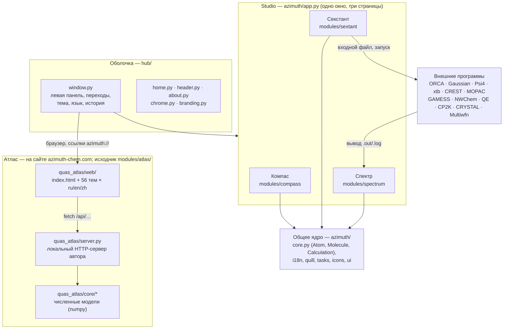
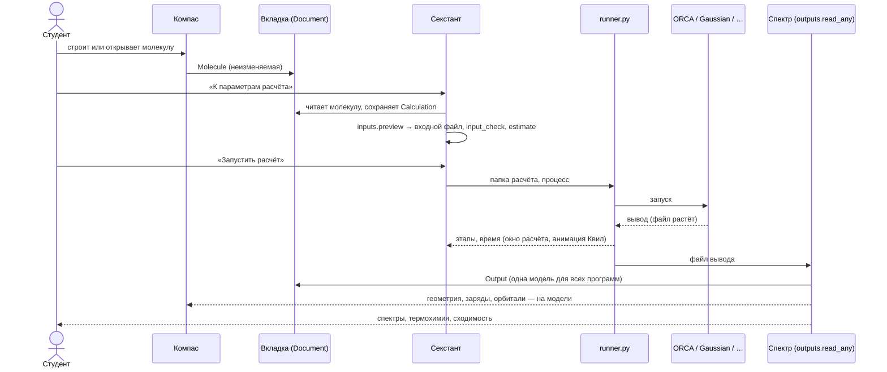

# Архитектура «Азимута» и план работ

Документ для тех, кто подключается к работе над программой: как она устроена, где проходят границы между частями, какие договорённости нельзя нарушать и какие пакеты работ можно отдать разным людям, не мешая друг другу. Подробный перечень модулей — в `docs/MODULES.md`, план версий — в `docs/plans/ROADMAP.md`, история — в `CHANGELOG.md`.

Начато 27 октября 2026 года (версия 0.64.7); разделы 1–3, 4.2, 8 и 9 сверены с кодом 0.216.157 (21 ноября 2026), 4.9–4.11 и 10 — с 0.108.56. Подробности по проектам и расчётам — `docs/architecture/`.

## 1. Что это за программа

«Азимут» — учебная программа по квантовой химии для macOS (Windows и Linux — в планах). Путь студента: **понять теорию → построить молекулу → подготовить и запустить расчёт → разобрать результат**. Каждому шагу соответствует свой раздел:

| Раздел | Что делает | Где код |
|---|---|---|
| **Атлас** | 56 интерактивных тем теории на трёх языках, на сайте azimuth-chem.com; численные модели — Python (Pyodide в браузере) | `modules/atlas/` (исходник), `tools/build_atlas_site.py` |
| **Компас** | Построение и редактирование молекул и кристаллов, 3D-модель, свойства и орбитали на модели; «Компас · Кристалл» — анализ кристаллов (упаковка, контакты, поверхности Хиршфельда, дифрактограмма) | `modules/compass/` |
| **Секстант** | Входные файлы ORCA, Gaussian, Psi4, xtb, CREST, MOPAC, GAMESS (US), NWChem, а для кристаллов Quantum ESPRESSO, CP2K и CRYSTAL; запуск, очереди и цепочки на компьютере или сервере SLURM; доктор расчёта | `modules/sextant/` |
| **Спектр** | Чтение результатов ORCA, Gaussian, Psi4, xtb, MOPAC, NWChem, Q-Chem, GAMESS/Firefly, а для кристаллов QE, CP2K и CRYSTAL; спектры, термохимия, орбитали, плотность, анализ Multiwfn | `modules/spectrum/` |

Сами расчётные программы (ORCA и другие) в «Азимут» не входят: их ставят отдельно, «Азимут» готовит для них файлы и читает их вывод.

Объём (0.216.157): около 132 тыс. строк Python в программе (406 модулей без Атласа), около 48 тыс. строк тестов (2131 функция-тест, ~2860 с параметризацией), Атлас — численное ядро и 43 темы × 3 языка.

## 2. Общая схема



Два разных мира:

- **Qt-часть** (оболочка, Компас, Секстант, Спектр) — PySide6, VTK для 3D, numpy. Компас, Секстант и Спектр — это три страницы одного окна `Studio`; класс `Studio` собран из миксинов `CompassWorkspace`, `SextantWorkspace`, `SpectrumWorkspace`, поэтому у них общее состояние (текущая молекула, вкладки).
- **Атлас** — веб-страницы (HTML/CSS/JS без сборщика), которые показываются во встроенном браузере. Числа для них считает Python-ядро `quas_atlas/core` через локальный HTTP-сервер. С программой Атлас общается только через объявленный API (раздел 4.6).

## 3. Папки и зоны ответственности

| Путь | Содержание | Кто может владеть |
|---|---|---|
| `hub/` | Оболочка: левая панель, главная, шапки разделов, «О программе», журнал, смена темы, значки | Владелец интерфейса |
| `azimuth/` | Общее ядро данных (`core.py`), окно `Studio` (`app.py`), переводы (`i18n.py`, `locale/*.json`), картинки Квил (`quill.py`), фоновые задачи (`tasks.py`), значки (`icons.py`) | Ведущий разработчик (общий код — правки через него) |
| `modules/compass/` | Модель (`viewer.py`, VTK — `vtk_view.py`, `vtk_model.py`), редактирование, форматы файлов (`formats.py`), симметрия, IUPAC, кристаллы, поверхности, вкладки (`documents.py`) | Разработчик Компаса |
| `modules/sextant/` | Страница Секстанта (`workspace.py`), входные файлы (`inputs.py`), проверка (`input_check.py`), запуск (`runner.py`), сервер и VPN (`remote.py`, `vpn.py`, `keychain.py`), подсказки метода (`advice.py`), оценка времени (`estimate.py`) | Разработчик Секстанта |
| `modules/spectrum/` | Парсеры выводов (`orca.py`, `gaussian.py`, `psi4.py`, `xtb.py`, `nwchem.py`, `qchem.py`, `gamess.py`, распознавание — `outputs.py`), спектры, термохимия, орбитали (`orbitals.py`, `gto.py`, `orbital_files.py`), плотность и QTAIM | Разработчик Спектра (парсеры удобно отдавать по одной программе) |
| `modules/atlas/atlas_v2/` | Атлас: `quas_atlas/core` (модели), `pages` (эндпоинты), `web` (страницы), свой `CHANGELOG.md` | Автор содержания Атласа + веб-разработчик |
| `assets/` | Шрифты, значки разделов, словесный знак, картинки Квил (`assets/quill/`, задания художнику — `docs/art/QUAIL_ART.md`) | Художник / владелец интерфейса |
| `docs/` | Руководство и записки Квил (`manual/`, `journal/` — ru/en/zh), план, этот документ | Все, по своей части |
| `tests/` | pytest, эталонные выводы программ в `tests/data/<программа>/` | Каждый — для своего кода |

Большие файлы с 0.222.29–0.222.30 разложены по смыслу: файлы программы короче 1000 строк, кроме трёх — `modules/compass/chemistry/iupac.py` (1,2 тыс.: разбор молекулы и слова названия ссылаются друг на друга и на общую `name`), `modules/sextant/remote_job.py` (1,0 тыс.: отправка и наблюдение за расчётом на сервере держатся за класс `RemoteJob`) и `modules/compass/panels/layout.py` (1,0 тыс.: почти весь — одна функция `structure_page`, её части делят десятки локальных переменных; делить — переписывать). Модуль, из которого что-то вынесено, по-прежнему называет вынесенные имена, которыми пользуются другие файлы (`from azimuth.core import BASIS_TABLE` работает). Длинный класс остаётся одним классом: его методы лежат в соседних файлах как функции `(self, …)`, а в теле класса стоит строка `name = _часть.name` (например, `SextantWorkspace.calculation_page = calculation_page.calculation_page`). Так разложены `modules/sextant/workspace.py` (страница — `calculation_page.py`, виджеты — `workspace_widgets.py`, тексты — `workspace_texts.py`), `modules/compass/actions/crystal_actions.py` (окна — `crystal_window.py`, `crystal_contacts_window.py`), `modules/compass/view/viewer.py` (`viewer_mouse.py`, `viewer_paint.py`), `modules/sextant/batch_actions.py` (`batch_dialog.py`, `batch_server.py`, `batch_results.py`), `modules/compass/actions/qe_window.py` (`qe_controls.py`, `qe_run.py`, `qe_results.py`, `qe_common.py`), `modules/compass/actions/structure_actions.py` (`structure_styles.py`, `structure_editing.py`, `structure_measures.py`), `modules/spectrum/workspace.py` (`results_page.py`, `result_analyses.py`, `result_orbitals.py`). Проверки «часть окна — только через свой порт» и «метод части не ищется на окне» читают и такие методы (`tests/program_files.moved_methods`). Вкладки и список проектов (`azimuth/project_navigation.py`, было 3,6 тыс.) разложены на части: `project_widgets.py` (виджеты списка и вкладок), `project_crystals.py`, `project_rows.py` (столбцы и конформеры), `project_moves.py` (перенос и удаление молекул), `project_saving.py` (сохранение, имена, черновики); класс `ProjectNavigation` собирается из них. Правки в них двух людей одновременно почти гарантированно дают конфликты — см. раздел 7.

## 4. Контракты между частями

Это места, где части программы договариваются друг с другом. Менять их можно только вместе со всеми, кто ими пользуется.

### 4.1. Данные молекулы — `azimuth/core.py`

- `Atom(symbol, x, y, z)` и `Molecule(title, atoms, bonds=None)` — **неизменяемые** (frozen dataclass, кортежи). Любая правка создаёт новую молекулу; на этом держатся отмена, кэш связей и сравнение «изменилось ли».
- Координаты — в ангстремах. Атом-призрак — символ `X` (`core.DUMMY`), в расчёт не идёт (`without_dummies`).
- `Calculation` — все настройки расчёта Секстанта (метод, базис, задача, заряд, мультиплетность, ресурсы, растворитель и т. д.). Задачи — ключи словаря `TASKS`.

### 4.2. Результат расчёта — `results.Output`

Все парсеры (ORCA, Gaussian, Psi4, xtb, NWChem, Q-Chem, GAMESS, Firefly) возвращают **одну и ту же** модель `modules/spectrum/readers/results.Output` (`orca.Output` — тот же класс, оставлен для совместимости): признаки завершения, энергии, шаги оптимизации, геометрии, частоты и моды, свойства (заряды, диполь), скан, UV-Vis, ЯМР, имя программы, итоговая энергия. Распознаёт файл и выбирает парсер `outputs.read_any` (таблица `READERS`). Новая программа = новый модуль-парсер + строка в `READERS` + эталоны в `tests/data`. Остальная программа ничего не узнаёт.

### 4.3. Вкладки — `modules/compass/panels/documents.py`

Вкладка (`Document`) — вся работа над одной структурой: молекула, история правок, настройки расчёта Секстанта, результат. Вкладки общие для Компаса · Молекулы, Секстанта и Спектра; у Компаса · Кристалла — свои.

### 4.4. Разделы оболочки — `hub/modules.json`

Порядок разделов, их имена на трёх языках, номер страницы `Studio` и значок (`assets/navigation/*.svg`). Проверяет `hub/registry.py`. В значках `currentColor` — цвет линии, `currentBrown` — коричневые детали (подставляет `hub/branding.paint_svg`).

### 4.5. Фоновая работа — `azimuth/tasks.py`

Долгие вычисления (разбор больших выводов, поля орбиталей, плотность) идут вне потока окна: `Tasks.run(key, work, done, failed)` или `run_waiting(parent, title, work, total)`. Функция `work` не трогает виджеты — только данные.

### 4.6. Атлас ↔ программа

- **С 0.160.0 Атлас — на сайте** azimuth-chem.com: программа открывает его в браузере (`azimuth/site.py`), молекула темы приходит обратно ссылкой `azimuth://compass/<ключ>` (`azimuth/links.py`). Движок симметрии Компаса и Спектра — `azimuth/symmetry_engine` (копия файлов `quas_atlas/core`). 0.161.0: окно Атласа в программе (`panel.py`, `browser.py`, `service.py`, `app.py`) удалено; ниже — как Атлас устроен внутри (на сайте так же).
- **QuASAtlas API, версия 1** (`window.QuASAtlas` в `web/index.html`): тема, язык, открыть тему, имя темы, «О программе», `setControl(name, visible)` — для Атласа автора; программа его не вызывает.
- **Сообщения**: оболочка Атласа → тема (`postMessage`): `{proj}`, `{hub}`, `{qcActive}` (тема на экране — анимации идут), `{qcGo}` (переход из поиска).
- **Числа**: страница → `fetch('/api/<имя>')` → эндпоинт `@endpoint` в `quas_atlas/pages/*.py` → модель в `quas_atlas/core/*.py`. Клиент — `web/assets/js/qcapi.js`.

### 4.7. Тексты и языки

- Тексты Qt-части пишутся по-русски внутри `tr('…')`; переводы — `azimuth/locale/en.json` и `zh.json` (числа в ключе заменяются на `{}`). Новая строка без перевода — ошибка.
- Атлас переведён по страницам: `web/ru|en|zh/*.html` и `*.js`.

### 4.8. Ресурсы

`assets-manifest.json` — SHA-256 всех ресурсов; после любой замены картинки или шрифта его пересчитывают (иначе `verify_install.py` сообщит о повреждении). Журналы и каталоги (`CHANGELOG.md`, `assets/quill/APPROVED.md`, журнал Атласа) в манифест не входят: они меняются при каждой правке и программе для работы не нужны.

### 4.9. Границы слоёв (с 0.108.11)

Научные и служебные слои не зависят от интерфейса. Это химия Компаса, анализ, чтение выводов и волновые функции Спектра, `azimuth/runtime`, хранилище проектов, а также запуск, сервер, очередь и история Секстанта. Они не импортируют Qt и VTK, даже внутри функций, и не импортируют модули интерфейса программы; без Qt и VTK они тоже импортируются. SQLite открывает только `azimuth/project_store.py`. Проверка — `tests/core/test_architecture_boundaries.py`; исключения перечисляются в нём с причиной.

### 4.10. Части окна без примесей (с 0.108.16)

Окно (`Studio`) собрано из классов-примесей разделов (`CompassWorkspace` — 2 части с 0.108.26: разметка страницы и вкладки документов, они строят виджеты окна, `SextantWorkspace` и `SpectrumWorkspace` — без примесей с 0.108.28). Части выносятся по одной: правила — в модуль без Qt, поведение — в класс со своим «портом» (dataclass с функциями: что части нужно от окна), окно держит экземпляр и не наследует его. Первая — ограничения оптимизации: `modules/compass/constraints.py` (правила), `ConstraintTool` и `ConstraintPort` (`actions/constraint_actions.py`), `CompassWorkspace.constraint_tool`. Вторая (0.108.17) — открытие окон пути реакции, вращения вокруг связи и поиска конформеров: `actions/dialog_openers.py` (`DialogOpeners`, `DialogPort`), `CompassWorkspace.compass_dialogs`; сами эти окна пока получают окно программы как родителя — их порты следующий шаг. Третья (0.108.19) — ленты белка и построение пептида: `ProteinTool`, `ProteinPort`, `CompassWorkspace.protein_tool`. С 0.108.20 части выносятся пачками и общим способом: класс части объявляет `PORT` — имена окна, которыми пользуется, — и получает `azimuth/window_port.WindowPort`, который пропускает только их (`.widget` — окно как родитель Qt-объектов). Так вынесены снимки и GIF (`picture_tool`), названия IUPAC и InChI (`naming_tool`), симметрия (`symmetry_tool`), выделение (`selection_tool`), свои фрагменты (`fragment_tool`); в 0.108.24 — шаги результата и конформеры (`trajectory_tool`), наложение для сравнения (`overlay_tool`), схемы отображения (`scheme_tool`), кристаллы (`crystal_tool`), панель вида, стандартные виды, Z-матрица и движок VTK (`view_tool`). Части, которые сами получают окно как владельца (окно кристалла, редактор схем, окна вращения и пути), зовут вынесенные методы через часть окна (`owner.crystal_tool.build_crystal`). В 0.108.25 — поверхности и поля (`surface_tool`), свойства результата (`property_tool`), открытие файлов (`opening_tool`), «Файл» — недавние файлы и сохранение многих (`file_tool`), меню структуры (`structure_tool`). В 0.108.26 — таблица координат (`coordinate_tool`), меню модели (`model_menu_tool`), панель плотности (`density_tool`), инструменты расчёта (`calculation_tool`). В 0.108.28 — Секстант: запуск (`run_tool`), входной файл (`input_tool`), очереди (`batch_tool`); Спектр: «Инструменты» (`spectrum_tools`); состояние места расчёта (`job`, `batch` и др.) остаётся у `SextantWorkspace`; части делает `azimuth.window_port.part`. Перевод делает `tools/mixin_to_tool.py` (результат читается глазами), а `test_a_tool_reaches_the_window_only_through_its_port` проверяет, что часть обращается к окну только через свой порт. Число примесей проверяет `tests/core/test_architecture_boundaries.py::test_the_window_gets_no_new_mixins`; потолок снижается с каждой вынесенной частью.

### 4.11. Проекты и расчёты — `azimuth/projects.py`, `azimuth/runtime/` (с 0.107.0)

Вкладка — проект. Проект — папка: `project.qcc` (указатель), `project.sqlite` (молекулы, настройки, попытки, записи расчётов и очередей), папки расчётов, `Анализ/`. Открытый проект — `runtime/session.py` (ProjectSession: рабочие правки с ревизиями, удаление и возврат молекул), один писатель между процессами — `runtime/writer_lock.py`. Попытка расчёта имеет неизменяемый снимок входа; отправка на сервер — с токеном и квитанцией (`runtime/delivery.py`), очередь на сервере — одно задание SLURM (`batch.sh`). Одиночный расчёт ведёт `runtime/single_run.py`, конец строки очереди — `runtime/lifecycle.py`. Результат возвращается в свою попытку по ID; сошедшаяся оптимизация отдаёт молекуле свою геометрию (`Project.adopt_geometry`). Владельцы данных, состояния, сценарии T01–T24 и что осталось — [RUNTIME_CONTRACTS.md](architecture/RUNTIME_CONTRACTS.md); исходная спецификация — [PROJECT_RUNTIME_GUIDE.md](architecture/PROJECT_RUNTIME_GUIDE.md); как пользоваться — [PROJECTS.md](features/PROJECTS.md).

## 5. Главный сценарий: «построил → посчитал → разобрал»



## 6. Договорённости, обязательные для всех

1. **Документация в коде — по Wilkinson.** У модуля и у сложных функций — строка документации с разделами §1 THEORY / PURPOSE, §2 ALGORITHM, §3 APPLICATIONS, §4 SPECIFICATION, §6 NOTES, §7 TESTS. Комментарий объясняет, зачем нужна ветка кода, коротко и по существу: без номеров версий, дат и цитат запросов — история изменений хранится в git и CHANGELOG.
2. **Тесты.** Каждое изменение — с тестом. Парсеры проверяются на эталонных файлах из открытых наборов (cclib и др.) в `tests/data/<программа>/`: каждое прочитанное число сверяется с напечатанным. Запуск: `.venv/bin/python -m pytest -q` (окна в тестах не показываются, платформа offscreen).
3. **Запись об изменении, версии и коммиты** — по `AGENTS.md` (разделы 4–6): что меняет программу для пользователя — версия, CHANGELOG, записка Квил, руководство; внутренние правки — коммит «внутр.:» без версии.
4. **Версии ниже 1** у программы и у всех разделов до первого выпуска.
5. **Тексты и оформление Атласа** меняются только по просьбе автора содержания.
6. **Оформление.** Светлая и тёмная темы обязательны для любого нового элемента; акцент — синий (#2a62b8 / #6ea2f0), фирменный коричневый — #b8893f / #d6a95c; картинки Квил — только утверждённые (`assets/quill/APPROVED.md`).
7. **Без лишних зависимостей.** Всё, что можно, — на numpy и PySide6; внешние программы (Open Babel, RDKit) — только для получения эталонов, не в самой программе.

## 7. Как делить работу

### 7.1. Правила

- **Одна ветка — один пакет** (раздел 8), слияние в основную ветку — после зелёных тестов.
- **Общие файлы** — `azimuth/core.py`, `azimuth/app.py`, `hub/window.py`, `modules/compass/workspace.py`, `modules/sextant/workspace.py`: правки в них делать маленькими и заранее сообщать; новую логику выносить в **свой новый модуль**, а в общий файл добавлять только подключение (так устроены, например, `estimate.py`, `molecule_card.py`, `tasks.py`).
- **Файлы, которые меняет каждый** — `CHANGELOG.md`, `docs/journal/*`, `azimuth/locale/*.json`, `assets-manifest.json`, номер версии. Чтобы не конфликтовать: в ветке пакета писать свою запись в CHANGELOG и журнале под временным заголовком «## Готовится: <пакет>», а номер версии, манифест и окончательные заголовки ставит тот, кто сливает ветки (ведущий).
- **Контракты из раздела 4** меняются только отдельной задачей, с обновлением всех мест, где они используются.

### 7.2. Как добавить типовые вещи

| Задача | Что сделать |
|---|---|
| Парсер новой программы | Модуль в `modules/spectrum/readers/<программа>.py`, возвращающий `results.Output`; распознавание и строка в `READERS` (`outputs.py`); эталоны в `tests/data/<программа>/` и `tests/spectrum/test_<программа>.py`; при наличии орбиталей — `output_orbitals.py` |
| Входной файл новой программы | Генератор в `modules/sextant/inputs.py`, проверка в `input_check.py`, поиск программы и запуск в `runner.py`, пункт в `PROGRAMS`; тесты на текст файла |
| Тема Атласа | Модель в `quas_atlas/core/`, эндпоинты в `quas_atlas/pages/`, страницы `web/ru|en|zh/<тема>.html` + `js/<тема>.js` + `.demo.js` (демонстрация), запись в списке тем `web/index.html` (PAGES, SIDX — поиск), картинка Квил, `CHANGELOG.md` Атласа |
| Картинка Квил | Задание в `docs/art/QUAIL_ART.md` → файл в `assets/quill/` → запись в `APPROVED.md` → имя в `azimuth/quill.NAMES` → место в интерфейсе → манифест |
| Строка интерфейса | `tr('…')` по-русски + перевод в `locale/en.json` и `zh.json` |

## 8. Пакеты работ

Пакеты A–L составлены 27 октября 2026 года для нескольких разработчиков; большая часть сделана. Текущий план версий —
`docs/plans/ROADMAP.md`, проверки перед бетой — `docs/plans/ASSUMPTIONS.md` и `docs/plans/MAIN_PATH.md`.

| # | Пакет | Состояние на 0.216.157 |
|---|---|---|
| A | Силовое поле UFF в Компасе | сделано (0.106.0), GFN-FF через xtb |
| B | Возбуждённые состояния | NTO (0.91.22), перенос заряда, излучение; анимация в GIF/MP4 — ? |
| C | Расчёты на сервере | сделано: очередь SLURM, несколько расчётов сразу, история, цепочки; ждёт проверки на втором кластере (T24) |
| D | Спектры | Раман, ЭКД, ВКД, КССВ ЯМР, двумерный скан, эксперимент поверх расчёта, NIST |
| E | Новые программы в Секстанте | MOPAC, GAMESS, NWChem сделаны, но входы GAMESS и NWChem ни разу не запускались; Q-Chem — только чтение |
| F | Сценарии на Python | не начато |
| G | Атлас: содержание | ведётся автором, на сайте |
| H | Картинки Квил | ведётся художником |
| I | Windows и Linux | установщик Windows (0.166.0), CI на трёх системах; окно VTK на Windows и Linux в CI выключено — проверяется руками |
| J | Большие системы | до 2000 атомов, ленты белка, строитель пептида; ДНК — нет |
| K | Картинки для статей | ? |
| L | Анализ в Multiwfn | сделано (заряды, NCI/IGMH, ESP, ELF/LOL, QTAIM, DOS, LMO, RESP, CDA, Фукуи) |

## 9. Известные слабые места

- **Большие файлы.** Список — в разделе 3. `Studio` по-прежнему собран из примесей разделов, но части окна выносятся в классы со своим портом (4.10); новую логику — только в отдельные модули.
- **Интерфейс не проверяется глазами в тестах.** Тесты идут offscreen; в CI на Windows и Linux VTK выключен (`AZIMUTH_NO_VTK`). После правок вида — смотреть на реальном экране.
- **Не сверено с эталоном:** порядок сферических функций NWChem и Q-Chem — эталон и тест готовы (`tests/data/spherical`, `test_spherical_order.py`), нужен запуск NWChem; входные файлы Gaussian, Psi4, GAMESS и NWChem ни разу не запускались; часть эталонов CP2K написана вручную. Полный список — `docs/plans/ASSUMPTIONS.md`.
- **Сервер:** проверен только на серверах лаборатории; другие версии SLURM, `module`, квоты — не проверены (T24).
- **Только macOS проверена полностью**; Windows — частично (ORCA 6.1.1, Multiwfn, установщик), Linux — только CI.
- **Старые копии Атласа** (`modules/atlas/QuAS_Атлас*.html`, `Отдельные_страницы/`) не используются программой; удалить — по решению автора.

## 10. Как запустить и проверить

```
.venv/bin/python main.py                 # программа
.venv/bin/python -m pytest -q            # все тесты (~6 минут)
.venv/bin/python -m pytest -q tests/spectrum/test_qchem.py   # тесты одной части
.venv/bin/python tools/run_test_groups.py   # каждая папка тестов в своём процессе (0.108.30: порядок не скрывает ошибку)
.venv/bin/python tools/bench_workloads.py   # замеры: запуск, чтение выводов, орбитали, сохранение, хеш, отрисовка, тема (0.108.35)
.venv/bin/python verify_install.py       # проверка установки и ресурсов
```

Отдельные окна разделов (для отладки): `python -m modules.compass`, `python -m modules.sextant`, `python -m modules.spectrum`, `python -m modules.atlas`.
