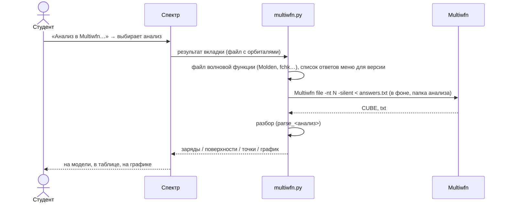

# Анализ волновой функции в Multiwfn — план

Как Спектр будет считать анализы волновой функции в Multiwfn, а показывать их в своём интерфейсе. Пользователь выбирает анализ в Азимуте и видит результат на модели, в таблице или на графике; Multiwfn работает невидимо, как ORCA при расчёте.

Состояние на 28 октября 2026 года: этап 1 сделан в 0.77.0 — `modules/spectrum/wavefunction/multiwfn.py` (поиск, запуск в фоне, разбор), заряды ADCH и CM5 в меню «±» Компаса; рецепт проверен на Multiwfn 2026.7.15 (Homebrew, macOS), записанные выводы — `tests/data/multiwfn/`. Этап 2 — в 0.78.0: NCI по волновой функции и по промолекулярной плотности, IRI; поверхность RDG с раскраской sign(λ₂)ρ на модели, график RDG — sign(λ₂)ρ (`modules/compass/view/nci_plot.py`), выбор сетки; рецепт 20 → 1 | 2 | 4 → сетка → 3 → 0 → 0 → q проверен на димере воды S22 (xtb GFN2 Molden и промолекулярная плотность). Этап 3 — в 0.79.0: ESP на поверхности ρ = 0,001 (12 → 0 → 1 → 7 → −2: экстремумы, вершины со значениями, сетка плотности; раскраска своей поверхности по ближайшим вершинам Multiwfn, экстремумы на модели, окно сводки `compass/esp_report.py`) и, по просьбе пользователя, топология ЭП: поиск критических точек Multiwfn (2 → 2, 3, 4, 5 → 7 → 0, CPprop.txt) в «QTAIM → Multiwfn», пути связей — своим трассировщиком от точек Multiwfn; на воде совпадает с поиском Азимута до 1e-4. 0.80.0, по просьбе пользователя: ESP и QTAIM — только Multiwfn (карта ESP по зарядам Малликена и свой поиск критических точек убраны из интерфейса; `density.critical_points` остался проверкой в тестах). Этап 4 — в 0.81.0: ELF и LOL (5 → 9 | 10 → сетка → 2) поверхностями на модели; в «QTAIM» — переключатель видов точек (ядра, связи, циклы, клетки), ядра — тоже точки, атомы связи — из Multiwfn (шаг 8, пути) или по ядрам на концах пути. Этап 5 — в 0.82.0: порядки связей (Майер, Виберг в базисе Лёвдина, FBO, LBO) с переключением в «±», состав орбиталей по Хиршфельду (столбец «Состав»), сетки орбиталей и плотности из Multiwfn (свой расчёт — запасной). Этап 6 — в 0.83.0: функции на сетке (12 штук), ALIE/LEA/LEAE на молекулярной поверхности, таблицы экстремумов всех поверхностей, сводка ESP и точки QTAIM по типам — CSV в папке расчёта (окно сводки ESP убрано), вкладка Спектра «Карты и профили» (4 → … → −6, 3 → … → 2), «Срез» убран из панели Компаса. Этап 7 — в 0.84.0: анализ возбуждений TD-DFT (18 → 1: дырка и электрон, индексы D, Sr, H, t, HDI, EDI; 18 → 4: Δr) во вкладке UV-Vis, таблица «<имя>_excitations.csv», дырка и электрон на модели; проверено на TD-DFT бензальдегида (ORCA, CAM-B3LYP/def2-SVPD) пользователя. 0.85.0 — переустройство по замечаниям пользователя: Multiwfn заменяет свой расчёт везде, где умеет (орбитали, ρ и, рецептом 5 → 5 → сетка → 2, спиновая плотность; ошибка Multiwfn сообщается, а не подменяется своим расчётом; лапласиан и остальные поля — только Multiwfn, во вкладке «Поверхности» панели слева); всё трёхмерное — в Компасе, таблицы и графики — в Спектре (вкладки «Топология ЭП» с подробной таблицей точек и «NCI» с графиком; в Компасе — короткий список ρ, ∇²ρ, H, пульсирующая выбранная точка, «На модель / Убрать с модели»; свой «Срез» окна анализа убран, критические точки рисуются на картах «Карт и профилей»); кэш запусков (тот же файл, та же программа, те же ответы), предупреждение о версии до 3.8, серые пункты и подсказка вместо окна выбора файла, если Multiwfn не найден; одна сетка; таблицы и выводы — в подпапке «Анализ», CSV с «;» и десятичной запятой (или международный); выбор состояний для анализа возбуждений. Дальше — NTO. В плане версий — 0.70 (`docs/plans/ROADMAP.md`), в архитектуре — пакет L (`docs/ARCHITECTURE.md`).

## Почему это возможно

- **Лицензия.** Multiwfn бесплатен и открыт для учебного и коммерческого использования, его можно распространять и включать бесплатным компонентом; продажа изменённой версии — только с согласия автора (Tian Lu). В работах ссылаются на Lu & Chen, *J. Comput. Chem.* 33, 580 (2012) и Lu, *J. Chem. Phys.* 161, 082503 (2024) — Азимут будет показывать эти ссылки рядом с результатом и в «О программе».
- **Без окна.** Программа управляется текстовыми меню, и её штатно запускают без человека: номера пунктов подаются на вход списком (`Multiwfn file.wfn < answers.txt`). Ключи: `-nt` (потоки), `-silent`, `-set <settings.ini>`.
- **Вход** — то, что уже получает Азимут: `.wfn`, `.wfx`, `.fch`, `.molden`, `.mwfn`, выводы Gaussian, ORCA, GAMESS-US, NWChem, xtb. Для ORCA Molden делается `orca_2mkl` (уже умеем).
- **Выход** — файлы: сетки `.cub`, таблицы `.txt`, `.pdb`. Сетки CUBE Спектр уже показывает (поверхности, срезы, раскраска ESP), критические точки — как в QTAIM.

## Что уже есть в Азимуте (чтобы не делать дважды)

- Заряды Малликена, Лёвдина, Хиршфельда и порядки связей Майера — из вывода ORCA (`modules/spectrum/readers/orca_properties.py`).
- Орбитали и плотность на сетке, CUBE, срезы, −∇²ρ, Δρ, QTAIM-точки своими силами (`orbitals.py`, `density.py`, `density_view.py`).
- Карта ESP на модели — по CUBE.

Multiwfn нужен там, где своего нет или своё — грубое.

## Первый набор анализов

| Анализ | Что видит студент | Вывод Multiwfn → Азимут |
|---|---|---|
| **Заряды CM5 и ADCH** | Заряды на модели и в таблице рядом с Малликеном и Хиршфельдом, сравнение схем | Таблица зарядов из текстового вывода → `Properties.charges['cm5' / 'adch']` |
| **NCI / RDG** (слабые взаимодействия) | Изоповерхность s(ρ) на модели, раскрашенная по sign(λ₂)ρ (синий — водородные связи, зелёный — ван-дер-ваальсовы, красный — отталкивание), и двумерный график s против sign(λ₂)ρ | Два CUBE (`func1.cub`, `func2.cub`) и `output.txt` с точками графика |
| **ESP на молекулярной поверхности** | Поверхность (ρ = 0,001) с раскраской ESP, точки минимумов и максимумов, площадь, объём, полярность, σ-дыры | Таблица экстремумов и сводка «quantitative molecular surface analysis» → поверхность и точки |
| **ELF / LOL** | Изоповерхности и срез функции локализации — где «сидят» пары электронов | CUBE функции → поверхность и срез, как плотность |

Следующие кандидаты: порядки связей Wiberg, Fuzzy и Laplacian для выводов, где их нет; разложение орбиталей по фрагментам (вклады атомов в МО); уширенные спектры из выводов других программ; анализ переноса заряда при возбуждении (индекс Δr, «дырка — частица»).

## Как устроено

- **`modules/spectrum/wavefunction/multiwfn.py`** — поиск программы (как `runner.find_program`: настройки, PATH, обычные места; «Указать…»), версия (из заставки), подготовка папки анализа рядом с папкой расчёта, запуск через `azimuth.tasks` (в фоне, с ходом и «Отменить»), разбор результатов.
- **`modules/spectrum/multiwfn_recipes.py`** (так в плане; отдельного файла не стало — ответы меню каждого анализа лежат в его модуле `modules/spectrum/wavefunction/multiwfn_*.py`) — для каждого анализа: список ответов меню **для каждой поддерживаемой версии**, какие файлы ждать, как их разобрать. Рецепт — данные, не код окна.
- **Окно** «Анализ в Multiwfn…» — список анализов с коротким объяснением, параметры (сетка: грубая / средняя / точная; для ESP — изоповерхность), кнопка «Посчитать». Вход в него — из Спектра и из панели «Электронная плотность» Компаса.
- **Результаты** идут в существующие места: заряды — в свойства результата (их сразу видно на модели); поверхности — в те же поверхности, что у орбиталей и ESP; точки — как QTAIM; график RDG — новый вид в Спектре по образцу графика сходимости.
- **Секстант** ничего не меняет, кроме одного: если анализы Multiwfn нужны, у ORCA должен быть файл с орбиталями (`.gbw` → `orca_2mkl`, уже делается).

## Главные трудности

1. **Нет программного интерфейса — только меню.** Номера пунктов иногда меняются между версиями. Поэтому рецепты привязаны к версии; незнакомая версия — предупреждение и попытка по ближайшему рецепту с проверкой, что нужные файлы появились.
2. **Разные текстовые таблицы.** Для каждого анализа — свой разборщик, проверенный на записанных выводах.
3. **Время.** Сетки для NCI и ELF у больших молекул считаются минуты: только в фоне, с ходом и отменой; грубая сетка по умолчанию.
4. **Установка.** Multiwfn ставится отдельно (macOS: готовый бинарник с сайта автора). Возможно — «Установить Multiwfn…» по образцу Open MPI, xtb, CREST (`install_tools.py`), если позволяет сайт загрузки.

## Проверка

- Эталоны в `tests/data/multiwfn/`: для каждого анализа — входной файл (вода, формальдегид, димер воды для NCI) и записанный вывод Multiwfn текущей версии; разборщик сверяется с числами вывода.
- Где можно — сверка со своим: Хиршфельд Multiwfn против Хиршфельда ORCA, ρ на сетке против `orbitals.py`.
- Живой тест (Multiwfn установлен) — помечен и пропускается, если программы нет.

## Этапы

1. `multiwfn.py`: поиск, версия, запуск в фоне, папка анализа; заряды CM5 и ADCH на модели.
2. NCI / RDG: поверхность с раскраской и график.
3. ESP на поверхности: раскраска, экстремумы, сводка.
4. ELF / LOL; затем следующие кандидаты.

## Вопросы

- Какая версия Multiwfn у вас (и у студентов) — под неё делаются первые рецепты.
- Какие анализы нужнее всего в курсе — порядок этапов можно поменять.
