# Azimuth User Manual

## Introduction

### What Azimuth is

Azimuth is a teaching program for quantum chemistry. It leads you along the whole path of quantum-chemical work: **understand the theory → build the molecule → prepare and run the calculation → read the result**. Each step has a section of its own, and the data pass from section to section without intermediate files: a molecule built in Compass goes to Sextant, and the result of the calculation comes back onto the model in Compass and into the plots of Spectrum.

The calculations themselves are done by external programs – ORCA, xtb, MOPAC, Psi4, NWChem and others. Azimuth prepares their input files, runs them on this computer or on a computing server, follows the course of the calculation and reads the results. Sextant installs some of these programs by itself; ORCA is downloaded from the site of its developers (see «Installing the calculation programs»).

The program is meant for students who are just starting with quantum-chemical calculations and for teachers who run a practical course. An experienced user will find it a convenient shell: it brings together building structures, projects with sets of molecules, calculation queues, work with a SLURM cluster and wavefunction analysis.

### Sections of the program

Table: The sections of Azimuth

| Section | Purpose | Chapter |
|---|---|---|
| **Atlas** | 56 interactive topics of theory – from the postulates of quantum mechanics to DFT, thermochemistry and spectra; self-check exercises | 5 |
| **Compass · Molecule** | Building and editing molecules, symmetry and name, conformers, reaction path, projects; the result of a calculation on the 3D model | 6 |
| **Compass · Crystal** | Crystals from CIF files: cell, symmetry, contacts, Hirshfeld surface, powder pattern, (hkl) surfaces | 7 |
| **Sextant** | Preparing the input file and running the calculation on this computer or on a server, queues and chains of calculations | 8 |
| **Spectrum** | Reading the result: energies, convergence, vibrations and IR, UV-Vis, NMR, thermochemistry, orbitals, electron density analysis | 9 |

The Atlas is the site [azimuth-chem.com](https://www.azimuth-chem.com/?lang=en); the program opens it in the browser, and the molecules of Atlas pages open in Compass with one click.

### How this manual is organized

Chapters 1–4 are for everyone: what the program is, how to install it, how to walk the whole path on one example and how the interface works. Chapters 5–9 describe the sections of the program in the order of work. Each chapter begins with an overview, followed by procedures – numbered «how to» steps – and reference information. Chapter 10 is for those who control the program from a language model, chapter 11 tells what to do when something does not work. The appendices gather into tables the file formats, the keyboard shortcuts and the capabilities of each calculation program.

The same manual opens in the program itself: «Help → Manual».

### Conventions

- **«File → Open…»** – a menu item: the arrow leads from a menu to a submenu and to the item. The menus of the sections are in the header of the window above the working area.
- **«Run calculation»** – the label of a button, field or tab in a window of the program.
- `Ctrl+S` – a keyboard shortcut. On macOS press `⌘` (Cmd) instead of `Ctrl` and `⌥` (Option) instead of `Alt`; the text gives the Windows and Linux variant. The `Delete` key on a Mac is `⌫`.
- `C:\ORCA`, `examples/README.md` – names of files, folders, commands and text typed as it is.
- **Click** – a press of the left mouse button; a **right-click** opens the context menu (a two-finger click on a Mac trackpad).

> **Note.** Explanations and details that can be skipped on first reading look like this.

> **Tip.** Techniques that save time look like this.

> **Warning.** Warnings look like this: the action cannot be undone or may spoil the result.

### Calculation programs and how they were checked

Azimuth supports several calculation programs, but not all of them have been checked equally. Programs whose input files have never been run by the real program are marked **«not checked»** in the program list of Sextant: check the input file yourself before a calculation with them. For crystal calculations in CP2K the same mark means something else: the program has been run both on this computer and on a server, but its numbers are not yet compared with the literature for known crystals – compare the result yourself. Calculations in Quantum ESPRESSO are compared on six crystals and carry no mark.

Table: Calculation programs

| Program | What Azimuth does | Status |
|---|---|---|
| ORCA | Input file, run, progress, reading the result | Checked |
| xtb | Run, reading, conformer search, quick calculation from Compass | Checked |
| CREST | Conformer search | Checked |
| MOPAC | Input file, run, reading | Checked |
| NWChem | Input file, run, reading | Checked |
| Psi4 | Input file, run, reading | Checked |
| Gaussian | Input file, run, reading | Input files not checked by a run |
| GAMESS (US) | Input file, run, reading | Input files not checked by a run |
| Quantum ESPRESSO | Crystal calculations | Runs checked (macOS, Linux, a server); lattice parameters, gaps and magnetic moments compared with the literature on six crystals (Si, MgO, SrTiO₃, TiO₂, graphene, NiO) |
| CP2K | Crystal calculations | Runs checked (macOS, Linux, a server); the numbers are not compared with the literature – marked «not checked» |
| CRYSTAL | Input file and reading the result (no run) | Not checked |
| Q-Chem, Firefly | Reading the result only | – |
| Multiwfn | Wavefunction analysis (charges, surfaces, QTAIM) | Checked (version 2026.7.15) |

## Installation and first start

### System requirements

Table: Supported systems

| System | Requirements |
|---|---|
| macOS | A Mac with an Apple Silicon processor (M1 or newer); Python 3.13 |
| Windows | Windows 10 or 11, 64-bit; Python 3.12 or 3.13 (64-bit) |
| Linux | x86_64, glibc 2.34 or newer (Ubuntu 22.04+, Debian 12+, Fedora 35+, Linux Mint 21+); Python 3.12 or 3.13 |

The first start needs the internet: the program installs its libraries (Qt, VTK, NumPy) once into the folder `.venv` inside the program folder. The Python of the system is not changed. After that, the internet is needed only by the Atlas (unless it is saved for offline work), by the search of molecules by name in PubChem, the search of crystals in COD and the installation of calculation programs.

Put the program folder on a path **without Cyrillic or other non-Latin letters and without spaces** – for example `~/Azimuth` on a Mac or `C:\work\Azimuth` on Windows: many calculation programs cannot open files on such paths.

### Installing on macOS

1. Unpack the archive of the program into a convenient folder (or get it with `git clone`).
2. Double-click `Azimuth.app` in the program folder. The application must stay in this folder next to the other files; for convenience make an alias of it in «Applications» or in the Dock.
3. The first start installs the dependencies and takes a few minutes. Then the program window opens.

The program is not signed with a paid Apple certificate, so on the first start macOS may say: «“Azimuth” Not Opened – Apple could not verify…». Nothing is wrong with the program – you only need to allow it to start once.

- **For the whole folder at once.** Open «Terminal» (Applications → Utilities), type `xattr -dr com.apple.quarantine ` (with a space at the end), drag the program folder into the Terminal window and press Return. The «downloaded from the internet» mark is removed from all files.
- **Through the system settings.** Try to open `Azimuth.app` and close the message. Open «System Settings → Privacy & Security» and at the bottom, next to the line about «Azimuth» being blocked, click «Open Anyway»; confirm with your password.

> **Note.** In macOS 15 (Sequoia) and newer, right-click → «Open» no longer bypasses this check. A folder obtained with `git clone` gets no such mark, and there are no warnings.

The file `Launch-macOS.command` in the program folder is for installation and diagnostics from the Terminal. After the first start of `Azimuth.app`, `.qcc` projects open with a double click in the Finder, and Azimuth appears in «Open With» for CIF, XYZ, MOL, SDF, PDB, Molden and CUBE files and the files of calculations.

### Installing on Windows

1. If the archive was downloaded from the internet, unblock it before unpacking: right-click the archive → «Properties» → the «Unblock» check box → «OK».
2. Unpack the program folder to a short Latin path, for example `C:\work\Azimuth`.
3. Run `windows_first_run.bat`. It finds a 64-bit Python 3.13 or 3.12 (Anaconda's too), installs the dependencies and checks the installation. If there is no suitable Python, the installer itself installs Python 3.13 for the current user only, without administrator rights.
4. After a successful check, start the program with `Launch-Windows.bat`.

If a blue window «Windows protected your PC» (SmartScreen) appears, click «More info» → «Run anyway»: the program is not signed with a paid Microsoft certificate.

> **Note.** The first loading of VTK after the installation may take several minutes while the antivirus checks its files. Do not interrupt it.

### Installing on Linux

1. Install Python 3.13 (3.12 also works) with the venv module. Ubuntu 24.04: `sudo apt install python3 python3-venv`; Fedora: `sudo dnf install python3.13`.
2. Install the Qt system libraries missing from a minimal installation. Ubuntu and Debian: `sudo apt install libxcb-cursor0 libegl1 libxkbcommon-x11-0`; Fedora: `sudo dnf install xcb-util-cursor`.
3. Unpack the program folder and run `./Launch-Linux.sh` in a terminal. The first start installs the dependencies, then the window opens.
4. To have the program in the application menu and to open the «Open in Compass» links of the Atlas site, run `./Launch-Linux.sh --install-desktop`. To remove the shortcut – `--remove-desktop`. After moving the program folder, repeat the command.

> **Tip.** If under Wayland the window or the model is drawn incorrectly, start the program under X11: `QT_QPA_PLATFORM=xcb ./Launch-Linux.sh`.

### Checking the installation

«Help → Installation check» checks Python and the libraries, the teaching files, the Atlas and the VTK 3D graphics. The same from a terminal: `.venv/bin/python verify_install.py` (on Windows `.venv\Scripts\python.exe verify_install.py`). Exit code 0 means that all checks passed.

### Installing the calculation programs

The calculation programs are not part of Azimuth. Sextant installs some of them itself; the others are installed separately.

Table: How the calculation programs are installed

| Program | How to install |
|---|---|
| xtb, CREST, MOPAC | «Sextant → Calculation → Install calculation programs…» (CREST – not on Windows) |
| Open MPI | The same, or the «Install Open MPI…» button in the run card (macOS, Linux) |
| Psi4, NWChem | «Install calculation programs…» (macOS and Linux) |
| Quantum ESPRESSO | «Install calculation programs…» (macOS, Linux, Windows) |
| ORCA | By hand from the developers' site (see below) |
| MS-MPI (Windows) | The installer `msmpisetup.exe` from the Microsoft site; the «Install MS-MPI…» button opens the page |
| Multiwfn | macOS: `brew install multiwfn`; Windows and Linux – the noGUI build from sobereva.com/multiwfn |
| CP2K | Linux – «Install calculation programs…»; macOS – `brew install cp2k`; on a server – the cp2k module |
| Gaussian, GAMESS (US) | Commercial or separately distributed programs; installed by their authors' instructions |

If xtb, CREST or MOPAC is not found, the run card of Sextant has an «Install into the program folder…» button next to the program. The «Install calculation programs…» window checks xtb and MOPAC at once if they are not there yet and says «already here» for programs it found. For big programs (Quantum ESPRESSO, NWChem, Psi4) the download size and the disk space are given. The programs are installed from conda-forge through the conda of the computer if there is one, otherwise through a small micromamba installer – without administrator rights and without changing the terminal settings. They go into the program folder, into the hidden folder `.tools` (for a built application – into `~/Library/Application Support/Azimuth` on a Mac and `%LOCALAPPDATA%\Azimuth` on Windows).

#### How to install ORCA

ORCA is free for teaching and research, but it is downloaded only from its developers' site after registration.

1. Register on the ORCA forum (orcaforum.kofo.mpg.de) and in the Downloads section download the archive for your system: for a Mac on Apple Silicon – «macOS arm64, Open MPI 4.1.1», for Windows – «Windows x64». ORCA 6.0.1 (macOS) and 6.1.1 (Windows) have been checked.
2. Unpack the archive: on a Mac – into «Applications» or the home folder, on Windows – into a folder with a Latin path without spaces, for example `C:\ORCA`.
3. On a Mac, remove the «from the internet» mark from the ORCA files once: type `xattr -dr com.apple.quarantine ` in the Terminal and drag the ORCA folder into the window.
4. Open Sextant. If ORCA has a green check mark in the «Run the calculation» card, the program is found. If not, click «Choose…» and select the file `orca` (`orca.exe` on Windows) in its folder.
5. To run on several processes ORCA needs MPI: Open MPI on a Mac and Linux (the «Install Open MPI…» button in the same card), Microsoft MPI on Windows. On one process no MPI is needed.

> **Note.** Sextant looks for the programs in PATH, in the usual installation folders (ORCA folders in «Applications» and in the home folder, Homebrew, conda) and in `.tools`. Where each program was found is shown in «File → Settings… → Programs»; there you can also set the file of a program by hand, for example one of two versions of ORCA.

### Where the program keeps its files

Table: The folders of Azimuth

| What | macOS and Linux | Windows |
|---|---|---|
| Calculations | `~/Documents/Azimuth/Расчёты` | `Documents\Azimuth\Calculations` |
| Projects | `~/Documents/Azimuth/Проекты` | `Documents\Azimuth\Projects` |
| Crystals from COD | `~/Documents/Azimuth/COD` | `Documents\Azimuth\COD` |
| Logs | `~/Library/Logs/Azimuth` (Linux – `~/.local/state/Azimuth`) | `%LOCALAPPDATA%\Azimuth\Logs` |
| Programs installed by Sextant | the `.tools` folder of the program | the `.tools` folder of the program |

Every calculation has a folder of its own named `<date>_<formula>_<program>`: it holds the input file, the whole output of the program and the subfolder «Анализ» with the tables of analyses. The folders of calculations and projects can be changed in «File → Settings… → Calculations».

> **Note.** If the Windows user name contains Cyrillic or other non-Latin letters, calculations go by default to `C:\Users\Public\Documents\Azimuth\Calculations`: calculation programs on Windows cannot open files on paths with non-Latin letters.

## Quick start: from theory to result

This chapter walks the whole path on one example – the geometry optimization and frequency calculation of ethanol. The details of every step are in chapters 5–9.

### Step 1. Theory in the Atlas

1. Click «Atlas» on the left panel – an Atlas topic opens in the browser.
2. Open the topic «Geometry optimization», watch the demonstration («▶ Demonstration» at the bottom right) and move the sliders.
3. Answer the «Check your knowledge» exercises at the end of the page.

Pages with molecules have «Open in Compass» buttons: the browser passes the molecule to the program, and it opens in Compass.

### Step 2. The molecule in Compass

1. Go to «Compass · Molecule» (`Ctrl+2`).
2. Open ethanol from the library: «File → Example molecules → Alcohols and ethers → Ethanol · C₂H₆O». Or build it from SMILES: «File → Molecule from SMILES…» and the line `CCO`.
3. Rotate the molecule with the mouse, zoom with the wheel. «View → Atom labels → Element and number · C1» labels the atoms.
4. Click an oxygen atom and a hydrogen atom – the O–H bond length (about 0.96 Å) appears under the model.
5. Click the symmetry button under the model: ethanol in the zigzag conformation has the group Cs.

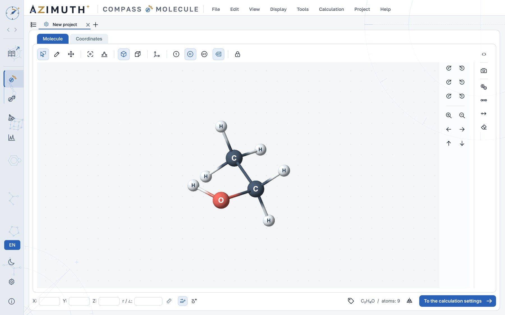

### Step 3. The calculation in Sextant

1. Click «To the calculation settings» under the model – Sextant opens with this molecule.
2. Choose the program (for example ORCA or xtb), the task «Optimization + frequencies», the method B3LYP and the basis set def2-SVP. The D3(BJ) dispersion correction is already on.
3. The input file is shown on the right – you can read it and correct it if needed.
4. Click «Run calculation» (`Ctrl+Enter`). The progress of the calculation takes the place of the input file: the stages, the optimization cycles, the last energy.

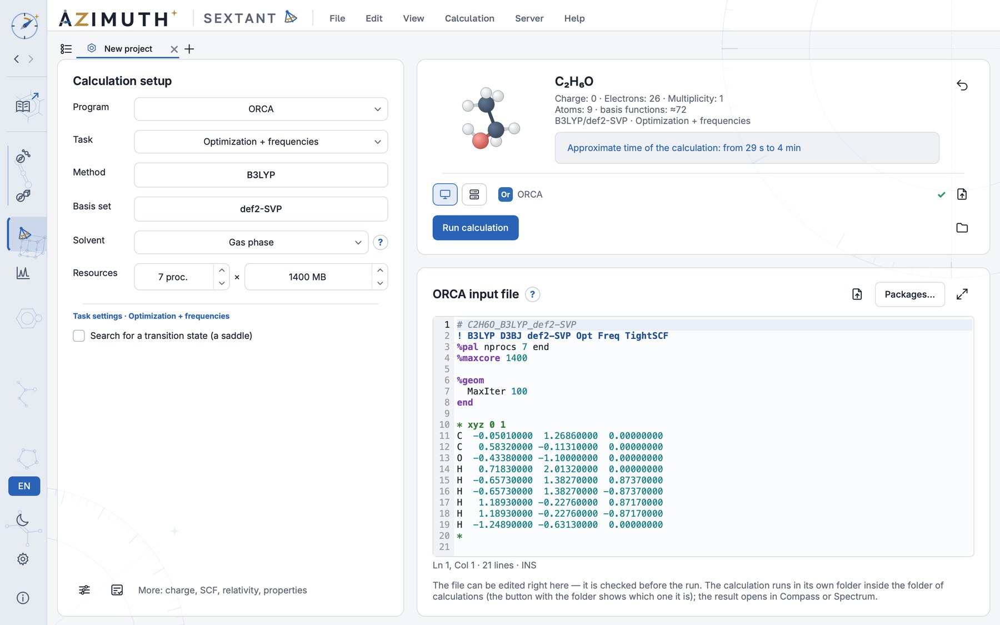

### Step 4. The result in Compass and Spectrum

When the calculation ends, the buttons «Go to Compass» and «Go to Spectrum» appear in the calculation window.

- In **Compass** the result opens as the optimization steps: the ☰ button at the top left of the model shows the energy plot and plays the steps. The vibrational frequencies can be viewed right on the model.
- In **Spectrum** – the final energy, the convergence of the optimization, the IR spectrum with animated vibrations and the thermochemistry (enthalpy and Gibbs free energy).

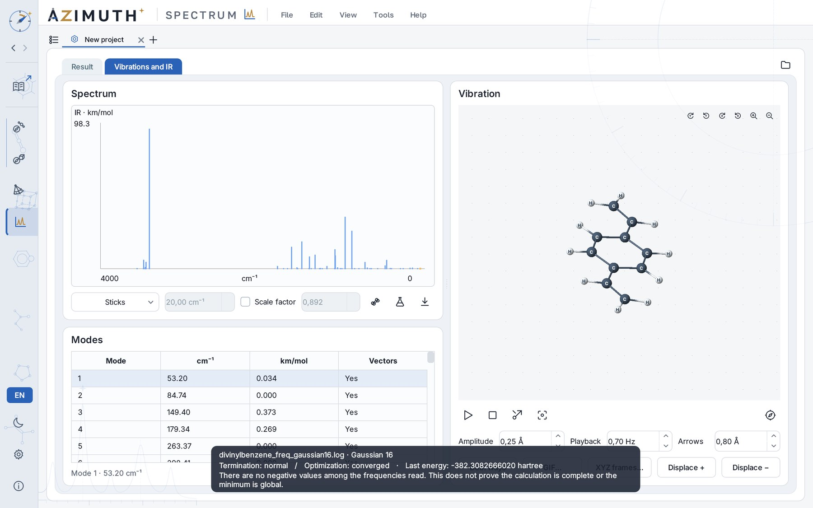

> **Tip.** If the result of an optimization with frequencies has an imaginary frequency, the structure is not at a minimum. The calculation doctor offers the button «Shift along the imaginary mode and optimise again» (section «Calculation doctor»).

### Teaching examples

«File → Open an example…» opens the `examples` folder of the program: real outputs of ORCA, Gaussian, xtb and Psi4 (properties, optimizations, scans, vibrations, UV-Vis and NMR, orbitals), pairs of structures to compare, molecules for rotation about a bond, CIF crystals (CsCl, NaCl, graphite, benzoic acid, silicon) and a file of custom fragments. What to open and what to look at is described in the table `examples/README.md`. The «File» menu of Spectrum also has teaching ORCA results that open without files.

## Interface and settings

### The main window

The Azimuth window consists of the left panel and the working area of a section.

- **The left panel.** At the top – the program icon, which opens the home page; under it – the «Back» and «Forward» buttons. Below – the sections: the Atlas (set apart by a line; the arrow ↗ reminds you that it opens in the browser), «Compass · Molecule», «Compass · Crystal», Sextant and Spectrum. At the bottom – the choice of language (Russian, English, Chinese), the theme, the settings and «About». The keys `Ctrl+1` … `Ctrl+5` also switch the sections.
- **The section header** – the name of the section and its menus: «File», «Edit», «View», «Calculation» and the menus of the section itself (Compass has «Tools», «Project», «Server», the crystal has «Crystal»); the last one is always «Help».
- **The working area** – the content of the section. At its top right there is a pale azimuth scale on the background, at the bottom left – the picture of the section (a compass, a sextant, a spectrum).

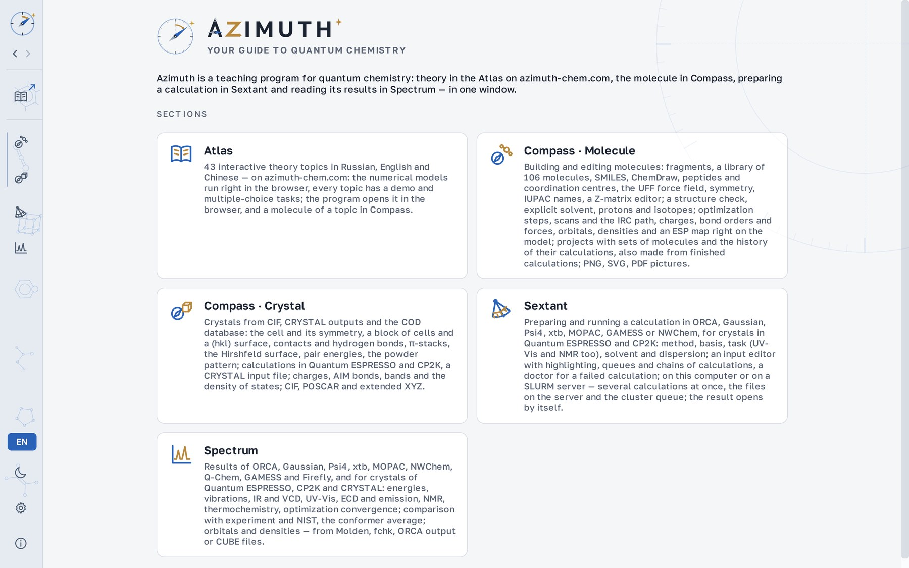

**The home page** tells what Azimuth is and gives a quick way into work. The «Continue» cards bring back the last molecule and the last crystal; the arrow on a card unfolds a stack of five more recent projects of the same kind. Below are the cards of the sections.

### Structure tabs

A tab is the whole work on one structure: the structure itself, the settings of its calculation and its result. The tabs are shared by «Compass · Molecule», Sextant and Spectrum: a tab chosen in one section is chosen in all of them. «Compass · Crystal» keeps its own tabs; Sextant and Spectrum return from it to the molecules.

- «+» above the model opens a new tab, the cross closes it (if there are unsaved changes, the program asks).
- The result of a calculation opens in the tab from which the calculation was started; a result from a file opens in an empty or a new tab.
- A result is shown where there is something to look at: vibrations, UV-Vis and NMR in Spectrum, the rest in Compass. Properties (charges, bond orders, dipole) appear on the model at once.

### The «File» and «Help» menus

The «File» menu is in every section. The main items:

- «Save» (`Ctrl+S`) writes the project into the same file without asking, «Save as…» (`Ctrl+Shift+S`) under a new name.
- «Close the tab» (`Ctrl+W`) and «Close the other tabs».
- «Clear» – an empty structure in the tab and nothing on top of the model (properties, surfaces, critical points, measurements, custom labels, an overlaid structure).
- «Molecule by name…» – an English name (aspirin, caffeine, 2-butanol); the structure is taken from PubChem – its 3D model (MMFF94 force field), or, when there is none, built from SMILES. The internet is needed.
- «Paste a structure from the clipboard» (`Ctrl+Shift+V`) – copied XYZ coordinates (whole or only the «C x y z» lines), a molfile or SMILES.
- «Show the file in its folder» – the Finder or Explorer with the file of the tab.
- «Settings…» – the window of the program settings (section «Program settings»).

A structure by name or from the clipboard goes into an empty tab, otherwise into a new one.

**The «Help» menu** begins with a search field in every section. Type a word, and the menu items and window buttons whose name or tooltip contains it appear below, with the path to them («Crystal ▸ Intermolecular interactions ▸ Hirshfeld surface…»). The chosen item is shown in its place: the menus open one after another, the item is highlighted, `Enter` runs it. `Ctrl+?` opens «Help» with the search field at once. The same menu has «Manual», «What's new» (the change journal), «Periodic table», «Handbook», the installation check, the folder of logs, the error report and «About».

**Updates** (0.225.0). At the start the program asks GitHub once for the number of the latest release – the one the site gives out. If a version newer than yours is out, a window appears: «Download» opens the «Download» section of the site, «What’s new» the page of the release, «Later» puts it off till the next start, «Don’t remind me of this version» keeps silent till the next one. Without a network the program says nothing. To check at any time: «Help → Check for updates…». To switch the check off: «File → Settings… → Appearance → Check for updates at start». None of your data is sent.

### Handbook and periodic table

«Help → Handbook» gathers data needed during work. The field at the top searches the table of the open tab.

- **Units and constants** – conversion of energy (Eh, eV, kcal/mol, kJ/mol, cm⁻¹, K, THz and the wavelength of a photon in nm), length and dipole moment; the fundamental constants of CODATA 2018 – those the program computes with.
- **Solvents** – the dielectric constant ε at 20–25 °C and the name of the solvent in ORCA, Gaussian, xtb and CREST, Psi4, MOPAC. The «?» sign next to the solvent in Sextant opens this table.
- **Frequency scaling factors** – the NIST CCCBDB table by methods and basis sets. From Spectrum («Tools → Frequency scaling factors…») a factor is put into the IR spectrum with the «Apply to the spectrum» button or a double click.
- **Experimental data** – databases of measured spectra, geometries and thermochemistry (NIST WebBook and CCCBDB, ATcT, SDBS, nmrshiftdb2, NIST atomic spectra, COD, PubChem) with a search by the formula of the molecule.

«Help → Periodic table» opens the cards of the elements: an animation of the atom, the atomic mass, the isotopes from NIST data and the electron configuration.

### The button panel above the model

Above the Compass model there is a row of view buttons, and at the right edge of the field – a column of «Snapshot» and of the buttons for what is overlaid from a calculation. The set of buttons can be changed.

1. Right-click any item or submenu in a menu of the window and choose «Add to the row above the field» or «Add to the column on the right». An item can also simply be dragged from the menu onto the row or the column.
2. The buttons of the row and the column are dragged with the mouse to another place. Dropped between the buttons of a group, a button joins the group; dropped after the last one, it stands behind a new divider.
3. Right-click a button – «Remove from the panel», a move to another place, or «Put the buttons back as they were». The standard buttons can be removed too – they stay in the menu.

The set of buttons is remembered and does not depend on the language of the program. «Compass · Crystal» has its own layout: changes there do not touch the panel of the molecule.

### The background work indicator

When long work goes on behind a window put away – a Sextant calculation while you are in another section, or a conformer search collapsed with the «Collapse» button – an icon appears at the bottom of the left panel above the languages: a compass on a «breathing» blue circle with a swinging needle. When the share of work done is known, a ring fills around it; when not, a comet runs around the circle. The tooltip shows the time.

- A click opens the window of the work without leaving the section. If there are several, the icon shows their number, and a click gives a list.
- When the work ends, the needle stops and a sign appears next to it: a check mark – success, a cross – an error, a dash – the work was stopped. Opening the window removes the sign.
- When you return to Sextant, the calculation window closes by itself, and the progress of the calculation stands in place of the input file.

### Theme, language and tooltips

The theme (light or dark) and the language are shared by all sections, the Atlas included. «Settings → Theme → As in the system» follows the appearance of macOS or Windows and changes with it until a theme is chosen by hand. The program icon in the Dock and the left panel follow the theme.

Questions and dialogs («Save changes?», choosing a file, entering a name) speak the language of the program, buttons «Yes», «No», «Save», «Cancel» included. The file dialogs on macOS are the system's own; their buttons follow the language of macOS.

Tooltips appear only where they tell something new: on icons without a label, on settings fields, on cut text. Icon buttons unfold on hover and show their label. Longer explanations are behind the «?» sign next to a field.

**Atoms in input fields.** Where atom numbers are needed (the plane and line of Spectrum maps, the fragments of charge transfer and CDA, «Select by numbers»), atoms are shown as «H1», «C3–C8». They can be entered either so or by numbers: «1-4, 7», «N1, H2–H4», and a plain «H» means all hydrogen atoms. A symbol that does not match the element of the atom with that number is not accepted – this protects against mixed-up numbers.

### Program settings

«File → Settings…» in any section (or the gear icon on the left panel) opens one window for the settings of the whole program. On the left – the list of sections, on the right – their fields. Changes act at once and are kept until the next start. Most sections have a «Defaults» button.

Table: Sections of the «Settings» window

| Section | What is set |
|---|---|
| Appearance | Language; theme – light, dark or as in the system |
| Files | «Add hydrogens to files without H» |
| Bonds and steps | The factor applied to the sum of covalent radii for bonds by distance (1.22; «Find bonds again» applies it to the open structure); the order threshold for «Bonds by Mayer bond orders» (0.5); «Optimization and scan steps in one orientation» |
| Model view | The display scheme at start («As last time» or any from the menu); fast drawing of big models – from N atoms |
| Snapshots | The magnification of the «High-resolution snapshot» (×2–×6), transparent background, cropping to the molecule |
| Spectra | IR as sticks or a curve, the width of IR and UV-Vis bands, the frequency scaling factor on at once |
| Units | Coordinates in the Compass table (Å or bohr); the ΔE energies of steps, scans, IRC and conformers (kcal/mol, kJ/mol, eV) |
| Analysis tables (CSV) | The column separator («;», «,» or tab) and the decimal mark; a sample line next to them |
| Calculations | The calculations folder, the projects folder, the default conformer search method |
| Programs | Where ORCA, Gaussian, Psi4, xtb, CREST, MOPAC and others were found; «Choose…» the program file and «Find it myself» |
| Multiwfn | The calculation grid (coarse, medium, fine) and the Multiwfn program file |
| Errors | The folder of logs, «Save the report…», «Send to the author…» |
| All settings | «Save to a file…» (JSON, without passwords and keys), «Load from a file…» (for example on another computer), «Reset all settings…» |

> **Tip.** By default the columns of the CSV tables are separated by a semicolon and the fraction of a number by a comma (1,5). Excel and Numbers open such tables with a double click on a computer with Russian settings. If a table is for a program that expects a comma between the columns and a point in the numbers (1.5), choose «,» and a point.

### Files from the Finder and Explorer

- A double click on a `.qcc` project opens it in Azimuth. For CIF, XYZ, MOL, SDF, PDB, the outputs and input files of calculations, Molden and CUBE, Azimuth is offered in «Open With». A structure and a crystal open in Compass, the result of a calculation in Spectrum.
- Files can be dragged onto the window. While they are held over it, the window turns grey and a hint for the section on the screen appears in the middle: in Compass – structure files (XYZ, MOL, SDF, MOL2, PDB, CIF, Molden, QCC), in Sextant – input files or structures, in Spectrum – calculation files.

### Errors and the report for the author

When something breaks, the program does not keep silent: the error is written into the log, and a window with Quail says «Something went wrong» (the program goes on working) and offers «Save the report…». If the program closed after a crash, it offers to save the report at the next start.

The report is one `.zip` archive: the logs of errors, crashes and starts, the versions of Azimuth, Python, Qt, NumPy, VTK, information on the system and the settings without passwords. The **«Send to the author…»** button (in the error window, in the question after a crash and in «Settings → Errors») saves the report on the desktop and opens in the mail program a letter to contact@azimuth-chem.com with the version, the system and the last error. You only need to drag the report file into the letter and add what you were doing. The same – «File → Error report…».

### Quail

Quail is the mascot of the program. She greets the end of a calculation in its window, stands in the questions before quitting and before replacing a project and in the input file check. While a Compass tab is empty, Quail stands in a corner of the field with a hint: the pencil in the bubble starts building, the folder opens a file. In Spectrum without a result she studies an empty sheet with a magnifier. In the Atlas, Quail leads the demonstrations of the topics.

## Atlas

The Atlas is an interactive textbook of theory: 56 topics in 13 sections, from the postulates of quantum mechanics and the hydrogen atom to DFT, perturbation theory, solvation, the choice of method, NMR, conformers, heavy elements, crystals, Walsh diagrams and machine learning in quantum chemistry. The numbers on the pages are computed right in the browser (Python on the page) – without calculation programs and without a server.

### How to open the Atlas

The Atlas lives on a site: the main address is [www.azimuth-chem.com](https://www.azimuth-chem.com/?lang=en), a mirror for Russia is [ru.azimuth-chem.com/atlas](https://ru.azimuth-chem.com/atlas/?lang=ru). The «Atlas» item on the left panel and its card on the home page open it in the browser in the theme of the program (light or dark): in Russian on the mirror, in English and Chinese at the main address. The language of an Atlas opened from the program is the language of the program; the theme and the language on the site are switched in its left panel.

> **Tip.** To read the Atlas without the internet (for example in a classroom without a network), click «Save the Atlas for offline work» in the left panel of the site.

### Sections of the Atlas

Basics of quantum mechanics · The molecule and the nuclei · Symmetry · Crystals · Many-electron functions · Hartree–Fock · Correlation · Density and DFT · Choosing the method and basis set · MOs and reactions · Thermochemistry and kinetics · Properties and spectra · Dynamics and machine learning. A section has from two to six topics. «Point groups» includes the reduction of representations and SALCs, «SCF iterations» – Koopmans' theorem, «The Hückel method» – reactivity indices, Fukui functions and semiempirical methods.

### The page of a topic

- **«What to understand»** and **the limits of the model** – at the beginning of the page: what you will learn and where the model stops working.
- **Sections with sliders, buttons and plots.** Change the parameters and watch how the result changes. Key concepts are highlighted, formulas are in the text; the caption under a plot explains what it shows.
- **Demonstration** – the «▶ Demonstration» button at the bottom right. A step-by-step show: Quail presses the buttons herself and explains what is seen. The `←` `→` arrows turn the steps, `Esc` ends the show. The animations of a topic run only while the topic is open – on another topic they stop and later go on from the same place.
- **Check your knowledge** – exercises at the end of the page: do something on the page and choose one answer of four. The answer is checked at once, and a wrong one hints where to look.
- **Glossary** – terms underlined with dots (there are 132). Hover or click – a definition appears with a link to the topic that explains the term.
- **«Open in Compass»** – on pages with molecules: the buttons with the names of molecules open them in the program (on a computer where Azimuth is installed).
- **What next** – a question at the end of the page that leads to the next topic.

### How to find a topic

1. The home page of the Atlas has all topics grouped by sections – click a topic.
2. Or click the magnifier icon (or press `/`) and start typing: the search covers titles, key concepts, section headings and exercises.
3. The tabs under the header switch the topics of one section; the ‹ › arrows at the right of the topic row turn all topics in order. The `←` and `→` keys do the same, and `↑` and `↓` scroll the topic.
4. The «Continue» line at the beginning of the Atlas overview returns to the last topic opened, and «Where to start» offers the first topics.

Every time the Atlas home page opens, Quail tells a textbook fact on one of the topics – the «Psst, did you know?» corner (129 facts, three per topic). «Open the topic» goes to it, «One more fact» shows another, «Hide» removes the card until the next start.

### How to work through a topic

1. Read «What to understand».
2. Start the «▶ Demonstration».
3. Move the sliders yourself: each block answers one question.
4. Answer the «Check your knowledge» exercises.
5. Open the molecule of the topic in Compass and calculate it in Sextant – compare with what the Atlas showed.

### The Atlas in class

**Presentation mode** (a button on the topic page) enlarges fonts and plots for a projector. The demonstration of a topic suits a lecture: the steps are turned with the arrows like slides.

In this manual many sections end with «Theory – in the Atlas» links: they lead to the topics that explain what exactly the program computes.

## Compass · Molecule

Compass is the section for building, editing and viewing molecules. Here the result of a calculation is laid onto the 3D model as well: optimization steps, vibrations, charges, orbitals and electron density surfaces.

### The Compass window

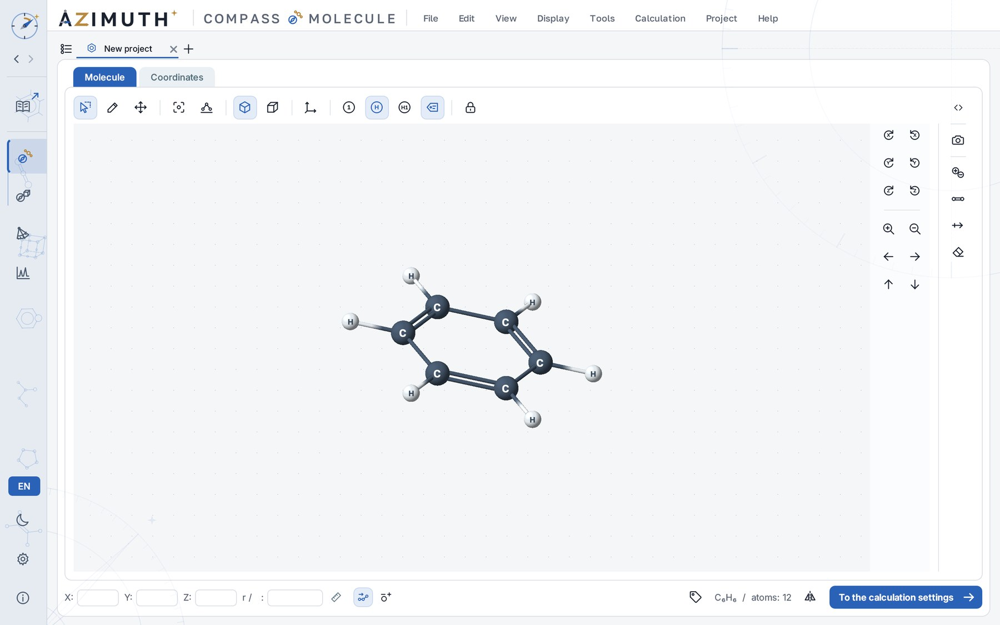

- **Structure tabs** above the model. The result of a calculation (optimization steps, a scan, an IRC or NEB path, XYZ frames) opens in a tab of its own, the molecule stays in its tab; if the open tab is empty, the result takes it.
- **The tool panel** on the left: building modes and tools – the element, the bond order, «Bond», «Break», «Delete», «Add hydrogens», «Tidy the geometry».
- **Modes above the model**: «View / select» (the arrow – rotate the model and select atoms; the structure does not change), «Edit the structure» (the pencil – atoms, fragments, molecules) and «Move atoms». The button of the active mode is pressed.
- **Buttons above the model**: the view (centre, isometric or perspective, axes, «Best view»), atom labels, optimization constraints (the lock), the chevron of the view panel.
- **The column at the right edge of the field**: «Snapshot» and below it what is overlaid from a calculation – «Atoms», «Bonds», «Dipole and forces» and the eraser «Remove everything overlaid from the model».
- **Under the model** – the summary (the formula and the number of atoms), the name button (IUPAC), the symmetry button and «To the calculation settings».
- **The «Coordinates» tab** – the table of coordinates (ångströms or bohrs), the format and copying. `Delete` deletes the atoms of the selected rows.

The Compass menus: «File» (open, save, picture), «Edit» (selection, atoms, bonds, geometry, coordinate system), «View» (projection, camera, axes, labels, measurements on the model), «Display» (model, bonds, schemes), «Tools» (moments of inertia, statistics of atoms and bonds, mass, fragments, comparison of structures), «Calculation», «Project» and «Server».

### Building a molecule

1. «File → New molecule» (`Ctrl+N`) or «+» above the model. If a project is open, an empty «New molecule» row appears in its list of molecules; with the first atom it becomes a molecule of the project.
2. Turn on the «Edit the structure» mode (the pencil). Choose an element on the panel and click the field – an atom appears; a click on an atom attaches a new one to it.
3. To place a group, choose a fragment (methyl, phenyl, carbonyl, rings…) and click the field, an atom or a hydrogen – the fragment takes its place.
4. «Add hydrogens» adds the missing H atoms, «Tidy the geometry» arranges the atoms by the VSEPR rules.

A ready molecule can be taken from the library – «File → Example molecules» (106 molecules in 7 sections) – or built from SMILES: «File → Molecule from SMILES…», for example `CC(=O)O` for acetic acid.

**Building switches** (icons in the pencil menu and in «Edit → Atoms, fragments and molecules»):

- **«Add hydrogens while building»** (off by default) – an atom placed on an empty field comes with its hydrogens at once (C → CH₄), a click on a saturated atom removes a hydrogen to make room for the new bond, and new atoms are filled with hydrogens by valence.
- **«Tidy while building»** («Edit → Geometry», on by default) – a new atom or group takes its VSEPR place at once, a chain is stretched into a zigzag, and the part of the molecule already drawn does not move.
- **«Tidy with UFF»** – while building, new atoms are aligned by the UFF force field instead of the simple VSEPR field.

**«Tidy the geometry»** – a simple force field for the whole molecule or the selection: bond lengths, VSEPR angles, planar multiple bonds and aromatic rings, repulsion of atoms and torsion terms (bonds between tetrahedral atoms become staggered). It gives a neat starting structure, not an optimized one: its energy is arbitrary and cannot be used to compare conformers.

### Opening and saving

**Open** – «File → Open…» (`Ctrl+O`) or drag a file onto the window. Compass reads XYZ, Azimuth projects (`.qcc`), Molfile and SDF, MOL2, PDB, ChemDraw XML (`.cdxml`), ORCA and Gaussian input files, the outputs of calculations, Molden and fchk files (the full list is in Appendix A). A CIF opens in «Compass · Crystal», the result of a calculation – as steps in Compass or in Spectrum.

- An SDF with several molecules opens as a set of structures (the «Structures» panel), a PDB with several models (MODEL … ENDMDL, for example molecular dynamics frames) – as steps in the result panel.
- If the name line of an SDF record is empty (as RDKit and many databases write it), the name is taken from its data fields – `<Name>`, `<Title>`, `<PUBCHEM_IUPAC_NAME>`, `<chembl_id>`.
- From ChemDraw XML the atoms and bonds of the fragments of the first page are taken, with bond orders, formal charges and the caption of the drawing. The flat drawing is converted into ångströms, hydrogens are added, «Make 3D» gives the volume. Expand abbreviations (Ph, OMe…) in ChemDraw; save a binary `.cdx` there as `.cdxml`.

**Files without hydrogens.** If an opened file has not a single H atom, Compass adds them by valence (C – 4, N – 3, O – 2, halogens – 1) and says how many it added. `Ctrl+Z` returns the file as it was. Double and triple bonds written in the file (MOL/SDF, MOL2, PDB CONECT) are taken into account; in XYZ the bond order is found from the length. A file with at least one H is not changed. To turn the completion off: «File → Add hydrogens to files without H».

> **Warning.** An ion or a radical without H gets the hydrogens of a neutral molecule – check the charge and the multiplicity before the calculation.

**Save.**

- «File → Save project…» – the molecule together with the calculation settings.
- «File → Export coordinates» – XYZ in ångströms or another format.
- The «Snapshot» button at the model – PNG (×1 and ×3; the magnification is in «Settings → Snapshots», a transparent background optional), a GIF of rotation and a GIF of optimization steps, vector SVG and PDF.
- «File → Model for 3D printing…» – what is on the screen as balls and sticks: STL in one colour for any printer or VRML in the colours of the elements. The scale is millimetres per ångström (10 by default: water is about 2.5 cm); bonds are not thinner than the thickness set, so that they do not break.

### Projects

A project gathers the molecules of one piece of work and all their calculations in one folder: the list of molecules, their structures, charges, settings and calculation attempts. A project appears when a set of molecules is opened (an SDF, several files) or when saving.

- **The project folder** – «Documents/Azimuth/Проекты/<name>»: `project.qcc` (the pointer), `project.sqlite` (molecules, settings and calculation history) and the calculation folders of the molecules. Every change is written into the database completely or not at all.
- **The «Project» menu** gathers the actions with a project: a new and an open project, the list of molecules, adding and removing molecules, bringing removed ones back, single or batch mode, the history and the files of the project.
- **Removing molecules.** In the list of molecules of the project choose one or several (`Shift`, `Ctrl`) and press `Delete` or right-click – «Remove from project…». The check box «Also delete the files of their calculations» deletes their folders too – irreversibly. Without it the files stay, and the molecules come back with `Ctrl+Z` in the list or «Restore removed».
- **The optimized geometry** after a converged optimization (or transition state search) becomes the structure of the project's molecule, so that a chain such as MOPAC → ORCA → QTAIM goes on without carrying anything by hand. The previous structure stays in the input of the attempt and in the undo history.
- **A result for earlier data.** If the geometry, charge, multiplicity, method or program of a molecule was changed after its calculation, its row in the list is marked «≠», and the tooltip names what changed. The result is not recomputed: it remains the result of its own calculation.
- **«Calculation folder»** in the right-click menu of the list opens the folder of the current result of the molecule or of its last attempt.
- **«Save all structures»** writes all molecules of the project into one XYZ or SDF file.
- **A project from calculations.** «File → Project from calculations…» gathers into a project the calculations made outside Azimuth from a chosen folder: the outputs of ORCA, Gaussian, Psi4, xtb, MOPAC, GAMESS, NWChem and Q-Chem together with their files. One molecule calculated in different ways becomes one molecule of the project with the history of these calculations.
- **Draft.** A molecule drawn on an empty tab and not saved to a file becomes a «New project» draft in the «Проекты» folder when the program closes (or when you go to another tab). In «Continue» and in «Recent files» it is marked «· draft»; «Save» gives it a name.
- **A file opened just to look at it** gets a project tab, but its folder stays in «Проекты» only if the project changed (the molecule was edited, calculated, or the project was saved under a name).
- **One project in two windows.** Only the first window writes into the project; the second shows it «read-only».

> **Warning.** Do not copy `project.sqlite` apart from the project folder. To get a copy, use «Save as…» or copy the whole project folder while the program is closed.

### Viewing, selecting and measuring

- **Rotate** – drag with the mouse, **zoom** – the wheel, **pan** – the arrow buttons. On a trackpad: a drag rotates, two fingers move, a pinch zooms.
- **Select** – click an atom; with a frame – drag with `Shift`. «Edit → Selection»: all, invert, by element, one step wider (`Ctrl+]`), the whole molecule (`Ctrl+Shift+]`), by numbers and by a range of coordinates.
- **Measurements.** Select 2, 3 or 4 atoms – the length, the bond angle or the dihedral angle appears under the model. «View → Measurements on the model» labels all bond lengths and bond angles; the ruler pins chosen distances and angles on the model. «Measurement style…» sets the text size and the number of digits.
- **Standard view** («View → Standard view»): along the x, y, z axes, along the selected bond or straight onto the plane of three selected atoms. «Rotation centre – selected atoms» rotates and zooms the model around them. «Camera → Camera position…» sets the angles and the scale as numbers – one viewpoint for several structures.
- **Model** («Display»): balls and sticks, sticks, space-filling; «Van der Waals spheres» – translucent spheres of Bondi radii.
- **Atom labels**: element, number, «Element and number · C1», «Number within the element · C1, H1», bond numbers and orders, labels of the selected atoms only; the size – «Label style…».
- **Custom labels** (the tag button next to «1», «H», «H1»): select atoms, press it and type a label; «#» becomes the number in the order of selection. The labels follow the atoms when editing and are kept in the project. In a PDB with residues (a protein, DNA) the residues are labelled by themselves.
- **Hide atoms**: the selected ones, dummy atoms X; «Show all atoms» brings them back. Hidden atoms stay in the structure and in the calculation.
- **Protein ribbons** («View → Protein ribbon»): α-helices – red ribbons, β-sheets – yellow arrows, the rest – a grey tube; the atoms of the chains are hidden, ligands and water stay.
- **The ghost atom X** (in the periodic table under the lanthanides, or X in the coordinate table) – a point without nucleus and electrons for a Z-matrix, the centre of a ring or an axis; it does not go into the input files of Sextant.

**Vectors and planes** («Edit → Vectors and planes»): «Vector between selected atoms», «Normal to the plane of selected atoms» (a 1.5 Å arrow from the centre of the mean plane) and «Plane through selected atoms» – a translucent sheet. Each object on the model has its own number. «Angles between vectors and planes…» gives the angle of every pair. «Vectors and planes as text…» – a line per object («vector 1 2», «normal 1-6», «plane C1–C6»); the list can be edited and applied. «Remove vectors and planes» removes them. «Geometry → Planes of groups of atoms…» – the mean plane of a group (for example the ring C1–C6) and the deviations of the atoms from it; for two groups – the angle between the planes, the distance between the centres and the offset (π-stacking).

### Editing the geometry

- **Undo and redo** – `Ctrl+Z` and `Ctrl+Shift+Z`.
- **Bonds.** Select two atoms and press «Bond» or «Break» (or `Ctrl+B`); the bond order is on the panel. A right-click on a bond gives single, double, triple, aromatic, partial (dashed) and «Bond colour…».
- **Moving atoms.** In the «Move atoms» mode drag an atom with the mouse. Next to it – what else can be dragged: a fragment around an anchor atom; rotation about a bond (select two bonded atoms and drag an atom of one side); the whole molecule; an unbranched chain; the selection.
- **Rotation about a bond** («Edit → Geometry → Rotate about a bond…» or right-click a bond): the exact dihedral angle with a field and a slider, a turn by a given angle, a sweep with a given step (the frames go to the steps panel or to an XYZ file). The closest contact of the two sides is shown. Ring bonds do not rotate.
- **Delete a molecule.** If there are several molecules on the model, right-click an atom – «Delete the molecule (N atoms)».
- **Z-matrix editor** («Edit → Geometry → Z-matrix editor…»): lengths, angles and dihedrals as numbers; the model changes at once.
- **Move and rotate…** – the selected atoms are rotated by an angle about the X, Y, Z axis or an axis through two atoms and shifted by a vector. **Reflect** – in the XY, XZ or YZ plane.
- **All bonds at once**: «Edit → Bonds → Remove all bonds»; «Find bonds again» builds them by distances.
- **Copying**: «Edit → Copy and paste» – atoms, coordinates and «Copy SMILES».
- **Atom order**: «Selected atoms first» (select atoms by clicks in the order wanted – they get the numbers 1, 2, 3…) and «Hydrogens after their atoms».
- **Symmetrise** («Edit → Geometry») fits the structure to the point group found; the second action also turns it into the standard orientation.
- **Optimise (UFF)** – the selected atoms or the whole molecule down to the minimum of the universal force field (Rappé et al., 1992; the parameters as in RDKit). The status line shows the energy before and after and its terms. The structure needs its hydrogens. For big molecules – «Calculation → Quick xtb calculation → GFN-FF optimization».
- **Build a peptide…** – the sequence in one-letter codes (up to 30 residues) and the conformation: α-helix (φ −57°, ψ −47°), β-sheet (−139°, +135°) or an extended chain. All amino acids are L, the ends are NH₂ and COOH.
- **Coordination centre…** – the metal, the oxidation state, the geometry (from linear to pentagonal bipyramid) and the ligands: one for all positions, a comma-separated list or «4 Cl, 2 NH3». Ligands: H2O, NH3, PH3, OH, CO, CN, F, Cl, Br, I, H. The M–L length is the sum of covalent radii (Cordero, 2008); the charge of the complex and the lowest multiplicity are put into the fields of the tab.

> **Note.** Set a high-spin state of a coordination compound in Sextant yourself: the program puts the lowest multiplicity.

### Name and symmetry

- **The symmetry button** under the model (bottom right) finds the point group with a tolerance that can be changed; a second press symmetrises the structure. The group is found for one molecule of up to 150 atoms. The same is in «Tools»: «Find the point group», «Symmetrise», «Symmetrise and turn to the standard orientation».
- **The name button** (IUPAC) gives the name by the IUPAC rules (acyclic and monocyclic compounds with C, H, N, O and halogens, in three languages) or from the program's dictionary. If no rule applies, Compass asks PubChem (the internet is needed; the name is in English).

Theory – in the Atlas: [«Point groups»](https://www.azimuth-chem.com/atlas/?lang=en#sym).

### Custom fragments and molecules

**Fragment.**

1. Select a group of atoms together with the atom by which it attaches (for example CF₃ and the carbon).
2. «Edit → Atoms, fragments and molecules → Save the selection as a fragment…» and give it a name.
3. The fragment appears in «My fragments» and is placed like the built-in ones. The same place has deletion, export and import as a JSON file (to carry fragments to another computer).

**Molecule.**

1. Right-click an atom – «Save the molecule to «My molecules»…» (all atoms connected to this one are saved). Or the same item in the «Molecule» menu of the building mode: the selected atoms, without a selection – the whole structure.
2. The molecule appears in «File → Example molecules → My molecules» and in the «Molecule» menu when building (it is placed with a click on the field next to the others). The same place has «Delete my molecule».

### Structure check, solvent, protons and isotopes

- **«Tools → Check the structure…»** before a calculation compares the charge and the multiplicity with the number of electrons and looks for atoms too close to each other, atoms with too many neighbours, a neutral N with four bonds and an O with three, unfilled valences and disconnected parts. The remarks come as a list (✕ – the program will not accept it, ! – looks like a mistake, · – check your intention), their atoms are selected on the model. «Run calculation» in Sextant makes the same check itself and asks «Start all the same?» when there are errors.
- **«Tools → Surround with a solvent…»** – explicit solvation by water, methanol, ethanol, ammonia, DMSO, dichloromethane, chloroform, THF or benzene. «The first coordination shell» puts a solvent molecule by a hydrogen bond on every free place; «Round the whole molecule, at random» – a given number of molecules without overlaps. «Remove the solvent» – in the same window.
- **«Tools → Protons»**: add a proton to the selected atom (charge +1), remove one (−1) or move a hydrogen to another atom (a tautomer).
- **Isotopes.** Right-click an atom → «Isotope»: the stable isotopes of all elements with their abundance (NIST), T and ¹⁴C or «A mass of one’s own…»; several atoms at once – «Tools → Isotopes of the selected atoms…». The mass number appears at the symbol on the model; isotopes go into the input files of ORCA, Gaussian and Psi4.

### Comparing structures

1. «View → Structure comparison» or «File → Overlay a structure for comparison…».
2. Choose the file of another structure of the same composition (a conformer, the result of another program, a file with another numbering).
3. The atoms are matched automatically. The RMSD (with all atoms and without H) and the largest deviation are shown. The model can be renumbered as in the file, and the structure from the file can be saved in the numbering of the model.

Enantiomers are distinguished: a mirror reflection is not allowed without asking. A quick comparison with another open tab – «Tools → Compare with a tab».

### Conformer search

«Calculation → Conformer search…» opens the search window. On the left – the «Search method» card: the method is chosen in a list, with its description and settings below it; further down – the common energy window and temperature. On the right – the conformers found. A method suited to the molecule is chosen at once.

Table: Conformer search methods

| Method | When it is chosen | How it works |
|---|---|---|
| Enumeration | Up to 4 rotatable bonds | Turns the rotatable bonds in 120° steps (or 60°, 180°) in all combinations (at most 200) or at random; discards structures with clashing atoms; refines the candidates in xtb |
| Bee search (ABC) | 5–10 rotatable bonds | An artificial bee colony: the turns of the bonds are «nectar sources», the energy is a short xtb (GFN2) optimization; first the lowest conformer, then low ones unlike those already found |
| CREST | More than 10 rotatable bonds | A full search by the CREST program (iMTD-GC; «quick» – the `--quick` key); the energy window is passed to it (`--ewin`) |

Single bonds outside rings count as rotatable; CH₃ groups and amide C–N bonds are not rotated.

**Sorting.** «Refine with xtb (GFN2)» optimizes every candidate and sorts them by the rules of CREST: the energy window (6 kcal/mol by default), duplicates (ΔE < 0.05 kcal/mol and RMSD < 0.125 Å) are removed, identical structures with differently numbered atoms count as rotamers of one conformer. The Boltzmann population at the chosen temperature (298.15 K by default) is shown. If the window discarded something, a line at the bottom says how many structures and how much higher the nearest one is.

**Method settings.** «Energy window» (6 kcal/mol by default, as in CREST) and the temperature are common. The bee search has «ABC: conformers» (how many to find, 10 by default) and «ABC: iterations» (the length of the search; each iteration is 2 × the number of rotatable bonds xtb runs); all its runs lie in one ABC_… folder among the calculations. CREST has «quick» and «CREST: metadynamics length». «Run CREST» is available if CREST is installed. During the search the line at the bottom shows the progress: for xtb – «conformer 5 of 20», for the bee search – the global or local search and the number of the xtb run.

**Result.** The conformers found are on the «Conformers» page of the result panel (☰): «Take the selected one» puts the conformer into Compass, «Save XYZ…» – all frames with their energies. If the molecule is in a project, the conformers within the energy window go into «Project molecules» as a group under it (numbers 1.1, 1.2…, each with its ΔE); each conformer is a molecule of the project with calculations of its own.

> **Tip.** A typical path: run the conformers found by xtb as a queue in MOPAC (PM7), then the best ones of the new sorting as a queue in ORCA (section «Calculation queue»).

> **Note.** CREST treats small conjugated molecules as rigid and gives them a short metadynamics, so it finds one conformer. Then increase «CREST: metadynamics length» (the `--mdlen` key).

Theory – in the Atlas: [«Conformers: which minima to look for»](https://www.azimuth-chem.com/atlas/?lang=en#conf).

### Reaction path

1. Open the starting structure. «Calculation → Path between structures…».
2. Choose the end structure – from a file or from the comparison. It is renumbered like the starting one and overlaid on it.
3. The intermediate structures (1–50) are built by IDPP (bonds are not shortened when groups rotate) or linearly; the frames go to the steps panel and to an XYZ file.
4. «To Sextant: ORCA NEB-CI» prepares a calculation of the path and the transition state: Sextant chooses the task «Reaction path (NEB-CI)», and `end.xyz` is written next to the input file.
5. A transition state found is checked with the task «Path from the transition state (IRC)» (0.223.0): ORCA goes down from it both ways, to the reactant and to the product. «Task settings» have «Steps each way» and a numerical Hessian for the methods without an analytic one. Start from a geometry with one imaginary frequency computed with the same method and basis. The result opens in Compass: the «Optimization» panel shows the profile of ΔE from the transition state and the structures step by step; the end steps are the minima this TS connects.

> **Tip.** A quick draft of the path (0.228.0). A path at the DFT level takes long: every image is optimized. Find it first with GFN2-xTB: in Sextant choose the program ORCA and the method «GFN2-xTB» of the group «Semiempirical (xtb through ORCA)». No basis set is needed, and the calculation takes seconds. The program xtb must be installed («Calculation → Install calculation programs…»): ORCA drives the calculation, xtb computes the energies and forces. Take the highest point of the path as the starting guess for the task «Transition state + frequencies» with a DFT functional. The barrier of GFN2-xTB itself does not go into the report: it may differ from DFT by tens of kcal/mol. The same method in ORCA also does «Energy» and «Optimization»; compute frequencies and the rest with the program xtb or with DFT.

Theory – in the Atlas: [«Potential energy surface»](https://www.azimuth-chem.com/atlas/?lang=en#pes).

### Constraints in an optimization

Select atoms (1 – an atom, 2 – a length, 3 – an angle, 4 – a dihedral angle) and choose «Calculation → Fix the selection for the optimization» or press the lock button above the model. A small lock appears on the model, and the constraint goes into the input file of the optimization. Constraints also serve as the coordinates of a potential energy surface scan (section «Calculation tasks»).

### Quick xtb calculation and calculation tools

The «Calculation» menu of Compass:

- **«Charge and multiplicity…»** – the fields of Sextant right from Compass.
- **«Quick xtb calculation»**: «Energy», «Optimization», «Optimization + frequencies», «GFN-FF optimization» and «Scan along the selected atoms…» (a length, an angle or a dihedral angle is changed to the final value in a given number of points, the rest is optimized). A GFN2-xTB calculation with the charge and multiplicity of the tab starts at once, whatever program is set in Sextant, and comes to the tab like an ordinary one.
- **«Calculation steps»**: «Save the steps as one XYZ…», «Coordinates of all steps (CSV)…» and «Parameter along the steps…» – a length, angle or dihedral of the selected atoms along the steps of an optimization, a scan or an IRC.
- **«Modes involving the selected atoms…»** – vibrations sorted by the share of the selected atoms in the displacements; this is how, for example, the C=O stretch is found quickly.

The «Tools» menu of Compass: «Table of internal coordinates…» (all lengths, angles and dihedrals; «Save CSV…»), «Volume and surface area…» (van der Waals volume, solvent-accessible area with a 1.4 Å probe, effective diameter; Bondi radii), the moments of inertia and the rotational constants, the mass of the molecule, the statistics of atoms and bonds.

### The result of a calculation on the model

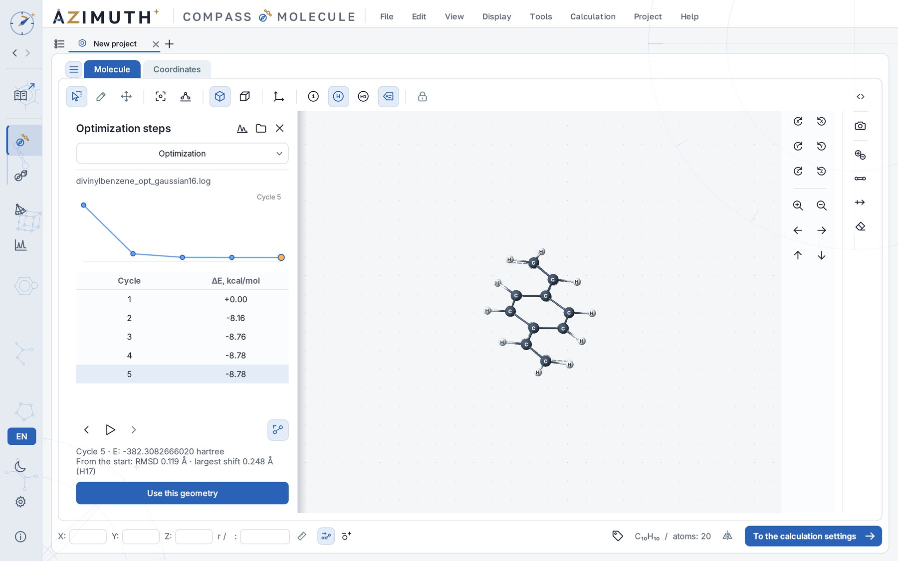

**The result panel** is opened by the ☰ button at the top left of the model; it is visible only when the tab has something to show. The pages of the panel:

- **«Optimization»** – the steps of an optimization, a scan, an IRC or a NEB: the energy plot, playback, GIF. After an optimization the last step is chosen; the chosen step remains the structure of the tab when the panel is collapsed. When a scan is turned through, its coordinate is labelled on the model in orange. A two-dimensional scan has the «Scan map» button: ΔE in colour with contour lines and the «valley» dashed.
- **«Structures»** – when several files or an SDF database are open at once: the chosen structure on the model, «Take this structure».
- **«Conformers»** – after a conformer search.
- **«Frequencies»** – frequencies and IR intensities (imaginary ones in orange); the chosen vibration moves right on the model (space – pause, arrows – another vibration).
- **«Orbitals»**, **«Surfaces»** and **«QTAIM»** – wavefunction analysis (section «Properties and electron density on the model»).

The header of the panel has the «Go to Spectrum» icon: Spectrum opens on the tab with the same content (convergence, vibrations, maps, topology). A click on an empty place of the field collapses the panel.

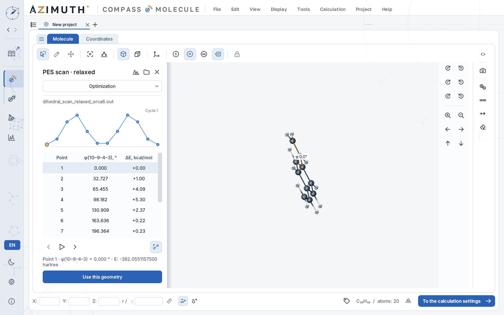

### Properties and electron density on the model

**Properties** («Calculation → Properties from the calculation» and three buttons of the column on the right):

- **«Atoms»** – charges (Mulliken, Löwdin, Hirshfeld, CM5, ADCH, RESP, AIM, APT, xtb, MOPAC), spin populations and Fukui functions; the kind shown is marked «•». Analyses that give new values are in the «Compute from the wavefunction» submenu.
- **«Bonds»** – Mayer, Wiberg, FBO and LBO bond orders; «Bonds by orders…».
- **«Dipole and forces»** – the dipole moment and the forces on the atoms at the chosen optimization step.

The eraser next to them removes everything overlaid from the model; the structure, its labels and measurements stay.

**Wavefunction analyses.** If the result has a file with orbitals (Molden, fchk or ORCA `.gbw`), the Multiwfn program computes in the background:

- ADCH and CM5 charges, Hirshfeld charges (for Gaussian and Molden, which do not have them in the output) and AIM charges by Bader basins, for an open shell – spin populations as well;
- RESP charges – fitted to the electrostatic potential (two-stage RESP), as in the AMBER and GAFF force fields; the status line shows the RRMSE, the «Анализ» folder gets a file `<name>_resp.chg` for molecular dynamics programs;
- bond orders by four definitions.

**Fukui functions** – for the result of the «Fukui functions» queue of Sextant: from the Hirshfeld charges of three calculations, f⁺ (nucleophilic attack), f⁻ (electrophilic attack), f⁰ (radical attack) and the dual descriptor Δf = f⁺ − f⁻ on the model; a window with a table, likely sites of attack and global indices (ionization potential, electron affinity, electronegativity, hardness, electrophilicity index). At the bottom of the window – the same functions as a surface on the model: the program builds the densities of the three calculations on one grid and subtracts them.

**Orbitals and surfaces.** If the result has orbitals, the result panel has the pages «Orbitals», «Surfaces» and «QTAIM» (the same – «View → Surface on the model»).

- **«Orbitals»** – the table of orbitals and the buttons «Orbital», «Spin» (for open shells) and «Composition» (contributions of atoms by Hirshfeld). Above the table – canonical or localized orbitals: Pipek–Mezey, its «Becke» variant (for basis sets with diffuse functions) or Boys; localized orbitals are labelled as cores, lone pairs, bonds and delocalized ones. `Shift`+click on another orbital overlays it on the one shown in its own pair of colours.
- **«Surfaces»** – the tree of Multiwfn surfaces by groups: the density and its derivatives (ρ, |∇ρ|, the Laplacian ∇²ρ, spin density, RDG), electron localization (ELF, LOL, entropy), energy (G, K, ALIE), potential (ESP), weak interactions (NCI, IRI, IGMH) and functions on the molecular surface ρ = 0.001 (ESP, ALIE, LEA, LEAE) with minima and maxima. A double click puts a surface on the model. Below – «Difference density Δρ» by fragments: blue – electrons gained, red – lost.
- **«QTAIM»** – «Find points»: the critical points of the density are searched for by Multiwfn, so bonds that Compass does not draw (hydrogen bonds, van der Waals contacts), rings and cages are found too. The list: type, atoms, ρ, ∇²ρ, the energy density H; at the bottom – the Poincaré–Hopf check n − b + r − c = 1. «On the model» draws the points (nuclei – grey, bonds – green, rings – orange, cages – violet) and the bond paths.

The calculation grid (coarse – seconds, medium, fine – minutes for big molecules) is common to all fields; when the grid is changed, what is shown is rebuilt. What was built is remembered: showing it again does not start the calculation anew. While a field is computed, the cursor and the icon at the button turn into a spinning ring.

**Weak interactions.** NCI from the wavefunction of the result, NCI from the promolecular density – for any structure on the model, without a calculation – and IRI: the RDG = 0.5 surface coloured by sign(λ₂)ρ: blue – hydrogen bonds, green – van der Waals contacts, red – repulsion. IGMH between molecules shows only the intermolecular part of the interaction. Plots and tables of domains are in the «NCI» tab of Spectrum.

**Tables.** With every surface a CSV table of its extrema (`<name>_<function>_extrema.csv`) is written into the «Анализ» subfolder of the calculation folder, for the molecular surface also a summary (`<name>_esp_summary.csv`: area, volume, averages, σ²tot, ν, Π, MPI), as well as the Multiwfn output.

> **Note.** Multiwfn is installed separately (section «Installing the calculation programs»). Without it the analysis items are grey, and the tooltip explains how to install it or point to it. If an old Multiwfn (before 3.8) is in use, the program warns once: some analyses do not work in it.

Theory – in the Atlas: [«Atomic charges: comparing the schemes»](https://www.azimuth-chem.com/atlas/?lang=en#chg), [«Electron density»](https://www.azimuth-chem.com/atlas/?lang=en#dens).

### The look for a paper and a presentation

«View → Display scheme» changes at once the model, bonds, labels, projection, axes, atom size, colours, background and grid. The built-in schemes: «Azimuth», «Publication · white background», «Black and white», «Jmol colours», «Sticks», «Space filling», «Presentation». The white or black background of a scheme goes into snapshots too. «Save the current look as a scheme…» adds a scheme of your own.

- **«Display → Own look…»** – all view parameters in one window, each change at once on the model: the model kind, atom size and bond thickness, bond colour, double bonds, labels, perspective, axes, background, grid, palette and your own element colours. «Save the scheme» – under your own name (a check box – start the program with it); «Export schemes…» and «Import schemes…» – as a `.json` file for colleagues.
- **«Bond style…»** («View → Bond display»): bond colour (by atoms smoothly, with a sharp border or in one colour), thickness, multiple bonds as several cylinders or one, the look of aromatic bonds, long bonds dashed, hydrogen bonds.
- The colour of one element – «Element colour…» in the atom menu.

### VTK 3D graphics

«View → 3D graphics by VTK (trial)»: atoms, bonds and surfaces are drawn by the VTK library (OpenGL) on the graphics card – a surface passes between the atoms by real depth, the transparency is honest. The choice is remembered and acts after the program restarts. If VTK does not work, Compass says so and returns to the built-in graphics.

## Compass · Crystal

«Compass · Crystal» works with crystals from CIF files: the cell and a block of cells, symmetry, intermolecular contacts, the Hirshfeld surface, the energies of molecule pairs, the powder pattern and (hkl) surfaces. Periodic calculations in Quantum ESPRESSO and CP2K are also set up from here. The crystal has its own tabs and menus; a molecule or the result of a molecular calculation opened here goes to «Compass · Molecule» by itself.

> **Note.** Crystal analysis and calculations are still marked as not checked in the program (section «Calculation programs and how they were checked»): compare their results with independent data.

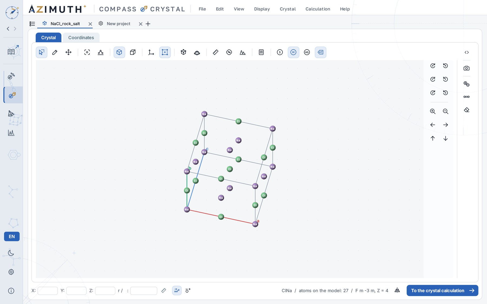

### Opening a crystal

1. «File → Open CIF…» (or open a CIF from «Molecules» – the program comes here by itself). Teaching crystals – «File → Open an example…»: CsCl, NaCl, graphite, benzoic acid, silicon.
2. The crystal is built at once: one cell, whole molecules, with disorder – one part. The atoms of the asymmetric unit are multiplied by the symmetry operations of the file (repeats on special positions are merged). The space group and Z are in the line under the model, the density is in the status line.
3. The crystal button above the model or «File → Rebuild the crystal (cells, surface)…» opens the «Crystal» panel to the right of the model.

While the field is empty, Quail stands in its lower left corner: the folder in her bubble opens a CIF, the small crystal opens an example.

**Crystals from COD.** «File → Find a crystal in COD…» searches the Crystallography Open Database – an open database of about half a million structures. The search conditions: words (the name of a substance or mineral, authors, the title of a paper), a formula (C7H6O2, TiO2 – the program puts the elements in Hill order), elements separated by spaces and «only these elements»; the second line has the cell parameters with a tolerance (±1 % of the length and ±1° by default). «As the open one» fills in the cell of the crystal from Compass – this is how the same structure is found in other works, and close phases. The result is up to 500 records: the COD number, formula, name, group, cell and year. «Open in Compass» (or a double click) downloads the CIF into the folder «Documents/Azimuth/COD» and opens it. The internet is needed; COD receives only the search conditions.

### The «Crystal» panel

The panels «Crystal», «Contacts», «Hirshfeld surface» and «Calculation results» open to the right of the model (one at a time); the button of the open panel is highlighted, a second press or a click on the field away from the atoms closes it. The «Crystal» panel is divided into collapsible sections.

- **«Cell and packing»** – the content of the cell, the space group (with its number if the file has it), the crystal system, the point group, the lattice type (P, A, B, C, I, F, R), the cell parameters and volume, Z, Z′, the density and Kitaigorodsky's packing coefficient – the share of the cell inside the van der Waals spheres of the atoms (usually 0.65–0.77 for molecular crystals). The «What the symbol … means» button parses the Hermann–Mauguin symbol into parts: the Bravais lattice, and for each position which axis and which plane along which direction.
- **«Block of cells»** – one cell or a block n₁ × n₂ × n₃ (up to 10 × 10 × 10, at most 2000 atoms), the range of coordinates in fractions of the cell, «Atoms on the faces, edges and corners», «Whole molecules» (molecules cut by a face of the cell are built whole, the centre of each inside the cell) and «One part of the disorder». The model is rebuilt right after a short pause – there is no «Build» button.
- **«Symmetry operations»** – the list of operations of the file with labels: the axis or plane, its direction and position in the cell.
- **«Surface (hkl)»** – cutting a slab (section «Surface (hkl)»).
- **«View»** – the viewing direction and what to draw on the model (section «View of the crystal»).

For crystals without separate molecules (salts, metals, frameworks) «Whole molecules» is not available, and the panel says that the structure is infinite (a chain, a layer or a framework).

**Disorder.** If the CIF has disorder groups (`_atom_site_disorder_group`), the «One part of the disorder» check box is on: the cell, the molecules, the surface and the contacts are built from the ordered atoms and part 1. Clear the check box to see all parts together.

### View of the crystal

The menu of the «View of the crystal» button above the model and the «View» section of the panel:

- **«Along a», «Along b», «Along c»** and **«Along the normal to (hkl)»** set the line of sight along an edge of the cell or perpendicular to the planes.
- **«Symmetry elements»** are drawn in the first cell: rotation axes (solid) and screw axes (dashed) in green, mirror and glide planes in blue, inversion centres as brown rings, each element with its symbol. If there are more than 400 elements (cubic groups with F centring), they are not drawn.
- **«Displacement ellipsoids (50 %)»** – projections of the thermal displacement ellipsoids of the atoms, as in ORTEP drawings (if the CIF has Uᵢⱼ, Bᵢⱼ, U_iso or B_iso).
- **«Coordination polyhedra»** – the polyhedra of the nearest neighbours of metal atoms (up to 1.12 × the shortest distance, from 4 to 12 atoms).
- **«Bravais lattice nodes»** – the lattice nodes of the block: small rhombi at the vertices of the cells, bigger ones at the centring nodes.
- **«Molecules coloured by symmetry»** – each molecule has the colour of the symmetry operation that generates it.
- **«Rings, π–π and C–H···π on the model»** – the planes of rings, centroids, π–π stacks and C–H···π contacts.
- «View → Show the cell» hides and shows the cell edges.

### The crystal menus

The «Crystal» menu is arranged in groups: «Block of cells», «View of the crystal», «Labels on the model», then the submenus «Intermolecular interactions» (contacts, Hirshfeld surface, pair energies, shell), «Structure and packing», «Cell and lattice» and the powder pattern. The «Calculation» menu: a calculation in Sextant and a CRYSTAL input file, then what the calculation gave – the submenus «Atomic charges», «Bonds and critical points (AIM)», «Fields on the model». Grey items say in their tooltip why they are not available.

### Crystal coordinates

The «Coordinates» tab of a crystal opens in the «Independent atoms (fractions)» format: label, element, x, y, z, occupancy and U of the independent atoms of the file; above the table – the group, the cell and the volume. A row of the table selects all copies of the atom on the model. The «Fractional (CIF)» format shows the atoms of the model in fractions of the cell. The same place has «CIF of the crystal», «POSCAR (VASP)» and «Extended XYZ» of one cell.

The arrow in the lower right corner of the field moves the selected molecules (one atom of each is enough) into a new tab of «Compass · Molecule» – for a molecular calculation.

### Contacts and hydrogen bonds

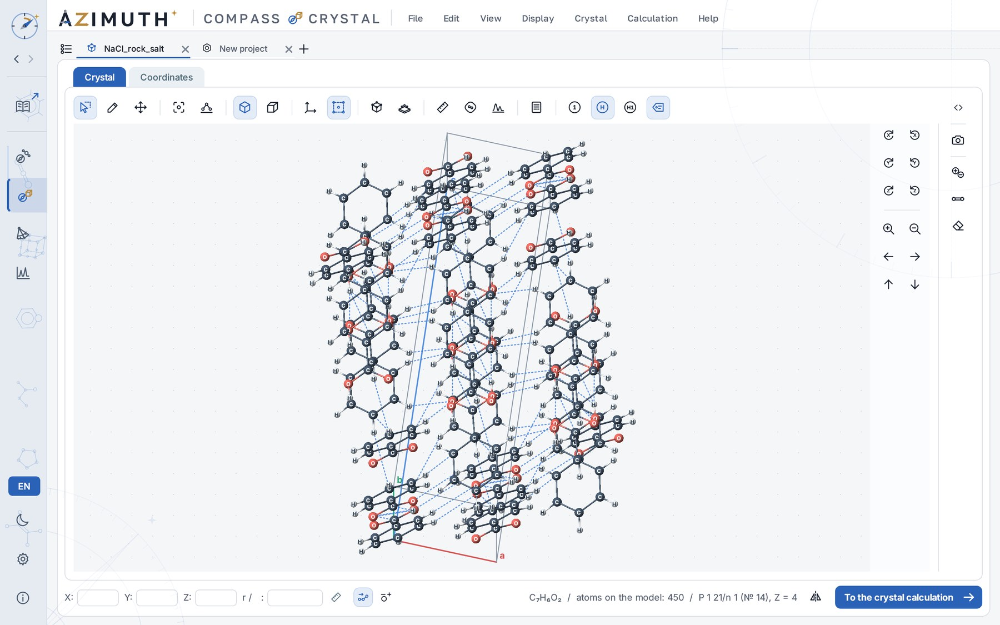

The «Contacts» panel shows the contacts between the atoms of the cell and of neighbouring cells:

- **hydrogen bonds** D–H···A (an angle of at least 120°);
- **halogen, chalcogen, pnictogen and tetrel** (σ-hole) bonds R–E···Y: the angle R–E···Y (θ1) at least 150°; the d/Σr column is the distance divided by the sum of van der Waals radii; for a contact of two halogens – the second angle θ2 and the type: type I (θ1 ≈ θ2) is a van der Waals contact, type II (θ1 ≈ 180°, θ2 ≈ 90°) is a halogen bond;
- **van der Waals contacts** – closer than the sum of radii plus 0.2 Å.

Contacts repeated by symmetry are gathered into one row with the «Count» column. A row of the table draws its contacts on the model and selects their atoms; a click on the dashed line of a hydrogen bond on the model selects its row.

**Search criteria** – a line above the table: the margin to the sum of van der Waals radii, the smallest angles of hydrogen and σ-hole bonds; «Search again» searches with them, «Defaults» returns 0.20 Å, 120° and 150°.

**Graph sets** (Etter's notation) – the «Graph set» column: D – one bond between two molecules, S(n) – a ring inside a molecule, C(n) – an infinite chain, Rᵃ_d(n) – a ring of several molecules; n is the number of atoms in the ring or in the repeat unit of the chain, a and d are the numbers of acceptors and hydrogens. A separate table under the contacts gives the second level: for each pair of kinds of hydrogen bonds – the smallest ring and the smallest chain that contain bonds of both kinds.

**π–π stacks and C–H···π.** Under the contact table – planar rings (5–7 atoms) and pairs of rings of different molecules lying in a stack (centroids closer than 4.0 Å, the planes almost parallel): the Cg···Cg distance, the angle between the planes, the distance from the centroid to the plane of the other ring and the offset. C–H···π contacts: H···Cg up to 3.0 Å, the C–H···Cg angle at least 120°.

**Network.** «Show the network» builds the network of hydrogen and σ-hole bonds, π–π stacks and C–H···π (the choice is next to the button); «layers: N» (1–6) grows the network from the added molecules N times. Select rows of the table – the network is built only from these contacts, for example from one hydrogen bond, to see its chain or layer.

**Table for a paper…** shows the hydrogen bonds the way they are published: D–H···A, the lengths D–H, H···A, D···A, the angle and the symmetry code of the acceptor (for example «-x+1, -y, -z+1», i). «Copy» puts the table with tabs on the clipboard (it is pasted as a table into Word and into a spreadsheet), «Save CSV…» – into a file.

**Molecular shell** («Crystal → Molecular shell…») – the neighbours of a molecule: molecules with an atom closer than R Å (4.0 by default) or touching it with their van der Waals spheres with a margin. The window gives the molecular coordination number (12–14 for most organic crystals) and for each neighbour – its formula, symmetry code and the shortest contact.

> **Note.** In X-ray structures the H atoms stand closer to their atoms than they really are (C–H about 0.95 Å instead of 1.09), so the H···A distances come out about 0.1 Å longer.

### Hirshfeld surface

«Crystal → Hirshfeld surface…» builds the surface of a molecule where its spherical atoms give half of the density of the crystal. The molecule is the one selected on the model, otherwise the first in the cell; the grid is coarse, medium or fine.

- The window gives the area, the volume, the globularity (1 – a sphere) and the shortest d_norm.
- **«Fingerprint»** – the share of the surface area for each pair of distances d_i (to the nearest nucleus inside) and d_e (outside), 0.4–2.6 Å, and a table of contact shares. The chosen pair of elements colours its part of the fingerprint, the rest is grey. «Save the fingerprint…» – PNG.
- **On the model** the surface is coloured: d_norm – red where the contact is shorter than the sum of van der Waals radii (hydrogen bonds), white at the sum, blue farther; d_i and d_e – from red (close) to blue; the shape index (blue – convex, red – concave, «bow ties» are a sign of a π–π stack) and the curvedness (flat patches and the edges between them).

### Pair energies and the energy framework

«Crystal → Pair energies and framework (xtb)…»: for a molecule and its neighbours closer than 3.8 Å the interaction energy E = E(pair) − E(A) − E(B) is computed in GFN2-xTB at the geometry of the crystal – single points, seconds per pair; pairs identical by symmetry are computed once.

- The table: the symmetry code of the neighbour, the distance between the centres, the shortest contact, E in kJ/mol and its GFN2 terms – electrostatics, dispersion, repulsion and the rest: a hydrogen bond shows in the electrostatics, a stack in the dispersion.
- The lattice energy ≈ ½ Σ E over the neighbours; its absolute value is close to the sublimation enthalpy without vibrations.
- «Show the framework on the model» draws lines between the centres of the molecules whose thickness grows with |E|: blue – attraction, red – repulsion. One sees where the strong columns, layers or a three-dimensional framework are.
- For salts the window shows the components of the cell and their charges: common ions (NH₄⁺, NO₃⁻, ClO₄⁻, SO₄²⁻ and others) are recognized by their formula; the charges can be corrected.

> **Note.** The accuracy of GFN2-xTB for pair energies is about 10–20 %. The lattice energy of a salt from the nearest neighbours is only a rough estimate: the long-range electrostatics is not in it. The xtb program is needed.

### Powder pattern

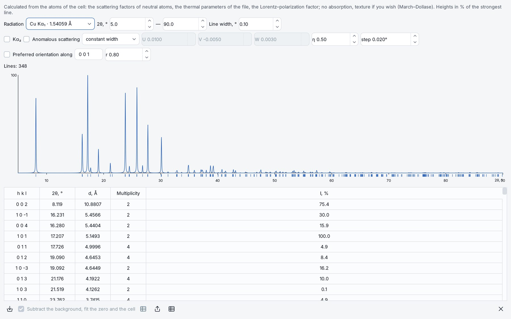

«Powder pattern…» computes the powder X-ray pattern from the atoms of the cell: the atomic scattering factors of neutral atoms, the thermal parameters from the file, the Lorentz–polarization factor. The window has the curve, the line marks under the axis and a table (hkl, 2θ, d, multiplicity, intensity in % of the strongest).

- The radiation – Kα₁ of copper, molybdenum, cobalt, iron, chromium or silver; the 2θ range, the step and the line width.
- «Kα₂» adds the second line of the tube with half the intensity; «Caglioti width» – FWHM² = U tan²θ + V tanθ + W; η is the share of the Lorentzian in the peak shape (pseudo-Voigt).
- «Preferred orientation along» hkl with the parameter r (March–Dollase): r < 1 – plates, r > 1 – needles, r = 1 – no texture.
- «Anomalous scattering» adds the f′ and f″ corrections at the line of the chosen tube (tables of Henke et al., 1993) – noticeable for heavy atoms and near an absorption edge.
- An experimental pattern (two columns: 2θ and intensity) can be overlaid, and the calculation saved to `.xy` or the list of lines to `.csv`.

If the CIF has no list of symmetry operations but has the symbol or the number of the group, the operations are taken from the tables of the 230 groups.

### Surface (hkl)

1. In the «Crystal» panel, section «Surface (hkl)», set the Miller indices (h k l), the number of layers, the number of cells in the plane and the vacuum (Å).
2. Click «Build the surface».
3. You get a slab turned so that the surface lies in the xy plane, with the slab cell on the model. For example, NaCl (111) lies with its face in the plane of the screen.

### Crystal calculations

A periodic calculation of a crystal is set up in Sextant: the «To the crystal calculation» arrow at the bottom of «Compass · Crystal» opens Sextant with this crystal and the Quantum ESPRESSO program; CP2K can be chosen in the «Program» line. The calculation page is arranged as for a molecule (chapter 8): «Calculation setup» – the task, the method, the basis set (CP2K) or the cutoffs (Quantum ESPRESSO), dispersion, resources, the k grid, the cell, the supercell and the optimization thresholds; the cell charge, spin, DFT+U, occupations and convergence are in «Additional settings…».

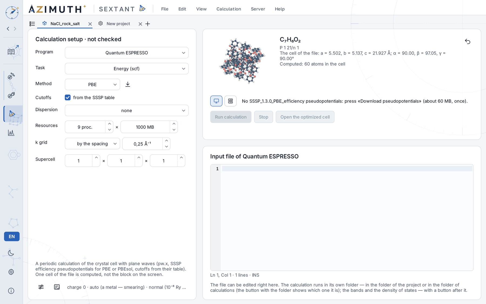

Table: Programs for periodic calculations

| | Quantum ESPRESSO | CP2K |
|---|---|---|
| Basis | Plane waves, SSSP efficiency pseudopotentials | MOLOPT Gaussian basis sets and plane waves for the density, Γ point |
| Good for | Small cells, solids | Big cells (from ~10 Å), molecular crystals |
| Tasks | Energy, atom optimization, optimization with the cell, band structure, density of states, frequencies at Γ, phonon branches and density of states | Energy, atom optimization, optimization with the cell, frequencies at Γ |
| Methods | PBE, PBEsol, LDA, vdW-DF2, rev-vdW-DF2, vdW-DF-cx, rVV10, PBE0, HSE06 | PBE, PBEsol, revPBE, BLYP, GFN1-xTB |
| Where to run | This computer (macOS, Linux) or a server | This computer or a server |

**Features of the methods.**

- PBEsol needs its own pseudopotentials – the «Download pseudopotentials» button (about 60 MB, once).
- The nonlocal functionals vdW-DF2, rev-vdW-DF2, vdW-DF-cx and rVV10 take dispersion into account themselves – do not choose the D3 correction with them. The list of corrections also has Tkatchenko–Scheffler (TS) and many-body dispersion (MBD).
- The hybrids PBE0 and HSE06 give the band gap more accurately than PBE (HSE06 is the standard for semiconductors), but take tens of times longer and work only in the «Energy» task: optimize the geometry with PBE or PBEsol, then compute the energy and the gap with a hybrid.
- GFN1-xTB in CP2K is hundreds of times faster than DFT: it is convenient for a preliminary optimization of big cells, with the geometry refined with PBE afterwards.
- CP2K basis sets: DZVP-MOLOPT-SR – for all elements and for solids; the full DZVP, TZVP and TZV2P exist only for H, C, N, O, F, Si, P, S, Cl.

**Electronic state** («Additional settings… → Electronic state»):

- **Cell charge** removes or adds electrons; the charge is compensated by a uniform background, so the energies of charged cells of different sizes are not compared directly.
- **DFT+U** – U in eV for a d or f shell, for example «Ni 6.2» or «Fe 5.3, Co 3.3» (the shell can be given explicitly: «Ni-3d 6.2»). It is needed for oxides and fluorides of transition metals and for cerium and uranium compounds. U depends on the program and the projectors – take a value obtained for the same program.
- **Magnetic order** – a spin-polarized calculation, ferromagnetic or antiferromagnetic order. For an antiferromagnet the cell must hold both sublattices: for NiO and MnO set a 2 × 1 × 1 supercell. If the cell contains usually magnetic atoms (V, Cr, Mn, Fe, Co, Ni, Cu, lanthanides, uranium) and spin is off, the program asks before the run whether to turn on antiferromagnetic order.

**Frequencies and phonons in Quantum ESPRESSO.** «Frequencies (Γ point)» – scf, then ph.x at q = 0 and dynmat.x with the acoustic sum rule; for an insulator also the dielectric constant ε∞ and the Born effective charges, and from them the IR intensities of the modes. «Phonon branches and density of states» is computed on a q grid and takes noticeably longer (NaCl – about half an hour on 6 processes). Negative frequencies mean that the structure is not at a minimum or the q grid is too small. The modes at Γ are shown on the crystal model – «Calculation → Frequencies (Γ point)», the branches with the «Show the phonon branches» button.

**Band structure and density of states.** The program sets up the steps of the calculation itself: scf, then the bands along a path through the high-symmetry points of the Brillouin zone or the density of states on a dense grid. «Show the bands» and «Show the density of states» open the plots (energies from the top of the valence band, for a metal from the Fermi level); «Save the data…» – CSV.

**The band gap** (0.229.0). Under the plot of the bands and in the summary of the calculation the program says whether the gap is direct or indirect, its size and where its edges are: the top of the valence band and the bottom of the conduction band are named by a point of the path («at Γ») or by its place («between Γ and X, 85 % of the way»). For an indirect gap the smallest direct one is given too. The edges are marked on the plot with dots: red for the top of the valence band, green for the bottom of the conduction band. The gap is searched only over the points of the path. A calculation without a hybrid functional usually underestimates it: silicon with PBE gives 0.57 eV against the measured 1.17 eV. For a spin-polarized calculation this line is not shown.

**Elastic constants** (0.237.0). The task «Elastic constants (a cubic crystal)» computes the cell as it is and 18 strained ones: a stretch along x, a stretch along x with a squeeze along y, and a shear xy, six amplitudes each from −1.5 to +1.5 %. The curvatures of the three curves ΔE/V₀ give C₁₁, C₁₂ and C₄₄, and these give the bulk modulus B = (C₁₁ + 2C₁₂)/3, the anisotropy A = 2C₄₄/(C₁₁ − C₁₂) and the deviation from the Cauchy relation C₁₂ = C₄₄. «Show the plot» draws the three curves with their fits. Compute in the equilibrium cell: optimize it first with the same functional. The atoms are relaxed in every strained cell – in silicon they move under a shear. An example, MgO in PBE: C₁₁ = 276, C₁₂ = 92, C₄₄ = 143 GPa, B = 153 GPa (experiment: 297, 96, 156 and 163 GPa).

**LDA** (0.236.0). The list «Functional» of Quantum ESPRESSO has LDA (Perdew–Zunger). It needs pseudopotentials of its own: the button «Download pseudopotentials» takes from the site of Quantum ESPRESSO the files of the pslibrary library for the elements of your crystal only, and reads the cutoffs from the header of the file. Not every element has an LDA file there – then the program says which one lacks it. An example, silicon: LDA gives a₀ = 5.399 Å, B₀ = 96.7 GPa and an indirect gap of 0.47 eV; PBE – 5.470 Å, 88.8 GPa and 0.57 eV; experiment – 5.431 Å, 99 GPa and 1.17 eV.

**Layers and graphene** (0.235.0). The program recognizes a layer with vacuum (graphene, a slab) by itself – by an empty gap of 7 Å or more along one of the axes. Along the vacuum it takes one k-point, and the band path of a hexagonal lattice stays in the plane: Γ–M–K–Γ. The task «Convergence in the vacuum (a layer)» computes the same layer with a vacuum of 8, 10, 12, 15, 18 and 20 Å. The task «Convergence in the k-point grid» of a layer takes the grids N × N × 1 with N = 6, 8, 9, 10, 12, 15, 18, 24; the table has a column of the Fermi level. Grids with N a multiple of 3 contain the corner K of the zone, where the π and π* bands of graphene touch: such points are green on the plot, and the energy of the two families of grids converges along different curves. If the bands touch at K, a second window opens after a band-structure run – «Dirac cone»: the neighbourhood of K enlarged, the Fermi velocity from the slope of the bands and the hopping integral t of the tight-binding model, which is drawn dashed. An example, graphene in PBE: v_F = 0.83·10⁶ m/s, t = 2.57 eV (experiment: about 1.0·10⁶ m/s).

**Quantum ESPRESSO on Windows** (0.234.0). «Calculation → Install calculation programs…» puts on Windows the build of Quantum ESPRESSO 7.6 from the MSYS2 repository: about 90 MB to download, 140 MB on disk; neither administrator rights nor MSYS2 itself are needed. This build has no MPI: the number of processes in the settings becomes the number of OpenMP threads, so on the same laptop a calculation may run slower than on macOS or Linux. If the computer already has MSYS2 with the Quantum ESPRESSO package, the program finds it by itself. At the time of release this part has not been checked by a run on Windows: if a calculation does not run, use a server and report the error.

**Magnetic crystals: the order and a series in U** (0.231.0). For transition-metal oxides (NiO, MnO, Fe₂O₃) two things matter: which magnetic order is lower in energy and how the U correction changes the gap. The task «Magnetic order (no spin, FM, AFM)» computes the same cell three times: without spin, with the ferromagnetic order and with the antiferromagnetic order chosen in the settings (it needs a supercell that holds it). The task «Series in U (DFT+U)» computes the crystal at U = 0, 2, 4, 6 and 8 eV on the elements given in the DFT+U field. When the run ends the summary opens with a table: the state or U, the energy difference per cell (for the magnetic series only – energies with different U are not compared with each other), the gap, the largest magnetic moment of an atom and the absolute magnetization. A dash in the gap column means a run with smearing: the program does not print the levels of the gap edges there. The summary of any spin-polarized run now shows the magnetization of the cell and the moments of the atoms. An example, NiO in the measured cell (PBE): a nickel moment of 1.33 μB and a gap of 0.8 eV without U, 1.68 μB and 3.1 eV at U = 6 eV; experiment – 1.6–1.9 μB and 4.3 eV.

**What the cell optimization changes** (0.231.0). The task «Optimization with the cell» has a choice: the whole cell, in the ab plane only, the volume only or the shape only. For a layer with vacuum (graphene, a slab) choose «in the ab plane only»: otherwise the program squeezes the vacuum.

**Convergence series** (0.230.0). A plane-wave result depends on two numerical parameters: the cutoff energy and the density of the k-point grid. The tasks «Convergence in the cutoff energy» and «Convergence in the k-point grid» compute the energy of the crystal for several values of one parameter, everything else as in the settings: six or seven cutoffs in steps of 10 Ry around the current one, or six grids from half as dense to twice as dense. «Show the convergence» opens the plot of ΔE per atom from the most accurate point, with a green band of ±1 meV, and a table of ΔE, the pressure and the gap. The summary says from which value the energy is converged to 1 meV per atom and from which the pressure is converged to 1 kbar. The pressure usually converges more slowly: for a cell optimization and the equation of state take the value by the pressure. This table is what a report needs as its convergence check.

**The equation of state** (0.229.0). The task «Equation of state (a series of volumes)» computes the crystal at seven volumes, from 0.94 to 1.06 of the starting one, and fits the E(V) curve with the Birch–Murnaghan equation. The summary gives the equilibrium volume V₀, the parameters of the equilibrium cell, the bulk modulus B₀ and its pressure derivative B₀′. «Show E(V)» opens the points and the curve; «Save data…» writes a CSV with the volumes, energies and pressure. Silicon with PBE gives a₀ = 5.470 Å and B₀ = 88.8 GPa (measured: 5.431 Å and 99 GPa). If the energy minimum lies outside the series, the program says so: the starting cell is far from equilibrium, optimize it first with the task «Optimization with the cell». B₀ is sensitive to the cutoff energy: check it at a higher value.

**Quick xtb calculation of a crystal** – «Calculation → Quick xtb calculation» computes the crystal of the tab at once with GFN1-xTB in CP2K (energy, atom optimization or optimization with the cell), without the Sextant page. CP2K must be installed.

**After the calculation.** «Calculation → Calculation results…» – the table of crystal calculations in the project (program, task, time, energy, pressure, outcome) and the details of the chosen one: the cell energy, the band gap or the Fermi level, the number of steps, the cell of the last step; the buttons «Calculation folder», «Optimization steps», «Charges…», «AIM bonds…», «To Spectrum». The optimized cell opens in a crystal tab with the «Open the optimized cell» button. CM5 and Hirshfeld charges and AIM bonds (Multiwfn, CP2K calculations) are shown on the crystal model and in the tabs of Spectrum.

**CRYSTAL.** «Calculation → CRYSTAL input file…» writes a CRYSTAL input file (`.d12`): the task (energy, optimization, elastic constants, frequencies at Γ), the functional (PBE0, B3LYP, HSE06, PBE, PBEsol, Hartree–Fock), a basis set from the CRYSTAL library (pob-TZVP, pob-DZVP and others), the pressure and the k grid. Next to it – «Save .d3 for TOPOND…» (a search for all critical points of the density). The program does not run CRYSTAL itself. A CRYSTAL output (`.out`) opens as a crystal with optimization steps, energy and elastic constants; a TOPOND output (`.outp`) – as a table of the critical points of the density.

### Saving and export

«File → Save the crystal as CIF…» writes the crystal from the file with its symmetry or the slab built. «File → Export the crystal» – POSCAR, extended XYZ, a block of cells in CIF (P 1) and a picture. «File → Model for 3D printing…» saves a block of cells or a shell for a printer together with the cell edges.

Theory – in the Atlas: [«Crystals: lattice and cell»](https://www.azimuth-chem.com/atlas/?lang=en#cryst).

## Sextant

Sextant prepares the input file of a calculation and runs it – on this computer or on a computing server. The geometry, the charge and the constraints come from Compass; the result returns to the tab from which the calculation was started.

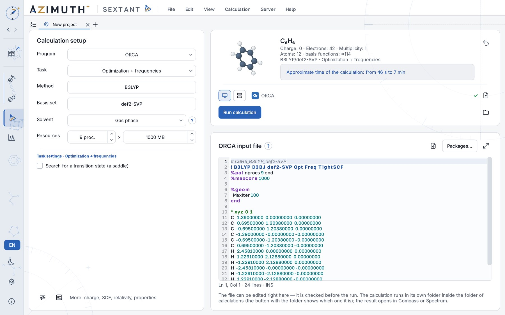

### The Sextant window

- **«Calculation setup»** (on the left) – the program, the task, the method, the basis set and the most common fields (solvent, processes and memory), as well as what the task cannot do without (the scan coordinate, the atoms of a CDA fragment). Under the fields – the «Task settings» of the chosen task. At the bottom of the card – «Additional settings…» and the «Fields…» button: it chooses which fields to keep in the card and which to move into the additional settings («As by default» returns the original set).
- **The calculation card** (top right) – a small model of the molecule (it can be rotated with the mouse), the formula, the number of electrons and the multiplicity; the arrow in the corner leads to the molecule in Compass. Under the line – where to run («This computer» or «Server»), the program icon with a green check mark if the program is found, the estimated time and «Run calculation».
- **The input file** – under the card. «Expand» gives it the whole column. During a calculation its place is taken by the progress of the calculation.

The buttons of Sextant are icons; what each does is shown in its tooltip.

### Preparing a calculation

1. In Compass build or open a molecule and click «To the calculation settings» (or go to Sextant: `Ctrl+4`).
2. **Program** – ORCA, Gaussian, Psi4, xtb, CREST, MOPAC, GAMESS (US) or NWChem. Programs whose input files have not been checked by a run are marked «not checked».
3. **Title** – the first line of the input file and the name of the calculation files. If the field is empty, the title is made up by itself: formula_method_basis_solvent, for example `H2O_B3LYP_def2-SVP_water.inp`. A title of your own can be typed in Russian – in the file name it becomes Latin letters.
4. **Task** – energy, optimization, frequencies, a spectrum and others (section «Calculation tasks»). The list has only the tasks of the chosen program. When a task is chosen, Sextant itself sets the method, basis set, dispersion and settings recommended for it (for example tight optimization convergence before frequencies, a fine grid for NMR); a hint at the bottom says what was set – everything can be changed.
5. **Method** and **basis set** are chosen by families: click the field – a list of families opens (Hartree–Fock, MP2, GGA, meta-GGA, hybrids, range-separated, double hybrids, coupled clusters; Pople, def2, cc, pcseg basis sets). The lists contain only what the chosen program knows. The tooltip of the button shows the recommendation for this molecule and task; the «★ Recommended: …» item sets it.
6. **Solvent** – CPCM or SMD (SMD – for solvation energies; ORCA and Gaussian), ALPB in xtb, PCM in Psi4, COSMO in MOPAC. **Dispersion** – D3(BJ), D3(0) or D4.
7. **Processes and memory per process.** Sextant finds out the number of cores and the memory of the computer or of the chosen server and offers values. Values set by hand stay.
8. **Charge and multiplicity** («Additional settings… → Electronic state»; their values are shown in a line next to the button) are computed from the molecule: N and P with four bonds – +1, B with four – −1, an atom – by Hund's rules, O₂ – a triplet, otherwise the lowest multiplicity for the number of electrons. If changed values do not agree with the number of electrons, Sextant explains what to correct.

A new window starts with B3LYP-D3(BJ)/def2-SVP: without a dispersion correction B3LYP describes stacks, conformers and weak complexes poorly. For a method without D3 parameters (HF, MP2, ωB97X-D) and for xtb the correction is turned off by itself.

> **Note.** Coupled clusters – CCSD(T) in ORCA, Gaussian and Psi4 and DLPNO-CCSD(T) in ORCA – compute only the «Energy»: optimize the geometry with a DFT functional first. CCSD(T) grows as N⁷ and suits molecules of up to about ten heavy atoms; DLPNO gives almost the same (0.1 kcal/mol for water in cc-pVTZ) for molecules of tens of atoms.

> **Tip.** Extrapolation to the complete basis set (0.226.0). The energy of coupled clusters and of MP2 converges slowly with the basis. In ORCA the «Basis» list has the group «Extrapolation to the complete basis set (CBS)»: for instance, «CBS(cc-pVDZ/TZ)» computes the energy in cc-pVDZ and cc-pVTZ and extrapolates the SCF part and the correlation part separately (`Extrapolate(2/3,cc)`). It is offered only for an «Energy» with MP2, CCSD(T) and DLPNO-CCSD(T). Spectrum shows both parts next to the last energy. The TZ/QZ pair is more accurate and much more expensive.

Theory – in the Atlas: [«The hierarchy of methods and Jacob's ladder»](https://www.azimuth-chem.com/atlas/?lang=en#lad), [«Basis sets»](https://www.azimuth-chem.com/atlas/?lang=en#basis).

### Calculation tasks

Table: Sextant tasks

| Task | What it computes |
|---|---|
| Energy | The energy at the given geometry; for ORCA and Gaussian optionally a check of the stability of the wavefunction |
| Optimization | The energy minimum; in «Task settings» – transition state search, convergence, cycle limit, exact Hessian |
| Optimization + frequencies | An optimization and frequencies at its geometry; thermochemistry at the given temperature and pressure |
| Frequencies and thermochemistry | Frequencies at the current geometry without optimization (it must have been optimized by the same method) |
| Transition state + frequencies | A search for a saddle point and its frequencies (there must be one imaginary) |
| UV-Vis spectrum (TD-DFT) | Excited states: the number of states, TDA or full TD-DFT, triplets, natural transition orbitals (ORCA) |
| NMR (shielding) | Shielding constants; in ORCA optionally spin–spin coupling constants |
| Excited state optimization | The geometry of the chosen excited state (ORCA, Gaussian) |
| Relaxed PES scan | A coordinate from the Compass constraints is changed to the final value in a given number of points, the rest is optimized; in ORCA also a second coordinate (a two-dimensional scan) |
| Reaction path (NEB-CI) | The path between the starting and the end structures and the transition state (ORCA) |
| Path from the transition state (IRC) | The descent from a transition state to both minima and the energy profile (ORCA) |
| Fukui functions (N, N+1, N−1) | Three energy calculations as a queue: the molecule, the anion and the cation (ORCA) |
| Donor–acceptor bond CDA | The Dapprich–Frenking charge decomposition analysis: the complex and two fragments (ORCA) |
| Interaction energy with BSSE | Five energy calculations of a pair of molecules with the Boys–Bernardi correction (ORCA) |

Which tasks each program has is in Appendix C. Only the task settings the program writes into its input file are shown; fields the program does not have (a basis set for MOPAC, a method for xtb) are hidden.

**Notes on the tasks.**

- **Relaxed PES scan.** The coordinate is a length, an angle or a dihedral angle from the optimization constraints of Compass (shown in the list with its current value). The points of the scan open in the ☰ panel of Compass with the energy plot; a two-dimensional scan has a ΔE map. In xtb a two-dimensional scan is not made as a grid: two scans go one after the other.
- **NMR with coupling constants.** The «Spin–spin coupling constants» check box of ORCA computes all J between H, C, F, P. Multiplets appear in Spectrum (section «NMR»).
- **Fukui functions.** The ions have a multiplicity one lower (doublets for a singlet). def2-SVPD is recommended: the anion needs diffuse functions, and the geometry must be optimized. At the end Compass opens the N result with the Fukui functions on the model.
- **CDA.** In «Task settings» – the atoms of fragment 1 (the donor) by numbers or with the «From selection» button, its charge and multiplicity; fragment 2 is the remaining atoms. Sextant sets up a queue of three single-point calculations: the complex, fragment 1, fragment 2. Then Multiwfn computes the donation d, the back-donation b, d − b and the repulsion r; a window explains the numbers.
- **Interaction energy with BSSE.** The structure must consist of exactly two molecules, the pair neutral and closed-shell. Five calculations give ΔE, the BSSE and ΔE(CP) – the interaction energy at frozen geometry; the table `interaction.csv` is in the queue folder.
- **Start from the orbitals of a previous calculation** (ORCA, MORead) – after a broken calculation, for another method or a close geometry: «Additional settings → Initial guess».

**Chains of calculations.** «Calculation → Chain of calculations» (and chains in the «Task» list): «Optimization + frequencies → UV spectrum (TD-DFT)», «… → NMR», «… → energy in a bigger basis set», «… → UV spectrum → NMR». Each step is computed at the geometry of the previous one; the following steps can have their own method and basis set. A chain runs as a queue; if a step fails, the following ones are not computed.

### Additional settings

«Calculation → Additional settings…» (or the icon with sliders) – a window with sections on the left and the page of the section on the right.

- **Task** – the title of the calculation, dispersion and the fine settings of the task that are not kept in the card.
- **Electronic state** – charge and multiplicity (values changed by hand are marked); for crystals – the cell charge, spin, magnetic order, DFT+U.
- **SCF and integration** – SCF convergence, difficult convergence (ORCA SlowConv / VerySlowConv, Gaussian SCF=XQC, damping in Psi4), the DFT grid, a calculation without RI, RIJCOSX and AutoAux (ORCA).
- **Relativistic corrections** – DKH2, ZORA or X2C (ORCA; Gaussian – DKH2). Sextant substitutes the recontracted basis set itself: def2-TZVP becomes DKH-def2-TZVP, ZORA-def2-TZVP or x2c-TZVPall; heavy atoms (Rb–Rn, Ac–Lr) with DKH and ZORA get all-electron SARC.
- **Basis sets by element** – a basis set of its own for some elements, for example `Fe=def2-TZVP; Cl=def2-SVP`; the other atoms take the basis set of the calculation.
- **Initial guess** – the orbitals of a previous ORCA calculation (MORead).
- **Properties and output** – charges (Mulliken, Hirshfeld, NBO), orbitals in the output.

Theory – in the Atlas: [«Solvent models»](https://www.azimuth-chem.com/atlas/?lang=en#solv), [«Intermolecular interactions»](https://www.azimuth-chem.com/atlas/?lang=en#disp), [«Heavy elements»](https://www.azimuth-chem.com/atlas/?lang=en#rel).

### The input file

The text of the input file is shown to the right of the settings and changes with them. The file can be edited right there (ORCA, Gaussian, Psi4); xtb has a command line instead of a file, and it is not edited. Before a run Sextant checks the file: an unclosed block, an atom line without three numbers, no charge and multiplicity, an unclosed bracket – it highlights the lines and asks whether to run it so. If the settings or the molecule changed after an edit, Sextant says that the file was not rebuilt; «Rebuild the file from the settings» brings back the generated one.

**The editor** works like a programmer's text editor: line numbers, syntax highlighting of the chosen program, highlighting of the matching bracket, a find and replace panel (case, whole word, regular expression, «In selection»), a status line. A right-click opens a menu with the submenus «Find and go to», «Lines», «Case», «View»; `F1` shows all keys (Appendix B).

**The «Edit» menu** of Sextant: undo and redo, find, replace, go to line, «Insert block» (ORCA – `%pal`, `%maxcore`, `%scf`, `%geom`, `%tddft`, `%cpcm`, `%output`, `%freq`, `%moinp`; Gaussian – `%nprocshared`, `%mem`, `%chk`; the block goes where the program expects it), «Check the input file», «Rebuild the file from the settings», «Copy the input file».

**Your own input file.** A ready ORCA or Gaussian input file opens with the folder icon at «Input file» or «File → Open an input file…»: the molecule, charge, multiplicity, program, method, basis set and task are taken from it, and the file itself is run as it is.

**Save and run by hand.** «File → Save the input file…» writes the file; «Edit → Copy the input file» puts the text on the clipboard.

### Running and following a calculation

1. Click «Run calculation» (`Ctrl+Enter`). The folder icon next to the button chooses where the calculation folders are created.
2. The **progress of the calculation** appears in place of the input file: the time, the stages («✓ The self-consistent field converged», «The geometry is optimized»), the cycles and the last energy. Back to the file – the «Input file» button on the card, again to the calculation – «Calculation window».
3. «Program output» opens the output file itself and follows it while the program writes (search, «Follow the end», «Open in an editor»).
4. «Stop» (`Ctrl+.`) interrupts the program together with all its processes.

In other sections the progress of a calculation is opened by the icon on the left panel (the background work indicator) or «Calculation → Calculation window».

When the calculation ends, the calculation window shows «Go to Compass» (optimization steps, frequencies, orbitals) and «Go to Spectrum» (frequencies, spectra, thermochemistry). If the calculation broke off with an error or was stopped, but there already were optimization steps, they still go to the tab: the last geometry becomes its structure (`Ctrl+Z` brings back the previous one).

After the end of any calculation the temporary files of the program are deleted from the calculation folder (ORCA `*.tmp`, Gaussian `Gau-*.rwf` and others); the results, orbitals (`.gbw`, `.chk`), the Hessian and the input file stay.

### Calculation doctor

If the program ended with an error, Sextant writes under the progress what happened and what it may be connected with: the SCF did not converge, not enough memory, an error in the input file, no basis set for an element. The details are at the end of the program output.

If there is a reliable fix, a button with it appears under the description of the problem, for example:

- «Repeat with difficult SCF convergence»;
- «Continue from the last geometry, cycles: 200» – for an optimization that did not converge or was stopped;
- «Repeat: 4 processes, 2000 MB memory per process», «Repeat on one process»;
- «Repeat with the def2-SVP basis set»;
- «Shift along the imaginary mode and optimise again» – if an optimization with frequencies ended with an imaginary frequency: the molecule is shifted along the mode by 0.15 Å at the most mobile atom, and a new optimization runs with tight convergence.

A click puts these settings into Sextant and runs the calculation again; the previous calculation and its files stay. The doctor changes the method, the basis set and the multiplicity only when the button says so. There is no button if there is no reliable fix (for example the disk is full), if the input file was edited by hand or the calculation belongs to a queue – then only advice remains.

### Calculation queue

A queue runs the same calculation for many structures: conformers after a search or a set of structures (several files, an SDF database, the molecules of a project).

1. Click the «Calculation queue for the set…» icon at «Input file». The window has the list of structures with the ΔE of the search; the lowest ones within 3 kcal/mol are checked, «How many» checks the first N, a check box adds or removes any of them.
2. «Choose for the queue» – Sextant goes into queue mode: a blue bar «Queue: N of M · …» appears in the card («Change the choice…», ✕ – back to one calculation), the button is called «Run the queue (N)».
3. Set up the calculation – the same settings for all. The charge and multiplicity are taken from the tab (for conformers) or from the bonds (for each structure of a set). A file edited by hand does not go into a queue.
4. Run the queue. The calculation window has a list (✓ done, ✗ error, ▶ running); «Skip» stops the current calculation and goes to the next one, «Stop» stops the whole queue. An error in one calculation does not stop the queue.

All calculation folders of a queue lie in one folder «…_batch_<program>». At the end – the table `Анализ/batch_energies.csv` (E, G with frequencies, ΔHf for MOPAC, differences, Boltzmann populations) and the conformers on the «Conformers» page of the Compass panel, sorted anew: by G if all had frequencies, otherwise by E, for MOPAC by the heat of formation. A queue left when the program was closed is continued by the «Resume the queue» icon; at the next start the program itself asks «Open the queue?» and opens its project in Compass.

**Input files for a set.** The «Input files for the whole set of structures…» icon writes a file for each structure with the same settings – to compute them outside the program.

### Calculations on a server

Sextant sends calculations to a computing server over SSH: with a SLURM queue or without one. ORCA and MOPAC are run on a server, and for crystals Quantum ESPRESSO and CP2K.

#### The server profile

«Server…» in the calculation card (or the «Server» menu) opens the profile window. There can be several profiles: «New profile», «Delete profile».

- **Login:** address, port, user name, password, a jump server (ProxyJump).
- **Calculations on the server:** the calculations folder on the server, environment lines, «SLURM: partition / time» and «SLURM: account / QoS».
- **VPN:** an OpenVPN Connect profile for a server behind a VPN.

The password does not go into the settings of the program: it is kept until the program is closed, and with the «Remember…» check box – in the system store: the Keychain on macOS, the Credential Manager on Windows.

> **Tip.** The most reliable way is to log in without a password. «Login without a password» creates a key of the program and writes it to the server once, with the password – after that no password is needed and it is not stored anywhere. On Windows a login by key is required: without a key the password would be asked for every command.

**Environment lines** – commands run before the program on the server, for example `module load orca-6.1.1`. Empty – ORCA is found on the server by itself. The «Environment lines for» list sets lines for all programs or for one only (ORCA, MOPAC, Quantum ESPRESSO, CP2K): so the lines of one program do not get into the jobs of another. `#SBATCH` lines (`--gres`, `--constraint`) can also be written here – they go to the beginning of the job script.

**SLURM: partition and time.** The values go into every job as `#SBATCH -p / -t / -A / --qos`; empty – the defaults of the cluster. On big clusters a job without a time limit gets little time or is not accepted.

**Check.** «Check the connection» shows whether the server answers. «Check resources» logs in to the server and shows the free cores and memory, as well as the programs – in PATH, among the modules, in conda environments, in `/opt` and in the home folder; for a program outside PATH the needed environment line is written by itself. After that the server is polled every 5 seconds: a check mark at the icon – connected, a cross – not (the reason is in the tooltip).

**VPN.** If the server is behind OpenVPN, choose an OpenVPN Connect profile (or «Import .ovpn…»): the program connects the VPN by itself when the server does not answer. The «Connect the VPN» and «Disconnect the VPN» buttons are in the VPN card; the check box «Disconnect the VPN after the calculations».

#### How to run on a server

1. Choose «Server» in the calculation card. The «Processes» and «Memory» fields get a recommendation from the free resources of the server.
2. Click «Run calculation». The input files are uploaded to the server, the job is put into the SLURM queue; the program follows it and downloads the result.
3. A calculation on the server goes on after the program is closed. At the next start «Calculation → Calculation history…» → «Check on the server» follows it again and downloads the result without sending anything anew.

While a calculation runs on the server, the next one can be started: the running one goes into a window of its own, and the Sextant card takes the new one. «Calculation → Other calculations on the server» – the list of such windows (▶ running, ✓ finished). A calculation on this computer and calculations on the server run at the same time.

**A queue on a server** is sent as one job: one archive, one SSH command, one SLURM job (`batch.sh`) that computes the calculations in order. «Skip» ends the current calculation, «Stop» cancels the queue job.

**A server without SLURM.** The calculation starts at once (through `nohup`) and runs by itself; in the program it looks like a queue job. It can be started only when cores are free: together with the new calculation at most 80 % of the server's cores may be busy. A queue of several calculations is not sent to such a server.

**Reliable transfer.** The result files are first downloaded into a temporary folder and get into the calculation folder only when their size matches what the server reported; a broken transfer is repeated up to three times. When the connection breaks, the calculation window writes what was known last, and the watcher waits for the connection by itself. A calculation is considered successful only by the mark of the normal end of the program in the output.

**The cluster queue.** «Server → Cluster queue…» – the SLURM jobs on the server (squeue): number, name, user, state, time, nodes, cores, node or the reason for waiting; Azimuth calculations are highlighted in blue. The table is reread every 30 s («Refresh by itself»). «All users» shows other people's jobs too, «Cancel the chosen» cancels your own jobs (scancel) after a question.

#### Files on the server

The «Files on the server» icon next to «Server…» opens a two-panel window: this computer on the left, the server on the right.

- `Enter` or a double click – enter a folder or open a file in Azimuth (a file from the server is first downloaded into «<calculations folder>/from-server»).
- `F3` – view, `F4` – edit a text file (a file from the server is saved back), `F5` – copy to the other panel, `F6` – move, `F7` – new folder, `F8` – delete (with a question; irreversible on the server, to the Trash on the computer).
- Files can be dragged from the Finder or Explorer into either panel, between the panels and out of the window.
- `F1` shows all keys of the window (Appendix B).

### Calculation history

«Calculation → Calculation history…» – the last 60 calculations started from Sextant: when, where (this computer or a server), what, and what state they are in now. «Open the result» opens the output of a finished calculation, «Folder» – its folder, «Check on the server» follows a server calculation again. If the connection broke at the moment of queuing, the calculation is marked «not known whether the server accepted it – check»: the check finds the job by the mark of the upload. A calculation closed before sending is marked «prepared, not sent» – it has to be started anew. «Clear the list» removes the entries; the calculation folders stay on the disk.

### Back to Compass

The arrow next to the heading of the input file and the arrow in the corner of the calculation card return to the molecule in Compass – for example to correct it before the calculation. The result of a calculation started from Sextant returns to the Compass tab from which it was started.

## Spectrum

Spectrum reads the result of a calculation: energies and convergence, vibrations and IR, UV-Vis, NMR, thermochemistry, orbitals and electron density analysis. It reads the outputs of ORCA, Gaussian, Psi4, xtb, MOPAC, NWChem, Q-Chem, GAMESS (US) and Firefly, and for crystals Quantum ESPRESSO, CP2K and CRYSTAL.

### How to open a result

- The result of a calculation from Sextant opens by itself – in the tab from which the calculation was started.
- «File → Open a calculation result…» – an output of ORCA (`.out`), Gaussian (`.log`), xtb, Psi4 and other programs.
- «File → Open orbitals…» – Molden, fchk, an ORCA output; «File → Open CUBE (3D)…».
- Teaching ORCA results (energy, vibrations, an orbital) are in the «File» menu, without files.
- «Edit → Use geometry from result» moves the final structure to Compass.

The file name, the program, the termination and the energy are in the status line at the bottom. The folder icon in this line opens the «Анализ» subfolder of the result – the CSV tables of all analyses and the outputs of Multiwfn.

**MOPAC results.** If an `.aux` file with the same name lies next to the `.out` (the `AUX` keyword), the optimization steps, charges, dipole, vibrations and orbitals are read from it. MOPAC gives the heat of formation ΔHf (kcal/mol at 298 K), not the total energy: it can be compared only with MOPAC results by the same method, so a MOPAC result does not go into the reaction diagram. MOPAC does not print IR intensities – its vibrations have only frequencies and animation.

> **Note.** MOPAC computes frequencies at the geometry it was given, without optimizing it. If the gradient norm is greater than 1 kcal/(mol·Å), Spectrum warns that the point is not stationary.

### The tabs of Spectrum

The tabs are gathered under three common ones:

- **Result** – energies and frequencies, convergence, thermochemistry;
- **Spectra** – vibrations and IR, UV-Vis, NMR;
- **Wavefunction** – maps and profiles, density of states, delocalization, electron density topology, NCI.

The tabs of the chosen group are a second row above the page; a group opens on the tab last chosen in it. Only tabs that have something to show are shown.

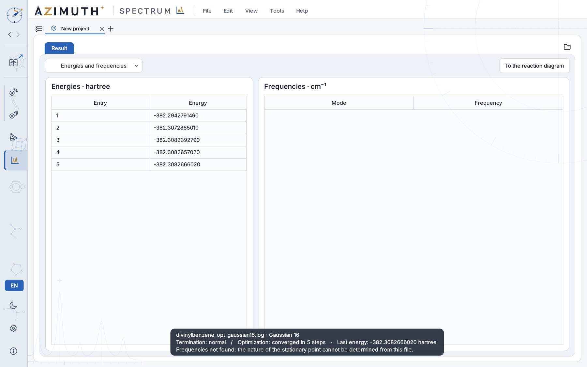

### Energies, convergence and thermochemistry

- **Energies and frequencies** – the program and its version, the final energy and the method, whether the termination was normal, whether the optimization converged, warnings.
- **Convergence** (for an optimization) – the energy of each step and the convergence criteria with their thresholds on a logarithmic scale: one sees which criterion holds the optimization back.
- **Thermochemistry** (for a frequency calculation) – the zero-point vibrations, the corrections to E, H and G and the total H and G at the chosen temperature and pressure; the entropy by contributions; the symmetry number σ from the point group. Grimme's «quasi-RRHO» softens the contribution of modes below 100 cm⁻¹. Imaginary frequencies are not counted, and this is said. For MOPAC instead of the total energy – ΔHf(T) = ΔHf(298 K) + H(T) − H(298 K), as MOPAC itself computes it.

Theory – in the Atlas: [«Thermochemistry from frequencies»](https://www.azimuth-chem.com/atlas/?lang=en#thermo).

### Vibrations, IR and Raman

The «Vibrations and IR» tab – the table of frequencies and intensities, imaginary frequencies, the IR spectrum and the animation of the chosen vibration.

- Displacement arrows – optionally in both directions; «GIF…» saves one period of the vibration, «XYZ frames…» – the same period as frames.
- «Displace +» and «Displace −» move to Compass the geometry shifted along the mode (section «How to leave a saddle point»).
- **The scaling factor** multiplies the frequencies of the spectrum by the scaling factor of the method and basis set from NIST CCCBDB (0.960 for B3LYP/6-31G*): harmonic frequencies are higher than the observed ones, and with the factor the spectrum is closer to experiment. The factor is set by itself from the method and basis set of the result; the table of modes stays as in the output.
- **Raman.** If the result has Raman activities (ORCA with the «Raman» check box in Sextant), a choice «IR / Raman: activity / Raman: intensity (532 nm)» appears above the plot, and the table gets the activity (Å⁴/amu) and the depolarization ratio ρ: ρ = 0.75 – a non-totally-symmetric vibration, ρ < 0.75 – a totally symmetric one. For a molecule with a centre of symmetry a vibration is seen either in the IR or in the Raman spectrum – the rule of mutual exclusion.
- **VCD.** If the output has the rotational strengths of vibrations (ORCA `%freq DoVCD true end`, Gaussian `Freq=VCD`), the «VCD» view of the spectrum shows bands going up and down from zero, and the table of modes gets an «R VCD» column.

Export – PNG, SVG and CSV.

Theory – in the Atlas: [«Normal modes»](https://www.azimuth-chem.com/atlas/?lang=en#nm).

### UV-Vis, ECD and emission

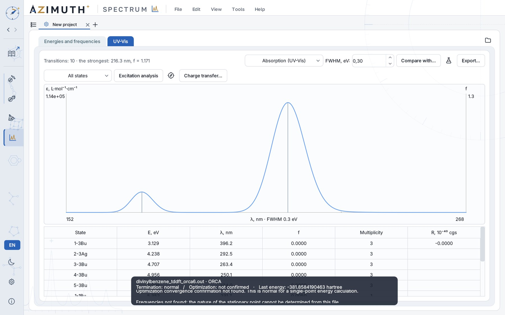

The «UV-Vis» tab – TD-DFT or CIS transitions and the spectrum in eV, nm or cm⁻¹; the band width.

- **Circular dichroism (ECD).** If the output has rotational strengths (ORCA prints them for TD-DFT by itself, Gaussian for `TD`), a «View» choice appears above the plot: «Circular dichroism (ECD)» shows the Δε spectrum with its sign, and the table gets an R column. The mirror isomer has a mirror spectrum, an achiral molecule has none. ECD is compared with experiment to find the absolute configuration (R or S).
- **Emission** – after an excited state optimization: the energy of the light from the relaxed geometry (fluorescence of a singlet or phosphorescence of a triplet), the absorption of the same state at the initial geometry, the Stokes shift, the oscillator strength and the radiative lifetime.
- **Natural transition orbitals (NTO)** – under the table of states, the «from → to» pairs of the chosen state with their weights; the compass icon puts the hole orbital or the particle orbital on the model.

**Excitation analysis** (a file of orbitals and Multiwfn are needed) computes for each state the distributions of the «hole» (where the electron left from) and of the «electron» (where it came) and their indices: D – the distance between the centres, Sr – the overlap, H – the size, t (t > 0 – the hole and the electron are separated), Δr – the charge transfer length, HDI and EDI – delocalization. The «Character» column says whether the excitation is local or a charge transfer. «Hole and electron on the model» shows both surfaces in Compass.

**Charge transfer…** – set the fragments by atom numbers or take the atoms selected in Compass and click «Calculate». The window shows what share of the excitation is a charge transfer between the fragments and what share is a local excitation, how many electrons moved between each pair of fragments, and a heat map of the transition matrix.

Theory – in the Atlas: [«Excited states and spectra»](https://www.azimuth-chem.com/atlas/?lang=en#exc).

### NMR

The «NMR» tab – shieldings and chemical shifts relative to the chosen reference (for example TMS by the same method); equivalent atoms are merged.

- The reference is kept for each level of calculation (method, basis set, solvent). «Compute TMS at this level» sends to Sextant a TMS input file with the settings of the result; when the TMS result opens in Spectrum, the reference is remembered by itself, and the shifts appear for all results of this level.
- **Multiplets (coupling constants)** – if spin–spin coupling constants were computed: the spectrometer frequency (¹H, MHz), «¹H decoupled» for ¹³C, the «Multiplet» column in the table («qd, J = 7.2, 1.2 Hz») and the chosen signal on a hertz scale. The splitting is first-order; when Δν/J is less than 5, the program warns about strong coupling. The J of equivalent atoms are averaged.
- **Compare with experiment…** (0.231.0) – a window for the chosen nucleus. Type the measured shifts, one signal per line. Without atom numbers the signals are matched by their order (the largest computed shift with the largest measured one): that is the assignment the calculation proposes. With atom numbers («C1 77.2», «H3 H4 H5 2.15») the match follows your assignment, and a part of the spectrum is enough. The window shows the table «computed – measured – deviation», the mean absolute error (MAE), the largest deviation and a plot. The linear correction: a straight line σ = a + b·δexp is drawn through the points, and the shifts are recomputed as δ = (σ − a)/b; it needs no reference (TMS). The line is fitted to the same signals the error is computed from, so with few signals the error after the correction is too low. If two computed signals are closer to each other than the usual error of the method (0.1 ppm for ¹H, 2 ppm for ¹³C), the window names them: the assignment of such signals from the calculation is unreliable.
- **Computational details…** (0.237.0, the «Tools» menu of Spectrum and «Calculation» of Sextant) – a paragraph for the report: the program and its version, the method and the basis set or the functional, the pseudopotentials and the cutoffs, the k-grid, the solvent, the convergence thresholds. It is put together from the files of the calculation and holds only what they say; the text can be edited in the window. «Save the archive of input files…» puts the input files of the calculation folder and this paragraph into a zip – the appendix of the report.
- **Average over conformers…** (0.232.0) – for a flexible molecule. The conformers turn into each other faster than the spectrometer measures, so a nucleus gives one signal – the average over the conformers with their shares. Choose the NMR results of the conformers (one method, one numbering of the atoms): the window shows their energies and the Boltzmann shares at the chosen temperature. The shares are proposed by the electronic energy; more accurate – by the free energy: type the values from the calculations with frequencies into the column «ΔG» («Tools → Energies from several files»). «Show the averaged spectrum» puts the averaged shieldings on the tab; everything else then works with them – the reference, the averaging of equivalent atoms, the comparison with experiment.
- The basis sets **pcSseg-1** and **pcSseg-2** (ORCA) are made for shieldings: they reach the basis set limit faster than ordinary ones of the same size.

Theory – in the Atlas: [«NMR: from shielding to chemical shift»](https://www.azimuth-chem.com/atlas/?lang=en#nmr).

### Comparing spectra and experiment

- **«Compare with…»** on the IR or UV-Vis tab – the spectrum of another file is laid dashed over the first (for example the same calculation by another method or in another program).
- **«Experiment and conformers»** (the button with a flask on the IR and UV-Vis tabs): «Experimental spectrum…» – a measured spectrum from JCAMP-DX, text or CSV is laid in green over the calculated one, the units are converted by themselves, the legend gives the similarity of shape; «Find in NIST…» takes a measured IR or UV-Vis spectrum from the NIST Chemistry WebBook. The calculation is fitted to the experiment at once (the frequency factor for IR, a shift for UV-Vis and ECD); «Fit to the experiment» repeats the fit.
- **«Average over conformers…»** adds up the spectra of conformers with Boltzmann weights (by G if all have frequencies, otherwise by E).

### How to leave a saddle point

1. Open the result of a frequency calculation with an imaginary frequency.
2. On the «Vibrations and IR» tab choose the imaginary mode and click «Displace +» (or «Displace −»).
3. The displaced geometry opens in Compass – send it to Sextant for a new optimization.

The calculation doctor does it by itself: if an optimization with frequencies ended with an imaginary frequency, the calculation window has the button «Shift along the imaginary mode and optimise again».

Theory – in the Atlas: [«Geometry optimization»](https://www.azimuth-chem.com/atlas/?lang=en#opt).

### Orbitals

1. The «Orbitals…» button or «File → Open orbitals…».
2. The table and the level diagram, HOMO and LUMO. The isosurface of the chosen orbital, of the electron or spin density is computed right from the file – no CUBE file is needed.
3. «Show: on the Compass model» moves the orbital, density or ESP onto the model. «ESP on the surface» colours the ρ = 0.001 surface by the electrostatic potential and marks its minima and maxima.

The «Density analysis…» button in the orbitals window opens a detailed QTAIM table and the density difference Δρ. ORCA orbitals are taken from the `.gbw` file next to the output (by the `orca_2mkl` program of ORCA). Orbitals also open right from the outputs of GAMESS (US) and Firefly, NWChem and Q-Chem if they are printed in the output.

Theory – in the Atlas: [«MOs of diatomic molecules»](https://www.azimuth-chem.com/atlas/?lang=en#mo).

### Electron density analysis

Volume fields (surfaces, critical points) are shown on the Compass model (section «Properties and electron density on the model»), and tables, maps and plots in the tabs of the «Wavefunction» group. Most analyses need the orbital file of the result and the Multiwfn program.

- **Maps and profiles** – a function (ρ, ∇²ρ, |∇ρ|, ELF, LOL, ESP, ALIE, RDG, sign(λ₂)ρ and others) in the plane of three atoms – a colour map with contour lines – or along a line through two atoms (a profile; the minimum of ρ between atoms is a bond critical point). Critical points and bond paths found near the plane are seen on the map. «Save picture…» – PNG.
- **Density topology** – a detailed table of critical points: coordinates, ρ, ∇²ρ, ellipticity ε, the energy densities G, V, H, |V|/G and the eigenvalues of the Hessian λ1–λ3. The points are numbered within their kind (n1… nuclei, b1… bonds, r1… rings, c1… cages); the number is also labelled on the model. A double click on a row opens Compass with this point. The points are written into «Анализ» as tables by type: `<name>_qtaim_nuclei.csv`, `…_bonds.csv`, `…_rings.csv`, `…_cages.csv`.
- **Density of states** – DOS (orbital levels broadened by a Gaussian or Lorentzian line), PDOS – the Mulliken contribution of fragments (by elements, or the selected atoms and the rest), the OPDOS of two fragments (above zero – bonding orbitals, below – antibonding); the HOMO–LUMO gap under the plot.
- **Delocalization** – rings of 5–7 atoms with HOMA (1 for benzene, 0 for the Kekulé structure) and, by a button, FLU, PDI and MCI; delocalization indices – how many electron pairs two atoms share (about 1 – a single bond, 1.4–1.5 – aromatic, about 2 – double).
- **NCI** – after an NCI or IRI calculation in Compass: the RDG – sign(λ₂)ρ plot (on the left, blue – hydrogen bonds; near zero, green – van der Waals; on the right, red – repulsion) and a table of weak-interaction domains – each region of the surface as a row: the type (hydrogen, halogen, chalcogen bond, C–H···π, π-stacking, van der Waals contact, repulsion), atoms, sign(λ₂)ρ, volume, distance and angle; for a hydrogen bond – an energy estimate from ρ. The number of the row stands above the dip on the plot and at the centre of the region on the model.
- **IGMH between molecules** – δg_inter: the density gradient that appears only where the densities of different molecules meet. In the «NCI» tab – the plot, the domain table and the table of atom pairs with their contribution to the interaction.

Theory – in the Atlas: [«Electron density»](https://www.azimuth-chem.com/atlas/?lang=en#dens), [«Atoms in molecules (Bader)»](https://www.azimuth-chem.com/atlas/?lang=en#aim).

### Analysis files

Every analysis writes tables into the «Анализ» subfolder of the calculation folder (next to the orbital file), so that they can be opened in a spreadsheet or put into a paper.

Table: Analysis tables

| File | What is in it |
|---|---|
| `<name>_<function>_extrema.csv` | Surface extrema: value, coordinates, nearest atom |
| `<name>_esp_summary.csv` | Molecular surface summary: area, volume, averages, σ²tot, ν, Π, MPI |
| `<name>_qtaim_nuclei.csv`, `…_bonds.csv`, `…_rings.csv`, `…_cages.csv` | Density critical points by type |
| `<name>_excitations.csv` | Excitation indices (D, Sr, H, t, Δr, HDI, EDI) |
| `<name>_charge_transfer_S<k>.csv` | Charge transfer of state k between fragments |
| `<name>_nci_domains.csv` | NCI weak-interaction domains |
| `<name>_resp.chg` | RESP coordinates and charges for molecular dynamics |
| `fukui_<field>_extrema.csv` | Extrema of the Fukui function surfaces |
| `batch_energies.csv` | Energies and Boltzmann populations of a calculation queue |
| `<name>_multiwfn_<analysis>.txt` | Output of the Multiwfn program |

### Reaction energy diagram

1. «File → Reaction diagram…» or the «To the reaction diagram» button above an open result (it becomes a stage).
2. «Stages from files…» – choose the results of the reactants, the transition state and the products: each file becomes a stage of its own (in the order of names; «Up» and «Down» reorder them). If a stage has two substances (A + B), choose the stage and click «Add to the stage…». Numbers from a paper or from the blackboard – «Type in…». A double click on a stage renames it.
3. At the top choose the quantity (ΔE, ΔE₀ with zero-point vibrations, ΔH, ΔG), the units, T and P and the stage to count from. ΔH and ΔG need a frequency calculation. For reactions in solution where the number of molecules changes (A + B → C), check «Standard state 1 mol/L».
4. Under the diagram – the barriers (‡ – a transition state, it has exactly one imaginary frequency) and the reaction energy. The ⚠ signs are checks: atoms or charge do not balance, different levels of theory, extra imaginary frequencies, normal termination not confirmed.
5. «Picture or table…» – PNG, SVG or CSV; «Save diagram…» – to open it later together with the results.
6. Rate constant (0.224.0). For ΔG, under every barrier there is the Eyring k, k = (k_B T/h)·(c°)^(1−n)·exp(−ΔG‡/RT), of the forward and the reverse reaction. A unimolecular step also gets its half-life t½. The order n is the number of species in the starting stage; the units of k are s⁻¹, L·mol⁻¹·s⁻¹… For a bimolecular step k is the same with either standard state: the program takes c° = 1 mol/L or P/RT, whichever is ticked. This is transition-state theory with κ = 1, without tunnelling. «Copy k(T)» puts on the clipboard a table of k from 200 to 600 K in steps of 50 K and at the chosen T, ready to paste into a report or a spreadsheet.

Theory – in the Atlas: [«Reaction rate: the transition state»](https://www.azimuth-chem.com/atlas/?lang=en#kin), [«Equilibrium: from energy to the constant»](https://www.azimuth-chem.com/atlas/?lang=en#eqm).

### Spectrum tools

The «Tools» menu of Spectrum:

- **«Isotope pattern of the molecular ion…»** – M, M+1, M+2… with exact masses and a picture (the formula of the result or your own, for example C6H5Cl; monoisotopic and average mass).
- **«Energies of several files…»** – the outputs of calculations side by side: E, G (if there are frequencies), ΔE, ΔG and Boltzmann populations. Warnings – if the composition, level of theory, charge or multiplicity differ, there are imaginary frequencies or normal termination is not confirmed.
- **«Boltzmann shares…»** – the same for a pasted column of energies (hartree, kcal/mol, kJ/mol, eV).
- **«Equilibrium of two forms…»** (0.226.0) – for two «Optimization + frequencies» results of one molecule (conformers, tautomers, isomers): the equilibrium constant K = [B]/[A], ΔG° and the shares of the forms from 200 to 600 K and at the chosen temperature. The lower table shows what K is made of: the factor exp(−ΔE₀/RT) and the ratios of the translational, rotational, vibrational and electronic partition functions. The symmetry number σ and the number of mirror forms (2 for a chiral form when both enantiomers are in the sample) are proposed from the point group and can be corrected. For soft torsions switch on «Quasi-RRHO». «Copy table» is for the report.
- **«Hindered rotor…»** (0.227.0) – for a torsion with a low barrier, which a harmonic oscillator describes poorly. Open a relaxed scan of the dihedral angle (the task «Relaxed PES scan»): from the potential of the scan the program solves the one-dimensional problem of the rotating top and compares the partition functions – harmonic, hindered rotor and free rotor – from 200 to 600 K. ΔG is the correction to the free energy computed with the harmonic frequency; an equilibrium or rate constant is multiplied by the «factor of K» of each species. Scan the whole turn, 0–360°, if you can; for a half (0–180°) or a third of the turn choose what the scan covers. The symmetry number of the top σ: 3 for a methyl group, 2 for a phenyl. «Harmonic frequency» is the frequency of this mode from the frequency calculation; left at «from the curvature of the scan», it is taken from the shape of the potential at its minimum. The reduced moment of inertia is that of the two parts of the molecule on either side of the bond; for a bond in a ring the tool refuses.
- **«Frequency scaling factors…»** and **«Measured data for the molecule…»** – the tables of the «Handbook» (chapter 4).

Tables are saved as CSV in the form chosen in «Settings → Analysis tables».

## Control from a language model

Azimuth can be controlled from a language model – Claude or a local one – through any client that supports the MCP protocol (Model Context Protocol). The program `tools/azimuth_mcp.py` in the Azimuth folder gives the model the tools of the program.

Table: Tools of the Azimuth MCP server

| Tool | What it does |
|---|---|
| Programs | Which calculation programs are installed on this computer |
| Options | Tasks, methods and basis sets of a program |
| Input file | An input file for a molecule (SMILES, XYZ or a file) and settings – without running |
| Calculation | Runs a calculation on this computer |
| Status and result | The progress and the result: energy, convergence, frequencies, thermochemistry, excitations, errors and the advice of the doctor |
| Server | An ORCA or MOPAC calculation on the SLURM server of a Sextant profile – with the limits below |
| Tests | Runs the tests of the program |

**Connecting.** In the client settings set the command `.venv/bin/python` (on Windows `.venv\Scripts\python.exe`) from the program folder and the argument `tools/azimuth_mcp.py`. Details – `docs/features/HEADLESS.md`.

**Limits of server calculations.** The model can send an ORCA or MOPAC calculation to a SLURM server of a Sextant profile, but only:

- with an SSH key login (never with a password);
- onto free cores and memory, so that together with the new calculation at most 80 % of the server's cores are busy;
- with a time limit for every job and at most three jobs at once;
- it may stop only its own jobs; nothing is deleted on the server, and no command of the model is run there.

All actions are written into a journal.

## When something goes wrong

Table: Common problems and solutions

| Problem | What to do |
|---|---|
| The program does not open | The reason is written in the start log: `~/Library/Logs/Azimuth/startup.log` (macOS) or `%LOCALAPPDATA%\Azimuth\Logs\startup.log` (Windows). Check the installation: `verify_install.py` (section «Checking the installation») |
| macOS: «“Azimuth” Not Opened» | Allow the start (section «Installing on macOS») |
| Windows: the SmartScreen window | «More info» → «Run anyway» |
| Sextant did not find ORCA | «Choose…» in the run card, «Calculation → Choose program…» or «File → Settings… → Programs» – choose the file `orca` (`orca.exe`) |
| ORCA stops on several cores | Install Open MPI with the button in Sextant (on Windows – MS-MPI) or run on one process. On macOS the error «Library not loaded: libmpi.40.dylib» means that ORCA did not find the Open MPI libraries; Sextant puts a small mpirun into the calculation folder that fixes this – install Open MPI from Sextant |
| A calculation on Windows does not open its files | The path to the calculations folder or to the program contains non-Latin letters or spaces – choose a Latin path in «Settings → Calculations» |
| SCF does not converge, not enough memory, no basis set | Follow the advice of the calculation doctor (section «Calculation doctor») |
| An imaginary frequency after an optimization | «Shift along the imaginary mode and optimise again» or section «How to leave a saddle point» |
| The server does not answer | «Check the connection» in the server window; if the server is behind a VPN – the OpenVPN Connect profile in the same window |
| The wavefunction analysis items are grey | Multiwfn is not found or the result has no orbital file – the tooltip of the item says what is missing |
| PubChem or COD does not answer | Check the internet; if a certificate is mentioned (macOS), run «Install Certificates.command» from the Python folder in «Applications» |
| The model is not drawn or drawn incorrectly | Turn off «View → 3D graphics by VTK (trial)» and restart the program; on Linux under Wayland start it under X11 |
| The program broke or closed | Save the report and send it to the author (section «Errors and the report for the author») |

**Report an error.** The «Report an error» button in the «About» window and «File → Error report…» open a letter to the author with the version of the program. Describe what you were doing and what you expected to see; attach the report, and if the error is connected with a file, the file itself. Address: contact@azimuth-chem.com.

## Appendix A. File formats

Table: What Azimuth opens

| Format | Extensions | Where it opens |
|---|---|---|
| XYZ (one or many frames) | `.xyz` | Compass; frames of one molecule as steps, of different molecules as a project |
| Azimuth project | `.qcc` | Compass |
| Molfile, SDF | `.mol`, `.sdf`, `.sd` | Compass; an SDF with several molecules as a set of structures |
| MOL2 | `.mol2` | Compass |
| PDB | `.pdb`, `.ent` | Compass; several models as steps; proteins with ribbons |
| ChemDraw XML | `.cdxml` | Compass |
| ORCA input file | `.inp` | Compass, Sextant |
| Gaussian input file | `.gjf`, `.com`, `.gjc` | Compass, Sextant |
| Calculation output | `.out`, `.log`, `.nwout`, `.qcout`, `.gamout` | Spectrum and Compass (ORCA, Gaussian, Psi4, xtb, MOPAC, NWChem, Q-Chem, GAMESS, Firefly) |
| MOPAC auxiliary file | `.aux` | Read together with the MOPAC output |
| Orbitals | `.molden`, `.molf`, `.fchk`, `.fch`; for ORCA the `.gbw` next to the output | Spectrum, Compass |
| Volume data | `.cube` | Spectrum |
| Crystal | `.cif` | «Compass · Crystal» |
| CRYSTAL and TOPOND output | `.out`, `.outp` | «Compass · Crystal» |
| Experimental spectrum | JCAMP-DX, text, CSV | Spectrum (comparison with experiment) |

Table: What Azimuth saves

| What | Formats |
|---|---|
| Molecule coordinates | XYZ, MOL, SDF, MOL2, PDB; ORCA, Gaussian, NWChem input blocks, Z-matrix; SMILES and InChI |
| Crystal | CIF (with symmetry or a block in P 1), POSCAR (VASP), extended XYZ |
| Picture of the model | PNG, SVG, PDF; GIF of rotation, steps and vibrations |
| Model for 3D printing | STL, VRML |
| Spectra, diagrams, maps | PNG, SVG, CSV |
| Analysis tables | CSV (the separator and the decimal mark are in the settings) |
| Input files | The formats of the calculation programs |
| Program settings | JSON (without passwords and keys) |
| Custom fragments and display schemes | JSON |

## Appendix B. Keyboard shortcuts

On macOS press `⌘` instead of `Ctrl` and `⌥` instead of `Alt`.

Table: Common keys

| Keys | Action |
|---|---|
| `Ctrl+1` … `Ctrl+5` | Atlas, «Compass · Molecule», «Compass · Crystal», Sextant, Spectrum |
| `Ctrl+?` | «Help» with the menu search field |
| `Ctrl+N` | New molecule |
| `Ctrl+O` | Open a file |
| `Ctrl+S` / `Ctrl+Shift+S` | Save / save as |
| `Ctrl+W` | Close the tab |
| `Ctrl+Shift+V` | Paste a structure from the clipboard |
| `Ctrl+Z` / `Ctrl+Shift+Z` | Undo / redo |

Table: Compass

| Keys | Action |
|---|---|
| `Ctrl+A` | Select all |
| `Ctrl+]` | Widen the selection by one step |
| `Ctrl+Shift+]` | Select the whole molecule |
| `Ctrl+C` / `Ctrl+V` | Copy / paste atoms |
| `Ctrl+B` | Bond or break the selected atoms |
| `Delete` | Delete the selected atoms (in the coordinate table – the atoms of the selected rows) |
| Space, `←` `→` | Pause and choice of the vibration on the model |

Table: Sextant and the input file editor

| Keys | Action |
|---|---|
| `Ctrl+Enter` | Run the calculation or the queue |
| `Ctrl+.` | Stop the calculation or the queue |
| `Ctrl+F` / `F3` / `Shift+F3` | Find / find next / find previous |
| `Ctrl+R` | Replace |
| `Ctrl+G` | Go to line |
| `Ctrl+D` | Duplicate the line |
| `Ctrl+Shift+K` | Delete the line |
| `Alt+↑` / `Alt+↓` | Move the line |
| `Ctrl+/` | Comment or uncomment with the comment sign of the program |
| `Ctrl+Shift+U` / `Ctrl+Shift+L` | Upper / lower case |
| `F5` | Insert the date and time |
| `Ctrl+U` | Word wrap |
| `Ctrl+=` / `Ctrl+-` / `Ctrl+0` | Bigger / smaller / normal size |
| `F1` | All keys of the editor |

Table: The «Files on the server» window

| Keys | Action |
|---|---|
| `Enter` | Enter a folder or open a file in Azimuth |
| `F3` / `F4` | View / edit a text file |
| `Shift+F4` | New file |
| `F5` / `F6` | Copy / move to the other panel |
| `Shift+F6` | Rename |
| `F7` | New folder |
| `F8` or `Delete` | Delete (with a question) |
| `Alt+F7` | Find files by mask |
| `Ctrl+D` | Favourite folders |
| `Insert` or space | Mark a file |
| `+` / `−` / `*` | Mark by mask / unmark by mask / invert the marks |
| `Ctrl+F3` … `Ctrl+F6` | Sort by name, type, date, size |
| `F2` or `Ctrl+R` | Reread the panels |
| `Backspace` | One level up |
| `Tab` | The other panel |
| `F1` | All keys of the window |

## Appendix C. Tasks by calculation program

Table: Sextant tasks for molecules

| Task | ORCA | Gaussian | Psi4 | xtb | MOPAC | NWChem | GAMESS |
|---|:-:|:-:|:-:|:-:|:-:|:-:|:-:|
| Energy | ✓ | ✓ | ✓ | ✓ | ✓ | ✓ | ✓ |
| Optimization | ✓ | ✓ | ✓ | ✓ | ✓ | ✓ | ✓ |
| Optimization + frequencies | ✓ | ✓ | ✓ | ✓ | ✓ | ✓ | ✓ |
| Frequencies and thermochemistry | ✓ | ✓ | ✓ | ✓ | ✓ | ✓ | ✓ |
| Transition state + frequencies | ✓ | ✓ | ✓ | | ✓ | ✓ | ✓ |
| UV-Vis spectrum (TD-DFT) | ✓ | ✓ | ✓ | | | ✓ | ✓ |
| NMR (shielding) | ✓ | ✓ | | | | ✓ | |
| Excited state optimization | ✓ | ✓ | | | | | |
| Relaxed PES scan | ✓ | ✓ | | ✓ | | | |
| Reaction path (NEB-CI) | ✓ | | | | | | |
| Path from the transition state (IRC) | ✓ | | | | | | |
| Fukui functions | ✓ | | | | | | |
| Donor–acceptor bond CDA | ✓ | | | | | | |
| Interaction energy with BSSE | ✓ | | | | | | |

CREST does one task – the conformer search (iMTD-GC, GFN2-xTB). xtb needs no method, basis set or memory (GFN2-xTB is its own method). MOPAC computes with the semiempirical methods PM7 (by default), PM6, PM6-D3H4, AM1, RM1, MNDO without a basis set, the solvent is COSMO. GAMESS has no def2 basis sets – take cc-pVDZ, pcseg-1 or Pople basis sets. GAMESS is started by its own `rungms` script, NWChem by the `nwchem` program (several processes – through mpirun).

Table: Task settings by program

| Setting | Programs |
|---|---|
| Transition state search | ORCA, Gaussian, Psi4, MOPAC |
| Optimization convergence | ORCA, Gaussian, Psi4, xtb, GAMESS |
| Optimization cycle limit | ORCA, Gaussian, Psi4, xtb, GAMESS, NWChem |
| Exact Hessian | ORCA, Gaussian, Psi4, GAMESS |
| Thermochemistry temperature | ORCA, Gaussian, Psi4, MOPAC, GAMESS, NWChem |
| Pressure, numerical frequencies | ORCA, Gaussian, Psi4 |
| Raman | ORCA |
| Coupling constants (NMR) | ORCA |
| Number of excited states | ORCA, Gaussian, Psi4, GAMESS, NWChem |
| TDA or full TD-DFT | ORCA, Gaussian, Psi4 |
| Triplets | ORCA, Gaussian, Psi4, NWChem |
| Natural transition orbitals | ORCA |
| Wavefunction stability check | ORCA, Gaussian |
| Second scan coordinate | ORCA |
| Start from the orbitals of a previous calculation | ORCA |

## Appendix D. External programs and literature

Azimuth entrusts some analyses to other programs. Their names are not always seen in the interface; here it is said what these programs are and what to cite in your work.

**Multiwfn** (Tian Lu, sobereva.com/multiwfn) – wavefunction analysis: ADCH, CM5, Hirshfeld, AIM and RESP charges, bond orders, orbital composition and grids, NCI, IRI and IGMH, ESP on the molecular surface, density critical points (QTAIM), ELF and LOL, excitation analysis, CDA. It reads Molden, fchk, wfn, wfx and mwfn orbital files (Azimuth first converts an ORCA `.gbw` into Molden). Checked with version 2026.7.15. Cite both papers:

- T. Lu, F. Chen, *J. Comput. Chem.* **33**, 580 (2012);
- T. Lu, *J. Chem. Phys.* **161**, 082503 (2024).

**Analysis methods:**

- ADCH – T. Lu, F. Chen, *J. Theor. Comput. Chem.* **11**, 163 (2012);
- CM5 – A. V. Marenich, S. V. Jerome, C. J. Cramer, D. G. Truhlar, *J. Chem. Theory Comput.* **8**, 527 (2012);
- Hirshfeld charges – F. L. Hirshfeld, *Theor. Chim. Acta* **44**, 129 (1977);
- QTAIM – R. F. W. Bader, *Atoms in Molecules: A Quantum Theory* (Oxford, 1990);
- NCI – E. R. Johnson et al., *J. Am. Chem. Soc.* **132**, 6498 (2010);
- IRI – T. Lu, Q. Chen, *Chemistry–Methods* **1**, 231 (2021);
- molecular surface analysis – T. Lu, F. Chen, *J. Mol. Graph. Model.* **38**, 314 (2012);
- ELF – A. D. Becke, K. E. Edgecombe, *J. Chem. Phys.* **92**, 5397 (1990);
- LOL – H. L. Schmider, A. D. Becke, *J. Mol. Struct. THEOCHEM* **527**, 51 (2000);
- bond orders: Mayer – I. Mayer, *Chem. Phys. Lett.* **97**, 270 (1983); Wiberg – K. B. Wiberg, *Tetrahedron* **24**, 1083 (1968); fuzzy (FBO) – I. Mayer, P. Salvador, *Chem. Phys. Lett.* **383**, 368 (2004); Laplacian (LBO) – T. Lu, F. Chen, *J. Phys. Chem. A* **117**, 3100 (2013);
- orbital composition – T. Lu, F. Chen, *Acta Chim. Sinica* **69**, 2393 (2011);
- hole–electron analysis – Z. Liu, T. Lu, Q. Chen, *Carbon* **165**, 461 (2020); the Δr index – C. A. Guido et al., *J. Chem. Theory Comput.* **9**, 3118 (2013);
- BSSE correction – S. F. Boys, F. Bernardi, *Mol. Phys.* **19**, 553 (1970).

**Bee conformer search (ABC)** – the SmartChemDesign/abc method (github.com/SmartChemDesign/abc, MIT license), rewritten in Azimuth; the artificial bee colony – D. Karaboga, B. Basturk, *J. Glob. Optim.* **39**, 459 (2007).

**xtb and GFN2-xTB** – C. Bannwarth, S. Ehlert, S. Grimme, *J. Chem. Theory Comput.* **15**, 1652 (2019).

**The UFF force field** – A. K. Rappé, C. J. Casewit, K. S. Colwell, W. A. Goddard III, W. M. Skiff, *J. Am. Chem. Soc.* **114**, 10024 (1992).

**Covalent radii** – B. Cordero et al., *Dalton Trans.* 2832 (2008).

When citing a calculation made in Azimuth, name both the calculation program itself (ORCA, xtb, MOPAC…) according to the rules of its authors and Azimuth (the form of the reference is on the second page of the manual and in the file `CITATION.cff`).
