# Руководство пользователя «Азимута»

## Введение

### Что такое «Азимут»

«Азимут» – учебная программа по квантовой химии. Она ведёт по всему пути квантово-химической работы: **понять теорию → построить молекулу → подготовить и запустить расчёт → разобрать результат**. Каждому шагу соответствует свой раздел программы, и данные переходят из раздела в раздел без промежуточных файлов: молекула, построенная в Компасе, уходит в Секстант, а результат расчёта возвращается на модель в Компасе и в графики Спектра.

Сами расчёты выполняют внешние программы – ORCA, xtb, MOPAC, Psi4, NWChem и другие. «Азимут» готовит для них входные файлы, запускает их на этом компьютере или на вычислительном сервере, следит за ходом расчёта и читает результаты. Часть программ Секстант ставит сам, ORCA скачивается с сайта её разработчиков (см. раздел «Установка программ для расчёта»).

Программа рассчитана на студентов, которые только начинают работать с квантово-химическими расчётами, и на преподавателей, которые ведут практикум. Опытному пользователю она полезна как удобная оболочка: в ней собраны построение структур, проекты с наборами молекул, очереди расчётов, работа с кластером SLURM и анализ волновой функции.

### Разделы программы

Таблица: Разделы «Азимута»

| Раздел | Назначение | Глава |
|---|---|---|
| **Атлас** | 56 интерактивных тем теории – от постулатов квантовой механики до DFT, термохимии и спектров; задания для самопроверки | 5 |
| **Компас · Молекула** | Построение и правка молекул, симметрия и название, конформеры, путь реакции, проекты; результат расчёта на 3D-модели | 6 |
| **Компас · Кристалл** | Кристаллы из файлов CIF: ячейка, симметрия, контакты, поверхность Хиршфельда, дифрактограмма, поверхности (hkl) | 7 |
| **Секстант** | Подготовка входного файла и запуск расчёта на этом компьютере или на сервере, очереди и цепочки расчётов | 8 |
| **Спектр** | Разбор результата: энергии, сходимость, колебания и ИК, UV-Vis, ЯМР, термохимия, орбитали, анализ электронной плотности | 9 |

Атлас – это сайт [azimuth-chem.com](https://www.azimuth-chem.com/); программа открывает его в браузере, а молекулы со страниц Атласа открываются в Компасе одним нажатием.

### Как устроено это руководство

Главы 1–4 нужны всем: что это за программа, как её установить, как пройти весь путь на одном примере и как устроен интерфейс. Главы 5–9 описывают разделы программы по порядку работы. Каждая глава начинается с обзора, затем идут процедуры – пронумерованные шаги «как сделать», – и справочные сведения. Глава 10 – для тех, кто управляет программой из языковой модели, глава 11 – о том, что делать, если что-то не получается. Приложения собирают в таблицы форматы файлов, сочетания клавиш и возможности каждой расчётной программы.

Это же руководство открывается в самой программе: «Справка → Руководство».

### Условные обозначения

- **«Файл → Открыть…»** – пункт меню: стрелка ведёт от меню к подменю и к пункту. Меню разделов находятся в шапке окна над рабочей областью.
- **«Запустить расчёт»** – надпись кнопки, поля или вкладки в окне программы.
- `Ctrl+S` – сочетание клавиш. На macOS вместо `Ctrl` нажимают `⌘` (Cmd), вместо `Alt` – `⌥` (Option); в тексте указан вариант для Windows и Linux. Клавиша `Delete` на Mac – это `⌫`.
- `C:\ORCA`, `examples/README.md` – имена файлов, папок, команд и текст, который вводится как есть.
- **Щелчок** – нажатие левой кнопкой мыши; **правый щелчок** открывает контекстное меню (на трекпаде Mac – щелчок двумя пальцами).

> **Примечание.** Так выделены пояснения и подробности, которые можно пропустить при первом чтении.

> **Совет.** Так выделены приёмы, которые экономят время.

> **Внимание.** Так выделены предупреждения: действие необратимо или может испортить результат.

### Расчётные программы и их проверка

«Азимут» поддерживает несколько расчётных программ, но не все они проверены одинаково. Программы, входные файлы которых ни разу не запускались настоящей программой, помечены в списке программ Секстанта словами **«не проверено»**: перед расчётом в них проверьте входной файл сами. У расчётов кристаллов та же пометка значит другое: Quantum ESPRESSO и CP2K запускались и на этом компьютере, и на сервере, но их числа ещё не сверены с литературой на известных кристаллах – сверяйте результат сами.

Таблица: Расчётные программы

| Программа | Что делает «Азимут» | Состояние |
|---|---|---|
| ORCA | Входной файл, запуск, ход расчёта, разбор результата | Проверено |
| xtb | Запуск, разбор, поиск конформеров, быстрый расчёт из Компаса | Проверено |
| CREST | Поиск конформеров | Проверено |
| MOPAC | Входной файл, запуск, разбор | Проверено |
| NWChem | Входной файл, запуск, разбор | Проверено |
| Psi4 | Входной файл, запуск, разбор | Проверено |
| Gaussian | Входной файл, запуск, разбор | Входные файлы не проверены запуском |
| GAMESS (US) | Входной файл, запуск, разбор | Входные файлы не проверены запуском |
| Quantum ESPRESSO, CP2K | Расчёты кристаллов | Запуск проверен (macOS, Linux, сервер); числа не сверены с литературой – пометка «не проверено» |
| CRYSTAL | Входной файл и разбор результата (без запуска) | Не проверено |
| Q-Chem, Firefly | Только разбор результата | – |
| Multiwfn | Анализ волновой функции (заряды, поверхности, QTAIM) | Проверено (версия 2026.7.15) |

## Установка и первый запуск

### Требования к компьютеру

Таблица: Поддерживаемые системы

| Система | Требования |
|---|---|
| macOS | Компьютер Mac с процессором Apple Silicon (M1 и новее); Python 3.13 |
| Windows | Windows 10 или 11, 64 бита; Python 3.12 или 3.13 (64-разрядный) |
| Linux | x86_64, glibc 2.34 и новее (Ubuntu 22.04+, Debian 12+, Fedora 35+, Linux Mint 21+); Python 3.12 или 3.13 |

Для первого запуска нужен интернет: программа один раз ставит свои библиотеки (Qt, VTK, NumPy) в папку `.venv` внутри папки программы. Системный Python при этом не меняется. Дальше интернет нужен только Атласу (если он не сохранён для работы без сети), поиску молекул по названию в PubChem, поиску кристаллов в COD и установке расчётных программ.

Папку программы кладите по пути **без кириллицы и пробелов** – например, `~/Azimuth` на Mac или `C:\work\Azimuth` на Windows: многие расчётные программы не открывают файлы по таким путям.

### Установка на macOS

1. Распакуйте архив программы в удобную папку (или получите её командой `git clone`).
2. Дважды щёлкните `Azimuth.app` в папке программы. Приложение должно оставаться в этой папке рядом с остальными файлами; для удобства сделайте на него псевдоним в «Программах» или в Dock.
3. Первый запуск ставит зависимости и занимает несколько минут. Затем открывается окно программы.

Программа не подписана платным сертификатом Apple, поэтому при первом запуске macOS может сообщить: «Файл „Azimuth“ заблокирован для защиты Вашего Mac». С программой всё в порядке – запуск нужно один раз разрешить.

- **Для всей папки сразу.** Откройте «Терминал» (Программы → Утилиты), наберите `xattr -dr com.apple.quarantine ` (с пробелом в конце), перетащите в окно Терминала папку программы и нажмите Return. Пометка «загружено из интернета» снимется со всех файлов.
- **Через настройки системы.** Попробуйте открыть `Azimuth.app` и закройте сообщение. Откройте «Системные настройки → Конфиденциальность и безопасность» и внизу, у строки о блокировке «Azimuth», нажмите «Всё равно открыть»; подтвердите паролем.

> **Примечание.** В macOS 15 (Sequoia) и новее правый щелчок → «Открыть» эту проверку больше не обходит. Папка, полученная через `git clone`, пометки не получает, и предупреждений нет.

Файл `Launch-macOS.command` в папке программы нужен для установки и диагностики из Терминала. После первого запуска `Azimuth.app` проекты `.qcc` открываются двойным щелчком в Finder, а «Азимут» появляется в «Открыть с помощью» для файлов CIF, XYZ, MOL, SDF, PDB, Molden, CUBE и файлов расчётов.

### Установка на Windows

1. Если архив скачан из интернета, до распаковки разблокируйте его: правый щелчок по архиву → «Свойства» → флажок «Разблокировать» → «ОК».
2. Распакуйте папку программы по короткому латинскому пути, например `C:\work\Azimuth`.
3. Запустите `windows_first_run.bat`. Он находит 64-разрядный Python 3.13 или 3.12 (в том числе из Anaconda), ставит зависимости и проверяет установку. Если подходящего Python нет, установщик сам поставит Python 3.13 только для текущего пользователя, без прав администратора.
4. После успешной проверки запускайте программу файлом `Launch-Windows.bat`.

Если появилось синее окно «Система Windows защитила ваш компьютер» (SmartScreen), нажмите «Подробнее» → «Выполнить в любом случае»: программа не подписана платным сертификатом Microsoft.

> **Примечание.** Первая загрузка VTK после установки может идти несколько минут: антивирус проверяет его файлы. Не прерывайте её.

### Установка на Linux

1. Поставьте Python 3.13 (подходит и 3.12) с модулем venv. Ubuntu 24.04: `sudo apt install python3 python3-venv`; Fedora: `sudo dnf install python3.13`.
2. Поставьте системные библиотеки Qt, которых нет в минимальной установке. Ubuntu и Debian: `sudo apt install libxcb-cursor0 libegl1 libxkbcommon-x11-0`; Fedora: `sudo dnf install xcb-util-cursor`.
3. Распакуйте папку программы и выполните в терминале `./Launch-Linux.sh`. Первый запуск ставит зависимости, затем открывается окно.
4. Чтобы программа появилась в меню приложений и открывала ссылки «Открыть в Компасе» с сайта Атласа, выполните `./Launch-Linux.sh --install-desktop`. Убрать ярлык – `--remove-desktop`. После переноса папки программы команду нужно повторить.

> **Совет.** Если под Wayland окно или модель рисуются неправильно, запустите программу под X11: `QT_QPA_PLATFORM=xcb ./Launch-Linux.sh`.

### Проверка установки

«Справка → Проверка установки» проверяет Python и библиотеки, учебные файлы, Атлас и трёхмерную графику VTK. То же из терминала: `.venv/bin/python verify_install.py` (на Windows – `.venv\Scripts\python.exe verify_install.py`). Код завершения 0 означает, что все проверки прошли.

### Установка программ для расчёта

Расчётные программы в «Азимут» не входят. Часть из них Секстант ставит сам, остальные ставятся отдельно.

Таблица: Как ставятся расчётные программы

| Программа | Как поставить |
|---|---|
| xtb, CREST, MOPAC | «Секстант → Расчёт → Установить программы для расчёта…» (CREST – кроме Windows) |
| Open MPI | Там же или кнопкой «Установить Open MPI…» в карточке запуска (macOS, Linux) |
| Psi4, NWChem, Quantum ESPRESSO | «Установить программы для расчёта…» (macOS и Linux) |
| ORCA | Вручную с сайта разработчиков (см. ниже) |
| MS-MPI (Windows) | Установщик `msmpisetup.exe` с сайта Microsoft; кнопка «Установить MS-MPI…» открывает страницу |
| Multiwfn | macOS: `brew install multiwfn`; Windows и Linux – сборка noGUI с сайта sobereva.com/multiwfn |
| CP2K | Linux – «Установить программы для расчёта…»; macOS – `brew install cp2k`; на сервере – модуль cp2k |
| Gaussian, GAMESS (US) | Коммерческая или отдельно распространяемая программа; ставится по инструкции её авторов |

Если xtb, CREST или MOPAC не найдены, в карточке запуска Секстанта рядом с программой есть кнопка «Установить в папку программы…». Окно «Установить программы для расчёта…» сразу отмечает xtb и MOPAC, если их ещё нет, а у найденных программ пишет «уже есть». Для больших программ (Quantum ESPRESSO, NWChem, Psi4) указаны размер загрузки и место на диске. Программы ставятся с conda-forge через conda компьютера, если он есть, иначе через небольшой установщик micromamba – без прав администратора и без правки настроек терминала. Они ложатся в папку программы, в скрытую папку `.tools` (у готовой сборки – в `~/Library/Application Support/Azimuth` на Mac и `%LOCALAPPDATA%\Azimuth` на Windows).

#### Как поставить ORCA

ORCA бесплатна для учёбы и науки, но скачивается только с сайта её разработчиков после регистрации.

1. Зарегистрируйтесь на форуме ORCA (orcaforum.kofo.mpg.de) и в разделе Downloads скачайте архив для своей системы: для Mac на Apple Silicon – «macOS arm64, Open MPI 4.1.1», для Windows – «Windows x64». Проверены ORCA 6.0.1 (macOS) и 6.1.1 (Windows).
2. Распакуйте архив: на Mac – в «Программы» или в домашнюю папку, на Windows – в папку с латинским путём без пробелов, например `C:\ORCA`.
3. На Mac один раз снимите с файлов ORCA пометку «из интернета»: в Терминале наберите `xattr -dr com.apple.quarantine ` и перетащите в окно папку ORCA.
4. Откройте Секстант. Если у ORCA в карточке «Запуск расчёта» стоит зелёная галочка, программа найдена. Если нет – нажмите «Указать…» и выберите файл `orca` (`orca.exe` на Windows) в её папке.
5. Для расчёта на нескольких процессах ORCA нужен MPI: на Mac и Linux – Open MPI (кнопка «Установить Open MPI…» в той же карточке), на Windows – Microsoft MPI. На одном процессе MPI не нужен.

> **Примечание.** Секстант сам ищет программы в PATH, в обычных папках установки (папки ORCA в «Программах» и в домашней папке, Homebrew, conda) и в `.tools`. Где найдена каждая программа, видно в «Файл → Настройки… → Программы»; там же можно указать файл программы вручную, например одной из двух версий ORCA.

### Где программа хранит файлы

Таблица: Папки «Азимута»

| Что | macOS и Linux | Windows |
|---|---|---|
| Расчёты | `~/Documents/Azimuth/Расчёты` | `Documents\Azimuth\Calculations` |
| Проекты | `~/Documents/Azimuth/Проекты` | `Documents\Azimuth\Projects` |
| Кристаллы из COD | `~/Documents/Azimuth/COD` | `Documents\Azimuth\COD` |
| Журналы | `~/Library/Logs/Azimuth` (Linux – `~/.local/state/Azimuth`) | `%LOCALAPPDATA%\Azimuth\Logs` |
| Программы, поставленные Секстантом | папка `.tools` программы | папка `.tools` программы |

У каждого расчёта своя папка с именем `<дата>_<формула>_<программа>`: в ней входной файл, весь вывод программы и подпапка «Анализ» с таблицами анализов. Папки расчётов и проектов можно сменить в «Файл → Настройки… → Расчёты».

> **Примечание.** Если в имени пользователя Windows есть кириллица, расчёты по умолчанию идут в `C:\Users\Public\Documents\Azimuth\Calculations`: расчётные программы на Windows не открывают файлы по путям с нелатинскими буквами.

## Быстрый старт: от теории до результата

Эта глава проводит по всему пути на одном примере – оптимизации геометрии и расчёте частот молекулы этанола. Подробности каждого шага – в главах 5–9.

### Шаг 1. Теория в Атласе

1. Нажмите «Атлас» на левой панели – тема Атласа откроется в браузере.
2. Откройте тему «Оптимизация геометрии», посмотрите демонстрацию («▶ Демонстрация» внизу справа) и подвигайте ползунки.
3. Ответьте на задания «Проверьте свои знания» в конце страницы.

На страницах с молекулами есть кнопки «Открыть в Компасе»: браузер передаёт молекулу программе, и она открывается в Компасе.

### Шаг 2. Молекула в Компасе

1. Перейдите в «Компас · Молекула» (`Ctrl+2`).
2. Откройте этанол из библиотеки: «Файл → Примеры молекул → Спирты и простые эфиры → Этанол · C₂H₆O». Или постройте его по SMILES: «Файл → Молекула по SMILES…» и строка `CCO`.
3. Поверните молекулу мышью, приблизьте колесом. «Вид → Подписи атомов → Элемент и номер · C1» подпишет атомы.
4. Щёлкните по двум атомам кислорода и водорода – под моделью появится длина связи O–H (около 0,96 Å).
5. Нажмите кнопку симметрии под моделью: у этанола в зигзаге – группа Cs.

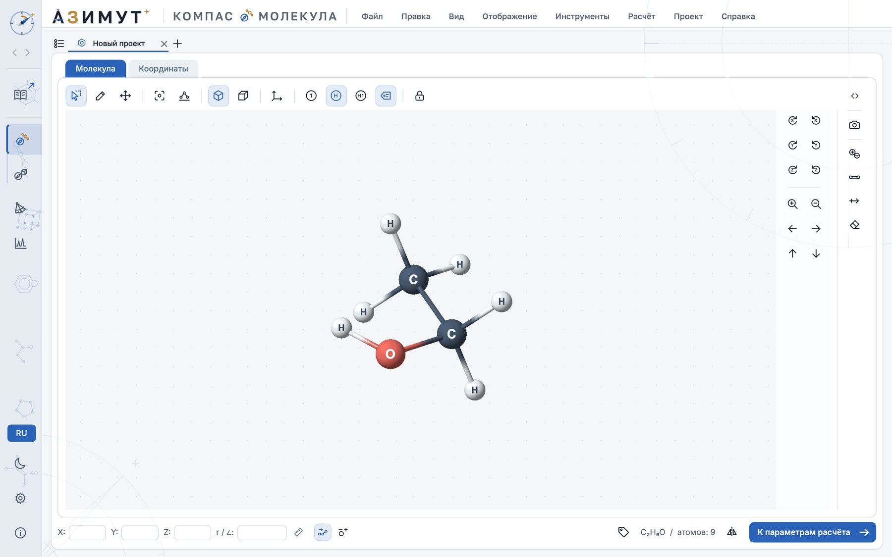

### Шаг 3. Расчёт в Секстанте

1. Нажмите «К параметрам расчёта» под моделью – откроется Секстант с этой молекулой.
2. Выберите программу (например, ORCA или xtb), задачу «Оптимизация + частоты», метод B3LYP и базис def2-SVP. Дисперсионная поправка D3(BJ) уже включена.
3. Справа виден входной файл – его можно прочитать и при необходимости поправить.
4. Нажмите «Запустить расчёт» (`Ctrl+Enter`). На месте входного файла появится ход расчёта: этапы, циклы оптимизации, последняя энергия.

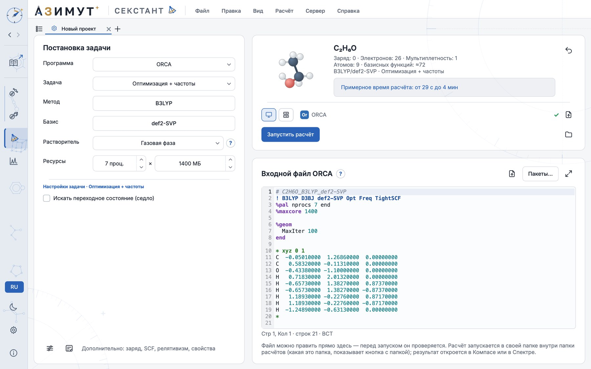

### Шаг 4. Результат в Компасе и Спектре

Когда расчёт закончится, в окне расчёта появятся кнопки «Перейти в Компас» и «Перейти в Спектр».

- В **Компасе** результат открывается шагами оптимизации: кнопка ☰ слева над моделью показывает график энергии и проигрывает шаги. Частоты колебаний можно посмотреть прямо на модели.
- В **Спектре** – итоговая энергия, сходимость оптимизации, ИК-спектр с анимацией колебаний и термохимия (энтальпия и свободная энергия Гиббса).

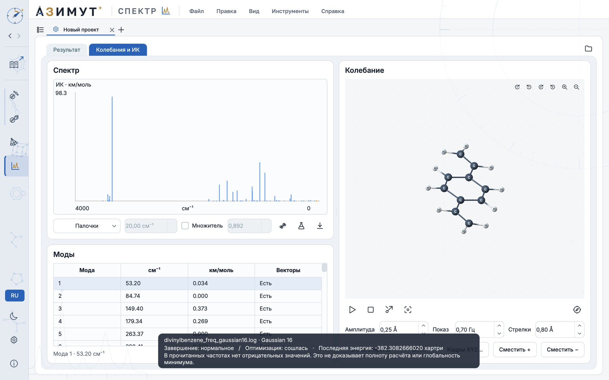

> **Совет.** Если в результате оптимизации с частотами есть мнимая частота, структура не в минимуме. Доктор расчёта предложит кнопку «Сдвинуть по мнимой моде и оптимизировать заново» (раздел «Доктор расчёта»).

### Учебные примеры

«Файл → Открыть пример…» открывает папку `examples` программы: настоящие выводы ORCA, Gaussian, xtb и Psi4 (свойства, оптимизации, сканы, колебания, UV-Vis и ЯМР, орбитали), пары структур для сравнения, молекулы для вращения вокруг связи, кристаллы CIF (CsCl, NaCl, графит, бензойная кислота, кремний) и файл своих фрагментов. Что открыть и на что посмотреть, описано в таблице `examples/README.md`. В меню «Файл» Спектра есть и учебные результаты ORCA, которые открываются без файлов.

## Интерфейс и настройки

### Главное окно

Окно «Азимута» состоит из левой панели и рабочей области раздела.

- **Левая панель.** Вверху – значок программы, он открывает главную страницу; под ним – кнопки «Назад» и «Вперёд». Ниже – разделы: Атлас (отделён линией; стрелка ↗ напоминает, что он открывается в браузере), «Компас · Молекула», «Компас · Кристалл», Секстант и Спектр. Внизу – выбор языка (русский, английский, китайский), тема, настройки и «О программе». Перейти к разделу можно и клавишами `Ctrl+1` … `Ctrl+5`.
- **Шапка раздела** – название раздела и его меню: «Файл», «Правка», «Вид», «Расчёт» и меню самого раздела (у Компаса – «Инструменты», «Проект», «Сервер», у кристалла – «Кристалл»); последним всегда идёт «Справка».
- **Рабочая область** – содержимое раздела. Справа вверху на её фоне – бледная шкала азимута, слева внизу – картинка раздела (компас, секстант, спектр).

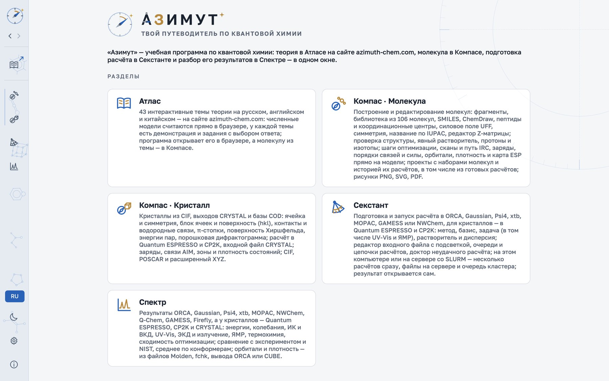

**Главная страница** рассказывает, что такое «Азимут», и даёт быстрый вход в работу. Карточки «Продолжить» возвращают к последней молекуле и к последнему кристаллу; стрелка на карточке раскрывает стопкой ещё пять последних проектов того же рода. Ниже – карточки разделов.

### Вкладки структур

Вкладка – это вся работа над одной структурой: сама структура, настройки её расчёта и его результат. Вкладки общие для «Компаса · Молекулы», Секстанта и Спектра: вкладка, выбранная в одном разделе, выбрана во всех. «Компас · Кристалл» держит свои вкладки; Секстант и Спектр из него возвращаются к молекулам.

- «+» над моделью открывает новую вкладку, крестик закрывает её (если есть несохранённые изменения, программа спросит).
- Результат расчёта открывается во вкладке, из которой расчёт запущен; результат из файла – в пустой или в новой вкладке.
- Результат показывается там, где на него есть что смотреть: колебания, UV-Vis и ЯМР – в Спектре, остальное – в Компасе. Свойства (заряды, порядки связей, диполь) сразу появляются на модели.

### Меню «Файл» и «Справка»

Меню «Файл» есть во всех разделах. Основные пункты:

- «Сохранить» (`Ctrl+S`) записывает проект в тот же файл без вопроса, «Сохранить как…» (`Ctrl+Shift+S`) – под новым именем.
- «Закрыть вкладку» (`Ctrl+W`) и «Закрыть остальные вкладки».
- «Очистить» – пустая структура во вкладке и ничего поверх модели (свойства, поверхности, критические точки, измерения, свои подписи, наложенная структура).
- «Молекула по названию…» – английское название (aspirin, caffeine, 2-butanol); структура берётся из PubChem – его трёхмерная модель (силовое поле MMFF94), а если её нет, строится по SMILES. Нужен интернет.
- «Вставить структуру из буфера» (`Ctrl+Shift+V`) – скопированные координаты XYZ (целиком или только строки «C x y z»), молфайл или SMILES.
- «Показать файл в папке» – Finder или Проводник с файлом вкладки.
- «Настройки…» – окно настроек программы (раздел «Настройки программы»).

Структура по названию или из буфера ложится в пустую вкладку, иначе – в новую.

**Меню «Справка»** во всех разделах начинается с поля поиска. Введите слово – ниже появятся пункты меню и кнопки окна, в названии или подсказке которых оно встречается, с путём к ним («Кристалл ▸ Межмолекулярные взаимодействия ▸ Поверхность Хиршфельда…»). Выбранный пункт показывается на своём месте: меню открываются по очереди, пункт подсвечен, `Enter` выполняет его. `Ctrl+?` открывает «Справку» сразу с полем поиска. В этом же меню – «Руководство», «Что нового» (журнал изменений), «Таблица Менделеева», «Справочник», проверка установки, папка журналов, отчёт об ошибке и «О программе».

**Обновления** (0.225.0). При запуске программа раз спрашивает у GitHub номер последнего выпуска – того же, что раздаёт сайт. Если вышла версия новее вашей, появится окно: «Скачать» открывает раздел «Скачать» сайта, «Что нового» – страницу выпуска, «Позже» откладывает до следующего запуска, «Не напоминать об этой версии» молчит до следующей. Без сети программа ничего не говорит. Проверить в любой момент: «Справка → Проверить обновления…». Отключить проверку: «Файл → Настройки… → Оформление → Проверять обновления при запуске». Никакие ваши данные при этом не отправляются.

### Справочник и таблица Менделеева

«Справка → Справочник» собирает данные, которые нужны во время работы. Поле сверху ищет по таблице открытой вкладки.

- **Единицы и константы** – пересчёт энергии (Eh, эВ, ккал/моль, кДж/моль, см⁻¹, К, ТГц и длина волны фотона в нм), длины и дипольного момента; фундаментальные постоянные CODATA 2018 – те, которыми считает программа.
- **Растворители** – диэлектрическая проницаемость ε при 20–25 °C и имя растворителя в ORCA, Gaussian, xtb и CREST, Psi4, MOPAC. Знак «?» у растворителя в Секстанте открывает эту таблицу.
- **Множители частот** – таблица NIST CCCBDB по методам и базисам. Из Спектра («Инструменты → Множители частот…») множитель ставится в ИК-спектр кнопкой «Применить к спектру» или двойным щелчком.
- **Опытные данные** – базы измеренных спектров, геометрий и термохимии (NIST WebBook и CCCBDB, ATcT, SDBS, nmrshiftdb2, атомные спектры NIST, COD, PubChem) с поиском по формуле молекулы.

«Справка → Таблица Менделеева» открывает карточки элементов: анимация атома, атомная масса, изотопы по данным NIST и электронная конфигурация.

### Панель кнопок над моделью

Над моделью Компаса – ряд кнопок вида, а у правого края поля – колонка «Снимок» и кнопок наложенного из расчёта. Набор кнопок можно менять.

1. Щёлкните правой кнопкой по любому пункту или подменю в меню окна и выберите «Добавить на панель над полем» или «Добавить в колонку справа». Пункт можно и просто перетащить из меню мышью на ряд или в колонку.
2. Кнопки ряда и колонки перетаскиваются мышью на другое место. Брошенная между кнопками группы, кнопка входит в эту группу; брошенная после последней – встаёт за новой чертой.
3. Правый щелчок по кнопке – «Убрать с панели», перенос в другое место или «Вернуть кнопки как было». Стандартные кнопки тоже можно убрать – они остаются в меню.

Набор кнопок запоминается и не зависит от языка программы. У «Компаса · Кристалла» своя раскладка: изменения в ней не трогают панель молекулы.

### Индикатор фоновой работы

Когда долгая работа идёт за убранным окном – расчёт Секстанта, пока вы в другом разделе, или поиск конформеров, свёрнутый кнопкой «Свернуть», – внизу левой панели над языками появляется значок: компас на «дышащем» синем круге со стрелкой, которая качается. Когда известна доля сделанного, вокруг заполняется кольцо; когда нет – по кругу бежит комета. Подсказка показывает время.

- Щелчок открывает окно работы, не уводя из раздела. Если работ несколько, на значке их число, а щелчок даёт список.
- Когда работа закончится, стрелка остановится, а рядом встанет знак: галочка – успех, крестик – ошибка, черта – работа остановлена. Открыли окно – знак уходит.
- Вернётесь в Секстант – окно расчёта закроется само, а ход расчёта будет на месте входного файла.

### Тема, язык и подсказки

Тема (светлая или тёмная) и язык общие для всех разделов, включая Атлас. «Настройки → Тема → Как в системе» следует внешнему виду macOS или Windows и меняется вместе с ним, пока тему не выберут вручную. Значок программы в Dock и левая панель следуют теме.

Вопросы и окна («Сохранить изменения?», выбор файла, ввод названия) говорят на языке программы, вместе с кнопками «Да», «Нет», «Сохранить», «Отмена». Окна выбора файла на macOS – системные, их кнопки следуют языку macOS.

Подсказки при наведении всплывают только там, где говорят что-то новое: у значков без подписи, у полей с настройками, у обрезанного текста. Кнопки-значки разворачиваются при наведении и показывают надпись. Объяснения подробнее открывает знак «?» рядом с полем.

**Атомы в полях ввода.** Где нужны номера атомов (плоскость и линия карт Спектра, фрагменты переноса заряда и CDA, «Выделить по номерам»), атомы показаны как «H1», «C3–C8». Вписать их можно и так, и номерами: «1-4, 7», «N1, H2–H4», а просто «H» означает все атомы водорода. Символ, не совпадающий с элементом атома с этим номером, не принимается – это защищает от перепутанных номеров.

### Настройки программы

«Файл → Настройки…» в любом разделе (или значок-шестерёнка на левой панели) открывает одно окно для настроек всей программы. Слева – список разделов, справа – их поля. Изменения действуют сразу и сохраняются до следующего запуска. У большинства разделов есть кнопка «По умолчанию».

Таблица: Разделы окна «Настройки»

| Раздел | Что настраивается |
|---|---|
| Оформление | Язык; тема – светлая, тёмная или как в системе |
| Файлы | «Достраивать водороды у файлов без H» |
| Связи и шаги | Множитель к сумме ковалентных радиусов для связей по расстояниям (1,22; «Найти связи заново» применяет его к открытой структуре); порог порядка для «Связей по порядкам Майера» (0,5); «Шаги оптимизации и скана – в одной ориентации» |
| Вид модели | Схема отображения при запуске («Как в прошлый раз» или любая из меню); быстрая отрисовка больших моделей – от N атомов |
| Снимки | Увеличение «Снимка высокого разрешения» (×2–×6), прозрачный фон, обрезка по молекуле |
| Спектры | ИК палочками или кривой, ширина полос ИК и UV-Vis, сразу включать множитель частот |
| Единицы | Координаты в таблице Компаса (Å или бор); энергии ΔE шагов, сканов, IRC и конформеров (ккал/моль, кДж/моль, эВ) |
| Таблицы анализа (CSV) | Разделитель столбцов («;», «,» или табуляция) и десятичный знак; рядом – образец строки |
| Расчёты | Папка расчётов, папка проектов, метод поиска конформеров по умолчанию |
| Программы | Где найдены ORCA, Gaussian, Psi4, xtb, CREST, MOPAC и другие; «Указать…» файл программы и «Искать самой» |
| Multiwfn | Сетка расчёта (грубая, средняя, точная) и файл программы Multiwfn |
| Ошибки | Папка журналов, «Сохранить отчёт…», «Отправить автору…» |
| Все настройки | «Сохранить в файл…» (JSON, без паролей и ключей), «Загрузить из файла…» (например, на другом компьютере), «Сбросить все настройки…» |

> **Совет.** В таблицах CSV по умолчанию столбцы разделены точкой с запятой, а дробная часть числа отделена запятой (1,5). Так их двойным щелчком открывают Excel и Numbers на компьютере с русскими настройками. Если таблица нужна для программы, которая ждёт запятую между столбцами и точку в числах (1.5), выберите «,» и точку.

### Файлы из Finder и Проводника

- Двойной щелчок по проекту `.qcc` открывает его в «Азимуте». Для CIF, XYZ, MOL, SDF, PDB, выходов и входных файлов расчётов, Molden и CUBE «Азимут» предлагается в «Открыть с помощью». Структура и кристалл открываются в Компасе, результат расчёта – в Спектре.
- Файлы можно перетащить на окно. Пока их держат над окном, оно сереет, а в середине появляется подсказка для раздела на экране: в Компасе – файлы структуры (XYZ, MOL, SDF, MOL2, PDB, CIF, Molden, QCC), в Секстанте – входные файлы или структуры, в Спектре – расчётные файлы.

### Ошибки и отчёт для автора

Если что-то сломалось, программа не молчит: ошибка записывается в журнал, а окно с Квил говорит «Что-то пошло не так» (программа продолжает работать) и предлагает «Сохранить отчёт…». Если программа закрылась аварийно, при следующем запуске она сама предложит сохранить отчёт.

Отчёт – один архив `.zip`: журналы ошибок, аварий и запуска, версии «Азимута», Python, Qt, NumPy, VTK, сведения о системе и настройки без паролей. Кнопка **«Отправить автору…»** (в окне ошибки, в вопросе после аварии и в «Настройках → Ошибки») сохраняет отчёт на рабочий стол и открывает в почтовой программе письмо на contact@azimuth-chem.com с версией, системой и последней ошибкой. Остаётся перетащить файл отчёта в письмо и дописать, что вы делали. То же – «Файл → Отчёт об ошибке…».

### Квил

Квил – талисман программы. Она встречает конец расчёта в его окне, стоит в вопросах перед выходом и заменой проекта и в проверке входного файла. Пока вкладка Компаса пуста, Квил стоит в углу поля с подсказкой: карандаш в облачке включает построение, папка открывает файл. В Спектре без результата она разглядывает пустой лист с лупой. В Атласе Квил ведёт демонстрации тем.

## Атлас

Атлас – интерактивный учебник теории: 56 тем в 13 разделах, от постулатов квантовой механики и атома водорода до DFT, теории возмущений, сольватации, выбора метода, ЯМР, конформеров, тяжёлых элементов, кристаллов, диаграмм Уолша и машинного обучения в квантовой химии. Числа на страницах считаются прямо в браузере (Python на странице) – без расчётных программ и без сервера.

### Как открыть Атлас

Атлас живёт на сайте: основной адрес – [www.azimuth-chem.com](https://www.azimuth-chem.com/), зеркало для России – [ru.azimuth-chem.com/atlas](https://ru.azimuth-chem.com/atlas/?lang=ru). Пункт «Атлас» на левой панели и его карточка на главной открывают его в браузере в теме программы (светлой или тёмной): на русском – на зеркале, на английском и китайском – на основном адресе. Язык Атласа, открытого из программы, – тот же, что у программы; тему и язык на сайте переключают в его левой панели.

> **Совет.** Чтобы читать Атлас без интернета (например, в аудитории без сети), нажмите на сайте в левой панели «Сохранить Атлас для работы без сети».

### Разделы Атласа

Основы квантовой механики · Молекула и ядра · Симметрия · Кристаллы · Многоэлектронные функции · Хартри–Фок · Корреляция · Плотность и DFT · Выбор метода и базиса · МО и реакции · Термохимия и кинетика · Свойства и спектры · Динамика и машинное обучение. В разделе от двух до шести тем. В «Точечных группах» есть разложение представлений и SALC, в «Итерациях SCF» – теорема Купманса, в «Методе Хюккеля» – индексы реакционной способности, функции Фукуи и полуэмпирические методы.

### Страница темы

- **«Что нужно понять»** и **границы модели** – в начале страницы: что вы узнаете и где модель перестаёт работать.
- **Разделы с ползунками, кнопками и графиками.** Меняйте параметры и смотрите, как меняется результат. Ключевые понятия выделены, формулы – в тексте; подпись под графиком объясняет, что на нём видно.
- **Демонстрация** – кнопка «▶ Демонстрация» внизу справа. Пошаговый показ: Квил сама нажимает кнопки и объясняет, что видно. Стрелки `←` `→` листают шаги, `Esc` завершает показ. Анимации темы идут, только пока тема открыта, – на другой теме они стоят и потом продолжаются с того же места.
- **Проверьте свои знания** – задания в конце страницы: выполните действие на странице и выберите ответ из четырёх. Ответ проверяется сразу, а ошибка подсказывает, где искать.
- **Глоссарий** – термины, подчёркнутые пунктиром (их 132). Наведите или щёлкните – появится определение и ссылка на тему, где о термине рассказано.
- **«Открыть в Компасе»** – на страницах с молекулами: кнопки с названиями молекул открывают их в программе (на компьютере, где «Азимут» установлен).
- **Что дальше** – вопрос в конце страницы, ведущий к следующей теме.

### Как найти тему

1. На главной Атласа все темы собраны по разделам – щёлкните по теме.
2. Или нажмите значок лупы (или клавишу `/`) и начните печатать: поиск идёт по названиям, ключевым понятиям, заголовкам разделов и заданиям.
3. Вкладки под шапкой переключают темы одного раздела; стрелки ‹ › справа в строке тем листают все темы по порядку. То же делают клавиши `←` и `→`, а `↑` и `↓` прокручивают тему.
4. Строка «Продолжить» в начале обзора Атласа возвращает к последней открытой теме, а «С чего начать» предлагает первые темы.

На главной Атласа при каждом открытии Квил рассказывает факт из учебника по одной из тем – рубрика «Псс, а ты знаешь?» (129 фактов, по три на тему). «Открыть тему» переходит к ней, «Ещё факт» показывает другой, «Скрыть» убирает карточку до следующего запуска.

### Как пройти тему

1. Прочитайте «Что нужно понять».
2. Запустите «▶ Демонстрацию».
3. Подвигайте ползунки сами: каждый блок отвечает на один вопрос.
4. Ответьте на задания «Проверьте свои знания».
5. Откройте молекулу темы в Компасе и посчитайте её в Секстанте – сравните с тем, что показал Атлас.

### Атлас на занятии

**Режим презентации** (кнопка на странице темы) увеличивает шрифты и графики для проектора. Демонстрация темы подходит для показа на лекции: шаги листаются стрелками, как слайды.

В этом руководстве в конце многих разделов стоят ссылки «Теория – в Атласе»: они ведут к темам, которые объясняют, что именно считает программа.

## Компас · Молекула

Компас – раздел построения, правки и просмотра молекул. Здесь же результат расчёта ложится на трёхмерную модель: шаги оптимизации, колебания, заряды, орбитали и поверхности электронной плотности.

### Окно Компаса

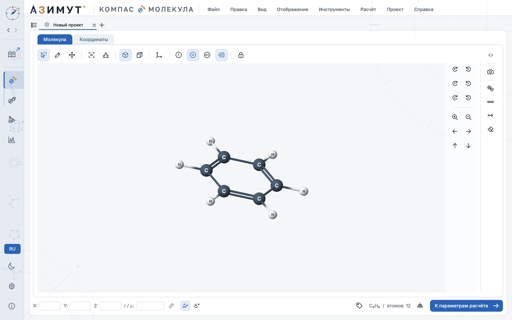

- **Вкладки структур** над моделью. Результат расчёта (шаги оптимизации, скан, путь IRC или NEB, кадры XYZ) открывается в своей вкладке, молекула остаётся в своей; если открытая вкладка пуста, результат займёт её.
- **Панель инструментов** слева: режимы и инструменты построения – элемент, порядок связи, «Связать», «Разорвать», «Удалить», «Достроить водороды», «Выровнять геометрию».
- **Режимы над моделью**: «Обзор / выделение» (стрелка – вращать модель и выделять атомы; структура не меняется), «Изменение структуры» (карандаш – атомы, фрагменты, молекулы) и «Перемещение атомов». Нажата кнопка включённого режима.
- **Кнопки над моделью**: вид (центровать, изометрия или перспектива, оси, «Лучший ракурс»), подписи атомов, ограничения оптимизации (замок), шеврон панели вида.
- **Колонка у правого края поля**: «Снимок» и под ним наложенное из расчёта – «Атомы», «Связи», «Диполь и силы» и ластик «Убрать с модели всё наложенное».
- **Под моделью** – сводка (брутто-формула и число атомов), кнопка названия (IUPAC), кнопка симметрии и «К параметрам расчёта».
- **Вкладка «Координаты»** – таблица координат (ангстремы или боры), формат и копирование. `Delete` удаляет атомы выделенных строк.

Меню Компаса: «Файл» (открыть, сохранить, рисунок), «Правка» (выделение, атомы, связи, геометрия, система координат), «Вид» (проекция, камера, оси, подписи, измерения на модели), «Отображение» (модель, связи, схемы), «Инструменты» (моменты инерции, статистика атомов и связей, масса, фрагменты, сравнение структур), «Расчёт», «Проект» и «Сервер».

### Построение молекулы

1. «Файл → Новая молекула» (`Ctrl+N`) или «+» над моделью. Если открыт проект, в его списке молекул появляется пустая строка «Новая молекула»; с первым атомом она становится молекулой проекта.
2. Включите режим «Изменение структуры» (карандаш). Выберите элемент на панели и щёлкните по полю – атом встанет; щелчок по атому присоединяет к нему новый.
3. Чтобы поставить группу, выберите фрагмент (метил, фенил, карбонил, кольца…) и щёлкните по полю, по атому или по водороду – фрагмент встанет вместо него.
4. «Достроить водороды» добавляет недостающие атомы H, «Выровнять геометрию» расставляет атомы по правилам VSEPR.

Готовую молекулу можно взять из библиотеки – «Файл → Примеры молекул» (106 молекул в 7 разделах) – или построить по SMILES: «Файл → Молекула по SMILES…», например `CC(=O)O` для уксусной кислоты.

**Переключатели построения** (значки в меню карандаша и в «Правка → Атомы, фрагменты и молекулы»):

- **«Достраивать водороды при построении»** (по умолчанию выключено) – атом в пустом поле сразу ставится с водородами (C → CH₄), щелчок по насыщенному атому снимает у него водород под новую связь, а новые атомы заполняются водородами по валентности.
- **«Выравнивать при построении»** («Правка → Геометрия», по умолчанию включено) – новый атом или группа сразу встают по VSEPR, цепочка вытягивается зигзагом, а уже нарисованная часть молекулы не двигается.
- **«Выравнивать по UFF»** – при построении новые атомы выравнивает силовое поле UFF, а не простое поле VSEPR.

**«Выровнять геометрию»** – простое силовое поле для всей молекулы или выделенного: длины связей, углы VSEPR, плоские кратные связи и ароматические кольца, отталкивание атомов и торсионные члены (связи между тетраэдрическими атомами становятся заторможенными). Это аккуратная стартовая структура, а не оптимизированная: энергия условная, сравнивать по ней конформеры нельзя.

### Открытие и сохранение

**Открыть** – «Файл → Открыть…» (`Ctrl+O`) или перетащите файл на окно. Компас читает XYZ, проекты «Азимута» (`.qcc`), Molfile и SDF, MOL2, PDB, ChemDraw XML (`.cdxml`), входные файлы ORCA и Gaussian, выводы расчётов, файлы Molden и fchk (полный список – в приложении А). CIF откроется в «Компасе · Кристалле», результат расчёта – шагами в Компасе или в Спектре.

- SDF с несколькими молекулами открывается набором структур (панель «Структуры»), PDB с несколькими моделями (MODEL … ENDMDL, например кадры молекулярной динамики) – шагами в панели результата.
- Если в записи SDF пустая строка имени (так пишут RDKit и многие базы), имя берётся из её полей данных – `<Name>`, `<Title>`, `<PUBCHEM_IUPAC_NAME>`, `<chembl_id>`.
- Из ChemDraw XML берутся атомы и связи фрагментов первой страницы, порядки связей, формальные заряды и подпись рисунка. Плоский рисунок переводится в ангстремы, водороды достраиваются, объём даёт «Сделать 3D». Сокращения (Ph, OMe…) раскройте в ChemDraw; двоичный `.cdx` сохраните там как `.cdxml`.

**Файлы без водородов.** Если в открытом файле нет ни одного атома H, Компас сам достраивает их по валентности (C – 4, N – 3, O – 2, галогены – 1) и пишет, сколько добавил. `Ctrl+Z` возвращает файл как он был. Двойные и тройные связи, записанные в файле (MOL/SDF, MOL2, PDB CONECT), учитываются; в XYZ порядок связи определяется по длине. Файл, где есть хоть один H, не меняется. Выключить достраивание: «Файл → Достраивать водороды у файлов без H».

> **Внимание.** Ион или радикал без H получит водороды нейтральной молекулы – проверьте заряд и мультиплетность перед расчётом.

**Сохранить.**

- «Файл → Сохранить проект…» – молекула вместе с параметрами расчёта.
- «Файл → Экспорт координат» – XYZ в ангстремах или другой формат.
- Кнопка «Снимок» у модели – PNG (×1 и ×3; увеличение – в «Настройках → Снимки», по желанию с прозрачным фоном), GIF вращения и GIF шагов оптимизации, векторные SVG и PDF.
- «Файл → Модель для 3D-печати…» – то, что на экране, шариками и палочками: STL одним цветом для любого принтера или VRML в цветах элементов. Масштаб – миллиметров на ангстрем (по умолчанию 10: вода около 2,5 см); связи не тоньше заданной толщины, чтобы не сломались.

### Проекты

Проект собирает молекулы одной работы и все их расчёты в одной папке: список молекул, их структуры, заряды, настройки и попытки расчёта. Проект появляется, когда открывается набор молекул (SDF, несколько файлов), или при сохранении.

- **Папка проекта** – «Документы/Azimuth/Проекты/<название>»: `project.qcc` (указатель), `project.sqlite` (молекулы, настройки и история расчётов) и папки расчётов молекул. Каждое изменение записывается в базу целиком или не записывается.
- **Меню «Проект»** собирает действия с проектом: новый и открытый проект, список молекул, добавить и удалить молекулы, вернуть удалённые, одиночный или пакетный режим, история и файлы проекта.
- **Удалить молекулы.** В списке молекул проекта выберите одну или несколько (`Shift`, `Ctrl`) и нажмите `Delete` или правой кнопкой – «Удалить из проекта…». Галочка «Удалить и файлы их расчётов» удаляет и их папки – безвозвратно. Без галочки файлы остаются, а молекулы возвращает `Ctrl+Z` в списке или «Вернуть удалённые».
- **Оптимизированная геометрия** после сошедшейся оптимизации (или поиска переходного состояния) становится структурой молекулы проекта, так что цепочка, например, MOPAC → ORCA → QTAIM идёт без ручного переноса. Прежняя структура остаётся во входе попытки и в истории отмен.
- **Результат для прежних данных.** Если после расчёта у молекулы изменили геометрию, заряд, мультиплетность, метод или программу, её строка в списке помечается «≠», а подсказка называет, что изменилось. Результат не пересчитывается: он остаётся результатом своего расчёта.
- **«Папка расчёта»** в меню правой кнопки списка открывает папку текущего результата молекулы или её последней попытки.
- **«Сохранить все структуры»** записывает все молекулы проекта одним файлом XYZ или SDF.
- **Проект из расчётов.** «Файл → Создать проект из расчётов…» собирает в проект расчёты, сделанные вне «Азимута», из выбранной папки: выходы ORCA, Gaussian, Psi4, xtb, MOPAC, GAMESS, NWChem и Q-Chem вместе с их файлами. Одна молекула, посчитанная разными способами, становится одной молекулой проекта с историей этих расчётов.
- **Черновик.** Молекула, нарисованная на пустой вкладке и не сохранённая в файл, при закрытии программы (или при переходе на другую вкладку) становится черновиком «Новый проект» в папке «Проекты». В «Продолжить» и в «Недавних файлах» он подписан «· черновик»; «Сохранить» даёт ему имя.
- **Файл, открытый только посмотреть,** получает вкладку-проект, но его папка остаётся в «Проектах», только если проект изменился (молекулу правили, по ней был расчёт, проект сохранили под именем).
- **Один проект в двух окнах.** Записывает в проект только первое окно; второе показывает его «только для просмотра».

> **Внимание.** Не копируйте `project.sqlite` отдельно от папки проекта. Чтобы получить копию, используйте «Сохранить как…» или копируйте папку проекта целиком при закрытой программе.

### Просмотр, выделение и измерения

- **Вращение** – перетаскивание мышью, **масштаб** – колесо, **сдвиг** – кнопки-стрелки. На трекпаде: протяжка вращает, два пальца двигают, щипок масштабирует.
- **Выделение** – щелчок по атому; рамкой – перетаскивание с `Shift`. «Правка → Выделение»: всё, обратить, по элементу, на шаг шире (`Ctrl+]`), молекулу целиком (`Ctrl+Shift+]`), по номерам и по диапазону координат.
- **Измерения.** Выделите 2, 3 или 4 атома – под моделью появится длина, валентный или двугранный угол. «Вид → Измерения на модели» подписывает все длины связей и валентные углы; линейка закрепляет на модели выбранные расстояния и углы. «Стиль измерений…» задаёт размер текста и число знаков.
- **Стандартный вид** («Вид → Стандартный вид»): вдоль осей x, y, z, вдоль выбранной связи или прямо на плоскость трёх выбранных атомов. «Центр вращения – выделенные атомы» вращает и приближает модель вокруг них. «Камера → Положение камеры…» задаёт углы и масштаб числами – один ракурс для нескольких структур.
- **Модель** («Отображение»): шары и стержни, стержни, пространственная модель; «Сферы Ван-дер-Ваальса» – полупрозрачные сферы радиусов Бонди.
- **Подписи атомов**: элемент, номер, «Элемент и номер · C1», «Номер в элементе · C1, H1», номера и порядки связей, подписи только у выделенных; размер – «Стиль подписей…».
- **Свои подписи** (кнопка-ярлык рядом с «1», «H», «H1»): выделите атомы, нажмите её и впишите подпись; «#» становится номером по порядку выделения. Подписи идут за атомами при правке и хранятся в проекте. У PDB с остатками (белок, ДНК) остатки подписываются сами.
- **Скрыть атомы**: выделенные, фиктивные атомы X; «Показать все атомы» возвращает их. Скрытые атомы остаются в структуре и в расчёте.
- **Ленты белка** («Вид → Ленты белка»): α-спирали – красные ленты, β-слои – жёлтые стрелки, остальное – серая трубка; атомы цепей скрываются, лиганды и вода остаются.
- **Атом-призрак X** (в таблице Менделеева – под лантаноидами, или X в таблице координат) – точка без ядра и электронов для Z-матрицы, центра цикла или оси; во входные файлы Секстанта не попадает.

**Векторы и плоскости** («Правка → Векторы и плоскости»): «Вектор между выделенными атомами», «Нормаль к плоскости выделенных атомов» (стрелка 1,5 Å из центра средней плоскости) и «Плоскость через выделенные атомы» – полупрозрачный лист. У каждого объекта на модели свой номер. «Углы между векторами и плоскостями…» даёт угол каждой пары. «Векторы и плоскости текстом…» – строка на объект («вектор 1 2», «нормаль 1-6», «плоскость C1–C6»), список можно поправить и применить. «Убрать векторы и плоскости» снимает их. «Геометрия → Плоскости групп атомов…» – средняя плоскость группы (например, кольца C1–C6) и отклонения атомов от неё; для двух групп – угол между плоскостями, расстояние между центрами и сдвиг (π-стэкинг).

### Правка геометрии

- **Отменить и повторить** – `Ctrl+Z` и `Ctrl+Shift+Z`.
- **Связи.** Выделите два атома и нажмите «Связать» или «Разорвать» (или `Ctrl+B`); порядок связи – на панели. Правый щелчок по связи даёт одинарную, двойную, тройную, ароматическую, частичную (пунктир) и «Цвет связи…».
- **Перемещение атомов.** В режиме «Перемещение атомов» тяните атом мышью. Рядом – что ещё можно тянуть: фрагмент вокруг опорного атома; вращение вокруг связи (выделите два связанных атома и тяните атом одной из сторон); молекулу целиком; неразветвлённую цепочку; выделенное.
- **Вращение вокруг связи** («Правка → Геометрия → Вращать вокруг связи…» или правой кнопкой по связи): точный двугранный угол полем и ползунком, поворот на заданный угол, перебор с заданным шагом (кадры идут в панель шагов или в файл XYZ). Показывается ближайший контакт двух сторон. Кольцевые связи не вращаются.
- **Удалить молекулу.** Если на модели несколько молекул, правой кнопкой по атому – «Удалить молекулу (N атомов)».
- **Редактор Z-матрицы** («Правка → Геометрия → Редактор Z-матрицы…»): длины, углы и двугранные углы числами; модель меняется сразу.
- **Сдвинуть и повернуть…** – выделенные атомы поворачиваются на угол вокруг оси X, Y, Z или оси через два атома и сдвигаются на вектор. **Отразить** – в плоскости XY, XZ или YZ.
- **Связи целиком**: «Правка → Связи → Удалить все связи»; «Найти связи заново» строит их по расстояниям.
- **Копирование**: «Правка → Копирование» – атомы, координаты и «Копировать SMILES».
- **Порядок атомов**: «Выделенные атомы – первыми» (выделите атомы щелчками в нужном порядке – они получат номера 1, 2, 3…) и «Водороды – после своих атомов».
- **Симметризовать** («Правка → Геометрия») подгоняет структуру под найденную точечную группу; второе действие ещё и поворачивает её в стандартную ориентацию.
- **Оптимизировать (UFF)** – выделенные атомы или вся молекула до минимума универсального силового поля (Rappé и др., 1992; параметры – как в RDKit). В строке состояния – энергия до и после и её слагаемые. Структура нужна с водородами. Для больших молекул – «Расчёт → Быстрый расчёт xtb → Оптимизация GFN-FF».
- **Построить пептид…** – последовательность однобуквенными кодами (до 30 остатков) и конформация: α-спираль (φ −57°, ψ −47°), β-слой (−139°, +135°) или вытянутая цепь. Все аминокислоты – L, концы NH₂ и COOH.
- **Координационный центр…** – металл, степень окисления, геометрия (от линейной до пентагональной бипирамиды) и лиганды: один на все места, список через запятую или «4 Cl, 2 NH3». Лиганды: H2O, NH3, PH3, OH, CO, CN, F, Cl, Br, I, H. Длина M–L – сумма ковалентных радиусов (Cordero, 2008); заряд комплекса и наименьшая мультиплетность ставятся в поля вкладки.

> **Примечание.** Высокоспиновое состояние координационного соединения задайте в Секстанте сами: программа ставит наименьшую мультиплетность.

### Название и симметрия

- **Кнопка симметрии** под моделью (справа внизу) определяет точечную группу с допуском, который можно поменять; повторное нажатие симметризует структуру. Группа определяется для одной молекулы до 150 атомов. То же – в «Инструменты»: «Определить точечную группу», «Симметризовать», «Симметризовать и повернуть в стандартную ориентацию».
- **Кнопка названия** (IUPAC) даёт название по правилам IUPAC (ациклические и моноциклические соединения с C, H, N, O и галогенами, на трёх языках) или из справочника программы. Если правил нет, Компас спрашивает PubChem (нужен интернет; название – на английском).

Теория – в Атласе: [«Точечные группы»](https://ru.azimuth-chem.com/atlas/?lang=ru#sym).

### Свои фрагменты и молекулы

**Фрагмент.**

1. Выделите группу атомов вместе с атомом, которым она присоединяется (например, CF₃ и углерод).
2. «Правка → Атомы, фрагменты и молекулы → Сохранить выделенное как фрагмент…» и дайте название.
3. Фрагмент появится в «Моих фрагментах» и ставится так же, как встроенные. Там же – удаление, экспорт и импорт файлом JSON (чтобы перенести фрагменты на другой компьютер).

**Молекула.**

1. Правой кнопкой по атому – «Сохранить молекулу в «Мои молекулы»…» (сохраняются все атомы, связанные с этим). Или тот же пункт в меню «Молекула» режима построения: выделенные атомы, без выделения – вся структура.
2. Молекула появится в «Файл → Примеры молекул → Мои молекулы» и в меню «Молекула» при построении (ставится щелчком по полю рядом с остальными). Там же – «Удалить мою молекулу».

### Проверка структуры, растворитель, протоны и изотопы

- **«Инструменты → Проверить структуру…»** до расчёта сверяет заряд и мультиплетность с числом электронов и ищет слишком близкие атомы, атомы с лишними соседями, нейтральный N с четырьмя связями и O с тремя, незаполненные валентности и несвязанные части. Замечания идут списком (✕ – программа не примет, ! – похоже на ошибку, · – проверьте замысел), их атомы выделяются на модели. «Запустить расчёт» в Секстанте делает ту же проверку сам и при ошибках спрашивает «Всё равно запустить?».
- **«Инструменты → Окружить растворителем…»** – явная сольватация водой, метанолом, этанолом, аммиаком, ДМСО, дихлорметаном, хлороформом, ТГФ или бензолом. «Первая координационная сфера» ставит молекулу растворителя водородной связью на каждое свободное место; «Вокруг всей молекулы, случайно» – заданное число молекул без наложений. «Убрать растворитель» – в том же окне.
- **«Инструменты → Протоны»**: добавить протон к выделенному атому (заряд +1), снять (−1) или перенести водород к другому атому (таутомер).
- **Изотопы.** Правой кнопкой по атому → «Изотоп»: стабильные изотопы всех элементов с их распространённостью (NIST), T и ¹⁴C или «Своя масса…»; несколько атомов сразу – «Инструменты → Изотопы выделенных атомов…». На модели у символа появляется массовое число; изотопы уходят во входные файлы ORCA, Gaussian и Psi4.

### Сравнение структур

1. «Вид → Сравнение структур» или «Файл → Наложить структуру для сравнения…».
2. Выберите файл другой структуры того же состава (конформер, результат другой программы, файл с другой нумерацией).
3. Атомы сопоставятся автоматически. Показываются RMSD (со всеми атомами и без H) и наибольшее отклонение. Модель можно перенумеровать как в файле, а структуру из файла – сохранить в нумерации модели.

Энантиомеры различаются: зеркальное отражение без спроса не допускается. Быстрое сравнение с другой открытой вкладкой – «Инструменты → Сравнить с вкладкой».

### Поиск конформеров

«Расчёт → Поиск конформеров…» открывает окно поиска. Слева – карточка «Метод поиска»: метод выбирается в списке, под ним – его описание и настройки; ниже – общие окно энергий и температура. Справа – найденные конформеры. Сразу выбран метод, подходящий для молекулы.

Таблица: Методы поиска конформеров

| Метод | Когда выбирается | Как работает |
|---|---|---|
| Перебор | До 4 вращаемых связей | Поворачивает вращаемые связи с шагом 120° (или 60°, 180°) во всех сочетаниях (не больше 200) или в случайных; отбрасывает налезающие структуры; уточняет кандидатов в xtb |
| Пчелиный поиск (ABC) | 5–10 вращаемых связей | Искусственная пчелиная колония: повороты связей – «источники нектара», энергия – короткая оптимизация xtb (GFN2); сначала самый низкий конформер, затем низкие и непохожие на найденные |
| CREST | Больше 10 вращаемых связей | Полный поиск программой CREST (iMTD-GC; «быстро» – ключ `--quick`), окно энергий передаётся ей (`--ewin`) |

Вращаемыми считаются одинарные связи вне циклов; группы CH₃ и амидные связи C–N не вращаются.

**Сортировка.** «Уточнить в xtb (GFN2)» оптимизирует каждого кандидата и сортирует по правилам CREST: окно энергий (по умолчанию 6 ккал/моль), повторы (ΔE < 0,05 ккал/моль и RMSD < 0,125 Å) убираются, одинаковые структуры с иначе пронумерованными атомами считаются ротамерами одного конформера. Показывается больцмановская доля при выбранной температуре (по умолчанию 298,15 К). Если окно что-то отбросило, строка внизу говорит, сколько структур и насколько выше ближайшая.

**Настройки методов.** «Окно энергий» (по умолчанию 6 ккал/моль, как у CREST) и температура – общие. У пчелиного поиска – «ABC: конформеров» (сколько найти, по умолчанию 10) и «ABC: итераций» (длина поиска; каждая итерация – 2 × число вращаемых связей запусков xtb); все его запуски лежат в одной папке ABC_… среди расчётов. У CREST – «быстро» и «CREST: длина метадинамики». «Запустить CREST» доступна, если CREST установлен. Во время поиска строка внизу показывает ход: у xtb – «конформер 5 из 20», у пчелиного поиска – глобальный или локальный поиск и номер запуска xtb.

**Результат.** Найденные конформеры – на странице «Конформеры» панели результата (☰): «Взять выбранный» ставит конформер в Компас, «Сохранить XYZ…» – все кадры с энергиями. Если молекула – в проекте, конформеры окна энергий встают в «Молекулы проекта» под ней группой (номера 1.1, 1.2…, у каждого ΔE); каждый конформер – молекула проекта со своими расчётами.

> **Совет.** Типичный путь: найденные xtb конформеры прогнать очередью в MOPAC (PM7), затем лучшие из новой сортировки – очередью в ORCA (раздел «Очередь расчётов»).

> **Примечание.** Небольшие сопряжённые молекулы CREST считает жёсткими и даёт им короткую метадинамику, поэтому находит один конформер. Тогда увеличьте «CREST: длина метадинамики» (ключ `--mdlen`).

Теория – в Атласе: [«Конформеры: какие минимумы искать»](https://ru.azimuth-chem.com/atlas/?lang=ru#conf).

### Путь реакции

1. Откройте начальную структуру. «Расчёт → Путь между структурами…».
2. Выберите конечную структуру – из файла или из сравнения. Она перенумеровывается как начальная и накладывается на неё.
3. Промежуточные структуры (1–50) строятся по IDPP (связи не укорачиваются при вращении групп) или линейно; кадры идут в панель шагов и в файл XYZ.
4. «В Секстант: ORCA NEB-CI» готовит расчёт пути и переходного состояния: в Секстанте выбирается задача «Путь реакции (NEB-CI)», рядом с входным файлом пишется `end.xyz`.
5. Найденное переходное состояние проверяется задачей «Путь от переходного состояния (IRC)» (0.223.0): ORCA спускается от него в обе стороны, к реагенту и к продукту. В «Настройках задачи» – «Шагов в каждую сторону» и численный гессиан для методов без аналитического. Начинайте с геометрии, у которой одна мнимая частота, посчитанной тем же методом и базисом. Результат открывается в Компасе: в панели «Оптимизация» – профиль ΔE от переходного состояния и структуры по шагам; крайние шаги – минимумы, которые этот TS соединяет.

Теория – в Атласе: [«Поверхность потенциальной энергии»](https://ru.azimuth-chem.com/atlas/?lang=ru#pes).

### Ограничения при оптимизации

Выделите атомы (1 – атом, 2 – длина, 3 – угол, 4 – двугранный угол) и выберите «Расчёт → Закрепить выделенное для оптимизации» или нажмите кнопку-замок над моделью. На модели появится замочек, а ограничение попадёт во входной файл оптимизации. Ограничения служат и координатами скана поверхности потенциальной энергии (раздел «Задачи расчёта»).

### Быстрый расчёт xtb и инструменты расчёта

Меню «Расчёт» Компаса:

- **«Заряд и мультиплетность…»** – поля Секстанта прямо из Компаса.
- **«Быстрый расчёт xtb»**: «Энергия», «Оптимизация», «Оптимизация + частоты», «Оптимизация GFN-FF» и «Скан по выделенным атомам…» (длина, угол или двугранный угол меняется до конечного значения за заданное число точек, остальное оптимизируется). Расчёт GFN2-xTB с зарядом и мультиплетностью вкладки запускается сразу, какая бы программа ни стояла в Секстанте, и приходит во вкладку как обычный.
- **«Шаги расчёта»**: «Сохранить шаги одним XYZ…», «Координаты всех шагов (CSV)…» и «График параметра по шагам…» – длина, угол или двугранный угол выделенных атомов по шагам оптимизации, скана или IRC.
- **«Моды с участием выделенных атомов…»** – колебания по доле выделенных атомов в смещениях; так быстро находится, например, валентное колебание C=O.

Меню «Инструменты» Компаса: «Таблица внутренних координат…» (все длины, углы и двугранные углы; «Сохранить CSV…»), «Объём и площадь поверхности…» (ван-дер-ваальсов объём, площадь, доступная растворителю с зондом 1,4 Å, эффективный диаметр; радиусы Бонди), моменты инерции и вращательные постоянные, масса молекулы, статистика атомов и связей.

### Результат расчёта на модели

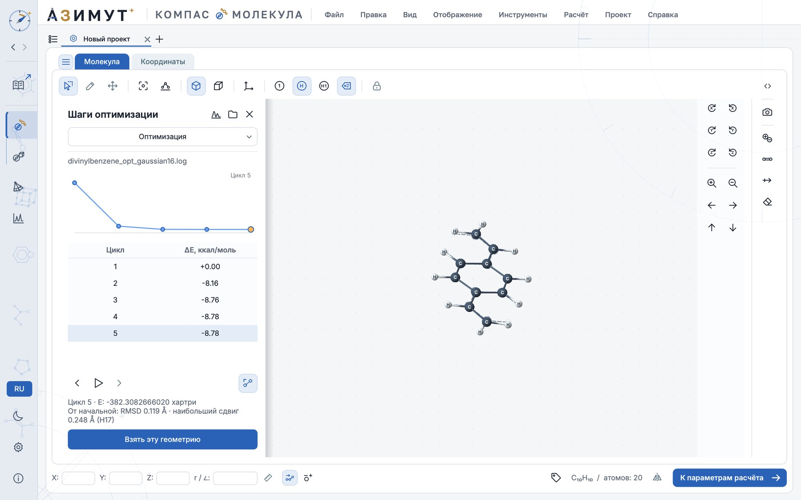

**Панель результата** открывает кнопка ☰ слева над моделью; она видна, только когда у вкладки есть что показать. Страницы панели:

- **«Оптимизация»** – шаги оптимизации, скана, IRC или NEB: график энергии, проигрывание, GIF. После оптимизации выбран последний шаг; выбранный шаг остаётся структурой вкладки, когда панель сворачивают. При листании скана его координата подписана на модели оранжевым. У двумерного скана – кнопка «Карта скана»: ΔE цветом с изолиниями и «долина» пунктиром.
- **«Структуры»** – когда открыто сразу несколько файлов или база SDF: выбранная структура на модели, «Взять эту структуру».
- **«Конформеры»** – после поиска конформеров.
- **«Частоты»** – частоты и ИК-интенсивности (мнимые – оранжевым); выбранное колебание движется прямо на модели (пробел – пауза, стрелки – другое колебание).
- **«Орбитали»**, **«Поверхности»** и **«QTAIM»** – анализ волновой функции (раздел «Свойства и электронная плотность на модели»).

В заголовке панели – значок «Перейти в Спектр»: Спектр откроется на вкладке с тем же содержимым (сходимость, колебания, карты, топология). Щелчок по пустому месту поля сворачивает панель.

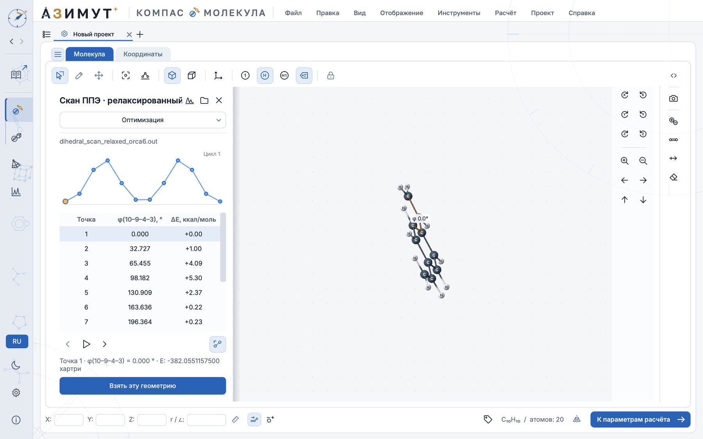

### Свойства и электронная плотность на модели

**Свойства** («Расчёт → Свойства из расчёта» и три кнопки колонки справа):

- **«Атомы»** – заряды (Малликен, Лёвдин, Хиршфельд, CM5, ADCH, RESP, AIM, APT, xtb, MOPAC), спиновые заселённости и функции Фукуи; показанный вид отмечен «•». Анализы, которые дают новые значения, – в подменю «Посчитать по волновой функции».
- **«Связи»** – порядки связей Майера, Виберга, FBO и LBO; «Связи по порядкам…».
- **«Диполь и силы»** – дипольный момент и силы на атомах на выбранном шаге оптимизации.

Ластик рядом убирает с модели всё наложенное; структура, её подписи и измерения остаются.

**Анализы по волновой функции.** Если у результата есть файл с орбиталями (Molden, fchk или `.gbw` ORCA), программа Multiwfn считает в фоне:

- заряды ADCH и CM5, Хиршфельда (для Gaussian и Molden, где их нет в выводе) и AIM по бассейнам Бейдера, у открытой оболочки – и спиновые заселённости;
- заряды RESP – подогнанные под электростатический потенциал (двухстадийный RESP), как в силовых полях AMBER и GAFF; в строке состояния – RRMSE, в папке «Анализ» – файл `<имя>_resp.chg` для программ молекулярной динамики;
- порядки связей по четырём определениям.

**Функции Фукуи** – у результата очереди «Функции Фукуи» Секстанта: по зарядам Хиршфельда трёх расчётов f⁺ (атака нуклеофила), f⁻ (атака электрофила), f⁰ (атака радикала) и дескриптор двойственности Δf = f⁺ − f⁻ на модели; окно с таблицей, вероятными местами атаки и глобальными индексами (потенциал ионизации, сродство к электрону, электроотрицательность, жёсткость, индекс электрофильности). Внизу окна – те же функции поверхностью на модели: программа строит плотности трёх расчётов на одной сетке и вычитает их.

**Орбитали и поверхности.** Если у результата есть орбитали, в панели результата есть страницы «Орбитали», «Поверхности» и «QTAIM» (то же – «Вид → Поверхность на модели»).

- **«Орбитали»** – таблица орбиталей и кнопки «Орбиталь», «Спин» (у открытых оболочек) и «Состав» (вклады атомов по Хиршфельду). Над таблицей – канонические или локализованные орбитали: Пипек – Меззи, его вариант «Беке» (для базисов с диффузными функциями) или Бойс; локализованные орбитали подписаны как остовы, неподелённые пары, связи и делокализованные. `Shift`+щелчок по другой орбитали накладывает её на показанную своей парой цветов.
- **«Поверхности»** – дерево поверхностей Multiwfn по группам: плотность и её производные (ρ, |∇ρ|, лапласиан ∇²ρ, спиновая плотность, RDG), локализация электронов (ELF, LOL, энтропия), энергия (G, K, ALIE), потенциал (ESP), слабые взаимодействия (NCI, IRI, IGMH) и функции на молекулярной поверхности ρ = 0,001 (ESP, ALIE, LEA, LEAE) с минимумами и максимумами. Двойной щелчок ставит поверхность на модель. Ниже – «Разность плотностей Δρ» по фрагментам: синее – электронов прибавилось, красное – убыло.
- **«QTAIM»** – «Найти точки»: критические точки плотности ищет Multiwfn, так что находятся и связи, которых Компас не рисует (водородные, ван-дер-ваальсовы), циклы и клетки. Список: тип, атомы, ρ, ∇²ρ, плотность энергии H; внизу – проверка Пуанкаре – Хопфа n − b + r − c = 1. «На модель» рисует точки (ядра – серые, связи – зелёные, циклы – оранжевые, клетки – фиолетовые) и пути связей.

Сетка расчёта (грубая – секунды, средняя, точная – для больших молекул минуты) общая для всех полей; сменили сетку – показанное перестраивается. Построенное запоминается: повторный показ не запускает расчёт заново. Пока поле считается, курсор и значок у кнопки становятся вращающимся кольцом.

**Слабые взаимодействия.** NCI по волновой функции результата, NCI по промолекулярной плотности – для любой структуры на модели, без расчёта, – и IRI: поверхность RDG = 0,5, раскрашенная по sign(λ₂)ρ: синее – водородные связи, зелёное – ван-дер-ваальсовы контакты, красное – отталкивание. IGMH между молекулами показывает только межмолекулярную часть взаимодействия. Графики и таблицы доменов – во вкладке «NCI» Спектра.

**Таблицы.** С каждой поверхностью в подпапку «Анализ» папки расчёта записывается таблица CSV её экстремумов (`<имя>_<функция>_extrema.csv`), для молекулярной поверхности – и сводка (`<имя>_esp_summary.csv`: площадь, объём, средние, σ²tot, ν, Π, MPI), а также вывод Multiwfn.

> **Примечание.** Multiwfn ставится отдельно (раздел «Установка программ для расчёта»). Без него пункты анализов серые, а подсказка объясняет, как его поставить или указать. Если работает старый Multiwfn (до 3.8), программа один раз предупредит: часть анализов в нём не работает.

Теория – в Атласе: [«Атомные заряды: сравнение схем»](https://ru.azimuth-chem.com/atlas/?lang=ru#chg), [«Электронная плотность»](https://ru.azimuth-chem.com/atlas/?lang=ru#dens).

### Вид для статьи и презентации

«Вид → Схема отображения» меняет сразу модель, связи, подписи, проекцию, оси, размер атомов, цвета, фон и сетку. Встроенные схемы: «Азимут», «Публикация · белый фон», «Чёрно-белая», «Цвета Jmol», «Стержни», «Объёмная модель», «Презентация». Белый или чёрный фон схемы попадает и в снимки. «Сохранить текущий вид как схему…» добавляет свою схему.

- **«Отображение → Свой вид…»** – все параметры вида в одном окне, каждое изменение сразу на модели: вид модели, размер атомов и толщина связей, цвет связей, двойные связи, подписи, перспектива, оси, фон, сетка, палитра и свои цвета элементов. «Сохранить схему» – под своим названием (галочка – открывать программу с ней); «Экспорт схем…» и «Импорт схем…» – файлом `.json` для коллег.
- **«Стиль связей…»** («Вид → Отображение связей»): цвет связей (по атомам плавно, с чёткой границей или одним цветом), толщина, кратные связи несколькими цилиндрами или одним, вид ароматических связей, длинные связи пунктиром, водородные связи.
- Цвет одного элемента – «Цвет элемента…» в меню атома.

### Трёхмерная графика VTK

«Вид → Трёхмерная графика VTK (проба)»: атомы, связи и поверхности рисует библиотека VTK (OpenGL) на видеокарте – поверхность проходит между атомами по настоящей глубине, прозрачность честная. Выбор запоминается и действует после перезапуска программы. Если VTK не заработает, Компас скажет об этом и вернётся к встроенной графике.

## Компас · Кристалл

«Компас · Кристалл» работает с кристаллами из файлов CIF: ячейка и блок ячеек, симметрия, межмолекулярные контакты, поверхность Хиршфельда, энергии пар молекул, порошковая дифрактограмма и поверхности (hkl). Отсюда же ставятся периодические расчёты в Quantum ESPRESSO и CP2K. У «Кристалла» свои вкладки и свои меню; молекула или результат молекулярного расчёта, открытые здесь, сами переходят в «Компас · Молекулу».

> **Примечание.** Анализ и расчёты кристаллов пока помечены в программе как непроверенные (раздел «Расчётные программы и их проверка»): результаты стоит сверять с независимыми данными.

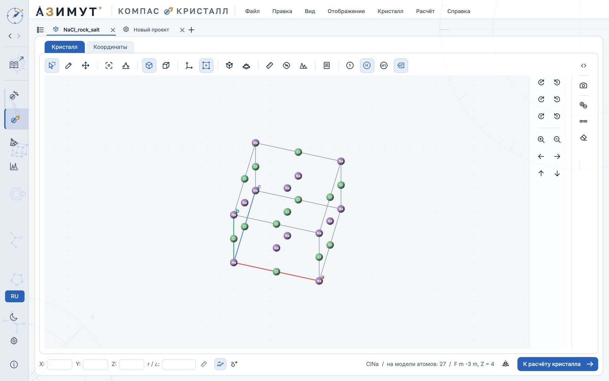

### Открытие кристалла

1. «Файл → Открыть CIF…» (или откройте CIF из «Молекулы» – программа сама перейдёт сюда). Учебные кристаллы – «Файл → Открыть пример…»: CsCl, NaCl, графит, бензойная кислота, кремний.
2. Кристалл сразу строится: одна ячейка, молекулы целиком, при разупорядочении – одна часть. Атомы асимметричной части размножаются операциями симметрии из файла (повторы на частных позициях сливаются). Пространственная группа и Z – в строке под моделью, плотность – в строке состояния.
3. Кнопка кристалла над моделью или «Файл → Перестроить кристалл (ячейки, поверхность)…» открывает панель «Кристалл» справа от модели.

Пока поле пустое, в его левом нижнем углу стоит Квил: папка в её облачке открывает CIF, кристаллик – пример.

**Кристаллы из COD.** «Файл → Найти кристалл в COD…» ищет в Crystallography Open Database – открытой базе примерно полумиллиона структур. Условия поиска: слова (название вещества или минерала, авторы, заголовок статьи), формула (C7H6O2, TiO2 – элементы программа переставит в порядок Хилла), элементы через пробел и «только эти элементы»; во второй строке – параметры ячейки с допуском (по умолчанию ±1 % длины и ±1°). «Как у открытого» подставляет ячейку кристалла из Компаса – так находятся та же структура в других работах и близкие фазы. Результат – до 500 записей: номер COD, формула, название, группа, ячейка и год. «Открыть в Компасе» (или двойной щелчок) загружает CIF в папку «Документы/Azimuth/COD» и открывает его. Нужен интернет; COD получает только условия поиска.

### Панель «Кристалл»

Панели «Кристалл», «Контакты», «Поверхность Хиршфельда» и «Результаты расчётов» открываются справа от модели (по одной); кнопка открытой панели подсвечена, повторное нажатие или щелчок по полю мимо атомов её закрывают. Панель «Кристалл» разбита на раскрывающиеся разделы.

- **«Ячейка и упаковка»** – состав ячейки, пространственная группа (номер – если он есть в файле), кристаллическая система, точечная группа, тип решётки (P, A, B, C, I, F, R), параметры и объём ячейки, Z, Z′, плотность и коэффициент упаковки Китайгородского – доля ячейки внутри ван-дер-ваальсовых сфер атомов (у молекулярных кристаллов обычно 0,65–0,77). Кнопка «Что значит символ …» разбирает символ Германа – Могена по частям: решётка Браве, каждая позиция – какая ось и какая плоскость и вдоль какого направления.
- **«Блок ячеек»** – одна ячейка или блок n₁ × n₂ × n₃ (до 10 × 10 × 10, не больше 2000 атомов), диапазон координат в долях ячейки, «Атомы на гранях, рёбрах и в вершинах», «Целые молекулы» (молекулы, которые грань ячейки разрезает, строятся целиком, центр каждой – внутри ячейки) и «Одна часть разупорядочения». Модель перестраивается сразу после короткой паузы – кнопки «Построить» нет.
- **«Операции симметрии»** – список операций файла с подписями: ось или плоскость, её направление и положение в ячейке.
- **«Поверхность (hkl)»** – вырезание пластины (раздел «Поверхность (hkl)»).
- **«Вид»** – направление взгляда и что рисовать на модели (раздел «Вид кристалла»).

У кристаллов без отдельных молекул (соли, металлы, каркасы) «Целые молекулы» недоступны, а панель говорит, что структура бесконечна (цепь, слой или каркас).

**Разупорядочение.** Если в CIF есть группы разупорядочения (`_atom_site_disorder_group`), флажок «Одна часть разупорядочения» включён: ячейка, молекулы, поверхность и контакты строятся из упорядоченных атомов и части 1. Снимите флажок, чтобы увидеть все части вместе.

### Вид кристалла

Меню кнопки «Вид кристалла» над моделью и раздел «Вид» панели:

- **«Вдоль a», «Вдоль b», «Вдоль c»** и **«Вдоль нормали к (hkl)»** ставят линию взгляда вдоль ребра ячейки или перпендикулярно плоскостям.
- **«Элементы симметрии»** рисуют в первой ячейке оси поворота (сплошные) и винтовые оси (пунктир) – зелёным, зеркальные плоскости и плоскости скольжения – синим, центры инверсии – коричневыми кольцами, каждый элемент с символом. Если элементов больше 400 (кубические группы с центрировкой F), они не рисуются.
- **«Эллипсоиды смещений (50 %)»** – проекции эллипсоидов тепловых смещений атомов, как на рисунках ORTEP (если в CIF есть Uᵢⱼ, Bᵢⱼ, U_iso или B_iso).
- **«Координационные полиэдры»** – многогранники ближайших соседей атомов металлов (до 1,12 × кратчайшего расстояния, от 4 до 12 атомов).
- **«Узлы решётки Браве»** – узлы решётки блока: в вершинах ячеек – маленькие ромбы, узлы центрировки – крупнее.
- **«Окраска молекул по симметрии»** – каждая молекула окрашена цветом операции симметрии, которая её порождает.
- **«Кольца, π–π и C–H···π на модели»** – плоскости колец, центроиды, π–π-стопки и контакты C–H···π.
- «Вид → Показывать ячейку» прячет и показывает рёбра ячейки.

### Меню кристалла

Меню «Кристалл» собрано по группам: «Блок ячеек», «Вид кристалла», «Подписи на модели», затем подменю «Межмолекулярные взаимодействия» (контакты, поверхность Хиршфельда, энергии пар, оболочка), «Структура и упаковка», «Ячейка и решётка» и дифрактограмма. Меню «Расчёт»: расчёт в Секстанте и входной файл CRYSTAL, затем то, что дал расчёт, – подменю «Заряды атомов», «Связи и критические точки (AIM)», «Поля на модели». Серые пункты говорят в подсказке, почему они недоступны.

### Координаты кристалла

Вкладка «Координаты» кристалла открывается на формате «Независимые атомы (доли)»: метка, элемент, x, y, z, заселённость и U независимых атомов файла; над таблицей – группа, ячейка и объём. Строка таблицы выделяет все копии атома на модели. Формат «Дробные (CIF)» показывает атомы модели в долях ячейки. Там же – «CIF кристалла», «POSCAR (VASP)» и «Расширенный XYZ» одной ячейки.

Стрелка в правом нижнем углу поля переносит выделенные молекулы (достаточно по одному атому каждой) в новую вкладку «Компаса · Молекулы» – для молекулярного расчёта.

### Контакты и водородные связи

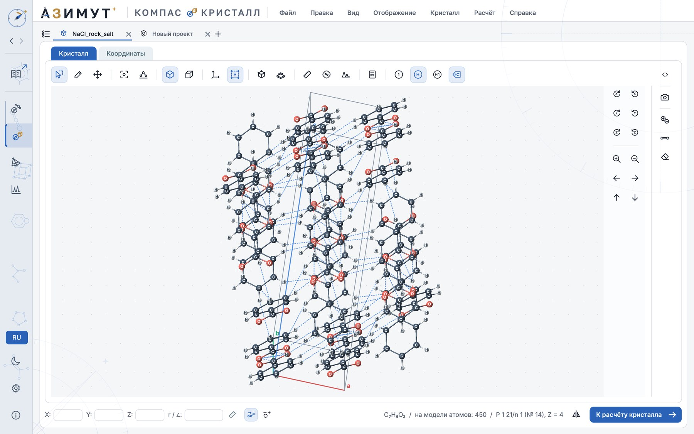

Панель «Контакты» показывает контакты между атомами ячейки и соседних ячеек:

- **водородные связи** D–H···A (угол не меньше 120°);
- **галогенные, халькогенные, пниктогенные и тетрельные** (σ-дырочные) связи R–E···Y: угол R–E···Y (θ1) не меньше 150°; столбец d/Σr – расстояние, делённое на сумму ван-дер-ваальсовых радиусов; для контакта двух галогенов – второй угол θ2 и тип: тип I (θ1 ≈ θ2) – ван-дер-ваальсов контакт, тип II (θ1 ≈ 180°, θ2 ≈ 90°) – галогенная связь;
- **ван-дер-ваальсовы контакты** – ближе суммы радиусов на 0,2 Å.

Контакты, которые повторяет симметрия, собраны в одну строку со столбцом «Число». Строка таблицы рисует свои контакты на модели и выделяет их атомы; щелчок по пунктиру водородной связи на модели выбирает её строку.

**Критерии поиска** – строка над таблицей: запас к сумме ван-дер-ваальсовых радиусов, наименьшие углы водородной и σ-дырочных связей; «Найти заново» ищет с ними, «По умолчанию» возвращает 0,20 Å, 120° и 150°.

**Графы-наборы** (запись Etter) – столбец «Граф-набор»: D – одна связь между двумя молекулами, S(n) – кольцо внутри молекулы, C(n) – бесконечная цепь, Rᵃ_d(n) – кольцо из нескольких молекул; n – число атомов в кольце или звене цепи, a и d – число акцепторов и водородов. Отдельная таблица под контактами даёт второй уровень: для каждой пары видов водородных связей – наименьшее кольцо и наименьшая цепь, в которые входят связи обоих видов.

**π–π-стопки и C–H···π.** Под таблицей контактов – плоские кольца (5–7 атомов) и пары колец разных молекул, уложенных стопкой (центроиды ближе 4,0 Å, плоскости почти параллельны): расстояние Cg···Cg, угол между плоскостями, расстояние от центроида до плоскости другого кольца и сдвиг. Контакты C–H···π: H···Cg до 3,0 Å, угол C–H···Cg не меньше 120°.

**Сеть.** «Показать сеть» строит сеть водородных и σ-дырочных связей, π–π-стопок и C–H···π (выбор рядом с кнопкой); «слоёв: N» (1–6) наращивает сеть от добавленных молекул N раз. Выделите строки таблицы – сеть строится только по этим контактам, например по одной водородной связи, чтобы увидеть её цепь или слой.

**Таблица для статьи…** показывает водородные связи так, как их публикуют: D–H···A, длины D–H, H···A, D···A, угол и код симметрии акцептора (например, «-x+1, -y, -z+1», i). «Копировать» кладёт таблицу с табуляциями (вставляется таблицей в Word и в электронную таблицу), «Сохранить CSV…» – в файл.

**Молекулярная оболочка** («Кристалл → Молекулярная оболочка…») – соседи молекулы: молекулы с атомом ближе R Å (по умолчанию 4,0) или касающиеся её ван-дер-ваальсовыми сферами с запасом. Окно пишет молекулярное координационное число (у большинства органических кристаллов 12–14) и для каждого соседа – формулу, код симметрии и кратчайший контакт.

> **Примечание.** В рентгеновских структурах атомы H стоят ближе к своим атомам, чем на самом деле (C–H около 0,95 Å вместо 1,09), поэтому расстояния H···A выходят примерно на 0,1 Å длиннее.

### Поверхность Хиршфельда

«Кристалл → Поверхность Хиршфельда…» строит поверхность молекулы – там, где её сферические атомы дают половину плотности кристалла. Молекула – выделенная на модели, иначе первая в ячейке; сетка – грубая, средняя или точная.

- Окно пишет площадь, объём, глобулярность (1 – шар) и самое короткое d_norm.
- **«Отпечаток пальцев»** – доля площади поверхности при каждой паре расстояний d_i (до ближайшего ядра внутри) и d_e (снаружи), 0,4–2,6 Å, и таблица долей контактов. Выбранная пара элементов окрашивает свою часть «отпечатка», остальное серое. «Сохранить «отпечаток»…» – PNG.
- **На модели** поверхность окрашивается: d_norm – красное там, где контакт короче суммы ван-дер-ваальсовых радиусов (водородные связи), белое – на сумме, синее – дальше; d_i и d_e – от красного (близко) к синему; индекс формы (синее – выпуклость, красное – впадина, «бабочки» – признак π–π-стопки) и кривизна (плоские участки и рёбра между ними).

### Энергии пар и энергетический каркас

«Кристалл → Энергии пар и каркас (xtb)…»: для молекулы и её соседей ближе 3,8 Å считается энергия взаимодействия E = E(пара) − E(A) − E(B) в GFN2-xTB при геометрии кристалла – одиночные точки, секунды на пару; пары, одинаковые по симметрии, считаются один раз.

- Таблица: код симметрии соседа, расстояние между центрами, кратчайший контакт, E в кДж/моль и её слагаемые GFN2 – электростатика, дисперсия, отталкивание и остальное: водородная связь видна по электростатике, стопка – по дисперсии.
- Энергия решётки ≈ ½ Σ E по соседям; её модуль близок к энтальпии сублимации без колебаний.
- «Показать каркас на модели» рисует между центрами молекул линии, толщина которых растёт с |E|: синие – притяжение, красные – отталкивание. Видно, где прочные колонны, слои или объёмный каркас.
- Для солей окно показывает компоненты ячейки и их заряды: обычные ионы (NH₄⁺, NO₃⁻, ClO₄⁻, SO₄²⁻ и другие) узнаются по формуле; заряды можно поправить.

> **Примечание.** Точность GFN2-xTB для энергий пар – порядка 10–20 %. Энергия решётки соли по ближайшим соседям – только грубая оценка: дальняя электростатика в неё не входит. Нужна программа xtb.

### Порошковая дифрактограмма

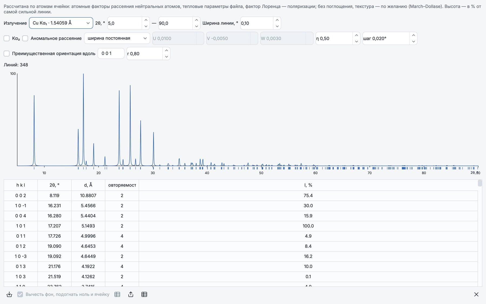

«Порошковая дифрактограмма…» считает рентгенограмму порошка по атомам ячейки: атомные факторы рассеяния нейтральных атомов, тепловые параметры из файла, фактор Лоренца – поляризации. В окне – кривая, отметки линий под осью и таблица (hkl, 2θ, d, повторяемость, интенсивность в % от самой сильной).

- Излучение – Kα₁ меди, молибдена, кобальта, железа, хрома или серебра; диапазон 2θ, шаг и ширина линии.
- «Kα₂» добавляет вторую линию трубки с половинной интенсивностью; «ширина по Кальоти» – FWHM² = U tan²θ + V tanθ + W; η – доля лоренциана в форме пика (псевдо-Фойгт).
- «Преимущественная ориентация вдоль» hkl с параметром r (March – Dollase): r < 1 – пластинки, r > 1 – иголки, r = 1 – без текстуры.
- «Аномальное рассеяние» добавляет поправки f′ и f″ на линии выбранной трубки (таблицы Henke и др., 1993) – заметно у тяжёлых атомов и вблизи края поглощения.
- Можно наложить опытную дифрактограмму (два столбца: 2θ и интенсивность) и сохранить расчёт в `.xy` или список линий в `.csv`.

Если в CIF нет списка операций симметрии, но есть символ группы или её номер, операции берутся из таблиц 230 групп.

### Поверхность (hkl)

1. В панели «Кристалл», раздел «Поверхность (hkl)», задайте индексы Миллера (h k l), число слоёв, число ячеек в плоскости и вакуум (Å).
2. Нажмите «Построить поверхность».
3. Получится пластина, повёрнутая так, что поверхность лежит в плоскости xy, с ячейкой пластины на модели. Например, NaCl (111) ляжет гранью в плоскость экрана.

### Расчёты кристалла

Периодический расчёт кристалла ставится в Секстанте: стрелка «К расчёту кристалла» внизу «Компаса · Кристалла» открывает Секстант с этим кристаллом и программой Quantum ESPRESSO; в строке «Программа» можно выбрать CP2K. Страница расчёта устроена так же, как у молекулы (глава 8): «Постановка задачи» – задача, метод, базис (CP2K) или обрезки (Quantum ESPRESSO), дисперсия, ресурсы, сетка k, ячейка, суперячейка и пороги оптимизации; заряд ячейки, спин, DFT+U, заполнение и сходимость – в «Дополнительных настройках…».

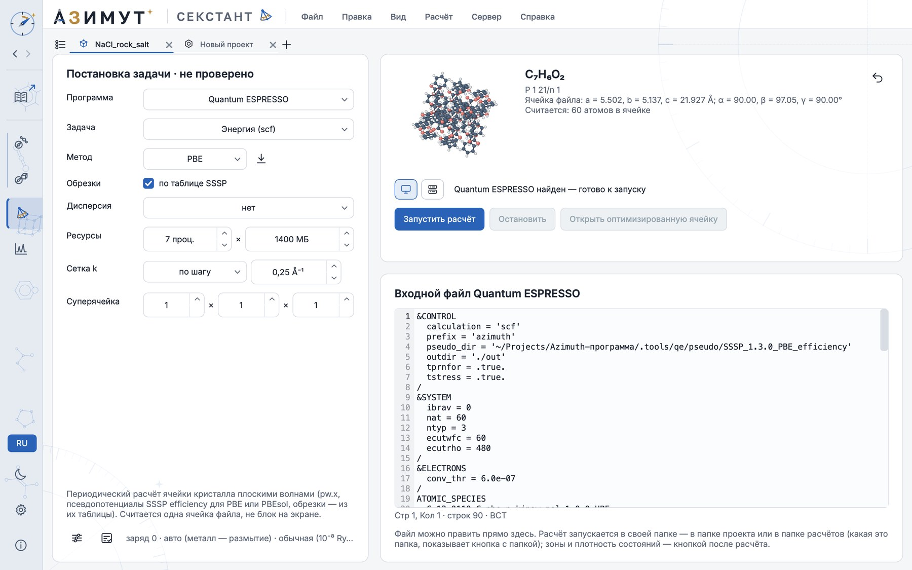

Таблица: Программы периодических расчётов

| | Quantum ESPRESSO | CP2K |
|---|---|---|
| Базис | Плоские волны, псевдопотенциалы SSSP efficiency | Гауссовы базисы MOLOPT и плоские волны для плотности, Γ-точка |
| Удобна для | Небольших ячеек, твёрдых тел | Больших ячеек (от ~10 Å), молекулярных кристаллов |
| Задачи | Энергия, оптимизация атомов, оптимизация с ячейкой, зонная структура, плотность состояний, частоты в Γ, фононные ветви и плотность состояний | Энергия, оптимизация атомов, оптимизация с ячейкой, частоты в Γ |
| Методы | PBE, PBEsol, vdW-DF2, rev-vdW-DF2, vdW-DF-cx, rVV10, PBE0, HSE06 | PBE, PBEsol, revPBE, BLYP, GFN1-xTB |
| Где считать | Этот компьютер (macOS, Linux) или сервер | Этот компьютер или сервер |

**Особенности методов.**

- Для PBEsol нужны свои псевдопотенциалы – кнопка «Скачать псевдопотенциалы» (около 60 МБ, один раз).
- Нелокальные функционалы vdW-DF2, rev-vdW-DF2, vdW-DF-cx и rVV10 сами учитывают дисперсию – поправку D3 с ними не выбирайте. В списке поправок есть также Ткаченко – Шеффлер (TS) и многочастичная дисперсия (MBD).
- Гибридные PBE0 и HSE06 точнее PBE дают ширину запрещённой зоны (HSE06 – стандарт для полупроводников), но считаются в десятки раз дольше и только в задаче «Энергия»: геометрию оптимизируйте с PBE или PBEsol, затем посчитайте энергию и щель с гибридом.
- GFN1-xTB в CP2K в сотни раз быстрее DFT: им удобно предварительно оптимизировать большие ячейки, а затем уточнить геометрию с PBE.
- Базисы CP2K: DZVP-MOLOPT-SR – для всех элементов и для твёрдых тел; полные DZVP, TZVP и TZV2P есть только для H, C, N, O, F, Si, P, S, Cl.

**Электронное состояние** («Дополнительные настройки… → Электронное состояние»):

- **Заряд ячейки** убирает или добавляет электроны; заряд компенсируется однородным фоном, поэтому энергии заряженных ячеек разного размера напрямую не сравнивают.
- **DFT+U** – U в эВ для d- или f-оболочки, например «Ni 6.2» или «Fe 5.3, Co 3.3» (оболочку можно указать явно: «Ni-3d 6.2»). Нужен для оксидов и фторидов переходных металлов и соединений церия и урана. U зависит от программы и проекторов – берите значение, полученное для той же программы.
- **Магнитный порядок** – спин-поляризованный расчёт, ферромагнитный или антиферромагнитный порядок. Для антиферромагнетика ячейка должна вмещать обе подрешётки: у NiO и MnO поставьте суперячейку 2 × 1 × 1. Если в ячейке обычно магнитные атомы (V, Cr, Mn, Fe, Co, Ni, Cu, лантаноиды, уран), а спин выключен, программа перед запуском спросит, включить ли антиферромагнитный порядок.

**Частоты и фононы в Quantum ESPRESSO.** «Частоты (точка Γ)» – scf, затем ph.x при q = 0 и dynmat.x с правилом сумм для акустических мод; для изолятора – ещё диэлектрическая проницаемость ε∞ и эффективные заряды Борна, из них ИК-интенсивности мод. «Фононные ветви и плотность состояний» считается на сетке q и занимает заметно больше времени (NaCl – около получаса на 6 процессах). Отрицательные частоты означают, что структура не в минимуме или сетка q мала. Моды в Γ показываются на модели кристалла – «Расчёт → Частоты (точка Γ)», ветви – кнопкой «Показать фононные ветви».

**Зонная структура и плотность состояний.** Программа сама ставит шаги расчёта: scf, затем зоны вдоль пути по точкам высокой симметрии зоны Бриллюэна или плотность состояний на густой сетке. «Показать зоны» и «Показать плотность состояний» открывают графики (энергии – от верха валентной зоны, у металла – от уровня Ферми); «Сохранить данные…» – CSV.

**Быстрый расчёт xtb кристалла** – «Расчёт → Быстрый расчёт xtb» сразу считает кристалл вкладки методом GFN1-xTB в CP2K (энергия, оптимизация атомов или оптимизация с ячейкой), без страницы Секстанта. Нужна установленная CP2K.

**После расчёта.** «Расчёт → Результаты расчётов…» – таблица расчётов кристалла в проекте (программа, задача, время, энергия, давление, итог) и подробности выбранного: энергия ячейки, запрещённая зона или уровень Ферми, число шагов, ячейка последнего шага; кнопки «Папка расчёта», «Шаги оптимизации», «Заряды…», «Связи AIM…», «В Спектр». Оптимизированная ячейка открывается во вкладке кристалла кнопкой «Открыть оптимизированную ячейку». Заряды CM5 и Хиршфельда и связи AIM (Multiwfn, расчёты CP2K) показываются на модели кристалла и во вкладках Спектра.

**CRYSTAL.** «Расчёт → Входной файл CRYSTAL…» составляет входной файл CRYSTAL (`.d12`): задача (энергия, оптимизация, упругие константы, частоты в Γ), функционал (PBE0, B3LYP, HSE06, PBE, PBEsol, Хартри – Фок), базис из библиотеки CRYSTAL (pob-TZVP, pob-DZVP и другие), давление и сетка k. Рядом – «Сохранить .d3 для TOPOND…» (поиск всех критических точек плотности). Сам CRYSTAL программа не запускает. Вывод CRYSTAL (`.out`) открывается как кристалл с шагами оптимизации, энергией и упругими константами; вывод TOPOND (`.outp`) – таблицей критических точек плотности.

### Сохранение и экспорт

«Файл → Сохранить кристалл в CIF…» записывает кристалл из файла с его симметрией или построенную пластину. «Файл → Экспорт кристалла» – POSCAR, расширенный XYZ, блок ячеек в CIF (P 1) и рисунок. «Файл → Модель для 3D-печати…» сохраняет блок ячеек или оболочку для принтера вместе с рёбрами ячейки.

Теория – в Атласе: [«Кристаллы: решётка и ячейка»](https://ru.azimuth-chem.com/atlas/?lang=ru#cryst).

## Секстант

Секстант готовит входной файл расчёта и запускает его – на этом компьютере или на вычислительном сервере. Геометрия, заряд и ограничения берутся из Компаса; результат возвращается во вкладку, из которой расчёт запущен.

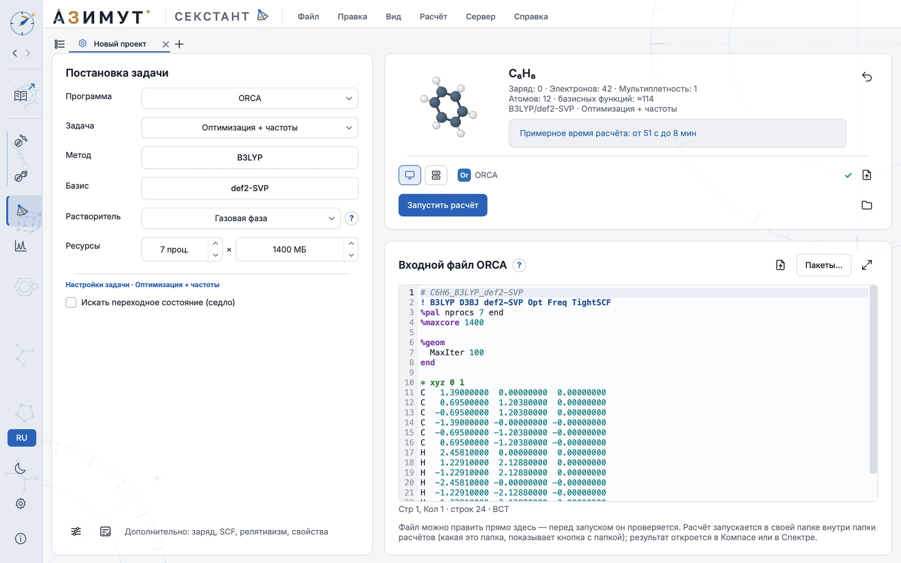

### Окно Секстанта

- **«Постановка задачи»** (слева) – программа, задача, метод, базис и самые частые поля (растворитель, процессы и память), а также то, без чего задача не обходится (координата скана, атомы фрагмента CDA). Под полями – «Настройки задачи» выбранной задачи. Внизу карточки – «Дополнительные настройки…» и кнопка «Поля…»: она выбирает, какие поля держать в карточке, а какие убрать в дополнительные настройки («Как по умолчанию» возвращает исходный набор).
- **Карточка расчёта** (справа вверху) – маленькая модель молекулы (её можно повернуть мышью), формула, число электронов и мультиплетность; стрелка в углу ведёт к молекуле в Компасе. Под линией – где считать («Этот компьютер» или «Сервер»), значок программы с зелёной галочкой, если она найдена, примерное время и «Запустить расчёт».
- **Входной файл** – ниже карточки. «Развернуть» отдаёт ему всю колонку. Во время расчёта на его месте показывается ход расчёта.

Кнопки Секстанта – значки; что делает каждая, видно в подсказке при наведении.

### Подготовка расчёта

1. В Компасе постройте или откройте молекулу и нажмите «К параметрам расчёта» (или перейдите в Секстант: `Ctrl+4`).
2. **Программа** – ORCA, Gaussian, Psi4, xtb, CREST, MOPAC, GAMESS (US) или NWChem. Программы, входные файлы которых не проверены запуском, помечены «не проверено».
3. **Название** – первая строка входного файла и имя файлов расчёта. Если поле пустое, название составляется само: формула_метод_базис_растворитель, например `H2O_B3LYP_def2-SVP_water.inp`. Своё название можно вписать по-русски – в имени файла оно станет латиницей.
4. **Задача** – энергия, оптимизация, частоты, спектр и другие (раздел «Задачи расчёта»). В списке только задачи выбранной программы. При выборе задачи Секстант сам ставит рекомендованные для неё метод, базис, дисперсию и настройки (например, строгую сходимость оптимизации перед частотами, мелкую сетку для ЯМР); подсказка внизу говорит, что поставлено, – всё можно сменить.
5. **Метод** и **базис** выбираются по семействам: нажмите на поле – откроется список семейств (Хартри – Фок, MP2, GGA, мета-GGA, гибридные, с разделением по расстоянию, двойные гибридные, связанные кластеры; базисы Попла, def2, cc, pcseg). В списках только то, что знает выбранная программа. Подсказка кнопки показывает рекомендацию для этой молекулы и задачи; пункт «★ Рекомендуется: …» ставит её.
6. **Растворитель** – CPCM или SMD (SMD – для энергий сольватации; ORCA и Gaussian), ALPB в xtb, PCM в Psi4, COSMO в MOPAC. **Дисперсия** – D3(BJ), D3(0) или D4.
7. **Процессы и память на процесс.** Секстант сам узнаёт число ядер и память компьютера или выбранного сервера и предлагает значения. Значения, заданные вручную, остаются.
8. **Заряд и мультиплетность** («Дополнительные настройки… → Электронное состояние»; их значения видны в строке рядом с кнопкой) посчитаны по молекуле: N и P с четырьмя связями – +1, B с четырьмя – −1, атом – по правилам Хунда, O₂ – триплет, иначе – наименьшая мультиплетность по числу электронов. Если изменённые значения не сходятся с числом электронов, Секстант объяснит, что исправить.

Новое окно начинает с B3LYP-D3(BJ)/def2-SVP: без дисперсионной поправки B3LYP плохо описывает стопки, конформеры и слабые комплексы. Для метода без параметров D3 (HF, MP2, ωB97X-D) и для xtb поправка выключается сама.

> **Примечание.** Связанные кластеры – CCSD(T) в ORCA, Gaussian и Psi4 и DLPNO-CCSD(T) в ORCA – считают только «Энергию»: геометрию сначала оптимизируйте функционалом DFT. CCSD(T) растёт как N⁷ и годится для молекул до десятка тяжёлых атомов; DLPNO даёт почти то же (у воды в cc-pVTZ – на 0,1 ккал/моль) для молекул в десятки атомов.

> **Совет.** Экстраполяция к полному базису (0.226.0). Энергия связанных кластеров и MP2 медленно сходится с ростом базиса. В ORCA в списке «Базис» есть группа «Экстраполяция к полному базису (CBS)»: например, «CBS(cc-pVDZ/TZ)» считает энергию в cc-pVDZ и cc-pVTZ и экстраполирует SCF-часть и корреляционную часть по отдельности (`Extrapolate(2/3,cc)`). Доступно только для «Энергии» методами MP2, CCSD(T) и DLPNO-CCSD(T). В Спектре рядом с последней энергией показаны обе части. Пара TZ/QZ точнее, но намного дороже.

Теория – в Атласе: [«Иерархия методов и лестница Якова»](https://ru.azimuth-chem.com/atlas/?lang=ru#lad), [«Базисные наборы»](https://ru.azimuth-chem.com/atlas/?lang=ru#basis).

### Задачи расчёта

Таблица: Задачи Секстанта

| Задача | Что считает |
|---|---|
| Энергия | Энергия на заданной геометрии; у ORCA и Gaussian – по желанию проверка устойчивости волновой функции |
| Оптимизация | Минимум энергии; в «Настройках задачи» – поиск переходного состояния, сходимость, предел циклов, точный гессиан |
| Оптимизация + частоты | Оптимизация и частоты на её геометрии; термохимия при заданных температуре и давлении |
| Частоты и термохимия | Частоты на текущей геометрии без оптимизации (она должна быть оптимизирована тем же методом) |
| Переходное состояние + частоты | Поиск седловой точки и её частоты (должна быть одна мнимая) |
| Спектр UV-Vis (TD-DFT) | Возбуждённые состояния: число состояний, TDA или полное TD-DFT, триплеты, натуральные переходные орбитали (ORCA) |
| ЯМР (экранирование) | Константы экранирования; в ORCA – по желанию константы спин-спинового взаимодействия |
| Оптимизация возбуждённого состояния | Геометрия выбранного возбуждённого состояния (ORCA, Gaussian) |
| Скан ППЭ с релаксацией | Координата из ограничений Компаса меняется до конечного значения за заданное число точек, остальное оптимизируется; в ORCA – и вторая координата (двумерный скан) |
| Путь реакции (NEB-CI) | Путь между начальной и конечной структурами и переходное состояние (ORCA) |
| Путь от переходного состояния (IRC) | Спуск от переходного состояния к обоим минимумам и профиль энергии (ORCA) |
| Функции Фукуи (N, N+1, N−1) | Три расчёта энергии очередью: молекула, анион и катион (ORCA) |
| Донорно-акцепторная связь CDA | Анализ разложения заряда Дапприха – Френкинга: комплекс и два фрагмента (ORCA) |
| Энергия взаимодействия с BSSE | Пять расчётов энергии пары молекул с поправкой Бойса – Бернарди (ORCA) |

Какие задачи есть у каждой программы – в приложении В. Настройки задачи показываются только те, что программа записывает во входной файл; поля, которых у программы нет (базис у MOPAC, метод у xtb), скрыты.

**Пояснения к задачам.**

- **Скан ППЭ с релаксацией.** Координата – длина, угол или двугранный угол из ограничений оптимизации Компаса (в списке – с её текущим значением). Точки скана открываются в панели ☰ Компаса с графиком энергии; у двумерного скана – карта ΔE. В xtb двумерный скан сеткой не делается: два скана идут по очереди.
- **ЯМР с КССВ.** Галочка «Константы спин-спинового взаимодействия (КССВ)» у ORCA считает все J между H, C, F, P. В Спектре появляются мультиплеты (раздел «ЯМР»).
- **Функции Фукуи.** У ионов мультиплетность на единицу меньше (у синглета – дублеты). Рекомендуется def2-SVPD: аниону нужны диффузные функции, а геометрия должна быть оптимизирована. В конце Компас открывает результат N с функциями Фукуи на модели.
- **CDA.** В «Настройках задачи» – атомы фрагмента 1 (донора) номерами или кнопкой «Из выделения», его заряд и мультиплетность; фрагмент 2 – остальные атомы. Секстант ставит очередь из трёх одноточечных расчётов: комплекс, фрагмент 1, фрагмент 2. Затем Multiwfn считает донирование d, обратное донирование b, d − b и отталкивание r; окно объясняет числа.
- **Энергия взаимодействия с BSSE.** Структура должна состоять ровно из двух молекул, пара – нейтральная, с закрытыми оболочками. Пять расчётов дают ΔE, BSSE и ΔE(CP) – энергию взаимодействия при замороженной геометрии; таблица `interaction.csv` – в папке очереди.
- **Старт с орбиталей прошлого расчёта** (ORCA, MORead) – после оборванного расчёта, для другого метода или близкой геометрии: «Дополнительные настройки → Начальное приближение».

**Цепочки расчётов.** «Расчёт → Цепочка расчётов» (и цепочки в списке «Задача»): «Оптимизация + частоты → УФ-спектр (TD-DFT)», «… → ЯМР», «… → энергия в большем базисе», «… → УФ-спектр → ЯМР». Каждый шаг считается на геометрии предыдущего; у следующих шагов можно выбрать свои метод и базис. Цепочка идёт как очередь; если шаг не удался, следующие не считаются.

### Дополнительные настройки

«Расчёт → Дополнительные настройки…» (или значок с ползунками) – окно с разделами слева и страницей раздела справа.

- **Задача** – название расчёта, дисперсия и тонкие настройки задачи, которые не держатся в карточке.
- **Электронное состояние** – заряд и мультиплетность (изменённые вручную помечаются); у кристаллов – заряд ячейки, спин, магнитный порядок, DFT+U.
- **SCF и интегрирование** – сходимость SCF, трудная сходимость (ORCA SlowConv / VerySlowConv, Gaussian SCF=XQC, демпфирование в Psi4), сетка DFT, расчёт без RI, RIJCOSX и AutoAux (ORCA).
- **Релятивистские поправки** – DKH2, ZORA или X2C (ORCA; Gaussian – DKH2). Перестроенный базис Секстант подставляет сам: def2-TZVP становится DKH-def2-TZVP, ZORA-def2-TZVP или x2c-TZVPall; тяжёлые атомы (Rb–Rn, Ac–Lr) с DKH и ZORA получают всеэлектронный SARC.
- **Базисы по элементам** – свой базис для отдельных элементов, например `Fe=def2-TZVP; Cl=def2-SVP`; остальные атомы берут базис расчёта.
- **Начальное приближение** – орбитали прошлого расчёта ORCA (MORead).
- **Свойства и вывод** – заряды (Малликен, Хиршфельд, NBO), орбитали в вывод.

Теория – в Атласе: [«Модели растворителя»](https://ru.azimuth-chem.com/atlas/?lang=ru#solv), [«Межмолекулярные взаимодействия»](https://ru.azimuth-chem.com/atlas/?lang=ru#disp), [«Тяжёлые элементы»](https://ru.azimuth-chem.com/atlas/?lang=ru#rel).

### Входной файл

Текст входного файла виден справа от настроек и меняется вместе с ними. Файл можно править прямо там (ORCA, Gaussian, Psi4); у xtb вместо файла – командная строка, её не правят. Перед запуском Секстант проверяет файл: незакрытый блок, строка атома без трёх чисел, нет заряда и мультиплетности, незакрытая скобка – подсвечивает строки и спрашивает, запускать ли так. Если после правки изменились настройки или молекула, Секстант скажет, что файл не пересобран; «Собрать файл заново по настройкам» вернёт собранный.

**Редактор** устроен как текстовые редакторы программиста: номера строк, подсветка синтаксиса выбранной программы, подсветка парной скобки, панель поиска и замены (регистр, слово целиком, регулярное выражение, «В выделенном»), строка состояния. Правая кнопка открывает меню с подменю «Поиск и переход», «Строки», «Регистр», «Вид»; `F1` показывает все клавиши (приложение Б).

**Меню «Правка»** Секстанта: отменить и повторить, поиск, замена, переход к строке, «Вставить блок» (ORCA – `%pal`, `%maxcore`, `%scf`, `%geom`, `%tddft`, `%cpcm`, `%output`, `%freq`, `%moinp`; Gaussian – `%nprocshared`, `%mem`, `%chk`; блок встаёт туда, где его ждёт программа), «Проверить входной файл», «Собрать файл заново по настройкам», «Скопировать входной файл».

**Свой входной файл.** Готовый входной файл ORCA или Gaussian открывается значком папки у «Входного файла» или «Файл → Открыть входной файл…»: молекула, заряд, мультиплетность, программа, метод, базис и задача берутся из него, а запускается сам файл как есть.

**Сохранить и запустить вручную.** «Файл → Сохранить входной файл…» записывает файл; «Правка → Скопировать входной файл» кладёт текст в буфер обмена.

### Запуск и ход расчёта

1. Нажмите «Запустить расчёт» (`Ctrl+Enter`). Значок папки рядом с кнопкой выбирает, где создаются папки расчётов.
2. На месте входного файла появится **ход расчёта**: время, этапы («✓ Самосогласованное поле сошлось», «Геометрия оптимизирована»), циклы и последняя энергия. Вернуться к файлу – кнопка «Входной файл» на карточке, снова к расчёту – «Окно расчёта».
3. «Вывод программы» открывает сам файл вывода и следит за ним, пока программа пишет (поиск, «Следить за концом», «Открыть в редакторе»).
4. «Остановить» (`Ctrl+.`) прерывает программу вместе со всеми её процессами.

В других разделах ход расчёта открывается значком на левой панели (индикатор фоновой работы) или «Расчёт → Окно расчёта».

Когда расчёт закончится, в окне расчёта появятся «Перейти в Компас» (шаги оптимизации, частоты, орбитали) и «Перейти в Спектр» (частоты, спектры, термохимия). Если расчёт оборвался ошибкой или его остановили, а шаги оптимизации уже были, они всё равно попадают во вкладку: последняя геометрия становится её структурой (`Ctrl+Z` вернёт прежнюю).

После конца любого расчёта временные файлы программы удаляются из папки расчёта (ORCA `*.tmp`, Gaussian `Gau-*.rwf` и другие); результаты, орбитали (`.gbw`, `.chk`), гессиан и входной файл остаются.

### Доктор расчёта

Если программа завершилась с ошибкой, Секстант пишет под ходом расчёта, что случилось и с чем это может быть связано: SCF не сошёлся, не хватило памяти, ошибка во входном файле, нет базиса для элемента. Подробности – в конце вывода программы.

Если надёжное исправление есть, под описанием проблемы появляется кнопка с ним, например:

- «Повторить с трудной сходимостью SCF»;
- «Продолжить с последней геометрии, циклов: 200» – для оптимизации, которая не сошлась или была остановлена;
- «Повторить: процессов 4, память на процесс 2000 МБ», «Повторить на одном процессе»;
- «Повторить с базисом def2-SVP»;
- «Сдвинуть по мнимой моде и оптимизировать заново» – если оптимизация с частотами кончилась мнимой частотой: молекула сдвигается вдоль моды на 0,15 Å у самого подвижного атома, и новая оптимизация идёт со строгой сходимостью.

Нажатие ставит эти настройки в Секстант и запускает расчёт снова; прежний расчёт и его файлы остаются. Метод, базис и мультиплетность доктор меняет только тогда, когда это написано на кнопке. Кнопки нет, если надёжного исправления нет (например, кончилось место на диске), если входной файл правили вручную или это расчёт очереди – тогда остаётся совет.

### Очередь расчётов

Очередь считает один и тот же расчёт для многих структур: конформеров после поиска или набора структур (несколько файлов, база SDF, молекулы проекта).

1. Нажмите значок «Очередь расчётов для набора…» у «Входного файла». В окне – список структур с ΔE поиска; отмечены самые низкие в пределах 3 ккал/моль, «Сколько» отмечает первые N, галочкой можно добавить или убрать любую.
2. «Выбрать для очереди» – Секстант переходит в режим очереди: в карточке появляется синяя полоса «Очередь: N из M · …» («Изменить выбор…», ✕ – вернуться к одному расчёту), кнопка называется «Запустить очередь (N)».
3. Настройте расчёт – одни настройки для всех. Заряд и мультиплетность берутся из вкладки (для конформеров) или по связям (для каждой структуры набора). Файл, исправленный вручную, в очередь не идёт.
4. Запустите очередь. В окне расчёта – список (✓ готово, ✗ ошибка, ▶ идёт); «Пропустить» останавливает текущий расчёт и переходит к следующему, «Остановить» – всю очередь. Ошибка одного расчёта очередь не останавливает.

Все папки расчётов очереди лежат в одной папке «…_batch_<программа>». В конце – таблица `Анализ/batch_energies.csv` (E, G при частотах, ΔHf у MOPAC, разности, доли по Больцману) и конформеры на странице «Конформеры» панели Компаса, отсортированные заново: по G, если у всех были частоты, иначе по E, у MOPAC – по теплоте образования. Очередь, оставленную при закрытии программы, продолжает значок «Продолжить очередь»; при следующем запуске программа сама спросит «Открыть очередь?» и откроет её проект в Компасе.

**Входные файлы для набора.** Значок «Входные файлы для всего набора структур…» пишет файл для каждой структуры с одними настройками – чтобы считать их вне программы.

### Расчёты на сервере

Секстант отправляет расчёты на вычислительный сервер по SSH: с очередью SLURM или без неё. На сервере считаются ORCA и MOPAC, а у кристаллов – Quantum ESPRESSO и CP2K.

#### Профиль сервера

«Сервер…» в карточке расчёта (или меню «Сервер») открывает окно профиля. Профилей может быть несколько: «Новый профиль», «Удалить профиль».

- **Вход:** адрес, порт, логин, пароль, промежуточный сервер (ProxyJump).
- **Расчёты на сервере:** папка расчётов на сервере, строки окружения, «SLURM: раздел / время» и «SLURM: проект / QoS».
- **VPN:** профиль OpenVPN Connect для сервера за VPN.

Пароль не попадает в настройки программы: он хранится до выхода из программы, а с галочкой «Запомнить…» – в системном хранилище: в Связке ключей на macOS, в диспетчере учётных данных на Windows.

> **Совет.** Надёжнее всего входить без пароля. «Вход без пароля» создаёт ключ программы и один раз, по паролю, записывает его на сервер – дальше пароль не нужен и нигде не хранится. На Windows вход по ключу обязателен: там без ключа пароль спрашивался бы на каждую команду.

**Строки окружения** – команды, которые выполняются перед программой на сервере, например `module load orca-6.1.1`. Пусто – ORCA найдётся на сервере сама. Список «Строки окружения для» задаёт строки для всех программ или только для одной (ORCA, MOPAC, Quantum ESPRESSO, CP2K): так строки одной программы не попадают в задачи другой. Строки `#SBATCH` (`--gres`, `--constraint`) тоже можно вписать сюда – они встанут в начало скрипта задачи.

**SLURM: раздел и время.** Значения уходят в каждую задачу как `#SBATCH -p / -t / -A / --qos`; пусто – значения кластера по умолчанию. На больших кластерах без предела времени задаче дают мало времени или не принимают её.

**Проверка.** «Проверить подключение» показывает, отвечает ли сервер. «Узнать ресурсы» входит на сервер и показывает свободные ядра и память, а также программы – в PATH, среди модулей, в окружениях conda, в `/opt` и в домашней папке; программе вне PATH нужная строка окружения вписывается сама. После этого сервер опрашивается каждые 5 секунд: галочка у значка – на связи, крестик – нет (причина – в подсказке).

**VPN.** Если сервер за OpenVPN, выберите профиль OpenVPN Connect (или «Импортировать .ovpn…»): программа сама подключит VPN, когда сервер не отвечает. Кнопки «Подключить VPN» и «Отключить VPN» – в карточке VPN; галочка «Отключать VPN после расчётов».

#### Как считать на сервере

1. Выберите «Сервер» в карточке расчёта. Поля «Процессы» и «Память» получат рекомендацию по свободным ресурсам сервера.
2. Нажмите «Запустить расчёт». Входные файлы загружаются на сервер, задача ставится в очередь SLURM; программа следит за ней и скачивает результат.
3. Расчёт на сервере идёт и после закрытия программы. При следующем запуске «Расчёт → История расчётов…» → «Проверить на сервере» снова следит за ним и скачивает результат, ничего не отправляя заново.

Пока на сервере идёт расчёт, можно запускать следующий: идущий уходит в своё окно, а карточка Секстанта берёт новый. «Расчёт → Другие расчёты на сервере» – список таких окон (▶ идёт, ✓ кончился). Расчёт на этом компьютере и расчёты на сервере идут одновременно.

**Очередь на сервере** отправляется одним заданием: один архив, одна команда SSH, одна задача SLURM (`batch.sh`), которая считает расчёты по порядку. «Пропустить» заканчивает текущий расчёт, «Остановить» снимает задачу очереди.

**Сервер без SLURM.** Расчёт запускается сразу (через `nohup`) и идёт сам; в программе он виден так же, как задание очереди. Запустить его можно, только когда ядра свободны: вместе с новым расчётом должно быть занято не больше 80 % ядер сервера. Очередь из нескольких расчётов на такой сервер не отправляется.

**Надёжность передачи.** Файлы результата сначала скачиваются во временную папку и попадают в папку расчёта, только когда их размер совпал с тем, что сообщил сервер; оборванная передача повторяется до трёх раз. При обрыве связи окно расчёта пишет, что было известно последним, а слежение само дождётся связи. Расчёт признаётся успешным только по отметке нормального конца программы в выводе.

**Очередь кластера.** «Сервер → Очередь кластера…» – задачи SLURM на сервере (squeue): номер, имя, пользователь, состояние, время, узлы, ядра, узел или причина ожидания; расчёты «Азимута» выделены синим. Таблица перечитывается каждые 30 с («Обновлять сам»). «Все пользователи» показывает и чужие задачи, «Отменить выбранные» снимает свои задачи (scancel) после вопроса.

#### Файлы на сервере

Значок «Файлы на сервере» рядом с «Сервер…» открывает окно в две панели: слева этот компьютер, справа сервер.

- `Enter` или двойной щелчок – войти в папку или открыть файл в «Азимуте» (файл с сервера сначала скачивается в «<папка расчётов>/from-server»).
- `F3` – просмотр, `F4` – правка текстового файла (файл с сервера сохраняется обратно), `F5` – копировать в другую панель, `F6` – переместить, `F7` – новая папка, `F8` – удалить (с вопросом; на сервере необратимо, на компьютере – в Корзину).
- Файлы можно перетаскивать из Finder или Проводника в любую панель, между панелями и из окна наружу.
- `F1` показывает все клавиши окна (приложение Б).

### История расчётов

«Расчёт → История расчётов…» – последние 60 расчётов, запущенных из Секстанта: когда, где (этот компьютер или сервер), что и в каком они состоянии сейчас. «Открыть результат» открывает вывод законченного расчёта, «Папка» – его папку, «Проверить на сервере» снова следит за расчётом на сервере. Если связь оборвалась в момент постановки в очередь, расчёт отмечен «неизвестно, принят ли сервером – проверить»: проверка найдёт задачу по метке отправки. Расчёт, закрытый до отправки, отмечен «подготовлен, не отправлен» – его нужно запустить заново. «Очистить список» убирает записи; папки расчётов остаются на диске.

### Обратно в Компас

Стрелка рядом с заголовком входного файла и стрелка в углу карточки расчёта возвращают к молекуле в Компасе – например, чтобы поправить её перед расчётом. Результат расчёта, запущенного из Секстанта, вернётся во вкладку Компаса, из которой его запустили.

## Спектр

Спектр разбирает результат расчёта: энергии и сходимость, колебания и ИК, UV-Vis, ЯМР, термохимию, орбитали и анализ электронной плотности. Он читает выводы ORCA, Gaussian, Psi4, xtb, MOPAC, NWChem, Q-Chem, GAMESS (US) и Firefly, а у кристаллов – Quantum ESPRESSO, CP2K и CRYSTAL.

### Как открыть результат

- Результат расчёта из Секстанта открывается сам – во вкладке, из которой расчёт запущен.
- «Файл → Открыть результат расчёта…» – вывод ORCA (`.out`), Gaussian (`.log`), xtb, Psi4 и других программ.
- «Файл → Открыть орбитали…» – Molden, fchk, вывод ORCA; «Файл → Открыть CUBE (3D)…».
- Учебные результаты ORCA (энергия, колебания, орбиталь) – в меню «Файл», без файлов.
- «Правка → Взять геометрию из результата» переносит итоговую структуру в Компас.

Имя файла, программа, завершение и энергия – в строке состояния внизу. Значок папки в этой строке открывает подпапку «Анализ» результата – таблицы CSV всех анализов и выводы Multiwfn.

**Результаты MOPAC.** Если рядом с `.out` лежит `.aux` с тем же именем (ключевое слово `AUX`), из него читаются шаги оптимизации, заряды, диполь, колебания и орбитали. MOPAC даёт теплоту образования ΔHf (ккал/моль при 298 К), а не полную энергию: её можно сравнивать только с результатами MOPAC тем же методом, поэтому в диаграмму реакции результат MOPAC не попадает. ИК-интенсивностей MOPAC не печатает – у колебаний только частоты и анимация.

> **Примечание.** MOPAC считает частоты на той геометрии, что ему дали, не оптимизируя её. Если норма градиента больше 1 ккал/(моль·Å), Спектр предупреждает, что точка не стационарная.

### Вкладки Спектра

Вкладки собраны под тремя общими:

- **Результат** – энергии и частоты, сходимость, термохимия;
- **Спектры** – колебания и ИК, UV-Vis, ЯМР;
- **Волновая функция** – карты и профили, плотность состояний, делокализация, топология электронной плотности, NCI.

Вкладки выбранной группы – второй строкой над страницей; группа открывается на вкладке, выбранной в ней последней. Показываются только вкладки, которым есть что показать.

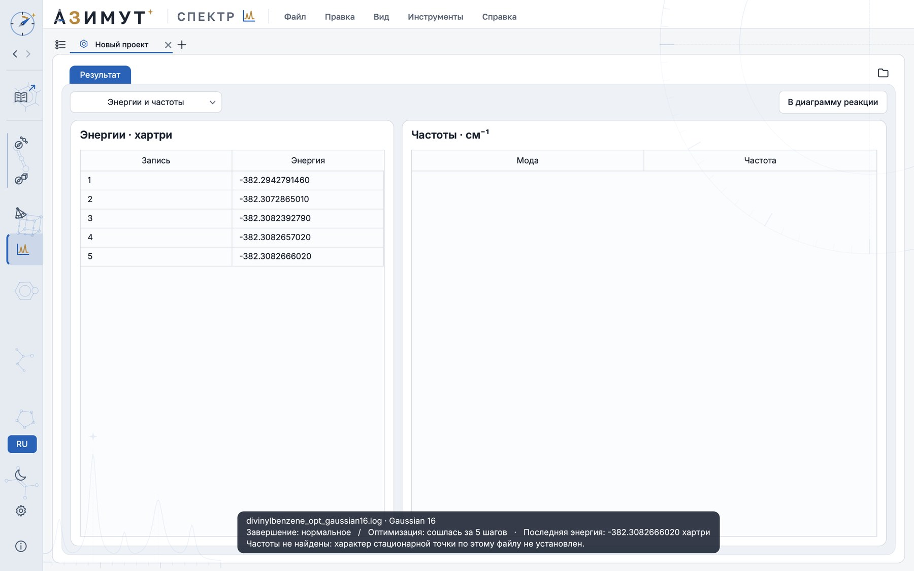

### Энергии, сходимость и термохимия

- **Энергии и частоты** – программа и её версия, итоговая энергия и метод, нормальное ли завершение, сошлась ли оптимизация, предупреждения.
- **Сходимость** (для оптимизации) – энергия каждого шага и критерии сходимости с порогами на логарифмической шкале: видно, какой критерий держит оптимизацию.
- **Термохимия** (для расчёта частот) – нулевые колебания, поправки к E, H и G и полные H и G при выбранных температуре и давлении; энтропия по вкладам; число симметрии σ по точечной группе. «Квази-RRHO» по Гримме смягчает вклад мод ниже 100 см⁻¹. Мнимые частоты не учитываются, и об этом сказано. Для MOPAC вместо полной энергии – ΔHf(T) = ΔHf(298 К) + H(T) − H(298 К), как считает сам MOPAC.

Теория – в Атласе: [«Термохимия из частот»](https://ru.azimuth-chem.com/atlas/?lang=ru#thermo).

### Колебания, ИК и Раман

Вкладка «Колебания и ИК» – таблица частот и интенсивностей, мнимые частоты, ИК-спектр и анимация выбранного колебания.

- Стрелки смещений – по желанию в обе стороны; «GIF…» сохраняет один период колебания, «Кадры XYZ…» – тот же период кадрами.
- «Сместить +» и «Сместить −» переносят в Компас геометрию, смещённую вдоль моды (раздел «Как уйти с седловой точки»).
- **Множитель** умножает частоты спектра на масштабирующий множитель метода и базиса из NIST CCCBDB (для B3LYP/6-31G* – 0,960): гармонические частоты выше наблюдаемых, и с множителем спектр ближе к эксперименту. Множитель подставляется сам по методу и базису результата; таблица мод остаётся как в выводе.
- **Раман.** Если у результата есть активности Рамана (ORCA с галочкой «Раман» в Секстанте), над графиком появляется выбор «ИК / Раман: активность / Раман: интенсивность (532 нм)», а в таблице – активность (Å⁴/а.е.м.) и степень деполяризации ρ: ρ = 0,75 – колебание неполносимметричное, ρ < 0,75 – полносимметричное. У молекулы с центром симметрии колебание видно либо в ИК, либо в Рамане – правило альтернативного запрета.
- **ВКД.** Если в выводе есть вращательные силы колебаний (ORCA `%freq DoVCD true end`, Gaussian `Freq=VCD`), вид спектра «ВКД» показывает полосы вверх и вниз от нуля, а в таблице мод появляется столбец «R ВКД».

Экспорт – PNG, SVG и CSV.

Теория – в Атласе: [«Нормальные колебания»](https://ru.azimuth-chem.com/atlas/?lang=ru#nm).

### UV-Vis, ЭКД и излучение

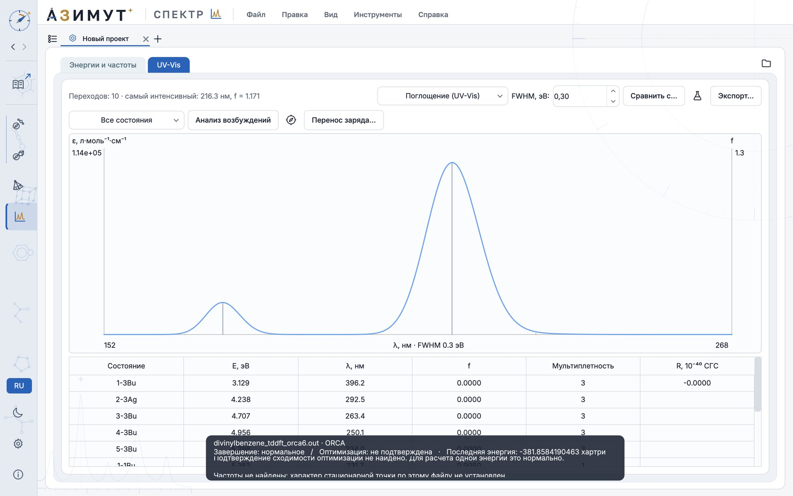

Вкладка «UV-Vis» – переходы TD-DFT или CIS и спектр в эВ, нм или см⁻¹; ширина полос.

- **Круговой дихроизм (ЭКД).** Если в выводе есть вращательные силы (ORCA печатает их у TD-DFT сама, Gaussian – у `TD`), над графиком появляется «Вид»: «Круговой дихроизм (ЭКД)» показывает спектр Δε со знаком, а в таблице – столбец R. У зеркального изомера спектр зеркальный, у ахиральной молекулы его нет. ЭКД сравнивают с экспериментом, чтобы узнать абсолютную конфигурацию (R или S).
- **Излучение** – после оптимизации возбуждённого состояния: энергия света из релаксированной геометрии (флуоресценция синглета или фосфоресценция триплета), поглощение того же состояния в начальной геометрии, стоксов сдвиг, сила осциллятора и излучательное время жизни.
- **Натуральные переходные орбитали (NTO)** – под таблицей состояний пары «откуда → куда» выбранного состояния с весами; значок компаса кладёт орбиталь-дырку или орбиталь-частицу на модель.

**Анализ возбуждений** (нужны файл орбиталей и Multiwfn) считает для каждого состояния распределения «дырки» (откуда ушёл электрон) и «электрона» (куда пришёл) и их индексы: D – расстояние между центрами, Sr – перекрывание, H – размер, t (t > 0 – дырка и электрон разделены), Δr – длина переноса заряда, HDI и EDI – делокализация. Столбец «Характер» говорит, локальное это возбуждение или перенос заряда. «Дырка и электрон на модели» показывает обе поверхности в Компасе.

**Перенос заряда…** – задайте фрагменты номерами атомов или возьмите атомы, выделенные в Компасе, и нажмите «Посчитать». Окно покажет, какая доля возбуждения – перенос заряда между фрагментами, а какая – локальное возбуждение, сколько электронов ушло между каждой парой фрагментов и тепловую карту матрицы перехода.

Теория – в Атласе: [«Возбуждённые состояния и спектры»](https://ru.azimuth-chem.com/atlas/?lang=ru#exc).

### ЯМР

Вкладка «ЯМР» – экранирования и химические сдвиги относительно выбранной опоры (например, TMS тем же методом); эквивалентные атомы объединяются.

- Опора хранится для каждого уровня расчёта (метод, базис, растворитель). «Рассчитать TMS этим уровнем» отправляет в Секстант входной файл TMS с настройками результата; когда результат TMS откроется в Спектре, опора запомнится сама, и сдвиги появятся у всех результатов этого уровня.
- **Мультиплеты (КССВ)** – если считались константы спин-спинового взаимодействия: частота прибора (¹H, МГц), «Развязка от ¹H» для ¹³C, столбец «Мультиплет» в таблице («кд, J = 7,2, 1,2 Гц») и выбранный сигнал в масштабе герц. Расщепление – в первом порядке; когда Δν/J меньше 5, программа предупреждает о сильной связи. J эквивалентных атомов усредняются.

Теория – в Атласе: [«ЯМР: от экранирования к химическому сдвигу»](https://ru.azimuth-chem.com/atlas/?lang=ru#nmr).

### Сравнение спектров и эксперимент

- **«Сравнить с…»** на вкладке ИК или UV-Vis – спектр другого файла ложится пунктиром поверх первого (например, тот же расчёт другим методом или в другой программе).
- **«Эксперимент и конформеры»** (кнопка с колбой на вкладках ИК и UV-Vis): «Экспериментальный спектр…» – измеренный спектр из JCAMP-DX, текста или CSV ложится зелёным поверх расчётного, единицы переводятся сами, в легенде – сходство формы; «Найти в NIST…» берёт измеренный ИК или UV-Vis из NIST Chemistry WebBook. Расчёт сразу подгоняется к эксперименту (множитель частот у ИК, сдвиг у UV-Vis и ЭКД); «Подогнать к эксперименту» повторяет подгонку.
- **«Среднее по конформерам…»** складывает спектры конформеров с долями Больцмана (по G, если у всех есть частоты, иначе по E).

### Как уйти с седловой точки

1. Откройте результат расчёта частот с мнимой частотой.
2. Во вкладке «Колебания и ИК» выберите мнимую моду и нажмите «Сместить +» (или «Сместить −»).
3. Смещённая геометрия откроется в Компасе – отправьте её в Секстант на новую оптимизацию.

Доктор расчёта делает это сам: если оптимизация с частотами кончилась мнимой частотой, в окне расчёта есть кнопка «Сдвинуть по мнимой моде и оптимизировать заново».

Теория – в Атласе: [«Оптимизация геометрии»](https://ru.azimuth-chem.com/atlas/?lang=ru#opt).

### Орбитали

1. Кнопка «Орбитали…» или «Файл → Открыть орбитали…».
2. Таблица и диаграмма уровней, ВЗМО и НСМО. Изоповерхность выбранной орбитали, электронной или спиновой плотности считается прямо из файла – CUBE-файл не нужен.
3. «Показать: на модели Компаса» переносит орбиталь, плотность или ESP на модель. «ESP на поверхности» раскрашивает поверхность ρ = 0,001 электростатическим потенциалом и отмечает его минимумы и максимумы.

Кнопка «Анализ ЭП…» в окне орбиталей открывает подробную таблицу QTAIM и разность плотностей Δρ. Орбитали ORCA берутся из файла `.gbw` рядом с выводом (программой `orca_2mkl` из ORCA). Орбитали открываются и прямо из выводов GAMESS (US) и Firefly, NWChem и Q-Chem, если они напечатаны в выводе.

Теория – в Атласе: [«МО двухатомных молекул»](https://ru.azimuth-chem.com/atlas/?lang=ru#mo).

### Анализ электронной плотности

Объёмные поля (поверхности, критические точки) показываются на модели Компаса (раздел «Свойства и электронная плотность на модели»), а таблицы, карты и графики – во вкладках группы «Волновая функция». Для большинства анализов нужны файл орбиталей результата и программа Multiwfn.

- **Карты и профили** – функция (ρ, ∇²ρ, |∇ρ|, ELF, LOL, ESP, ALIE, RDG, sign(λ₂)ρ и другие) в плоскости трёх атомов – цветная карта с изолиниями – или вдоль линии через два атома (профиль; минимум ρ между атомами – критическая точка связи). Найденные критические точки и пути связей вблизи плоскости видны на карте. «Сохранить картинку…» – PNG.
- **Топология ЭП** – подробная таблица критических точек: координаты, ρ, ∇²ρ, эллиптичность ε, плотности энергии G, V, H, |V|/G и собственные значения гессиана λ1–λ3. Точки пронумерованы внутри своего вида (n1… ядра, b1… связи, r1… циклы, c1… клетки); номер подписан и на модели. Двойной щелчок по строке открывает Компас с этой точкой. Точки записываются в «Анализ» таблицами по типам: `<имя>_qtaim_nuclei.csv`, `…_bonds.csv`, `…_rings.csv`, `…_cages.csv`.
- **Плотность состояний** – DOS (уровни орбиталей, уширенные линией Гаусса или Лоренца), PDOS – вклад фрагментов по Малликену (по элементам или выделенные атомы и остальные), OPDOS двух фрагментов (выше нуля – связывающие орбитали, ниже – разрыхляющие); щель ВЗМО–НСМО под графиком.
- **Делокализация** – циклы из 5–7 атомов с HOMA (1 у бензола, 0 у структуры Кекуле) и, по кнопке, FLU, PDI и MCI; индексы делокализации – сколько электронных пар делят два атома (около 1 – одинарная связь, 1,4–1,5 – ароматическая, около 2 – двойная).
- **NCI** – после расчёта NCI или IRI в Компасе: график RDG – sign(λ₂)ρ (слева, синее – водородные связи; у нуля, зелёное – ван-дер-ваальсовы; справа, красное – отталкивание) и таблица доменов слабых взаимодействий – каждая область поверхности строкой: тип (водородная, галогенная, халькогенная связь, C–H···π, π-стэкинг, ван-дер-ваальсов контакт, отталкивание), атомы, sign(λ₂)ρ, объём, расстояние и угол; для водородной связи – оценка энергии по ρ. Номер строки стоит над провалом на графике и у центра области на модели.
- **IGMH между молекулами** – δg_inter: градиент плотности, который появляется только там, где встречаются плотности разных молекул. Во вкладке «NCI» – график, таблица доменов и таблица пар атомов с их вкладом во взаимодействие.

Теория – в Атласе: [«Электронная плотность»](https://ru.azimuth-chem.com/atlas/?lang=ru#dens), [«Атомы в молекулах (Бейдер)»](https://ru.azimuth-chem.com/atlas/?lang=ru#aim).

### Файлы анализов

Каждый анализ записывает таблицы в подпапку «Анализ» папки расчёта (рядом с файлом орбиталей), чтобы их можно было открыть в электронной таблице или вставить в статью.

Таблица: Таблицы анализов

| Файл | Что в нём |
|---|---|
| `<имя>_<функция>_extrema.csv` | Экстремумы поверхности: значение, координаты, ближайший атом |
| `<имя>_esp_summary.csv` | Сводка молекулярной поверхности: площадь, объём, средние, σ²tot, ν, Π, MPI |
| `<имя>_qtaim_nuclei.csv`, `…_bonds.csv`, `…_rings.csv`, `…_cages.csv` | Критические точки плотности по типам |
| `<имя>_excitations.csv` | Индексы возбуждений (D, Sr, H, t, Δr, HDI, EDI) |
| `<имя>_charge_transfer_S<k>.csv` | Перенос заряда состояния k между фрагментами |
| `<имя>_nci_domains.csv` | Домены слабых взаимодействий NCI |
| `<имя>_resp.chg` | Координаты и заряды RESP для молекулярной динамики |
| `fukui_<поле>_extrema.csv` | Экстремумы поверхностей функций Фукуи |
| `batch_energies.csv` | Энергии и доли по Больцману очереди расчётов |
| `<имя>_multiwfn_<анализ>.txt` | Вывод программы Multiwfn |

### Энергетическая диаграмма реакции

1. «Файл → Диаграмма реакции…» или кнопка «В диаграмму реакции» над открытым результатом (он станет стадией).
2. «Стадии из файлов…» – выберите результаты реагентов, переходного состояния и продуктов: каждый файл станет своей стадией (по порядку имён; «Выше» и «Ниже» переставляют). Если в стадии два вещества (A + B), выберите стадию и нажмите «Добавить в стадию…». Числа из статьи или с доски – «Ввести вручную…». Двойной щелчок по стадии переименовывает её.
3. Вверху выберите величину (ΔE, ΔE₀ с нулевыми колебаниями, ΔH, ΔG), единицы, T и P и стадию, от которой считать. Для ΔH и ΔG нужен расчёт частот. Для реакций в растворе, где меняется число молекул (A + B → C), отметьте «Стандартное состояние 1 моль/л».
4. Под диаграммой – барьеры (‡ – переходное состояние, у него ровно одна мнимая частота) и энергия реакции. Значки ⚠ – проверки: атомы или заряд не сходятся, разный уровень теории, лишние мнимые частоты, не подтверждено нормальное завершение.
5. «Картинка или таблица…» – PNG, SVG или CSV; «Сохранить диаграмму…» – чтобы открыть её потом вместе с результатами.
6. Константа скорости (0.224.0). Для ΔG под каждым барьером стоит k по Эйрингу, k = (k_B T/h)·(c°)^(1−n)·exp(−ΔG‡/RT), прямой и обратной реакции. Для мономолекулярной стадии показан ещё период полупревращения t½. Порядок n – это число веществ в начальной стадии; единицы k: с⁻¹, л·моль⁻¹·с⁻¹… Для бимолекулярной стадии k одна и та же при любом стандартном состоянии: программа берёт c° = 1 моль/л или P/RT, смотря что отмечено. Это теория переходного состояния с κ = 1, без туннелирования. «Копировать k(T)» кладёт в буфер таблицу k от 200 до 600 К через 50 К и при выбранной T; её можно вставить в отчёт или в таблицу.

Теория – в Атласе: [«Скорость реакции: переходное состояние»](https://ru.azimuth-chem.com/atlas/?lang=ru#kin), [«Равновесие: от энергии к константе»](https://ru.azimuth-chem.com/atlas/?lang=ru#eqm).

### Инструменты Спектра

Меню «Инструменты» Спектра:

- **«Изотопный пик молекулярного иона…»** – M, M+1, M+2… с точными массами и картинкой (формула результата или своя, например C6H5Cl; моноизотопная и средняя масса).
- **«Энергии из нескольких файлов…»** – выводы расчётов рядом: E, G (если есть частоты), ΔE, ΔG и доли по Больцману. Предупреждения – если различаются состав, уровень теории, заряд или мультиплетность, есть мнимые частоты или не подтверждено нормальное завершение.
- **«Доли по Больцману…»** – то же для вставленного столбца энергий (хартри, ккал/моль, кДж/моль, эВ).
- **«Равновесие двух форм…»** (0.226.0) – для двух результатов «Оптимизация + частоты» одной молекулы (конформеры, таутомеры, изомеры): константа равновесия K = [B]/[A], ΔG° и доли форм от 200 до 600 К и при выбранной температуре. Нижняя таблица показывает, из чего состоит K: множитель exp(−ΔE₀/RT) и отношения поступательных, вращательных, колебательных и электронных сумм по состояниям. Число симметрии σ и число зеркальных форм (2 для хиральной формы, если в образце оба энантиомера) предложены по точечной группе; их можно исправить. Для мягких торсионных колебаний включите «Квази-RRHO». «Копировать таблицу» – для отчёта.
- **«Множители частот…»** и **«Опытные данные для молекулы…»** – таблицы «Справочника» (глава 4).

Таблицы сохраняются в CSV в виде, выбранном в «Настройках → Таблицы анализа».

## Управление из языковой модели

«Азимутом» можно управлять из языковой модели – Claude или локальной – через любой клиент с поддержкой протокола MCP (Model Context Protocol). Программа `tools/azimuth_mcp.py` из папки «Азимута» даёт модели инструменты программы.

Таблица: Инструменты MCP-сервера «Азимута»

| Инструмент | Что делает |
|---|---|
| Программы | Какие расчётные программы установлены на этом компьютере |
| Варианты | Задачи, методы и базисы программы |
| Входной файл | Входной файл для молекулы (SMILES, XYZ или файл) и настроек – без запуска |
| Расчёт | Запуск расчёта на этом компьютере |
| Состояние и результат | Ход расчёта и результат: энергия, сходимость, частоты, термохимия, возбуждения, ошибки и совет доктора |
| Сервер | Расчёт ORCA или MOPAC на сервере SLURM профиля Секстанта – с ограничениями ниже |
| Проверки | Запуск тестов программы |

**Подключение.** В настройках клиента укажите команду `.venv/bin/python` (на Windows – `.venv\Scripts\python.exe`) из папки программы и аргумент `tools/azimuth_mcp.py`. Подробно – `docs/features/HEADLESS.md`.

**Ограничения расчётов на сервере.** Модель может отправить расчёт ORCA или MOPAC на сервер SLURM из профиля Секстанта, но только:

- со входом по ключу SSH (никогда не по паролю);
- на свободные ядра и память, так чтобы вместе с новым расчётом было занято не больше 80 % ядер сервера;
- с пределом времени у каждой задачи и не больше трёх задач одновременно;
- останавливать можно только свои задачи; на сервере ничего не удаляется, и никакая команда модели там не выполняется.

Все действия записываются в журнал.

## Если что-то не так

Таблица: Частые проблемы и решения

| Проблема | Что сделать |
|---|---|
| Программа не открывается | Причина записана в журнале запуска: `~/Library/Logs/Azimuth/startup.log` (macOS) или `%LOCALAPPDATA%\Azimuth\Logs\startup.log` (Windows). Проверьте установку: `verify_install.py` (раздел «Проверка установки») |
| macOS: «заблокирован для защиты Вашего Mac» | Разрешите запуск (раздел «Установка на macOS») |
| Windows: окно SmartScreen | «Подробнее» → «Выполнить в любом случае» |
| Секстант не нашёл ORCA | «Указать…» в карточке запуска, «Расчёт → Указать программу…» или «Файл → Настройки… → Программы» – выберите файл `orca` (`orca.exe`) |
| ORCA на нескольких ядрах останавливается | Поставьте Open MPI кнопкой в Секстанте (на Windows – MS-MPI) или считайте на одном процессе. На macOS ошибка «Library not loaded: libmpi.40.dylib» означает, что ORCA не нашла библиотеки Open MPI; Секстант кладёт в папку расчёта маленький mpirun, который это исправляет, – поставьте Open MPI из Секстанта |
| Расчёт на Windows не открывает файлы | Путь к папке расчётов или к программе содержит кириллицу или пробелы – выберите латинский путь в «Настройках → Расчёты» |
| SCF не сходится, не хватает памяти, нет базиса | Следуйте совету доктора расчёта (раздел «Доктор расчёта») |
| Мнимая частота после оптимизации | «Сдвинуть по мнимой моде и оптимизировать заново» или раздел «Как уйти с седловой точки» |
| Сервер не отвечает | «Проверить подключение» в окне сервера; если сервер за VPN – профиль OpenVPN Connect в том же окне |
| Пункты анализа волновой функции серые | Не найден Multiwfn или у результата нет файла орбиталей – подсказка пункта говорит, чего не хватает |
| PubChem или COD не отвечает | Проверьте интернет; если сказано про сертификат (macOS), запустите «Install Certificates.command» из папки Python в «Программах» |
| Модель не рисуется или рисуется неправильно | Выключите «Вид → Трёхмерная графика VTK (проба)» и перезапустите программу; на Linux под Wayland запустите под X11 |
| Программа сломалась или закрылась | Сохраните отчёт и отправьте автору (раздел «Ошибки и отчёт для автора») |

**Сообщить об ошибке.** Кнопка «Сообщить об ошибке» в окне «О программе» и «Файл → Отчёт об ошибке…» открывают письмо автору с версией программы. Опишите, что делали и что ожидали увидеть; приложите отчёт, а если ошибка связана с файлом – и сам файл. Адрес: contact@azimuth-chem.com.

## Приложение А. Форматы файлов

Таблица: Что «Азимут» открывает

| Формат | Расширения | Где открывается |
|---|---|---|
| XYZ (один или много кадров) | `.xyz` | Компас; кадры одной молекулы – шагами, разных молекул – проектом |
| Проект «Азимута» | `.qcc` | Компас |
| Molfile, SDF | `.mol`, `.sdf`, `.sd` | Компас; SDF с несколькими молекулами – набором структур |
| MOL2 | `.mol2` | Компас |
| PDB | `.pdb`, `.ent` | Компас; несколько моделей – шагами; белки – с лентами |
| ChemDraw XML | `.cdxml` | Компас |
| Входной файл ORCA | `.inp` | Компас, Секстант |
| Входной файл Gaussian | `.gjf`, `.com`, `.gjc` | Компас, Секстант |
| Вывод расчёта | `.out`, `.log`, `.nwout`, `.qcout`, `.gamout` | Спектр и Компас (ORCA, Gaussian, Psi4, xtb, MOPAC, NWChem, Q-Chem, GAMESS, Firefly) |
| Вспомогательный файл MOPAC | `.aux` | Читается вместе с выводом MOPAC |
| Орбитали | `.molden`, `.molf`, `.fchk`, `.fch`; у ORCA – `.gbw` рядом с выводом | Спектр, Компас |
| Объёмные данные | `.cube` | Спектр |
| Кристалл | `.cif` | «Компас · Кристалл» |
| Вывод CRYSTAL и TOPOND | `.out`, `.outp` | «Компас · Кристалл» |
| Экспериментальный спектр | JCAMP-DX, текст, CSV | Спектр (сравнение с экспериментом) |

Таблица: Что «Азимут» сохраняет

| Что | Форматы |
|---|---|
| Координаты молекулы | XYZ, MOL, SDF, MOL2, PDB; входные блоки ORCA, Gaussian, NWChem, Z-матрица; SMILES и InChI |
| Кристалл | CIF (с симметрией или блок в P 1), POSCAR (VASP), расширенный XYZ |
| Рисунок модели | PNG, SVG, PDF; GIF вращения, шагов и колебаний |
| Модель для 3D-печати | STL, VRML |
| Спектры, диаграммы, карты | PNG, SVG, CSV |
| Таблицы анализов | CSV (разделитель и десятичный знак – в настройках) |
| Входные файлы | Форматы расчётных программ |
| Настройки программы | JSON (без паролей и ключей) |
| Свои фрагменты и схемы отображения | JSON |

## Приложение Б. Сочетания клавиш

На macOS вместо `Ctrl` нажимайте `⌘`, вместо `Alt` – `⌥`.

Таблица: Общие клавиши

| Клавиши | Действие |
|---|---|
| `Ctrl+1` … `Ctrl+5` | Атлас, «Компас · Молекула», «Компас · Кристалл», Секстант, Спектр |
| `Ctrl+?` | «Справка» с полем поиска по меню |
| `Ctrl+N` | Новая молекула |
| `Ctrl+O` | Открыть файл |
| `Ctrl+S` / `Ctrl+Shift+S` | Сохранить / сохранить как |
| `Ctrl+W` | Закрыть вкладку |
| `Ctrl+Shift+V` | Вставить структуру из буфера |
| `Ctrl+Z` / `Ctrl+Shift+Z` | Отменить / повторить |

Таблица: Компас

| Клавиши | Действие |
|---|---|
| `Ctrl+A` | Выделить всё |
| `Ctrl+]` | Расширить выделение на шаг |
| `Ctrl+Shift+]` | Выделить молекулу целиком |
| `Ctrl+C` / `Ctrl+V` | Копировать / вставить атомы |
| `Ctrl+B` | Связать или разорвать выделенные атомы |
| `Delete` | Удалить выделенные атомы (в таблице координат – атомы выделенных строк) |
| Пробел, `←` `→` | Пауза и выбор колебания на модели |

Таблица: Секстант и редактор входного файла

| Клавиши | Действие |
|---|---|
| `Ctrl+Enter` | Запустить расчёт или очередь |
| `Ctrl+.` | Остановить расчёт или очередь |
| `Ctrl+F` / `F3` / `Shift+F3` | Найти / найти далее / найти назад |
| `Ctrl+R` | Заменить |
| `Ctrl+G` | Перейти к строке |
| `Ctrl+D` | Дублировать строку |
| `Ctrl+Shift+K` | Удалить строку |
| `Alt+↑` / `Alt+↓` | Переместить строку |
| `Ctrl+/` | Закомментировать или раскомментировать знаком программы |
| `Ctrl+Shift+U` / `Ctrl+Shift+L` | Верхний / нижний регистр |
| `F5` | Вставить дату и время |
| `Ctrl+U` | Перенос по словам |
| `Ctrl+=` / `Ctrl+-` / `Ctrl+0` | Крупнее / мельче / обычный размер |
| `F1` | Все клавиши редактора |

Таблица: Окно «Файлы на сервере»

| Клавиши | Действие |
|---|---|
| `Enter` | Войти в папку или открыть файл в «Азимуте» |
| `F3` / `F4` | Просмотр / правка текстового файла |
| `Shift+F4` | Новый файл |
| `F5` / `F6` | Копировать / переместить в другую панель |
| `Shift+F6` | Переименовать |
| `F7` | Новая папка |
| `F8` или `Delete` | Удалить (с вопросом) |
| `Alt+F7` | Поиск файлов по маске |
| `Ctrl+D` | Избранные папки |
| `Insert` или пробел | Отметить файл |
| `+` / `−` / `*` | Отметить по маске / снять по маске / обратить отметку |
| `Ctrl+F3` … `Ctrl+F6` | Сортировка по имени, типу, дате, размеру |
| `F2` или `Ctrl+R` | Перечитать панели |
| `Backspace` | На уровень выше |
| `Tab` | Другая панель |
| `F1` | Все клавиши окна |

## Приложение В. Задачи по расчётным программам

Таблица: Задачи Секстанта для молекул

| Задача | ORCA | Gaussian | Psi4 | xtb | MOPAC | NWChem | GAMESS |
|---|:-:|:-:|:-:|:-:|:-:|:-:|:-:|
| Энергия | ✓ | ✓ | ✓ | ✓ | ✓ | ✓ | ✓ |
| Оптимизация | ✓ | ✓ | ✓ | ✓ | ✓ | ✓ | ✓ |
| Оптимизация + частоты | ✓ | ✓ | ✓ | ✓ | ✓ | ✓ | ✓ |
| Частоты и термохимия | ✓ | ✓ | ✓ | ✓ | ✓ | ✓ | ✓ |
| Переходное состояние + частоты | ✓ | ✓ | ✓ | | ✓ | ✓ | ✓ |
| Спектр UV-Vis (TD-DFT) | ✓ | ✓ | ✓ | | | ✓ | ✓ |
| ЯМР (экранирование) | ✓ | ✓ | | | | ✓ | |
| Оптимизация возбуждённого состояния | ✓ | ✓ | | | | | |
| Скан ППЭ с релаксацией | ✓ | ✓ | | ✓ | | | |
| Путь реакции (NEB-CI) | ✓ | | | | | | |
| Путь от переходного состояния (IRC) | ✓ | | | | | | |
| Функции Фукуи | ✓ | | | | | | |
| Донорно-акцепторная связь CDA | ✓ | | | | | | |
| Энергия взаимодействия с BSSE | ✓ | | | | | | |

CREST делает одну задачу – поиск конформеров (iMTD-GC, GFN2-xTB). Для xtb метод, базис и память не нужны (GFN2-xTB – свой метод). MOPAC считает полуэмпирическими методами PM7 (по умолчанию), PM6, PM6-D3H4, AM1, RM1, MNDO без базиса, растворитель – COSMO. У GAMESS нет базисов def2 – берите cc-pVDZ, pcseg-1 или базисы Попла. GAMESS запускается своим скриптом `rungms`, NWChem – программой `nwchem` (несколько процессов – через mpirun).

Таблица: Настройки задач по программам

| Настройка | Программы |
|---|---|
| Поиск переходного состояния | ORCA, Gaussian, Psi4, MOPAC |
| Сходимость оптимизации | ORCA, Gaussian, Psi4, xtb, GAMESS |
| Предел циклов оптимизации | ORCA, Gaussian, Psi4, xtb, GAMESS, NWChem |
| Точный гессиан | ORCA, Gaussian, Psi4, GAMESS |
| Температура термохимии | ORCA, Gaussian, Psi4, MOPAC, GAMESS, NWChem |
| Давление, численные частоты | ORCA, Gaussian, Psi4 |
| Раман | ORCA |
| КССВ (ЯМР) | ORCA |
| Число возбуждённых состояний | ORCA, Gaussian, Psi4, GAMESS, NWChem |
| TDA или полное TD-DFT | ORCA, Gaussian, Psi4 |
| Триплеты | ORCA, Gaussian, Psi4, NWChem |
| Натуральные переходные орбитали | ORCA |
| Проверка устойчивости волновой функции | ORCA, Gaussian |
| Вторая координата скана | ORCA |
| Старт с орбиталей прошлого расчёта | ORCA |

## Приложение Г. Внешние программы и литература

Часть анализов «Азимут» поручает другим программам. В интерфейсе их имена не всегда видны, а здесь сказано, что это за программы и на что ссылаться в работе.

**Multiwfn** (Tian Lu, sobereva.com/multiwfn) – анализ волновой функции: заряды ADCH, CM5, Хиршфельда, AIM и RESP, порядки связей, состав и сетки орбиталей, NCI, IRI и IGMH, ESP на молекулярной поверхности, критические точки плотности (QTAIM), ELF и LOL, анализ возбуждений, CDA. Читает файлы орбиталей Molden, fchk, wfn, wfx и mwfn (`.gbw` ORCA «Азимут» сначала переводит в Molden). Проверено на версии 2026.7.15. Ссылаться – на обе статьи:

- T. Lu, F. Chen, *J. Comput. Chem.* **33**, 580 (2012);
- T. Lu, *J. Chem. Phys.* **161**, 082503 (2024).

**Методы анализа:**

- ADCH – T. Lu, F. Chen, *J. Theor. Comput. Chem.* **11**, 163 (2012);
- CM5 – A. V. Marenich, S. V. Jerome, C. J. Cramer, D. G. Truhlar, *J. Chem. Theory Comput.* **8**, 527 (2012);
- заряды Хиршфельда – F. L. Hirshfeld, *Theor. Chim. Acta* **44**, 129 (1977);
- QTAIM – R. F. W. Bader, *Atoms in Molecules: A Quantum Theory* (Oxford, 1990);
- NCI – E. R. Johnson и др., *J. Am. Chem. Soc.* **132**, 6498 (2010);
- IRI – T. Lu, Q. Chen, *Chemistry–Methods* **1**, 231 (2021);
- анализ молекулярной поверхности – T. Lu, F. Chen, *J. Mol. Graph. Model.* **38**, 314 (2012);
- ELF – A. D. Becke, K. E. Edgecombe, *J. Chem. Phys.* **92**, 5397 (1990);
- LOL – H. L. Schmider, A. D. Becke, *J. Mol. Struct. THEOCHEM* **527**, 51 (2000);
- порядки связей Майера – I. Mayer, *Chem. Phys. Lett.* **97**, 270 (1983); Виберга – K. B. Wiberg, *Tetrahedron* **24**, 1083 (1968); нечёткие (FBO) – I. Mayer, P. Salvador, *Chem. Phys. Lett.* **383**, 368 (2004); лапласиановы (LBO) – T. Lu, F. Chen, *J. Phys. Chem. A* **117**, 3100 (2013);
- состав орбиталей – T. Lu, F. Chen, *Acta Chim. Sinica* **69**, 2393 (2011);
- анализ «дырка – электрон» – Z. Liu, T. Lu, Q. Chen, *Carbon* **165**, 461 (2020); индекс Δr – C. A. Guido и др., *J. Chem. Theory Comput.* **9**, 3118 (2013);
- поправка на BSSE – S. F. Boys, F. Bernardi, *Mol. Phys.* **19**, 553 (1970).

**Пчелиный поиск конформеров (ABC)** – метод SmartChemDesign/abc (github.com/SmartChemDesign/abc, лицензия MIT), в «Азимуте» написан заново; искусственная пчелиная колония – D. Karaboga, B. Basturk, *J. Glob. Optim.* **39**, 459 (2007).

**xtb и GFN2-xTB** – C. Bannwarth, S. Ehlert, S. Grimme, *J. Chem. Theory Comput.* **15**, 1652 (2019).

**Силовое поле UFF** – A. K. Rappé, C. J. Casewit, K. S. Colwell, W. A. Goddard III, W. M. Skiff, *J. Am. Chem. Soc.* **114**, 10024 (1992).

**Ковалентные радиусы** – B. Cordero и др., *Dalton Trans.* 2832 (2008).

Ссылаясь на расчёт, сделанный в «Азимуте», называйте и саму расчётную программу (ORCA, xtb, MOPAC…) по правилам её авторов, и «Азимут» (форма ссылки – на второй странице руководства и в файле `CITATION.cff`).
