# “方位”用户手册

## 简介

### 什么是“方位”

“方位”（Azimuth）是一个量子化学教学程序。它引导你走完量子化学工作的全过程：**理解理论 → 构建分子 → 准备并运行计算 → 解读结果**。每一步都有对应的程序板块，数据在板块之间直接传递，无需中间文件：在罗盘中构建的分子进入六分仪，计算结果再回到罗盘的模型上和光谱的图表中。

计算本身由外部程序完成——ORCA、xtb、MOPAC、Psi4、NWChem 等。“方位”为它们准备输入文件，在本机或计算服务器上运行，跟踪计算进程并读取结果。其中一部分程序可由六分仪自动安装，ORCA 则需从其开发者网站下载（见“安装计算程序”一节）。

本程序面向刚开始接触量子化学计算的学生，以及开设实验课的教师。对有经验的用户，它是一个方便的操作界面：集成了结构构建、包含多个分子的项目、计算队列、SLURM 集群上的计算以及波函数分析。

### 程序的板块

表：“方位”的板块

| 板块 | 用途 | 章 |
|---|---|---|
| **图谱** | 56 个交互式理论主题——从量子力学基本假设到 DFT、热化学和光谱；自测练习 | 5 |
| **罗盘 · 分子** | 构建和编辑分子，对称性与命名，构象，反应路径，项目；在三维模型上显示计算结果 | 6 |
| **罗盘 · 晶体** | 来自 CIF 文件的晶体：晶胞、对称性、接触、Hirshfeld 表面、粉末衍射图、(hkl) 表面 | 7 |
| **六分仪** | 准备输入文件，在本机或服务器上运行计算，计算队列与计算链 | 8 |
| **光谱** | 解读结果：能量、收敛、振动与红外、UV-Vis、NMR、热化学、轨道、电子密度分析 | 9 |

图谱是网站 [azimuth-chem.com](https://www.azimuth-chem.com/?lang=zh)；程序在浏览器中打开它，图谱页面上的分子可一键在罗盘中打开。

### 本手册的结构

第 1–4 章适用于所有人：程序是什么、如何安装、如何用一个例子走完全过程、界面如何组织。第 5–9 章按工作顺序介绍程序的各个板块。每章先是概述，然后是操作步骤（编号的“如何做”）和参考信息。第 10 章面向通过语言模型控制程序的用户，第 11 章说明出现问题时该怎么办。附录以表格形式汇总文件格式、快捷键以及各计算程序的功能。

同一份手册也可以在程序中打开：“帮助 → 手册”。

### 约定

- **“文件 → 打开…”**——菜单项：箭头从菜单指向子菜单和菜单项。各板块的菜单位于工作区上方的窗口标题栏中。
- **“运行计算”**——程序窗口中按钮、字段或选项卡的名称。
- `Ctrl+S`——快捷键。在 macOS 上用 `⌘`（Cmd）代替 `Ctrl`，用 `⌥`（Option）代替 `Alt`；正文中给出的是 Windows 和 Linux 的写法。Mac 上的 `Delete` 键即 `⌫`。
- `C:\ORCA`、`examples/README.md`——文件、文件夹、命令的名称以及需原样输入的文本。
- **单击**——按下鼠标左键；**右键单击**打开上下文菜单（在 Mac 触控板上为双指单击）。

> **说明。** 这样标出的是解释和细节，初次阅读时可以跳过。

> **提示。** 这样标出的是能节省时间的技巧。

> **注意。** 这样标出的是警告：操作不可撤销，或可能破坏结果。

### 计算程序及其验证情况

“方位”支持多种计算程序，但它们的验证程度不同。输入文件从未被真实程序运行过的程序，在六分仪的程序列表中标有 **“未验证”**：用它们计算前，请自己检查输入文件。CP2K 晶体计算的同一标记含义不同：该程序已在本机和服务器上运行过，但其数值尚未在已知晶体上与文献对照——请自行核对结果。Quantum ESPRESSO 的计算已在六种晶体上对照，不带标记。

表：计算程序

| 程序 | “方位”的功能 | 状态 |
|---|---|---|
| ORCA | 输入文件、运行、进程、解读结果 | 已验证 |
| xtb | 运行、解读、构象搜索、从罗盘快速计算 | 已验证 |
| CREST | 构象搜索 | 已验证 |
| MOPAC | 输入文件、运行、解读 | 已验证 |
| NWChem | 输入文件、运行、解读 | 已验证 |
| Psi4 | 输入文件、运行、解读 | 已验证 |
| Gaussian | 输入文件、运行、解读 | 输入文件未经运行验证 |
| GAMESS (US) | 输入文件、运行、解读 | 输入文件未经运行验证 |
| Quantum ESPRESSO | 晶体计算 | 运行已验证（macOS、Linux、服务器）；晶格参数、带隙和磁矩已在六种晶体（Si、MgO、SrTiO₃、TiO₂、石墨烯、NiO）上与文献对照 |
| CP2K | 晶体计算 | 运行已验证（macOS、Linux、服务器）；数值尚未与文献对照——标记为“未验证” |
| CRYSTAL | 输入文件和解读结果（不运行） | 未验证 |
| Q-Chem、Firefly | 仅解读结果 | — |
| Multiwfn | 波函数分析（电荷、表面、QTAIM） | 已验证（版本 2026.7.15） |

## 安装与首次启动

### 系统要求

表：支持的系统

| 系统 | 要求 |
|---|---|
| macOS | 搭载 Apple Silicon 处理器（M1 及更新）的 Mac；Python 3.13 |
| Windows | Windows 10 或 11，64 位；Python 3.12 或 3.13（64 位） |
| Linux | x86_64，glibc 2.34 及以上（Ubuntu 22.04+、Debian 12+、Fedora 35+、Linux Mint 21+）；Python 3.12 或 3.13 |

首次启动需要联网：程序会把自己的库（Qt、VTK、NumPy）一次性安装到程序文件夹内的 `.venv` 文件夹中，系统的 Python 不会被改动。此后只有以下操作需要联网：图谱（除非已保存为离线版）、在 PubChem 中按名称查找分子、在 COD 中查找晶体以及安装计算程序。

程序文件夹请放在**不含中文等非拉丁字母、也不含空格**的路径下——例如 Mac 上的 `~/Azimuth` 或 Windows 上的 `C:\work\Azimuth`：许多计算程序无法打开此类路径中的文件。

### 在 macOS 上安装

1. 将程序压缩包解压到合适的文件夹（或用 `git clone` 获取）。
2. 双击程序文件夹中的 `Azimuth.app`。该应用必须留在此文件夹中、与其他文件放在一起；为方便起见，可在“应用程序”或程序坞中为它创建替身。
3. 首次启动会安装依赖项，需要几分钟。之后打开程序窗口。

程序没有使用付费的 Apple 证书签名，因此首次启动时 macOS 可能提示：“无法打开‘Azimuth’——Apple 无法验证……”。程序本身没有问题——只需允许它启动一次。

- **一次处理整个文件夹。** 打开“终端”（应用程序 → 实用工具），输入 `xattr -dr com.apple.quarantine `（末尾带空格），把程序文件夹拖入终端窗口并按回车。所有文件上的“从互联网下载”标记都会被清除。
- **通过系统设置。** 尝试打开 `Azimuth.app` 并关闭提示。打开“系统设置 → 隐私与安全性”，在底部“Azimuth”被阻止的那一行旁点击“仍要打开”，再输入密码确认。

> **说明。** 在 macOS 15（Sequoia）及更新版本中，右键 →“打开”已不能绕过这项检查。用 `git clone` 获取的文件夹不会带此标记，也不会出现警告。

程序文件夹中的 `Launch-macOS.command` 用于在终端中安装和诊断。首次启动 `Azimuth.app` 后，在访达中双击即可打开 `.qcc` 项目，“方位”也会出现在 CIF、XYZ、MOL、SDF、PDB、Molden、CUBE 文件和计算文件的“打开方式”中。

### 在 Windows 上安装

1. 如果压缩包是从互联网下载的，解压前先解除锁定：右键单击压缩包 →“属性”→ 勾选“解除锁定”→“确定”。
2. 将程序文件夹解压到简短的拉丁字母路径，例如 `C:\work\Azimuth`。
3. 运行 `windows_first_run.bat`。它会查找 64 位 Python 3.13 或 3.12（包括 Anaconda 中的），安装依赖并检查安装。如果没有合适的 Python，安装程序会仅为当前用户安装 Python 3.13，无需管理员权限。
4. 检查通过后，用 `Launch-Windows.bat` 启动程序。

如果出现蓝色窗口“Windows 已保护你的电脑”（SmartScreen），点击“更多信息”→“仍要运行”：程序没有使用付费的 Microsoft 证书签名。

> **说明。** 安装后首次加载 VTK 可能需要几分钟，因为杀毒软件在检查其文件。请不要中断。

### 在 Linux 上安装

1. 安装带 venv 模块的 Python 3.13（3.12 也可以）。Ubuntu 24.04：`sudo apt install python3 python3-venv`；Fedora：`sudo dnf install python3.13`。
2. 安装最小系统中缺少的 Qt 系统库。Ubuntu 和 Debian：`sudo apt install libxcb-cursor0 libegl1 libxkbcommon-x11-0`；Fedora：`sudo dnf install xcb-util-cursor`。
3. 解压程序文件夹，在终端中运行 `./Launch-Linux.sh`。首次启动会安装依赖，然后打开窗口。
4. 若要让程序出现在应用程序菜单中，并能打开图谱网站上的“在罗盘中打开”链接，运行 `./Launch-Linux.sh --install-desktop`。删除快捷方式用 `--remove-desktop`。移动程序文件夹后需重新运行此命令。

> **提示。** 如果在 Wayland 下窗口或模型显示不正常，请在 X11 下启动程序：`QT_QPA_PLATFORM=xcb ./Launch-Linux.sh`。

### 检查安装

“帮助 → 安装检查”会检查 Python 和各个库、教学文件、图谱以及 VTK 三维图形。在终端中也可以这样检查：`.venv/bin/python verify_install.py`（Windows 上为 `.venv\Scripts\python.exe verify_install.py`）。退出代码 0 表示所有检查都已通过。

### 安装计算程序

计算程序不包含在“方位”中。其中一部分由六分仪自动安装，其余需单独安装。

表：计算程序的安装方式

| 程序 | 安装方式 |
|---|---|
| xtb、CREST、MOPAC | “六分仪 → 计算 → 安装计算程序…”（CREST 不支持 Windows） |
| Open MPI | 同上，或运行卡片中的“安装 Open MPI…”按钮（macOS、Linux） |
| Psi4、NWChem | “安装计算程序…”（macOS 和 Linux） |
| Quantum ESPRESSO | “安装计算程序…”（macOS、Linux、Windows） |
| ORCA | 从开发者网站手动安装（见下文） |
| MS-MPI（Windows） | Microsoft 网站上的安装程序 `msmpisetup.exe`；“安装 MS-MPI…”按钮会打开该页面 |
| Multiwfn | macOS：`brew install multiwfn`；Windows 和 Linux——从 sobereva.com/multiwfn 下载 noGUI 版本 |
| CP2K | Linux——“安装计算程序…”；macOS——`brew install cp2k`；服务器上——cp2k 模块 |
| Gaussian、GAMESS (US) | 商业或单独分发的程序；按其作者的说明安装 |

如果找不到 xtb、CREST 或 MOPAC，六分仪运行卡片中该程序旁会有“安装到程序文件夹…”按钮。“安装计算程序…”窗口会自动勾选尚未安装的 xtb 和 MOPAC，对已找到的程序则显示“已安装”。对于大型程序（Quantum ESPRESSO、NWChem、Psi4），会标明下载大小和磁盘占用。程序从 conda-forge 安装：若计算机上已有 conda 则用它，否则用一个小型安装器 micromamba——无需管理员权限，也不修改终端设置。程序安装在程序文件夹内的隐藏文件夹 `.tools` 中（打包好的应用则安装在 Mac 的 `~/Library/Application Support/Azimuth` 和 Windows 的 `%LOCALAPPDATA%\Azimuth`）。

#### 如何安装 ORCA

ORCA 可免费用于教学和科研，但只能在注册后从其开发者网站下载。

1. 在 ORCA 论坛（orcaforum.kofo.mpg.de）注册，在 Downloads 栏目下载适合你系统的压缩包：Apple Silicon 的 Mac——“macOS arm64, Open MPI 4.1.1”，Windows——“Windows x64”。已验证的版本为 ORCA 6.0.1（macOS）和 6.1.1（Windows）。
2. 解压：Mac 上解压到“应用程序”或个人文件夹，Windows 上解压到不含空格的拉丁字母路径，例如 `C:\ORCA`。
3. 在 Mac 上，需一次性清除 ORCA 文件的“来自互联网”标记：在终端中输入 `xattr -dr com.apple.quarantine `，再把 ORCA 文件夹拖入窗口。
4. 打开六分仪。如果“运行计算”卡片中 ORCA 旁有绿色对勾，说明程序已找到；否则点击“指定…”，在其文件夹中选择 `orca` 文件（Windows 上为 `orca.exe`）。
5. 多进程运行时 ORCA 需要 MPI：Mac 和 Linux 上用 Open MPI（同一卡片中的“安装 Open MPI…”按钮），Windows 上用 Microsoft MPI。单进程运行无需 MPI。

> **说明。** 六分仪会在 PATH、常见安装文件夹（“应用程序”和个人文件夹中的 ORCA 文件夹、Homebrew、conda）以及 `.tools` 中查找程序。每个程序的位置显示在“文件 → 设置… → 程序”中；也可以在那里手动指定程序文件，例如在两个 ORCA 版本中选择一个。

### 程序文件的存放位置

表：“方位”的文件夹

| 内容 | macOS 和 Linux | Windows |
|---|---|---|
| 计算 | `~/Documents/Azimuth/Расчёты` | `Documents\Azimuth\Calculations` |
| 项目 | `~/Documents/Azimuth/Проекты` | `Documents\Azimuth\Projects` |
| 来自 COD 的晶体 | `~/Documents/Azimuth/COD` | `Documents\Azimuth\COD` |
| 日志 | `~/Library/Logs/Azimuth`（Linux——`~/.local/state/Azimuth`） | `%LOCALAPPDATA%\Azimuth\Logs` |
| 六分仪安装的程序 | 程序的 `.tools` 文件夹 | 程序的 `.tools` 文件夹 |

每个计算都有自己的文件夹，名为 `<日期>_<分子式>_<程序>`：其中包含输入文件、程序的全部输出以及存放分析表格的子文件夹“Анализ”。计算和项目文件夹可在“文件 → 设置… → 计算”中更改。

> **说明。** 如果 Windows 用户名中含有中文、西里尔字母等非拉丁字母，计算默认存放在 `C:\Users\Public\Documents\Azimuth\Calculations`：Windows 上的计算程序无法打开路径中含非拉丁字母的文件。

## 快速入门：从理论到结果

本章用一个例子——乙醇的几何优化和频率计算——走完全过程。每一步的细节见第 5–9 章。

### 第 1 步　在图谱中学习理论

1. 点击左侧面板上的“图谱”——图谱主题将在浏览器中打开。
2. 打开“几何优化”主题，观看演示（右下角的“▶ 演示”），并拖动滑块。
3. 回答页面末尾的“检验你的知识”练习。

含有分子的页面上有“在罗盘中打开”按钮：浏览器把分子传给程序，分子在罗盘中打开。

### 第 2 步　在罗盘中准备分子

1. 进入“罗盘 · 分子”（`Ctrl+2`）。
2. 从分子库打开乙醇：“文件 → 示例分子 → 醇和醚 → 乙醇 · C₂H₆O”。或由 SMILES 构建：“文件 → 由 SMILES 生成分子…”，输入 `CCO`。
3. 用鼠标旋转分子，用滚轮缩放。“浏览 → 原子标签 → 元素和编号 · C1”为原子加上标签。
4. 依次单击一个氧原子和一个氢原子——模型下方会显示 O–H 键长（约 0.96 Å）。
5. 点击模型下方的对称性按钮：锯齿构象的乙醇属于 Cs 点群。

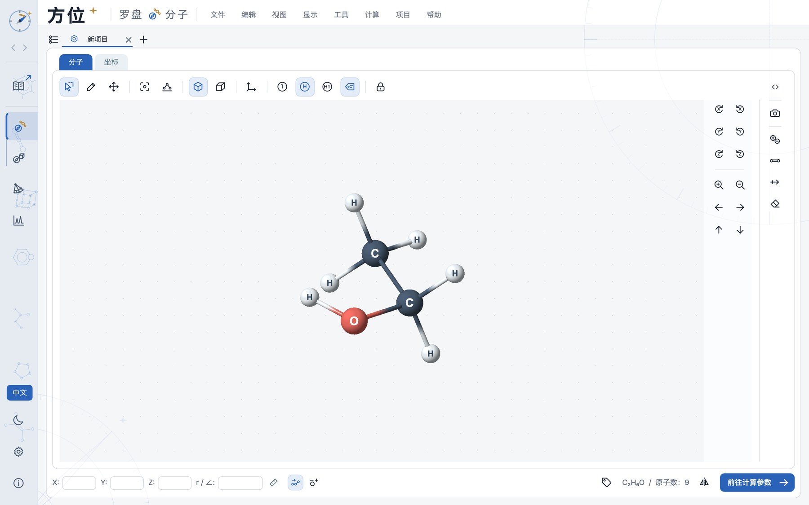

### 第 3 步　在六分仪中计算

1. 点击模型下方的“前往计算参数”——六分仪会带着这个分子打开。
2. 选择程序（例如 ORCA 或 xtb）、任务“优化 + 频率”、方法 B3LYP 和基组 def2-SVP。D3(BJ) 色散校正已默认开启。
3. 右侧显示输入文件——可以阅读，必要时也可以修改。
4. 点击“运行计算”（`Ctrl+Enter`）。输入文件的位置会显示计算进程：各个阶段、优化循环、最新能量。

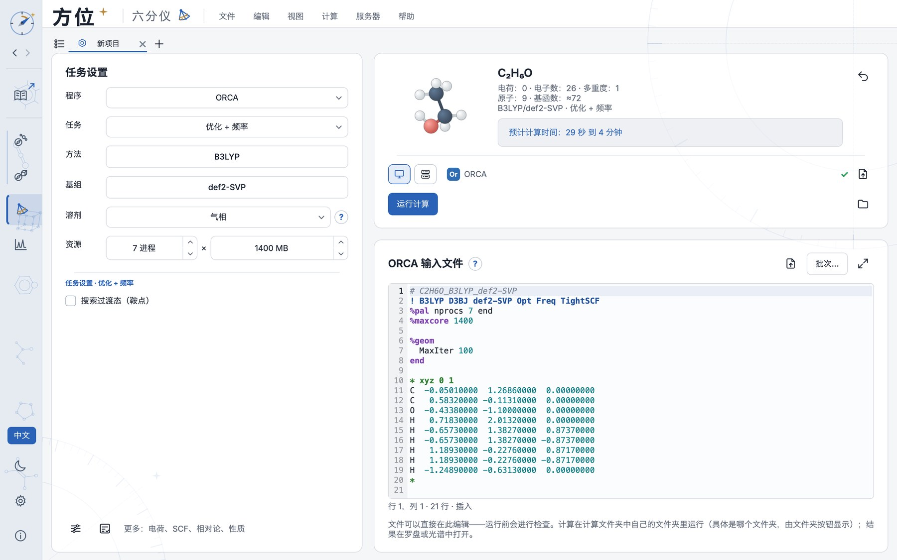

### 第 4 步　在罗盘和光谱中查看结果

计算结束后，计算窗口中会出现“前往罗盘”和“前往光谱”按钮。

- 在**罗盘**中，结果以优化步骤的形式打开：模型左上方的 ☰ 按钮显示能量曲线并播放各步。振动频率可以直接在模型上查看。
- 在**光谱**中可以看到最终能量、优化的收敛情况、带振动动画的红外光谱以及热化学（焓和吉布斯自由能）。

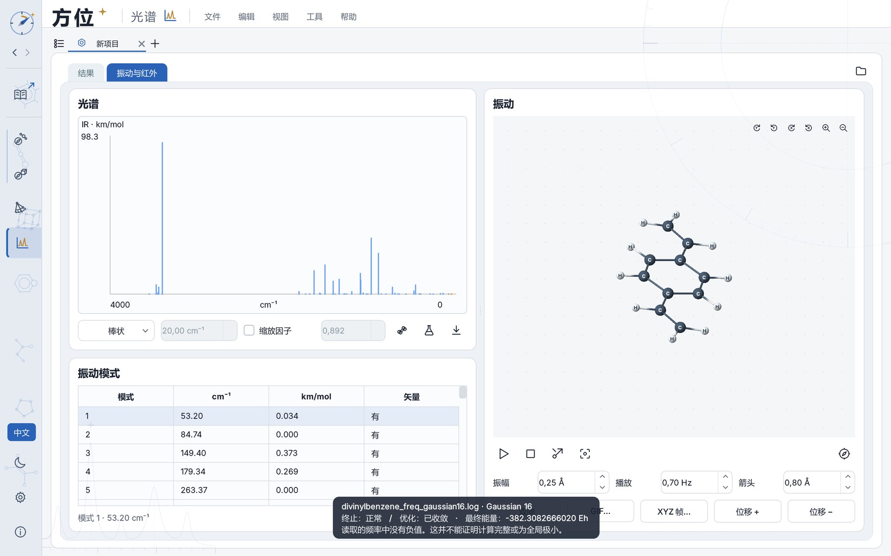

> **提示。** 如果带频率的优化结果中出现虚频，说明结构不在极小点。计算医生会提供“沿虚频模式移动并重新优化”按钮（见“计算医生”一节）。

### 教学示例

“文件 → 打开示例…”打开程序的 `examples` 文件夹：ORCA、Gaussian、xtb 和 Psi4 的真实输出（性质、优化、扫描、振动、UV-Vis 和 NMR、轨道），用于比较的结构对，用于绕键旋转的分子，CIF 晶体（CsCl、NaCl、石墨、苯甲酸、硅）以及自定义片段文件。打开什么、看什么，写在 `examples/README.md` 的表格中。光谱的“文件”菜单中还有无需文件即可打开的 ORCA 教学结果。

## 界面与设置

### 主窗口

“方位”的窗口由左侧面板和板块的工作区组成。

- **左侧面板。** 顶部是程序图标，点击打开主页；图标下方是“后退”和“前进”按钮。其下是各板块：图谱（用一条线隔开；箭头 ↗ 提示它在浏览器中打开）、“罗盘 · 分子”、“罗盘 · 晶体”、六分仪和光谱。底部是语言选择（俄语、英语、中文）、主题、设置和“关于”。也可以用 `Ctrl+1` … `Ctrl+5` 切换板块。
- **板块标题栏**——板块名称及其菜单：“文件”“编辑”“浏览”“计算”以及板块自己的菜单（罗盘有“工具”“项目”“服务器”，晶体有“晶体”）；最后一个总是“帮助”。
- **工作区**——板块的内容。右上方背景中有一个淡色的方位陀螺仪，左下角是板块的图案（罗盘、六分仪、光谱）。自 0.245.0 起背景具有立体感：光线来自左上角，面板投下柔和的阴影，背景图案透过面板可见，如同透过厚玻璃——略微模糊并有位移；左侧面板也是如此。主页面板后方是硝基电子密度的等值线（模型，而非计算结果），陀螺仪缓慢旋转：外环、内环和指针。切换到其他板块时，它会平稳地停在平面位置，指针朝北。打开板块时，左下角的板块图案会动起来（0.246.0）：罗盘指针摆动后静止，六分仪的指标臂摆动后停住，光谱的谱带依次升起。

**主页**介绍“方位”是什么，并提供进入工作的快捷方式。“继续”卡片可回到最近的分子和最近的晶体；卡片上的箭头会展开同类的另外五个最近项目。下方是各板块的卡片。

### 结构选项卡

一个选项卡就是对一个结构的全部工作：结构本身、其计算设置和计算结果。“罗盘 · 分子”、六分仪和光谱共用选项卡：在一个板块中选中的选项卡，在所有板块中都被选中。“罗盘 · 晶体”有自己的选项卡；从它进入六分仪和光谱时，会回到分子的选项卡。

- 模型上方的“+”打开新选项卡，叉号关闭选项卡（如有未保存的更改，程序会询问）。
- 计算结果在启动该计算的选项卡中打开；从文件打开的结果放在空选项卡或新选项卡中。
- 结果显示在有内容可看的地方：振动、UV-Vis 和 NMR 在光谱中，其余在罗盘中。性质（电荷、键级、偶极）会立即显示在模型上。

### “文件”和“帮助”菜单

每个板块都有“文件”菜单。主要菜单项：

- “保存”（`Ctrl+S`）不加询问地写入同一个文件，“另存为…”（`Ctrl+Shift+S`）以新名称保存。
- “关闭标签页”（`Ctrl+W`）和“关闭其他标签页”。
- “清空”——选项卡中只留空结构，模型上不再叠加任何内容（性质、表面、临界点、测量、自定义标签、叠加的结构）。
- “按名称获取分子…”——输入英文名称（aspirin、caffeine、2-butanol）；结构取自 PubChem 的三维模型（MMFF94 力场），若没有三维模型，则由 SMILES 构建。需要联网。
- “从剪贴板粘贴结构”（`Ctrl+Shift+V`）——复制的 XYZ 坐标（完整的，或仅“C x y z”行）、molfile 或 SMILES。
- “在文件夹中显示文件”——在访达或资源管理器中显示选项卡的文件。
- “设置…”——程序设置窗口（见“程序设置”一节）。

按名称或从剪贴板得到的结构放入空选项卡，否则放入新选项卡。

**菜单搜索**（自 0.248.0 起）是左侧面板语言按钮上方小方框中的放大镜，每个板块都有。点击它，搜索框从方框中滑出；输入一个词，下方会列出名称或提示中含有该词的菜单项和窗口按钮，以及它们的路径（“晶体 ▸ 分子间相互作用 ▸ Hirshfeld 表面…”）。选中的项会在原位置显示：菜单依次展开，该项高亮，按 `Enter` 执行。按 `Esc` 或点击别处可收起搜索框。`Ctrl+?` 用键盘打开搜索。0.244.0–0.247.0 放大镜位于菜单栏右端，更早时搜索框在“帮助”菜单中。**“帮助”菜单**中有“手册”“新功能”（更新日志）、“元素周期表”、参考资料（菜单中同样名为“手册”）、安装检查、日志文件夹、错误报告和“关于”。

**更新**（0.225.0）。程序启动时向 GitHub 查询一次最新发布的版本号——与网站提供的相同。如果有比您的版本更新的版本，会出现窗口：“下载”打开网站的“下载”部分，“新功能”打开发布页面，“稍后”推迟到下次启动，“不再提醒此版本”在下一个版本之前不再提示。没有网络时程序不作任何提示。随时检查：“帮助 → 检查更新…”。关闭检查：“文件 → 设置… → 外观 → 启动时检查更新”。此过程不发送您的任何数据。

### 参考资料与元素周期表

“帮助”菜单中的参考资料（第二个“手册”）汇集了工作中需要的数据。顶部的搜索框在当前选项卡的表格中查找。

- **单位与常数**——能量换算（Eh、eV、kcal/mol、kJ/mol、cm⁻¹、K、THz 以及光子波长 nm）、长度和偶极矩换算；CODATA 2018 基本物理常数——程序计算所用的常数。
- **溶剂**——20–25 °C 下的介电常数 ε，以及溶剂在 ORCA、Gaussian、xtb 和 CREST、Psi4、MOPAC 中的名称。六分仪中溶剂旁的“?”会打开此表。
- **频率校正因子**——按方法和基组列出的 NIST CCCBDB 表。在光谱中（“工具 → 频率校正因子…”），用“应用到谱图”按钮或双击即可把校正因子用于红外光谱。
- **实验数据**——实测光谱、几何结构和热化学数据库（NIST WebBook 和 CCCBDB、ATcT、SDBS、nmrshiftdb2、NIST 原子光谱、COD、PubChem），可按分子式检索。

“帮助 → 元素周期表”打开元素卡片：原子动画、原子质量、NIST 数据中的同位素以及电子排布。

### 模型上方的按钮栏

罗盘模型上方有一排视图按钮，视野右边缘有一列按钮：“快照”以及计算结果叠加内容的按钮。按钮的组合可以修改。

1. 在窗口的任何菜单中右键单击某个菜单项或子菜单，选择“添加到视野上方的工具栏”或“添加到右侧按钮列”。也可以直接用鼠标把菜单项拖到工具栏或按钮列上。
2. 工具栏和按钮列中的按钮可以用鼠标拖到别处。放在一组按钮之间，按钮就加入该组；放在最后一个之后，则排在一条新的分隔线后面。
3. 右键单击按钮——“从面板移除”、移到别处，或“恢复默认按钮”。标准按钮也可以移除——它们仍保留在菜单中。

按钮组合会被记住，且与程序语言无关。“罗盘 · 晶体”有自己的布局：在那里的修改不影响分子的按钮栏。

### 后台任务指示器

当耗时的工作在被收起的窗口后进行时——例如你在其他板块时六分仪的计算，或用“收起”按钮收起的构象搜索——左侧面板底部、语言选择上方会出现一个图标：在“呼吸”的蓝色圆圈上有一个指针摆动的罗盘。已知完成比例时，周围会逐渐填满一个圆环；未知时，有一颗彗星绕圈运行。提示中显示时间。

- 单击可打开该工作的窗口，而不离开当前板块。如果有多个工作，图标上会显示数量，单击则给出列表。
- 工作结束时指针停止，旁边出现标记：对勾——成功，叉号——出错，短横——已被停止。打开窗口后标记消失。
- 回到六分仪时，计算窗口会自动关闭，计算进程显示在输入文件的位置。

### 主题、语言与提示

主题（浅色或深色）和语言为所有板块共用，包括图谱。“设置 → 界面主题 → 跟随系统”会跟随 macOS 或 Windows 的外观一起变化，直到手动选择主题为止。程序坞中的程序图标和左侧面板随主题变化。

提问和对话框（“保存更改？”、选择文件、输入名称）使用程序的语言，按钮“是”“否”“保存”“取消”也一样。macOS 上的文件选择窗口是系统自带的，其按钮跟随 macOS 的语言。

鼠标悬停提示只在提供新信息的地方出现：没有文字的图标、设置字段、被截断的文本。图标按钮在悬停时展开并显示文字。更详细的说明在字段旁的“?”中。

**输入框中的原子。** 在需要原子编号的地方（光谱中图的平面和直线、电荷转移和 CDA 的片段、“按编号选择”），原子显示为“H1”“C3–C8”。输入时两种写法都可以，也可以用编号：“1-4, 7”“N1, H2–H4”，单独的“H”表示所有氢原子。如果元素符号与该编号原子的元素不符，输入不会被接受——这可以防止编号弄错。

### 程序设置

在任何板块中选择“文件 → 设置…”（或左侧面板上的齿轮图标），会打开一个包含整个程序设置的窗口。左侧是分类列表，右侧是其字段。修改立即生效，并保留到下次启动。大多数分类都有“恢复默认”按钮。

表：“设置”窗口的分类

| 分类 | 设置内容 |
|---|---|
| 外观 | 语言；主题——浅色、深色或跟随系统 |
| 文件 | “为无氢文件补全氢原子” |
| 化学键与步骤 | 按距离判定化学键时共价半径之和的系数（1.22；“重新识别化学键”将其应用于当前结构）；“按 Mayer 键级识别化学键”的键级阈值（0.5）；“优化和扫描步骤保持同一取向” |
| 模型视图 | 启动时的显示方案（“与上次相同”或菜单中的任一方案）；大模型快速绘制——从 N 个原子起 |
| 快照 | “高分辨率快照”的放大倍数（×2–×6）、透明背景、按分子裁剪 |
| 光谱 | 红外以线条或曲线显示，红外和 UV-Vis 谱带宽度，是否立即应用频率校正因子 |
| 单位 | 罗盘坐标表中的坐标（Å 或 bohr）；步骤、扫描、IRC 和构象的 ΔE 能量（kcal/mol、kJ/mol、eV） |
| 分析表格（CSV） | 列分隔符（“;”“,”或制表符）和小数点符号；旁边显示示例行 |
| 计算 | 计算文件夹、项目文件夹、默认的构象搜索方法 |
| 程序 | ORCA、Gaussian、Psi4、xtb、CREST、MOPAC 等程序的位置；“指定…”程序文件和“自动查找” |
| Multiwfn | 计算网格（粗、中、细）和 Multiwfn 程序文件 |
| 错误 | 日志文件夹、“保存报告…”“发送给作者…” |
| 全部设置 | “保存到文件…”（JSON，不含密码和密钥）、“从文件加载…”（例如在另一台计算机上）、“重置所有设置…” |

> **提示。** CSV 表格默认用分号分隔各列，数字的小数部分用逗号分隔（1,5）。在使用俄语设置的电脑上，Excel 和 Numbers 双击即可打开这样的表格。如果表格要给需要列间用逗号、数字用小数点（1.5）的程序使用，请选择“,”和小数点。

### 来自访达和资源管理器的文件

- 双击 `.qcc` 项目即可在“方位”中打开。对于 CIF、XYZ、MOL、SDF、PDB、计算的输出和输入文件、Molden 和 CUBE，“打开方式”中会出现“方位”。结构和晶体在罗盘中打开，计算结果在光谱中打开。
- 可以把文件拖到窗口上。文件悬停在窗口上方时，窗口变灰，中央出现适用于当前板块的提示：罗盘——结构文件（XYZ、MOL、SDF、MOL2、PDB、CIF、Molden、QCC），六分仪——输入文件或结构，光谱——计算文件。

### 错误与给作者的报告

出现故障时程序不会沉默：错误被写入日志，窗口提示“出了点问题”（程序继续运行），并提供“保存报告…”。如果程序异常关闭，下次启动时会主动提议保存报告。

报告是一个 `.zip` 压缩包：错误、崩溃和启动日志，“方位”、Python、Qt、NumPy、VTK 的版本，系统信息以及不含密码的设置。**“发送给作者…”**按钮（在错误窗口、崩溃后的提问中以及“设置 → 错误”中）把报告保存到桌面，并在邮件程序中打开一封发往 contact@azimuth-chem.com 的信，其中包含版本、系统和最后一个错误。你只需把报告文件拖进邮件，并写明当时在做什么。也可用“文件 → 错误报告…”。

### 状态图标

自 0.247.0 起，程序窗口中不再出现小鹌，而是以细线绘制的小图标：正在进行、已完成、已停止和失败的计算，退出、删除和替换前的提问，错误，无法连接服务器，未找到程序，输入文件检查，空白视野和选项卡。图标上的金色标记表示状态，橙红色表示错误。罗盘的空白视野会提示如何开始：构建分子或打开文件，在晶体中则是打开 CIF 或示例。小鹌留在网站上的图谱中：她主持各主题的演示。

## 图谱

图谱是一本交互式理论教材：13 个部分共 56 个主题，从量子力学基本假设和氢原子到 DFT、微扰理论、溶剂化、方法选择、NMR、构象、重元素、晶体、Walsh 图以及量子化学中的机器学习。页面上的数值直接在浏览器中计算（页面内运行 Python）——不需要计算程序，也不需要服务器。

### 如何打开图谱

图谱位于网站上：主地址为 [www.azimuth-chem.com](https://www.azimuth-chem.com/?lang=zh)，俄罗斯镜像为 [ru.azimuth-chem.com/atlas](https://ru.azimuth-chem.com/atlas/?lang=ru)。左侧面板上的“图谱”和主页上的图谱卡片会以程序的主题（浅色或深色）在浏览器中打开它：俄语版在镜像上，英语和中文版在主地址上。从程序打开的图谱使用程序的语言；网站的主题和语言在其左侧面板中切换。

> **提示。** 若要在没有网络的情况下阅读图谱（例如在没有网络的教室里），请在网站左侧面板中点击“保存图谱以供离线使用”。

### 图谱的部分

量子力学基础 · 分子与原子核 · 对称性 · 晶体 · 多电子波函数 · Hartree–Fock · 电子相关 · 密度与 DFT · 方法与基组的选择 · 分子轨道与反应 · 热化学与动力学 · 性质与光谱 · 动力学与机器学习。每个部分有二到六个主题。“点群”中包含表示的约化和 SALC，“SCF 迭代”中包含 Koopmans 定理，“Hückel 方法”中包含反应活性指数、Fukui 函数和半经验方法。

### 主题页面

- **“需要理解什么”**和**模型的适用范围**——位于页面开头：你将学到什么，模型在哪里不再适用。
- **带滑块、按钮和图表的段落。** 改变参数，观察结果如何变化。关键概念会突出显示，公式在正文中；图下方的说明解释图中显示的内容。
- **演示**——右下角的“▶ 演示”按钮。逐步演示：小鹌亲自按下按钮并讲解看到的现象。`←` `→` 翻动步骤，`Esc` 结束演示。主题的动画只在该主题打开时运行——切换到其他主题时会暂停，之后从原处继续。
- **检验你的知识**——页面末尾的练习：在页面上完成一个操作，再从四个答案中选一个。答案会立即判定，答错时会提示到哪里寻找。
- **术语表**——用虚线下划线标出的术语（共 132 个）。悬停或单击——会显示定义和讲解该术语的主题链接。
- **“在罗盘中打开”**——在含有分子的页面上：带分子名称的按钮会在程序中打开它们（在安装了“方位”的计算机上）。
- **下一步**——页面末尾的问题，引向下一个主题。

### 如何查找主题

1. 图谱首页按部分列出所有主题——单击即可打开。
2. 或点击放大镜图标（或按 `/`）开始输入：搜索范围包括标题、关键概念、小节标题和练习。
3. 标题栏下的选项卡用于切换同一部分的主题；主题行右侧的箭头 ‹ › 按顺序翻阅所有主题。`←` 和 `→` 键也能做到这一点，`↑` 和 `↓` 用于滚动主题。
4. 图谱概览开头的“继续”一行会回到上次打开的主题，“从哪里开始”推荐入门主题。

每次打开图谱首页，小鹌都会讲一个与某个主题相关的教科书知识——栏目“嘘，你知道吗？”（共 129 条，每个主题三条）。“打开主题”跳转到该主题，“再来一条”显示另一条，“隐藏”把卡片隐藏到下次启动。

### 如何学习一个主题

1. 阅读“需要理解什么”。
2. 启动“▶ 演示”。
3. 自己拖动滑块：每个模块回答一个问题。
4. 回答“检验你的知识”中的练习。
5. 在罗盘中打开该主题的分子，并在六分仪中计算——与图谱所示的结果进行比较。

### 课堂上的图谱

**演示模式**（主题页面上的按钮）为投影仪放大字体和图表。主题演示适合在讲课时展示：用箭头翻动步骤，就像翻幻灯片。

本手册许多小节的末尾都有“理论——见图谱”链接：它们指向解释程序具体计算内容的主题。

## 罗盘 · 分子

罗盘是构建、编辑和查看分子的板块。计算结果也在这里显示在三维模型上：优化步骤、振动、电荷、轨道和电子密度表面。

### 罗盘窗口

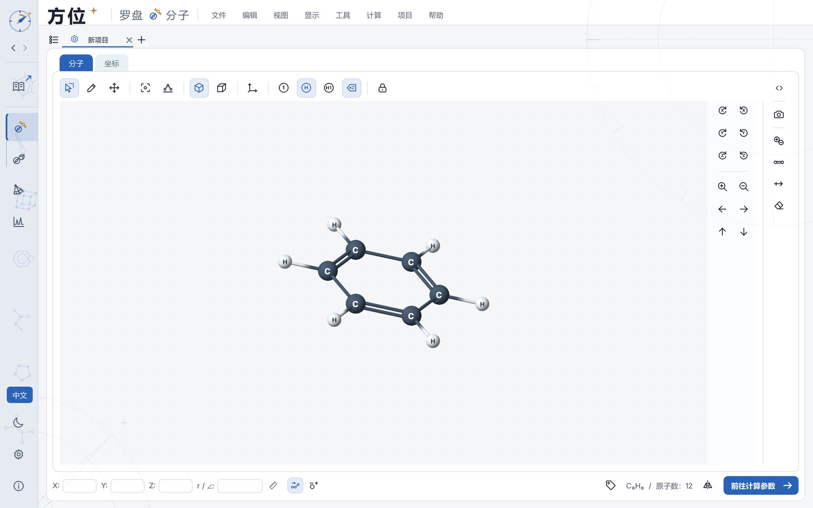

- **结构选项卡**位于模型上方。计算结果（优化步骤、扫描、IRC 或 NEB 路径、XYZ 帧）在单独的选项卡中打开，分子留在自己的选项卡中；如果当前选项卡为空，结果会占用它。
- 左侧的**工具面板**：构建模式和工具——元素、键级、“成键”“断键”“删除”“补全氢原子”“整理几何结构”。
- **模型上方的模式**：“浏览 / 选择”（箭头——旋转模型和选择原子；结构不变）、“编辑结构”（铅笔——原子、片段、分子）和“移动原子”。当前模式的按钮处于按下状态。
- **模型上方的按钮**：视图（居中、等轴或透视、坐标轴、“最佳视图”）、原子标签、优化约束（锁）、视图面板的折叠箭头。
- **视野右边缘的按钮列**：“快照”，其下是计算结果的叠加内容——“原子”“键”“偶极与受力”和橡皮擦“清除模型上叠加的所有内容”。
- **模型下方**——概要（分子式和原子数）、名称按钮（IUPAC）、对称性按钮和“前往计算参数”。
- **“坐标”选项卡**——坐标表（埃或玻尔）、格式和复制。`Delete` 删除所选行的原子。

罗盘的菜单：“文件”（打开、保存、图片）、“编辑”（选择、原子、键、几何结构、坐标系）、“浏览”（投影、相机、坐标轴、标签、模型上的测量）、“显示”（模型、键、方案）、“工具”（转动惯量、原子和键的统计、质量、片段、结构比较）、“计算”“项目”和“服务器”。

### 构建分子

1. “文件 → 新建分子”（`Ctrl+N`）或模型上方的“+”。如果打开了项目，其分子列表中会出现一个空行“新建分子”；放入第一个原子后它就成为项目中的分子。
2. 打开“编辑结构”模式（铅笔）。在面板上选择元素并单击视野——原子就放好了；单击某个原子会在它上面连接一个新原子。
3. 若要放置基团，选择一个片段（甲基、苯基、羰基、环……）并单击视野、某个原子或某个氢原子——片段会放在该位置上。
4. “补全氢原子”添加缺少的 H 原子，“整理几何结构”按 VSEPR 规则排布原子。

现成的分子可以从分子库中获取——“文件 → 示例分子”（7 个类别共 106 个分子）——也可以由 SMILES 构建：“文件 → 由 SMILES 生成分子…”，例如乙酸为 `CC(=O)O`。

**构建开关**（铅笔菜单中以及“编辑 → 原子、片段与分子”中的图标）：

- **“构建时补全氢原子”**（默认关闭）——在空白视野放置的原子会立即带上氢（C → CH₄），单击饱和原子会为新键去掉一个氢，新原子按化合价补满氢。
- **“构建时自动整理”**（“编辑 → 几何结构”，默认开启）——新原子或基团立即按 VSEPR 就位，碳链拉成锯齿形，已画好的部分不移动。
- **“用 UFF 整理”**——构建时用 UFF 力场而不是简单的 VSEPR 场来调整新原子。

**“整理几何结构”**——对整个分子或所选部分使用简单力场：键长、VSEPR 角、平面的重键和芳香环、原子间排斥和扭转项（四面体原子之间的键变为交叉式）。它给出整齐的初始结构，而不是优化后的结构：其能量是约定值，不能用来比较构象。

### 打开与保存

**打开**——“文件 → 打开…”（`Ctrl+O`）或把文件拖到窗口上。罗盘可读取 XYZ、“方位”项目（`.qcc`）、Molfile 和 SDF、MOL2、PDB、ChemDraw XML（`.cdxml`）、ORCA 和 Gaussian 输入文件、计算输出、Molden 和 fchk 文件（完整列表见附录 A）。CIF 在“罗盘 · 晶体”中打开，计算结果以步骤形式在罗盘或光谱中打开。

- 包含多个分子的 SDF 作为结构集打开（“结构”面板），包含多个模型的 PDB（MODEL … ENDMDL，例如分子动力学的帧）作为结果面板中的步骤打开。
- 如果 SDF 记录的名称行为空（RDKit 和许多数据库都这样写），名称取自其数据字段——`<Name>`、`<Title>`、`<PUBCHEM_IUPAC_NAME>`、`<chembl_id>`。
- 从 ChemDraw XML 中读取第一页各片段的原子和键、键级、形式电荷以及图注。平面图被换算为埃，补全氢原子，“生成 3D”给出立体结构。缩写（Ph、OMe……）请在 ChemDraw 中展开；二进制的 `.cdx` 请在其中另存为 `.cdxml`。

**无氢文件。** 如果打开的文件中一个 H 原子都没有，罗盘会按化合价（C——4，N——3，O——2，卤素——1）补全，并说明添加了多少个。`Ctrl+Z` 恢复文件原样。文件中写明的双键和三键（MOL/SDF、MOL2、PDB CONECT）会被考虑；在 XYZ 中键级由键长确定。只要有一个 H，文件就不会被改动。关闭补全：“文件 → 为无氢文件补全氢原子”。

> **注意。** 不含 H 的离子或自由基会得到中性分子的氢原子——计算前请检查电荷和自旋多重度。

**保存。**

- “文件 → 保存项目…”——分子连同计算参数一起保存。
- “文件 → 导出坐标”——以埃为单位的 XYZ 或其他格式。
- 模型旁的“快照”按钮——PNG（×1 和 ×3；放大倍数在“设置 → 快照”中，可选透明背景）、旋转 GIF 和优化步骤 GIF、矢量 SVG 和 PDF。
- “文件 → 3D 打印模型…”——以球棍形式保存屏幕上的内容：单色 STL 适用于任何打印机，或按元素着色的 VRML。比例为每埃多少毫米（默认 10：水分子约 2.5 cm）；键不会细于设定的粗细，以免折断。

### 项目

项目把一项工作中的分子及其所有计算集中在一个文件夹中：分子列表、它们的结构、电荷、设置和计算尝试。打开一组分子（SDF、多个文件）或保存时会生成项目。

- **项目文件夹**——“Documents/Azimuth/Проекты/<名称>”：`project.qcc`（索引）、`project.sqlite`（分子、设置和计算历史）以及各分子的计算文件夹。每次更改要么完整写入数据库，要么完全不写入。
- **“项目”菜单**汇集了项目操作：新建和打开项目、分子列表、添加和删除分子、恢复已删除的分子、单个或批量模式、项目历史与文件。
- **删除分子。** 在项目分子列表中选择一个或多个（`Shift`、`Ctrl`），按 `Delete` 或右键——“从项目中删除…”。勾选“同时删除其计算文件”会把它们的文件夹也删除——不可恢复。不勾选时文件保留，可在列表中用 `Ctrl+Z` 或“恢复已删除”找回分子。
- **优化后的几何结构**：优化（或过渡态搜索）收敛后，它会成为项目中该分子的结构，因此像 MOPAC → ORCA → QTAIM 这样的计算链无需手动传递。原先的结构保留在该次尝试的输入和撤销历史中。
- **基于旧数据的结果。** 如果计算后修改了分子的几何结构、电荷、多重度、方法或程序，它在列表中的那一行会标上“≠”，提示中会说明改了什么。结果不会重新计算：它仍是原计算的结果。
- 列表右键菜单中的 **“计算文件夹”** 打开该分子当前结果或最近一次尝试的文件夹。
- **“保存所有结构”** 把项目中的所有分子写入一个 XYZ 或 SDF 文件。
- **由计算创建项目。** “文件 → 由计算创建项目…”把在“方位”之外完成的计算从所选文件夹收集到项目中：ORCA、Gaussian、Psi4、xtb、MOPAC、GAMESS、NWChem 和 Q-Chem 的输出及其文件。同一分子用不同方法计算的结果会成为项目中的同一个分子，并带有这些计算的历史。
- **草稿。** 在空选项卡上画出、未保存到文件的分子，在关闭程序（或切换到其他选项卡）时成为“Проекты”文件夹中的“新项目”草稿。在“继续”和“最近的文件”中它标有“· 草稿”；“保存”会为它命名。
- **只为查看而打开的文件**也会得到一个项目选项卡，但只有项目发生变化（分子被编辑、做过计算、项目以某个名称保存）时，其文件夹才会保留在“Проекты”中。
- **两个窗口中的同一项目。** 只有第一个窗口会写入项目；第二个窗口以“只读”方式显示。

> **注意。** 不要脱离项目文件夹单独复制 `project.sqlite`。若要复制，请用“另存为…”，或在程序关闭时复制整个项目文件夹。

### 查看、选择与测量

- **旋转**——用鼠标拖动，**缩放**——滚轮，**平移**——箭头按钮。触控板上：拖动旋转，双指移动，捏合缩放。
- **选择**——单击原子；框选——按住 `Shift` 拖动。“编辑 → 所选”：全选、反选、按元素选、扩大一步（`Ctrl+]`）、整个分子（`Ctrl+Shift+]`）、按编号和按坐标范围选。
- **测量。** 选择 2、3 或 4 个原子——模型下方会显示键长、键角或二面角。“浏览 → 模型上的测量”标出所有键长和键角；标尺可把所选距离和角度固定在模型上。如果没有选中任何原子而模型上已有固定的测量，标尺图标上会出现一个小叉：点击即可把它们全部从模型上移除（0.244.0）。“测量样式…”设置文字大小和小数位数。
- **标准视图**（“浏览 → 标准视图”）：沿 x、y、z 轴，沿所选的键，或正对三个所选原子构成的平面。“旋转中心——所选原子”使模型绕它们旋转和缩放。“相机 → 相机位置…”以数值设置角度和比例——为多个结构使用同一视角。
- **模型**（“显示”）：球棍、棍状、空间填充；“范德华球”——Bondi 半径的半透明球。
- **原子标签**：元素、编号、“元素和编号 · C1”“元素内编号 · C1, H1”、键的编号和键级、仅所选原子的标签；大小——“标签样式…”。
- **自定义标签**（“1”“H”“H1”旁边的标签按钮）：选择原子，按下按钮并输入标签；“#”会替换为选择顺序编号。编辑时标签跟随原子移动，并保存在项目中。对于含残基的 PDB（蛋白质、DNA），残基会自动标注。
- **隐藏原子**：所选原子、哑原子 X；“显示所有原子”恢复显示。隐藏的原子仍在结构和计算中。
- **蛋白质飘带**（“浏览 → 蛋白质飘带”）：α 螺旋——红色飘带，β 折叠——黄色箭头，其余——灰色管；链上的原子被隐藏，配体和水保留。
- **幽灵原子 X**（在元素周期表中位于镧系下方，或在坐标表中输入 X）——没有原子核和电子的点，用于 Z 矩阵、环中心或轴；它不会进入六分仪的输入文件。

**矢量与平面**（“编辑 → 矢量与平面”）：“所选原子间的矢量”“所选原子平面的法线”（从平均平面中心出发的 1.5 Å 箭头）和“经过所选原子的平面”——一张半透明平面。模型上的每个对象都有自己的编号。“矢量与平面之间的夹角…”给出每一对的夹角。“以文本编辑矢量与平面…”——每个对象一行（“vector 1 2”“normal 1-6”“plane C1–C6”），列表可以修改后应用。“移除矢量与平面”将其删除。“几何结构 → 原子组的平面…”——一组原子（例如环 C1–C6）的平均平面以及各原子偏离它的距离；对两组原子——两平面的夹角、中心距离和错位（π 堆积）。

### 编辑几何结构

- **撤销和重做**——`Ctrl+Z` 和 `Ctrl+Shift+Z`。
- **化学键。** 选择两个原子，按“成键”或“断键”（或 `Ctrl+B`）；键级在面板上设置。右键单击键可设为单键、双键、三键、芳香键、部分键（虚线）以及“键的颜色…”。
- **移动原子。** 在“移动原子”模式下用鼠标拖动原子。旁边还有其他可拖动的对象：绕锚定原子转动的片段；绕键旋转（选择两个相连的原子，拖动其中一侧的原子）；整个分子；无支链的链；所选部分。
- **绕键旋转**（“编辑 → 几何结构 → 绕键旋转…”或右键单击键）：用字段和滑块设置精确二面角，按给定角度旋转，按给定步长扫描（帧进入步骤面板或 XYZ 文件）。显示两侧之间最近的接触。环内的键不能旋转。
- **删除分子。** 如果模型上有多个分子，右键单击某个原子——“删除该分子（N 个原子）”。
- **Z 矩阵编辑器**（“编辑 → 几何结构 → Z 矩阵编辑器…”）：以数值编辑键长、键角和二面角；模型立即改变。
- **平移和旋转…**——所选原子绕 X、Y、Z 轴或过两个原子的轴旋转一定角度，并沿矢量平移。**镜像**——关于 XY、XZ 或 YZ 平面。
- **一次处理所有键**：“编辑 → 键 → 删除所有键”；“重新识别化学键”按距离重建它们。
- **复制**：“编辑 → 复制与粘贴”——原子、坐标和“复制 SMILES”。
- **原子顺序**：“所选原子排在最前”（按所需顺序依次单击选择原子——它们会得到编号 1、2、3……）和“氢原子排在所连原子之后”。
- **对称化**（“编辑 → 几何结构”）使结构符合找到的点群；第二个操作还会把它转到标准取向。
- **优化（UFF）**——把所选原子或整个分子优化到通用力场的极小点（Rappé 等，1992；参数与 RDKit 相同）。状态栏显示优化前后的能量及其各项。结构需要包含氢原子。大分子请用“计算 → 快速 xtb 计算 → GFN-FF 优化”。
- **构建多肽…**——单字母代码序列（最多 30 个残基）和构象：α 螺旋（φ −57°，ψ −47°）、β 折叠（−139°，+135°）或伸展链。所有氨基酸均为 L 型，两端为 NH₂ 和 COOH。
- **配位中心…**——金属、氧化态、几何构型（从直线形到五角双锥）和配体：所有位置用同一种配体、逗号分隔的列表或“4 Cl, 2 NH3”。配体：H2O、NH3、PH3、OH、CO、CN、F、Cl、Br、I、H。M–L 键长为共价半径之和（Cordero，2008）；配合物的电荷和最低多重度会填入选项卡的字段。

> **说明。** 配合物的高自旋态请在六分仪中自行设置：程序设置的是最低多重度。

### 名称与对称性

- 模型下方（右下）的**对称性按钮**用可调的容差确定点群；再按一次会对结构进行对称化。点群可对不超过 150 个原子的单个分子确定。“工具”菜单中也有：“确定点群”“对称化”“对称化并转到标准取向”。
- **名称按钮**（IUPAC）按 IUPAC 规则（含 C、H、N、O 和卤素的无环及单环化合物，三种语言）或程序的词典给出名称。如果规则不适用，罗盘会查询 PubChem（需要联网；名称为英文）。

理论——见图谱：[“点群”](https://www.azimuth-chem.com/atlas/?lang=zh#sym)。

### 自定义片段和分子

**片段。**

1. 选择一组原子，连同用于连接的那个原子（例如 CF₃ 和碳原子）。
2. “编辑 → 原子、片段与分子 → 将所选保存为片段…”，并为它命名。
3. 片段会出现在“我的片段”中，用法与内置片段相同。在那里还可以删除，以及以 JSON 文件导出和导入（把片段带到另一台计算机）。

**分子。**

1. 右键单击原子——“将分子保存到‘我的分子’…”（保存与该原子相连的所有原子）。或在构建模式的“分子”菜单中使用同一项：保存所选原子，没有选择时保存整个结构。
2. 分子会出现在“文件 → 示例分子 → 我的分子”中，以及构建时的“分子”菜单中（单击视野即可放在其他分子旁边）。在那里还有“删除我的分子”。

### 结构检查、溶剂、质子与同位素

- **“工具 → 检查结构…”**在计算前比较电荷、多重度与电子数，并查找距离过近的原子、邻居过多的原子、带四个键的中性 N 和带三个键的 O、未饱和的化合价以及不相连的部分。问题以列表形式给出（✕——程序不接受，!——看起来像错误，·——请确认你的意图），对应原子会在模型上被选中。六分仪中的“运行计算”会自动做同样的检查，有错误时询问“仍然开始吗？”。
- **“工具 → 用溶剂包围…”**——用水、甲醇、乙醇、氨、DMSO、二氯甲烷、氯仿、THF 或苯进行显式溶剂化。“第一配位层”通过氢键在每个空位放一个溶剂分子；“随机分布在整个分子周围”——放置给定数目、互不重叠的分子。“移除溶剂”在同一窗口中。
- **“工具 → 质子”**：给所选原子加一个质子（电荷 +1）、去掉一个（−1），或把氢转移到另一个原子（互变异构体）。
- **同位素。** 右键单击原子 →“同位素”：所有元素的稳定同位素及其丰度（NIST）、T 和 ¹⁴C，或“自定义质量…”；同时处理多个原子——“工具 → 所选原子的同位素…”。模型上元素符号旁会显示质量数；同位素会写入 ORCA、Gaussian 和 Psi4 的输入文件。

### 比较结构

1. “浏览 → 结构比较”或“文件 → 叠合结构以进行比较…”。
2. 选择另一个组成相同的结构文件（构象、另一程序的结果、编号不同的文件）。
3. 原子会自动对应。显示 RMSD（含全部原子和不含 H）以及最大偏差。可以按文件的编号重新编号模型，也可以按模型的编号保存文件中的结构。

对映体会被区分开：未经询问不允许镜像反射。与另一个已打开选项卡快速比较——“工具 → 与标签页比较”。

### 构象搜索

“计算 → 构象搜索…”打开搜索窗口。左侧是“搜索方法”卡片：在列表中选择方法，其下方是方法说明和设置；再往下是通用的能量窗口和温度。右侧是找到的构象。程序会自动选择适合该分子的方法。

表：构象搜索方法

| 方法 | 何时选用 | 工作原理 |
|---|---|---|
| 穷举 | 不超过 4 个可旋转键 | 以 120°（或 60°、180°）为步长，按所有组合（不超过 200 个）或随机组合旋转可旋转键；舍弃原子重叠的结构；用 xtb 细化候选结构 |
| 蜂群搜索（ABC） | 5–10 个可旋转键 | 人工蜂群算法：键的旋转是“蜜源”，能量是一次短的 xtb（GFN2）优化；先找能量最低的构象，再找能量低且与已找到构象不同的 |
| CREST | 超过 10 个可旋转键 | 由 CREST 程序进行完整搜索（iMTD-GC；“快速”——`--quick` 参数），能量窗口传给它（`--ewin`） |

环外的单键视为可旋转键；CH₃ 基团和酰胺 C–N 键不旋转。

**排序。** “用 xtb（GFN2）细化”会优化每个候选结构，并按 CREST 的规则排序：能量窗口（默认 6 kcal/mol），去除重复结构（ΔE < 0.05 kcal/mol 且 RMSD < 0.125 Å），原子编号不同的相同结构视为同一构象的旋转异构体。显示在所选温度（默认 298.15 K）下的玻尔兹曼分布比例。如果能量窗口舍弃了某些结构，底部的一行会说明舍弃了多少个、最近的一个高出多少。

**方法设置。** “能量窗口”（默认 6 kcal/mol，与 CREST 相同）和温度是通用的。蜂群搜索有“ABC：构象数”（要找多少个，默认 10）和“ABC：迭代次数”（搜索长度；每次迭代运行 xtb 的次数为可旋转键数的 2 倍）；它的所有运行都放在计算文件夹中的同一个 ABC_… 文件夹里。CREST 有“快速”和“CREST：元动力学时长”。安装了 CREST 后才能使用“运行 CREST”。搜索过程中底部一行显示进度：xtb 为“第 5 个构象，共 20 个”，蜂群搜索为全局或局部搜索以及 xtb 运行的序号。

**结果。** 找到的构象位于结果面板（☰）的“构象”页：“采用所选构象”把构象放入罗盘，“保存 XYZ…”保存所有帧及其能量。如果分子属于某个项目，能量窗口内的构象会作为一组出现在“项目分子”中该分子下方（编号 1.1、1.2……，各带自己的 ΔE）；每个构象都是项目中的一个分子，有自己的计算。

> **提示。** 典型流程：把 xtb 找到的构象作为队列在 MOPAC（PM7）中计算，再把重新排序后最好的几个作为队列在 ORCA 中计算（见“计算队列”一节）。

> **说明。** CREST 把小的共轭分子视为刚性分子，只给它很短的元动力学，因此只找到一个构象。这时请增大“CREST：元动力学时长”（`--mdlen` 参数）。

理论——见图谱：[“构象：寻找哪些极小点”](https://www.azimuth-chem.com/atlas/?lang=zh#conf)。

### 反应路径

1. 打开起始结构。“计算 → 结构之间的路径…”。
2. 选择终点结构——来自文件或来自结构比较。它会按起始结构重新编号并与之叠合。
3. 中间结构（1–50 个）按 IDPP（基团旋转时键长不会缩短）或线性插值生成；帧进入步骤面板和 XYZ 文件。
4. “送到六分仪：ORCA NEB-CI”准备路径和过渡态的计算：六分仪中选择任务“反应路径（NEB-CI）”，并在输入文件旁写入 `end.xyz`。
5. 找到的过渡态用任务“从过渡态出发的路径（IRC）”（0.223.0）检验：ORCA 从它出发向两个方向下降，到反应物和产物。“任务设置”中有“每个方向的步数”，以及为没有解析 Hessian 的方法使用数值 Hessian。请从用相同方法和基组算得、只有一个虚频的几何开始。结果在 Compass 中打开：“几何优化”面板显示相对过渡态的 ΔE 曲线和各步结构；两端的步骤就是这个过渡态所连接的极小点。

> **提示。** 快速的路径草稿（0.228.0）。DFT 水平的路径计算很慢：每个中间结构都要优化。请先用 GFN2-xTB 找路径：在六分仪中选择程序 ORCA，方法选“半经验（通过 ORCA 调用 xtb）”一组中的“GFN2-xTB”。此时不需要基组，计算只需几秒。需要已安装 xtb 程序（“计算 → 安装计算程序…”）：ORCA 负责控制计算，能量和力由 xtb 计算。把路径的最高点作为初始猜测，再用 DFT 泛函做“过渡态 + 频率”任务。GFN2-xTB 自己的能垒不写入报告：它与 DFT 可能相差几十 kcal/mol。ORCA 中该方法还可做“能量”和“优化”；频率等请用 xtb 程序或 DFT 计算。

理论——见图谱：[“势能面”](https://www.azimuth-chem.com/atlas/?lang=zh#pes)。

### 优化中的约束

选择原子（1 个——原子，2 个——键长，3 个——键角，4 个——二面角），然后选择“计算 → 在优化中固定所选”或按模型上方的锁形按钮。模型上会出现一把小锁，约束会写入优化的输入文件。约束也用作势能面扫描的坐标（见“计算任务”一节）。

### xtb 快速计算与计算工具

罗盘的“计算”菜单：

- **“电荷与自旋多重度…”**——直接在罗盘中设置六分仪的这些字段。
- **“xtb 快速计算”**：“能量”“几何优化”“优化 + 频率”“GFN-FF 优化”和“沿所选原子扫描…”（键长、键角或二面角在给定点数内变化到终值，其余部分进行优化）。无论六分仪中选的是哪个程序，都会立即以当前选项卡的电荷和多重度启动 GFN2-xTB 计算，结果像普通计算一样回到选项卡。
- **“计算步骤”**：“将步骤保存为一个 XYZ…”“所有步骤的坐标（CSV）…”和“参数随步骤变化图…”——所选原子的键长、键角或二面角在优化、扫描或 IRC 各步中的变化。
- **“所选原子参与的振动模式…”**——按所选原子在位移中所占的比例排列振动；例如，这样可以很快找到 C=O 伸缩振动。

罗盘的“工具”菜单：“内坐标表…”（所有键长、键角和二面角；“保存 CSV…”）、“体积与表面积…”（范德华体积、用 1.4 Å 探针计算的溶剂可及表面积、有效直径；Bondi 半径）、转动惯量和转动常数、分子质量、原子和键的统计。

### 模型上的计算结果

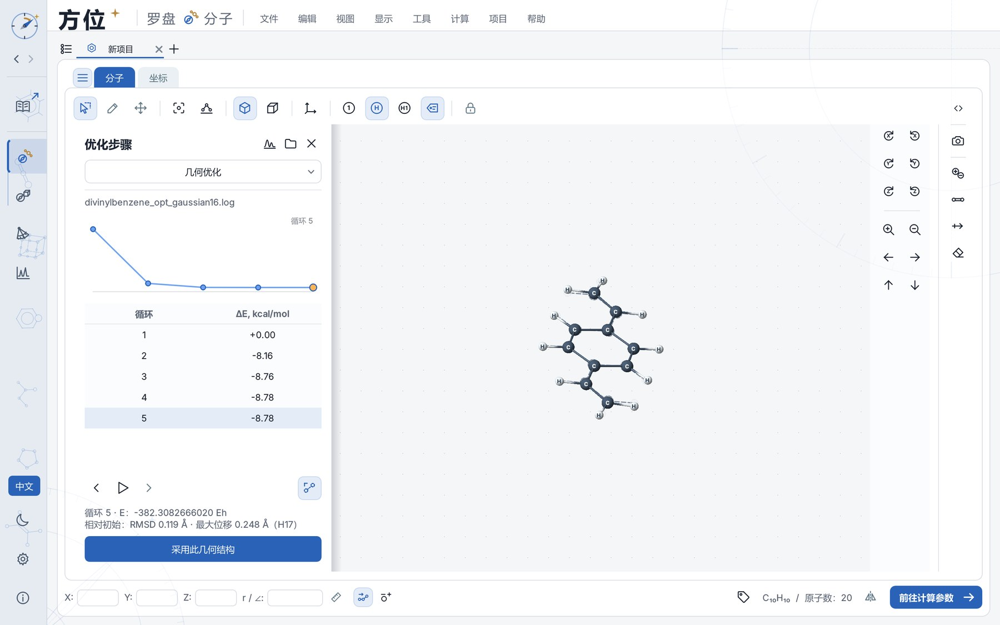

**结果面板**由模型左上方的 ☰ 按钮打开；只有选项卡中有内容可显示时它才可见。面板的各页：

- **“几何优化”**——优化、扫描、IRC 或 NEB 的步骤：能量曲线、播放、GIF。优化后默认选中最后一步；收起面板后，所选步骤仍是选项卡的结构。翻阅扫描时，扫描坐标会以橙色标在模型上。二维扫描有“扫描图”按钮：用颜色表示 ΔE 并带等值线，“谷”以虚线表示。 “能量剖面”按钮（0.239.0）打开供报告使用的同一张图：坐标轴带标注，单位取自设置，单坐标扫描的 x 轴是该坐标本身，IRC 路径的能量从过渡态算起；表格可保存为 CSV。
- **“结构”**——同时打开多个文件或 SDF 数据库时：在模型上显示所选结构，“采用此结构”。
- **“构象”**——构象搜索之后。
- **“频率”**——频率和红外强度（虚频以橙色表示）；所选振动直接在模型上运动（空格——暂停，方向键——切换振动）。
- **“轨道”“表面”**和 **“QTAIM”**——波函数分析（见“模型上的性质与电子密度”一节）。

面板标题中有“前往光谱”图标：光谱会在内容相同的选项卡上打开（收敛、振动、图、拓扑）。单击视野中的空白处会收起面板。

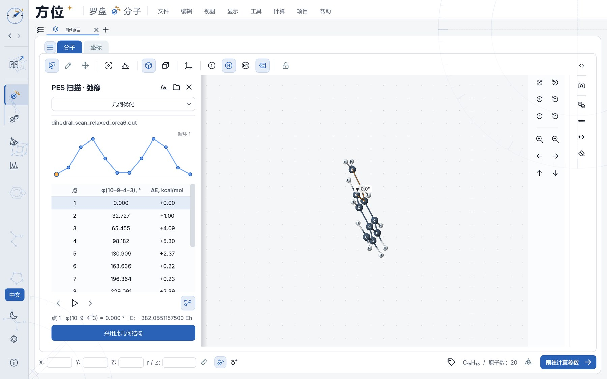

### 模型上的性质与电子密度

**性质**（“计算 → 计算结果中的性质”以及右侧按钮列中的三个按钮）：

- **“原子”**——电荷（Mulliken、Löwdin、Hirshfeld、CM5、ADCH、RESP、AIM、APT、xtb、MOPAC）、自旋布居和 Fukui 函数；当前显示的种类以“•”标记。能给出新数值的分析位于“由波函数计算”子菜单中。
- **“键”**——Mayer、Wiberg、FBO 和 LBO 键级；“按键级识别化学键…”。
- **“偶极与受力”**——所选优化步的偶极矩和原子受力。

旁边的橡皮擦会清除模型上叠加的所有内容；结构、标签和测量保留。

**基于波函数的分析。** 如果结果带有轨道文件（Molden、fchk 或 ORCA 的 `.gbw`），Multiwfn 程序会在后台计算：

- ADCH 和 CM5 电荷、Hirshfeld 电荷（对于输出中没有这些电荷的 Gaussian 和 Molden）以及按 Bader 盆计算的 AIM 电荷，开壳层体系还包括自旋布居；
- RESP 电荷——拟合静电势得到的电荷（两步 RESP），与 AMBER 和 GAFF 力场中相同；状态栏显示 RRMSE，“Анализ”文件夹中会生成供分子动力学程序使用的 `<名称>_resp.chg` 文件；
- 四种定义的键级。

**Fukui 函数**——针对六分仪“Fukui 函数”队列的结果：由三次计算的 Hirshfeld 电荷得到 f⁺（亲核进攻）、f⁻（亲电进攻）、f⁰（自由基进攻）和对偶描述符 Δf = f⁺ − f⁻，显示在模型上；还有一个窗口，给出表格、可能的进攻位点以及全局指数（电离能、电子亲和能、电负性、硬度、亲电指数）。窗口底部可以把同样的函数以表面形式显示在模型上：程序在同一网格上构建三次计算的密度并相减。

**轨道与表面。** 如果结果带有轨道，结果面板中有“轨道”“表面”和“QTAIM”页（也可用“浏览 → 模型上的曲面”）。

- **“轨道”**——轨道表，以及“轨道”“自旋”（开壳层）和“组成”（按 Hirshfeld 计算的原子贡献）按钮。表上方可选择正则轨道或定域轨道：Pipek–Mezey、其“Becke”变体（用于含弥散函数的基组）或 Boys；定域轨道标注为内层、孤对、键和离域轨道。按住 `Shift` 单击另一个轨道，会用另一对颜色把它叠加在当前轨道上。
- **“表面”**——按组排列的 Multiwfn 表面树：密度及其导数（ρ、|∇ρ|、拉普拉斯量 ∇²ρ、自旋密度、RDG），电子定域化（ELF、LOL、熵），能量（G、K、ALIE），势（ESP），弱相互作用（NCI、IRI、IGMH），以及分子表面 ρ = 0.001 上的函数（ESP、ALIE、LEA、LEAE）及其极小值和极大值。双击把表面显示在模型上。下方是按片段计算的“差分密度 Δρ”：蓝色——电子增加，红色——电子减少。
- **“QTAIM”**——“查找临界点”：密度临界点由 Multiwfn 搜索，因此罗盘不画出的键（氢键、范德华接触）、环和笼也能找到。列表：类型、原子、ρ、∇²ρ、能量密度 H；底部是 Poincaré–Hopf 检验 n − b + r − c = 1。“显示在模型上”画出这些点（核——灰色，键——绿色，环——橙色，笼——紫色）和键径。

计算网格（粗——几秒，中，细——大分子需数分钟）对所有场通用；更换网格后，已显示的内容会重新构建。已构建的内容会被记住：再次显示不会重新计算。计算场时，光标和按钮旁的图标会变成旋转的圆环。

**弱相互作用。** 基于结果波函数的 NCI，基于前分子密度的 NCI——适用于模型上的任何结构，无需计算——以及 IRI：按 sign(λ₂)ρ 着色的 RDG = 0.5 表面：蓝色——氢键，绿色——范德华接触，红色——排斥。分子间 IGMH 只显示相互作用中分子间的部分。图和域表位于光谱的“NCI”选项卡中。

**表格。** 每生成一个表面，就会在计算文件夹的“Анализ”子文件夹中写入其极值的 CSV 表（`<名称>_<函数>_extrema.csv`），对于分子表面还有汇总表（`<名称>_esp_summary.csv`：面积、体积、平均值、σ²tot、ν、Π、MPI）以及 Multiwfn 的输出。

> **说明。** Multiwfn 需单独安装（见“安装计算程序”一节）。没有它时，分析菜单项为灰色，提示中会说明如何安装或指定它。如果使用的是旧版 Multiwfn（3.8 之前），程序会提醒一次：其中部分分析无法使用。

理论——见图谱：[“原子电荷：各方案比较”](https://www.azimuth-chem.com/atlas/?lang=zh#chg)、[“电子密度”](https://www.azimuth-chem.com/atlas/?lang=zh#dens)。

### 用于论文和演示的外观

“浏览 → 显示方案”可一次性改变模型、键、标签、投影、坐标轴、原子大小、颜色、背景和网格。内置方案：“方位”“发表 · 白色背景”“黑白”“Jmol 颜色”“棍状模型”“空间填充模型”“演示”。方案的白色或黑色背景也会用于快照。“将当前外观保存为方案…”添加自己的方案。

- **“显示 → 自定义外观…”**——在一个窗口中设置所有视图参数，每次修改立即在模型上生效：模型类型、原子大小和键的粗细、键的颜色、双键、标签、透视、坐标轴、背景、网格、调色板以及自定义的元素颜色。“保存方案”以自己的名称保存（勾选后程序启动时使用它）；“导出方案…”和“导入方案…”——以 `.json` 文件与同事共享。
- **“键的样式…”**（“浏览 → 键的显示”）：键的颜色（按原子平滑过渡、带清晰分界或单色）、粗细、重键用多个圆柱或一个圆柱表示、芳香键的样式、长键用虚线、氢键。
- 单个元素的颜色——原子菜单中的“元素颜色…”。

### VTK 三维图形

“浏览 → VTK 三维图形（试用）”：原子、键和表面由 VTK 库（OpenGL）在显卡上绘制——表面按真实深度穿过原子之间，透明效果真实。选择会被记住，程序重启后生效。如果 VTK 无法工作，罗盘会说明这一点并回到内置图形。

## 罗盘 · 晶体

“罗盘 · 晶体”处理来自 CIF 文件的晶体：晶胞和晶胞块、对称性、分子间接触、Hirshfeld 表面、分子对能量、粉末衍射图和 (hkl) 表面。Quantum ESPRESSO 和 CP2K 中的周期性计算也从这里设置。晶体有自己的选项卡和菜单；在这里打开的分子或分子计算的结果会自动转到“罗盘 · 分子”。

> **说明。** 晶体分析和晶体计算目前在程序中仍标为未验证（见“计算程序及其验证情况”一节）：请将结果与独立数据进行比对。

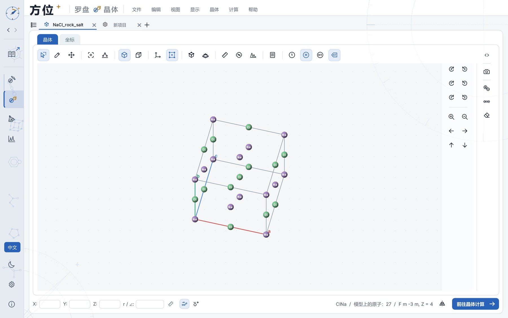

### 打开晶体

1. “文件 → 打开 CIF…”（或在“分子列表”中打开 CIF——程序会自动转到这里）。教学用晶体——“文件 → 打开示例…”：CsCl、NaCl、石墨、苯甲酸、硅。
2. 晶体立即构建：一个晶胞，完整的分子，若有无序则只取一个部分。不对称单元中的原子按文件中的对称操作复制（特殊位置上的重复原子会合并）。空间群和 Z 显示在模型下方的一行中，密度显示在状态栏中。
3. 模型上方的晶体按钮或“文件 → 重建晶体（晶胞、表面）…”会在模型右侧打开“晶体”面板。

视野为空时，它会提示：从 CIF 文件打开晶体（“文件 → 打开 CIF…”）或使用示例（“打开示例…”）。

**来自 COD 的晶体。** “文件 → 在 COD 中查找晶体…”在 Crystallography Open Database（一个约有五十万个结构的开放数据库）中搜索。搜索条件：关键词（物质或矿物名称、作者、论文标题）、分子式（C7H6O2、TiO2——程序会把元素按 Hill 顺序排列）、以空格分隔的元素以及“仅限这些元素”；第二行是晶胞参数及容差（默认长度 ±1 %、角度 ±1°）。“与已打开的相同”会填入罗盘中晶体的晶胞——这样可以找到其他研究中的同一结构以及相近的物相。结果最多 500 条：COD 编号、分子式、名称、空间群、晶胞和年份。“在罗盘中打开”（或双击）把 CIF 下载到“Documents/Azimuth/COD”文件夹并打开。需要联网；COD 只会收到搜索条件。

### “晶体”面板

“晶体”“接触”“Hirshfeld 表面”和“计算结果”面板在模型右侧打开（一次一个）；已打开面板的按钮会高亮，再按一次或在视野中原子以外的地方单击即可关闭。“晶体”面板分为可展开的几个部分。

- **“晶胞与堆积”**——晶胞组成、空间群（若文件中有编号则显示编号）、晶系、点群、晶格类型（P、A、B、C、I、F、R）、晶胞参数和体积、Z、Z′、密度以及 Kitaigorodsky 堆积系数——晶胞中位于原子范德华球内的比例（分子晶体通常为 0.65–0.77）。“符号……的含义”按钮把 Hermann–Mauguin 符号逐项拆解：布拉维格子，以及每个位置对应哪个轴、哪个平面、沿哪个方向。
- **“晶胞块”**——一个晶胞或 n₁ × n₂ × n₃ 的晶胞块（最多 10 × 10 × 10，不超过 2000 个原子）、以晶胞分数表示的坐标范围、“面、棱和顶点上的原子”“完整分子”（被晶胞面切开的分子完整构建，每个分子的中心位于晶胞内）和“仅一个无序部分”。短暂停顿后模型立即重建——没有“构建”按钮。
- **“对称操作”**——文件中的操作列表及其说明：轴或平面、其方向和在晶胞中的位置。
- **“表面（hkl）”**——切出平板（见“表面（hkl）”一节）。
- **“浏览”**——观察方向以及在模型上绘制哪些内容（见“晶体视图”一节）。

对于没有独立分子的晶体（盐、金属、骨架），“完整分子”不可用，面板会说明该结构是无限的（链、层或骨架）。

**无序。** 如果 CIF 中有无序组（`_atom_site_disorder_group`），“仅一个无序部分”默认勾选：晶胞、分子、表面和接触由有序原子和第 1 部分构建。取消勾选即可同时看到所有部分。

### 晶体视图

模型上方“晶体视图”按钮的菜单以及面板的“浏览”部分：

- **“沿 a”“沿 b”“沿 c”**和**“沿 (hkl) 法线”**把视线设为沿晶胞棱或垂直于晶面。
- **“对称元素”**画在第一个晶胞中：旋转轴（实线）和螺旋轴（虚线）为绿色，镜面和滑移面为蓝色，对称中心为棕色圆环，每个元素都带符号。如果元素超过 400 个（F 心立方群），则不绘制。
- **“位移椭球（50 %）”**——原子热位移椭球的投影，与 ORTEP 图相同（需 CIF 中有 Uᵢⱼ、Bᵢⱼ、U_iso 或 B_iso）。
- **“配位多面体”**——金属原子最近邻构成的多面体（不超过最短距离的 1.12 倍，4 到 12 个原子）。
- **“布拉维晶格结点”**——晶胞块的格点：晶胞顶点处为小菱形，带心格点稍大。
- **“按对称性为分子着色”**——每个分子用生成它的对称操作的颜色着色。
- **“在模型上显示环、π–π 和 C–H···π”**——环平面、质心、π–π 堆积和 C–H···π 接触。
- “浏览 → 显示晶胞”隐藏或显示晶胞棱。

### 晶体菜单

“晶体”菜单按组排列：“晶胞块”“晶体视图”“模型标注”，然后是子菜单“分子间相互作用”（接触、Hirshfeld 表面、分子对能量、分子壳层）、“结构与堆积”“晶胞与晶格”以及粉末衍射图。“计算”菜单：在六分仪中计算和 CRYSTAL 输入文件，然后是计算得到的内容——子菜单“原子电荷”“键与临界点（AIM）”“模型上的场”。灰色菜单项会在提示中说明为何不可用。

### 晶体坐标

晶体的“坐标”选项卡以“独立原子（分数坐标）”格式打开：文件中独立原子的标签、元素、x、y、z、占有率和 U；表格上方是空间群、晶胞和体积。选中表中的一行会在模型上选中该原子的所有副本。“分数坐标 (CIF)”格式以晶胞分数显示模型中的原子。同一位置还有单个晶胞的“晶体的 CIF”“POSCAR (VASP)”和“扩展 XYZ”。

视野右下角的箭头把所选分子（每个分子选一个原子即可）移到“罗盘 · 分子”的新选项卡中——用于分子计算。

### 接触与氢键

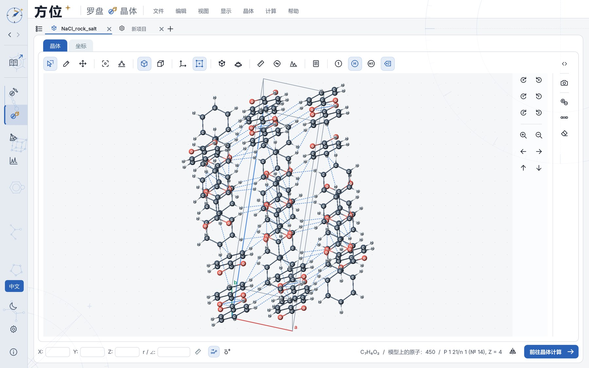

“接触”面板显示晶胞内原子与相邻晶胞原子之间的接触：

- **氢键** D–H···A（角度不小于 120°）；
- **卤键、硫属键、氮族键和碳族键**（σ 空穴键）R–E···Y：R–E···Y 角（θ1）不小于 150°；d/Σr 列为距离除以范德华半径之和；对于两个卤素之间的接触——还有第二个角 θ2 和类型：I 型（θ1 ≈ θ2）为范德华接触，II 型（θ1 ≈ 180°，θ2 ≈ 90°）为卤键；
- **范德华接触**——比半径之和小 0.2 Å 以内。

由对称性重复的接触合并为一行，并带“数目”列。选中表中的一行会在模型上画出这些接触并选中其原子；在模型上单击氢键的虚线会选中对应的行。

**搜索标准**——表格上方的一行：范德华半径之和的余量，氢键和 σ 空穴键的最小角度；“重新查找”按这些标准搜索，“恢复默认”恢复 0.20 Å、120° 和 150°。

**图集**（Etter 记号）——“图集”列：D——两个分子之间的一个键，S(n)——分子内的环，C(n)——无限链，Rᵃ_d(n)——由多个分子组成的环；n 为环或链重复单元中的原子数，a 和 d 为受体和氢的数目。接触下方另有一张表给出第二级：对每一对氢键类型——同时包含两类键的最小环和最小链。

**π–π 堆积与 C–H···π。** 接触表下方——平面环（5–7 个原子）以及不同分子中堆积在一起的环对（质心距离小于 4.0 Å，平面几乎平行）：Cg···Cg 距离、两平面夹角、质心到另一环平面的距离以及错位。C–H···π 接触：H···Cg 不超过 3.0 Å，C–H···Cg 角不小于 120°。

**网络。** “显示网络”构建由氢键、σ 空穴键、π–π 堆积和 C–H···π 组成的网络（在按钮旁选择）；“层数：N”（1–6）让网络从新加入的分子再扩展 N 次。选中表中的几行——网络只由这些接触构建，例如只用一种氢键，以便看清它形成的链或层。

**论文用表格…**按发表的格式显示氢键：D–H···A、D–H、H···A、D···A 的长度、角度以及受体的对称代码（例如“-x+1, -y, -z+1”，i）。“复制”把带制表符的表格放到剪贴板（粘贴到 Word 和电子表格中即为表格），“保存 CSV…”保存到文件。

**分子壳层**（“晶体 → 分子壳层…”）——一个分子的邻居：有原子距离小于 R Å（默认 4.0）、或范德华球在一定余量内与之接触的分子。窗口给出分子配位数（大多数有机晶体为 12–14），以及每个邻居的分子式、对称代码和最短接触。

> **说明。** 在 X 射线结构中，H 原子离其所连原子比实际更近（C–H 约 0.95 Å 而不是 1.09 Å），因此 H···A 距离大约偏长 0.1 Å。

### Hirshfeld 表面

“晶体 → Hirshfeld 表面…”构建分子的表面——在该处分子的球形原子贡献晶体密度的一半。分子为模型上所选的分子，否则为晶胞中的第一个分子；网格可选粗、中、细。

- 窗口给出面积、体积、球形度（1——球）和最短的 d_norm。
- **“指纹图”**——每一对距离 d_i（到内部最近原子核）和 d_e（到外部）所对应的表面面积比例，范围 0.4–2.6 Å，以及各类接触比例表。所选的元素对会给指纹图中自己的部分着色，其余为灰色。“保存“指纹图”…”——PNG。
- **在模型上**表面会着色：d_norm——接触短于范德华半径之和处为红色（氢键），等于半径之和处为白色，更远处为蓝色；d_i 和 d_e——从红色（近）到蓝色；形状指数（蓝色——凸起，红色——凹陷，“领结”是 π–π 堆积的标志）和曲度（平坦区域及其间的棱）。

### 分子对能量与能量框架

“晶体 → 分子对能量与框架（xtb）…”：对一个分子及其 3.8 Å 以内的邻居，用 GFN2-xTB 在晶体几何结构下计算相互作用能 E = E(分子对) − E(A) − E(B)——单点计算，每对几秒；对称等价的分子对只计算一次。

- 表格：邻居的对称代码、中心间距离、最短接触、以 kJ/mol 表示的 E 及其 GFN2 分项——静电、色散、排斥和其余部分：氢键体现在静电项中，堆积体现在色散项中。
- 晶格能 ≈ ½ Σ E（对所有邻居求和）；其绝对值接近不含振动的升华焓。
- “在模型上显示能量框架”在分子中心之间画线，线的粗细随 |E| 增大：蓝色——吸引，红色——排斥。可以看出牢固的柱、层或三维骨架在哪里。
- 对于盐，窗口显示晶胞的组分及其电荷：常见离子（NH₄⁺、NO₃⁻、ClO₄⁻、SO₄²⁻ 等）可按分子式识别；电荷可以修改。

> **说明。** GFN2-xTB 计算分子对能量的精度约为 10–20 %。由最近邻估算的盐的晶格能只是粗略估计：其中不包括长程静电作用。需要安装 xtb 程序。

### 粉末衍射图

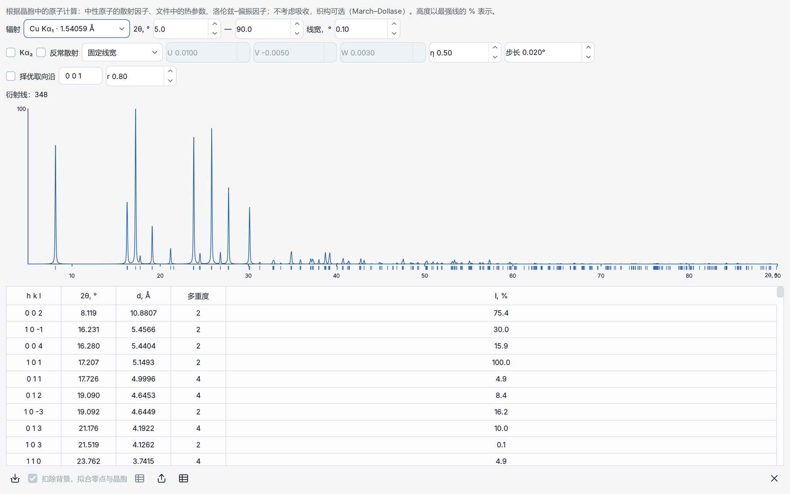

“粉末衍射图…”根据晶胞中的原子计算 X 射线粉末衍射图：中性原子的原子散射因子、文件中的热参数、洛伦兹–偏振因子。窗口中有曲线、坐标轴下方的衍射线标记和表格（hkl、2θ、d、多重性、以最强峰为 100 % 的强度）。

- 辐射——铜、钼、钴、铁、铬或银的 Kα₁；2θ 范围、步长和线宽。
- “Kα₂”添加强度为一半的第二条谱线；“Caglioti 线宽”——FWHM² = U tan²θ + V tanθ + W；η 为峰形中洛伦兹成分的比例（赝 Voigt）。
- “择优取向沿”hkl，参数为 r（March–Dollase）：r < 1——片状，r > 1——针状，r = 1——无织构。
- “反常散射”在所选靶的谱线处加入 f′ 和 f″ 修正（Henke 等，1993 年的数据表）——对重原子和吸收边附近有明显影响。
- 可以叠加实验衍射图（两列：2θ 和强度），并把计算结果保存为 `.xy`，或把衍射线列表保存为 `.csv`。

如果 CIF 中没有对称操作列表，但有空间群符号或编号，则从 230 个空间群的表中取得对称操作。

### 表面（hkl）

1. 在“晶体”面板的“表面（hkl）”部分设置密勒指数 (h k l)、层数、平面内的晶胞数和真空层厚度（Å）。
2. 点击“构建表面”。
3. 得到一块平板，其表面位于 xy 平面内，模型上显示平板晶胞。例如，NaCl (111) 的晶面会位于屏幕平面内。

### 晶体计算

晶体的周期性计算在六分仪中设置：“罗盘 · 晶体”底部的“前往晶体计算”箭头会带着该晶体打开六分仪，并选择 Quantum ESPRESSO 程序；也可以在“程序”一行中选择 CP2K。计算页面的组织方式与分子相同（第 8 章）：“任务设置”——任务、方法、基组（CP2K）或截断能（Quantum ESPRESSO）、色散、资源、k 网格、晶胞、超胞和优化阈值；晶胞电荷、自旋、DFT+U、占据和收敛在“其他设置…”中。

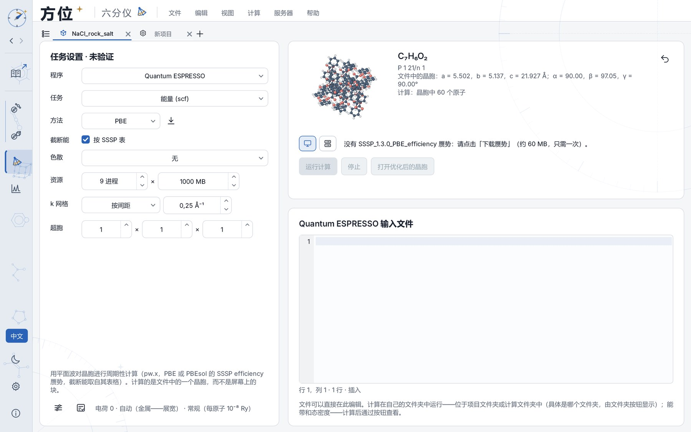

表：周期性计算程序

| | Quantum ESPRESSO | CP2K |
|---|---|---|
| 基组 | 平面波，SSSP efficiency 赝势 | MOLOPT 高斯基组和用于密度的平面波，Γ 点 |
| 适用于 | 小晶胞，固体 | 大晶胞（约 10 Å 以上），分子晶体 |
| 任务 | 能量、原子优化、含晶胞优化、能带结构、态密度、Γ 点频率、声子色散与态密度 | 能量、原子优化、含晶胞优化、Γ 点频率 |
| 方法 | PBE、PBEsol、LDA、vdW-DF2、rev-vdW-DF2、vdW-DF-cx、rVV10、PBE0、HSE06 | PBE、PBEsol、revPBE、BLYP、GFN1-xTB |
| 计算位置 | 本机（macOS、Linux）或服务器 | 本机或服务器 |

**各方法的特点。**

- PBEsol 需要专用赝势——“下载赝势”按钮（约 60 MB，只需一次）。
- 非局域泛函 vdW-DF2、rev-vdW-DF2、vdW-DF-cx 和 rVV10 本身已包含色散——不要同时选择 D3 校正。校正列表中还有 Tkatchenko–Scheffler（TS）和多体色散（MBD）。
- 杂化泛函 PBE0 和 HSE06 给出的带隙比 PBE 更准确（HSE06 是半导体的标准方法），但计算时间长几十倍，且只能用于“能量”任务：先用 PBE 或 PBEsol 优化几何结构，再用杂化泛函计算能量和带隙。
- CP2K 中的 GFN1-xTB 比 DFT 快数百倍：适合对大晶胞进行预优化，之后再用 PBE 细化几何结构。
- CP2K 基组：DZVP-MOLOPT-SR——适用于所有元素和固体；完整的 DZVP、TZVP 和 TZV2P 仅适用于 H、C、N、O、F、Si、P、S、Cl。
- CP2K 的密度网格（CUTOFF）按晶体的元素给出（0.240.0）：Si 为 400 Ry，C、H、O 为 450 Ry，含 Na 为 950 Ry，含 Mg 为 1250 Ry——这两种元素的 2s 和 2p 壳层算作价层，网格过稀时晶胞能量随晶胞大小的变化比晶格本身的贡献还大，晶胞优化会来回游走。手动输入的数值保持不变。要检验自己晶体的网格，可用 1.5 倍的 CUTOFF 计算一次“能量”。

**电子态**（“其他设置… → 电子态”）：

- **晶胞电荷**减少或增加电子；电荷由均匀背景补偿，因此不同大小的带电晶胞的能量不能直接比较。
- **DFT+U**——d 或 f 壳层的 U 值（eV），例如“Ni 6.2”或“Fe 5.3, Co 3.3”（壳层可明确指定：“Ni-3d 6.2”）。用于过渡金属的氧化物和氟化物以及铈、铀的化合物。U 取决于程序和投影子——请采用针对同一程序得到的数值。
- **磁有序**——自旋极化计算，铁磁或反铁磁有序。对于反铁磁体，晶胞必须能容纳两套亚晶格：NiO 和 MnO 请设置 2 × 1 × 1 超胞。如果晶胞中有通常具有磁性的原子（V、Cr、Mn、Fe、Co、Ni、Cu、镧系元素、铀）而自旋关闭，程序在运行前会询问是否开启反铁磁有序。

**Quantum ESPRESSO 中的频率与声子。** “频率（Γ 点）”——先做 scf，然后在 q = 0 处运行 ph.x，并用带声学求和规则的 dynmat.x；对于绝缘体，还会计算介电常数 ε∞ 和 Born 有效电荷，并由此得到各模式的红外强度。“声子色散与态密度”在 q 网格上计算，耗时明显更长（NaCl 在 6 个进程上约半小时）。负频率表示结构不在极小点或 q 网格过小。Γ 点的模式显示在晶体模型上——“计算 → 频率（Γ 点）”，色散曲线用“显示声子色散”按钮查看。

**能带结构与态密度。** 程序会自动设置计算步骤：先做 scf，然后沿布里渊区高对称点路径计算能带，或在密网格上计算态密度。“显示能带”和“显示态密度”打开图表（能量以价带顶为零点，金属以费米能级为零点）；“保存数据…”——CSV。“保存图片…”（图表窗口中的按钮，或在图表上单击鼠标右键，包括光谱的“能带”和“态密度”选项卡）——PNG 或 SVG，无论使用何种主题都是白色背景，坐标轴及单位均已标注：图片可直接插入报告。

**带隙**（0.229.0）。能带图下方和计算摘要中会写明带隙是直接的还是间接的、它的大小以及带边的位置：价带顶和导带底用路径上的点（“在点 Γ”）或其位置（“在 Γ 和 X 之间，路程的 85 %”）表示。对间接带隙还给出最小的直接带隙。带边在图上用圆点标出：红色为价带顶，绿色为导带底。带隙只在路径上的点中寻找。不用杂化泛函的计算通常会低估带隙：硅用 PBE 得到 0.57 eV，而实测为 1.17 eV。自旋极化计算不显示这一行。

**由声子得到热容**（0.239.0）。任务“声子色散与态密度”结束后会打开第三个窗口——“热容”：由声子态密度得到的 10 至 1000 K 的 C_V(T)、拟合出德拜温度 Θ_D 的德拜模型曲线，以及杜隆–珀蒂极限。表格（“保存数据…”）中有每摩尔化学式单元的 C_V、熵、内能和自由能，以及 Θ_D(T)——在该温度下给出相同 C_V 的德拜温度。计算是简谐的，给出 C_V；实验测量的是 C_P，大百分之几。示例，NaCl：C_V(300 K) = 47.8 J/(mol·K)，S = 72.1 J/(mol·K)，Θ_D(10 K) = 325 K（实验值：C_P = 50.5，S° = 72.1，Θ_D = 321 K）。

**层状晶体的单层**（0.239.0）。“罗盘 · 晶体”中的“文件 → 层状晶体的单层”切出一层（MoS₂、石墨、h-BN），并作为带 15 Å 真空层的独立晶体打开。层由沿 c 轴不小于 2.4 Å 的空隙识别。

**体心四方晶格**（0.238.0）。对于锐钛矿这类晶体，能带结构现在沿该晶格的标准路径计算（c > a 时：Γ–X–Y–Σ–Γ–Z–Σ₁–N–P–Y₁–Z 以及 X–P）；此前只有沿坐标轴的一般路径。示例，PBE 下的锐钛矿：间接带隙 2.11 eV，价带顶位于 Γ–X 路径的 87 % 处，导带底在 Γ。

**弹性常数**（0.237.0）。任务“弹性常数（立方晶体）”计算原始晶胞和 18 个形变晶胞：沿 x 拉伸、x 拉伸同时 y 压缩，以及 xy 剪切，各取从 −1.5 % 到 +1.5 % 的六个幅度。由三条 ΔE/V₀ 曲线的曲率得到 C₁₁、C₁₂ 和 C₄₄，进而得到体弹模量 B = (C₁₁ + 2C₁₂)/3、各向异性 A = 2C₄₄/(C₁₁ − C₁₂) 以及对柯西关系 C₁₂ = C₄₄ 的偏离。“显示图”画出三条曲线及其拟合。需在平衡晶胞中计算：请先用相同的泛函优化晶胞。每个形变晶胞中原子都会弛豫——硅在剪切下原子会移动。示例，PBE 下的 MgO：C₁₁ = 276、C₁₂ = 92、C₄₄ = 143 GPa，B = 153 GPa（实验值：297、96、156 和 163 GPa）。

**LDA**（0.236.0）。Quantum ESPRESSO 的“泛函”列表中有 LDA（Perdew–Zunger）。它需要自己的赝势：“下载赝势”按钮只为您晶体中的元素从 Quantum ESPRESSO 网站获取 pslibrary 库的文件，截断能从文件头读取。并非每种元素在那里都有 LDA 文件——此时程序会指出缺少哪种元素的文件。示例，硅：LDA 给出 a₀ = 5.399 Å、B₀ = 96.7 GPa 和间接带隙 0.47 eV；PBE——5.470 Å、88.8 GPa 和 0.57 eV；实验值——5.431 Å、99 GPa 和 1.17 eV。

**层状体系与石墨烯**（0.235.0）。程序会自行识别带真空层的层状体系（石墨烯、薄片）——依据沿某一轴不小于 7 Å 的空隙。沿真空方向只取一个 k 点，六角晶格的能带路径只在平面内：Γ–M–K–Γ。任务“真空层收敛性（层）”在真空层为 8、10、12、15、18 和 20 Å 时计算同一层。层状体系的任务“k 点网格收敛性”取 N × N × 1 网格，N = 6、8、9、10、12、15、18、24；表中有费米能级一列。N 为 3 的倍数的网格包含布里渊区的顶点 K，石墨烯的 π 和 π* 能带在此相接：这些点在图中为绿色，两类网格的能量沿不同的曲线收敛。如果能带在 K 点相接，能带计算结束后会打开第二个窗口——“狄拉克锥”：放大的 K 点附近、由能带斜率得到的费米速度，以及紧束缚模型的跃迁积分 t（模型以虚线画出）。示例，PBE 下的石墨烯：v_F = 0.83·10⁶ m/s，t = 2.57 eV（实验值约 1.0·10⁶ m/s）。

**Windows 上的 Quantum ESPRESSO**（0.234.0）。“计算 → 安装计算程序…”在 Windows 上安装 MSYS2 软件源中的 Quantum ESPRESSO 7.5 构建：下载约 90 MB，占用磁盘 140 MB，不需要管理员权限，也不需要 MSYS2 本身。该构建没有 MPI：设置中的进程数变为 OpenMP 线程数，因此在同一台笔记本上计算可能比 macOS 或 Linux 慢。如果电脑上已有带 Quantum ESPRESSO 包的 MSYS2，程序会自行找到它。自 0.244.0 起安装 7.5 版，而不是最新的 7.6 版：该软件源的 7.6 构建在 Windows 上能算出能量，却读不了自己保存的文件，因此能带结构、态密度和声子无法运行。7.5 版的程序已在 Windows 11 上用硅运行过：能量、能带、态密度和 Γ 点声子均通过。文件依次从软件源的多个镜像获取；如果都没有响应，请检查网络，并在开启或关闭 VPN 后重新安装。 自 0.241.0 起，安装程序会扩大该构建中各程序的栈：否则第一次计算就以代码 3221225725 停止。如果此前已在 Windows 上安装过 Quantum ESPRESSO，请再安装一次。

**磁性晶体：磁序与 U 系列**（0.231.0）。对于过渡金属氧化物（NiO、MnO、Fe₂O₃），有两点很重要：哪种磁序能量更低，以及 U 修正如何改变带隙。任务“磁序（无自旋、铁磁、反铁磁）”对同一个晶胞计算三次：无自旋、铁磁序以及在设置中选择的反铁磁序（需要能容纳它的超胞）。任务“U 系列（DFT+U）”在 DFT+U 字段指定的元素上取 U = 0、2、4、6 和 8 eV 计算晶体。计算结束后，摘要以一张表开头：状态或 U、每晶胞的能量差（仅磁序系列——不同 U 的能量不能相互比较）、带隙、原子的最大磁矩和绝对磁化强度。带隙一栏的短横线表示使用展宽的计算：程序在其中不输出带隙边缘能级。任何自旋极化计算的摘要现在都显示晶胞磁化强度和原子磁矩。示例，实测晶胞中的 NiO（PBE）：无 U 时镍磁矩 1.33 μB、带隙 0.8 eV，U = 6 eV 时为 1.68 μB 和 3.1 eV；实验值为 1.6–1.9 μB 和 4.3 eV。

**晶胞优化改变什么**（0.231.0）。任务“连同晶胞优化”新增选项：整个晶胞、仅 ab 平面内、仅体积或仅形状。对于带真空层的层状体系（石墨烯、薄片），请选择“仅 ab 平面内”：否则程序会压缩真空层。

**收敛性系列**（0.230.0）。平面波计算的结果取决于两个数值参数：截断能和 k 点网格的密度。任务“截断能收敛性”和“k 点网格收敛性”在其他设置不变的情况下，对其中一个参数取若干个值计算晶体能量：围绕当前值、步长 10 Ry 的六到七个截断能，或从稀一半到密一倍的六个网格。“显示收敛性”打开相对于最精确点的每原子 ΔE 图（带 ±1 meV 的绿色带）以及 ΔE、压力和带隙的表格。摘要中说明能量从哪个值起收敛到每原子 1 meV，压力从哪个值起收敛到 1 kbar。压力通常收敛得更慢：优化晶胞和计算状态方程时请按压力取值。报告中的收敛性检验需要的正是这张表。

**状态方程**（0.229.0）。任务“状态方程（体积系列）”在七个体积（初始体积的 0.94 到 1.06 倍）下计算晶体，并用 Birch–Murnaghan 方程拟合 E(V) 曲线。摘要中给出平衡体积 V₀、平衡晶胞参数、体模量 B₀ 及其压力导数 B₀′。“显示 E(V)”打开数据点和曲线；“保存数据…”写出包含体积、能量和压力的 CSV。硅用 PBE 得到 a₀ = 5.470 Å、B₀ = 88.8 GPa（实测 5.431 Å 和 99 GPa）。如果能量极小点在系列之外，程序会提示：初始晶胞离平衡太远，请先用“含晶胞的优化”任务优化。B₀ 对截断能敏感：请在更高的截断能下核对。

**晶体的 xtb 快速计算**——“计算 → xtb 快速计算”立即用 CP2K 中的 GFN1-xTB 计算当前选项卡中的晶体（能量、原子优化或含晶胞优化），无需打开六分仪页面。需要已安装 CP2K。

**计算之后。** “计算 → 计算结果…”——项目中晶体计算的表格（程序、任务、时间、能量、压力、结果）以及所选计算的详情：晶胞能量、带隙或费米能级、步数、最后一步的晶胞；按钮“计算文件夹”“优化步骤”“电荷…”“AIM 键…”“转到光谱”。优化后的晶胞用“打开优化后的晶胞”按钮在晶体选项卡中打开。CM5 和 Hirshfeld 电荷以及 AIM 键（Multiwfn，CP2K 计算）显示在晶体模型上和光谱的选项卡中。

**CRYSTAL。** “计算 → CRYSTAL 输入文件…”生成 CRYSTAL 输入文件（`.d12`）：任务（能量、优化、弹性常数、Γ 点频率）、泛函（PBE0、B3LYP、HSE06、PBE、PBEsol、Hartree–Fock）、CRYSTAL 库中的基组（pob-TZVP、pob-DZVP 等）、压力和 k 网格。旁边是“保存 TOPOND 的 .d3…”（搜索密度的所有临界点）。程序本身不运行 CRYSTAL。CRYSTAL 的输出（`.out`）作为带优化步骤、能量和弹性常数的晶体打开；TOPOND 的输出（`.outp`）作为密度临界点表打开。

### 保存与导出

“文件 → 将晶体保存为 CIF…”保存来自文件的晶体（带对称性）或构建的平板。“文件 → 导出晶体”——POSCAR、扩展 XYZ、CIF 格式的晶胞块（P 1）和图片。“文件 → 3D 打印模型…”把晶胞块或分子壳层连同晶胞棱一起保存，供打印机使用。

理论——见图谱：[“晶体：晶格与晶胞”](https://www.azimuth-chem.com/atlas/?lang=zh#cryst)。

## 六分仪

六分仪准备计算的输入文件并运行它——在本机或计算服务器上。几何结构、电荷和约束来自罗盘；结果返回到启动该计算的选项卡。

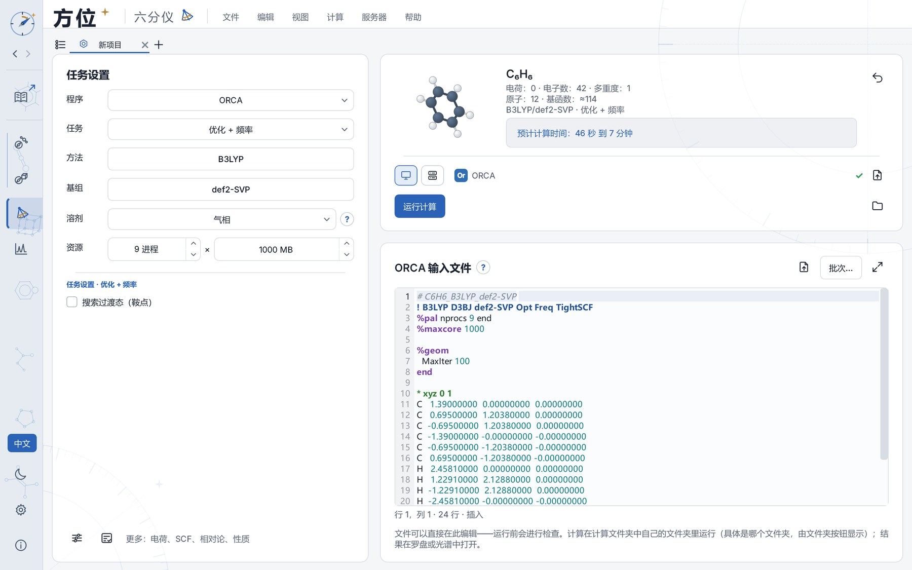

### 六分仪窗口

- **“任务设置”**（左侧）——程序、任务、方法、基组和最常用的字段（溶剂、进程数和内存），以及任务必不可少的内容（扫描坐标、CDA 片段的原子）。字段下方是所选任务的“任务设置”。卡片底部是“其他设置…”和“字段…”按钮：后者用于选择哪些字段留在卡片中、哪些移到其他设置中（“恢复默认”恢复原来的组合）。
- **计算卡片**（右上）——分子的小模型（可以用鼠标旋转）、分子式、电子数和多重度；角上的箭头通向罗盘中的该分子。分隔线下方是计算位置（“本机”或“服务器”）、程序图标（找到程序时带绿色对勾）、预计时间以及“运行计算”。
- **输入文件**——位于卡片下方。“展开”让它占据整列。计算期间，这里显示计算进程。

六分仪的按钮都是图标；每个按钮的作用显示在悬停提示中。

### 准备计算

1. 在罗盘中构建或打开分子，然后点击“前往计算参数”（或进入六分仪：`Ctrl+4`）。
2. **程序**——ORCA、Gaussian、Psi4、xtb、CREST、MOPAC、GAMESS (US) 或 NWChem。输入文件未经运行验证的程序标有“未验证”。
3. **标题**——输入文件的第一行，也是计算文件的名称。字段为空时，标题自动生成：分子式_方法_基组_溶剂，例如 `H2O_B3LYP_def2-SVP_water.inp`。也可以用俄文输入自己的标题——在文件名中会转写为拉丁字母。
4. **任务**——能量、优化、频率、光谱等（见“计算任务”一节）。列表中只有所选程序支持的任务。选择任务时，六分仪会自动设置推荐的方法、基组、色散和设置（例如，计算频率前使用严格的优化收敛标准，NMR 使用精细网格）；底部的提示会说明设置了什么——一切都可以修改。
5. **方法**和**基组**按类别选择：点击字段会打开类别列表（Hartree–Fock、MP2、GGA、meta-GGA、杂化、范围分离、双杂化、耦合簇；Pople、def2、cc、pcseg 基组）。列表中只有所选程序支持的项目。按钮的提示显示针对该分子和任务的推荐；“★ 推荐：…”一项会应用它。
6. **溶剂**——CPCM 或 SMD（SMD 用于溶剂化能；ORCA 和 Gaussian），xtb 中为 ALPB，Psi4 中为 PCM，MOPAC 中为 COSMO。**色散**——D3(BJ)、D3(0) 或 D4。
7. **进程数和每进程内存。** 六分仪会自动获取本机或所选服务器的核数和内存，并给出建议值。手动设置的值会保留。
8. **电荷和多重度**（“其他设置… → 电子态”；数值显示在按钮旁的一行中）根据分子计算：带四个键的 N 和 P——+1，带四个键的 B——−1，原子——按洪特规则，O₂——三重态，其他情况——与电子数相符的最低多重度。如果修改后的数值与电子数不符，六分仪会说明该如何修正。

新窗口默认使用 B3LYP-D3(BJ)/def2-SVP：没有色散校正，B3LYP 对堆积、构象和弱相互作用复合物的描述很差。对于没有 D3 参数的方法（HF、MP2、ωB97X-D）以及 xtb，校正会自动关闭。

> **说明。** 耦合簇方法——ORCA、Gaussian 和 Psi4 中的 CCSD(T) 以及 ORCA 中的 DLPNO-CCSD(T)——只计算“能量”：请先用 DFT 泛函优化几何结构。CCSD(T) 的计算量按 N⁷ 增长，适用于最多约十个重原子的分子；DLPNO 对几十个原子的分子给出几乎相同的结果（水在 cc-pVTZ 下相差 0.1 kcal/mol）。

> **提示。** 外推到完备基组（0.226.0）。耦合簇和 MP2 的能量随基组增大收敛很慢。ORCA 的“基组”列表中有“外推到完备基组（CBS）”一组：例如“CBS(cc-pVDZ/TZ)”在 cc-pVDZ 和 cc-pVTZ 中计算能量，并分别外推 SCF 部分和相关能部分（`Extrapolate(2/3,cc)`）。仅用于 MP2、CCSD(T) 和 DLPNO-CCSD(T) 的“能量”计算。Spectrum 在最后的能量旁显示这两部分。TZ/QZ 组合更准确，但昂贵得多。

理论——见图谱：[“方法的层级与雅各布天梯”](https://www.azimuth-chem.com/atlas/?lang=zh#lad)、[“基组”](https://www.azimuth-chem.com/atlas/?lang=zh#basis)。

### 计算任务

表：六分仪的任务

| 任务 | 计算内容 |
|---|---|
| 能量 | 给定几何结构下的能量；ORCA 和 Gaussian 可选波函数稳定性检查 |
| 几何优化 | 能量极小点；“任务设置”中有过渡态搜索、收敛标准、循环上限、精确 Hessian |
| 优化 + 频率 | 优化及其几何结构下的频率；给定温度和压力下的热化学 |
| 频率与热化学 | 不经优化、在当前几何结构下计算频率（结构必须已用相同方法优化） |
| 过渡态 + 频率 | 搜索鞍点并计算其频率（应恰有一个虚频） |
| UV-Vis 光谱（TD-DFT） | 激发态：态的数目、TDA 或完整 TD-DFT、三重态、自然跃迁轨道（ORCA） |
| NMR（屏蔽） | 屏蔽常数；ORCA 中可选自旋–自旋耦合常数 |
| 激发态优化 | 所选激发态的几何结构（ORCA、Gaussian） |
| 弛豫势能面扫描 | 来自罗盘约束的坐标在给定点数内变化到终值，其余部分进行优化；ORCA 中还可加入第二个坐标（二维扫描） |
| 反应路径（NEB-CI） | 起始结构与终点结构之间的路径以及过渡态（ORCA） |
| 从过渡态出发的路径（IRC） | 从过渡态下降到两个极小点以及能量曲线（ORCA） |
| Fukui 函数（N、N+1、N−1） | 以队列方式进行三次能量计算：分子、阴离子和阳离子（ORCA） |
| 给体–受体键 CDA | Dapprich–Frenking 电荷分解分析：配合物和两个片段（ORCA） |
| 含 BSSE 的相互作用能 | 对一对分子进行五次能量计算，带 Boys–Bernardi 校正（ORCA） |

各程序支持哪些任务见附录 C。只显示程序会写入输入文件的任务设置；程序没有的字段（MOPAC 的基组、xtb 的方法）会被隐藏。

**任务说明。**

- **弛豫势能面扫描。** 坐标是罗盘优化约束中的键长、键角或二面角（列表中显示其当前值）。扫描点在罗盘的 ☰ 面板中打开，并带能量曲线；二维扫描有 ΔE 图。在 xtb 中二维扫描不按网格进行：两个扫描依次进行。
- **含耦合常数的 NMR。** ORCA 的“自旋–自旋耦合常数”复选框会计算 H、C、F、P 之间的所有 J。光谱中会出现多重峰（见“NMR”一节）。
- **Fukui 函数。** 离子的多重度比中性分子低一（单重态分子的离子为二重态）。推荐使用 def2-SVPD：阴离子需要弥散函数，且几何结构必须已经优化。最后罗盘会打开 N 的结果，并在模型上显示 Fukui 函数。
- **CDA。** 在“任务设置”中用编号或“从选择”按钮指定片段 1（给体）的原子、其电荷和多重度；片段 2 为其余原子。六分仪会建立由三次单点计算组成的队列：配合物、片段 1、片段 2。随后 Multiwfn 计算给予 d、反馈 b、d − b 和排斥 r；会有一个窗口解释这些数值。
- **含 BSSE 的相互作用能。** 结构必须恰好由两个分子组成，分子对为中性、闭壳层。五次计算给出 ΔE、BSSE 和 ΔE(CP)——冻结几何下的相互作用能；表格 `interaction.csv` 位于队列文件夹中。
- **从先前计算的轨道开始**（ORCA，MORead）——用于计算中断后、换方法或几何结构相近时：“其他设置 → 初始猜测”。

**计算链。** “计算 → 计算链”（以及“任务”列表中的计算链）：“优化 + 频率 → 紫外光谱（TD-DFT）”“… → NMR”“… → 更大基组下的能量”“… → 紫外光谱 → NMR”。每一步都在上一步的几何结构上计算；后续步骤可以选择各自的方法和基组。计算链以队列方式运行；某一步失败时，后续步骤不再计算。

### 其他设置

“计算 → 其他设置…”（或带滑块的图标）——窗口左侧为分类，右侧为该分类的页面。

- **任务**——计算标题、色散以及卡片中没有的任务细节设置。
- **电子态**——电荷和多重度（手动修改过的会标出）；对于晶体——晶胞电荷、自旋、磁有序、DFT+U。
- **SCF 与积分**——SCF 收敛、困难收敛（ORCA 的 SlowConv / VerySlowConv、Gaussian 的 SCF=XQC、Psi4 中的阻尼）、DFT 网格、不使用 RI 的计算、RIJCOSX 和 AutoAux（ORCA）。
- **相对论校正**——DKH2、ZORA 或 X2C（ORCA；Gaussian 为 DKH2）。六分仪会自动替换为重新收缩的基组：def2-TZVP 变为 DKH-def2-TZVP、ZORA-def2-TZVP 或 x2c-TZVPall；使用 DKH 和 ZORA 时，重原子（Rb–Rn、Ac–Lr）使用全电子 SARC 基组。
- **按元素指定基组**——为某些元素指定单独的基组，例如 `Fe=def2-TZVP; Cl=def2-SVP`；其余原子使用计算的基组。
- **初始猜测**——先前 ORCA 计算的轨道（MORead）。
- **性质与输出**——电荷（Mulliken、Hirshfeld、NBO）、在输出中打印轨道。

理论——见图谱：[“溶剂模型”](https://www.azimuth-chem.com/atlas/?lang=zh#solv)、[“分子间相互作用”](https://www.azimuth-chem.com/atlas/?lang=zh#disp)、[“重元素”](https://www.azimuth-chem.com/atlas/?lang=zh#rel)。

### 输入文件

输入文件的文本显示在设置右侧，并随设置一起变化。文件可以直接在那里编辑（ORCA、Gaussian、Psi4）；xtb 用命令行代替文件，命令行不可编辑。运行前六分仪会检查文件：未闭合的块、原子行中缺少三个数、没有电荷和多重度、未闭合的括号——会高亮相应行并询问是否仍要运行。如果编辑后设置或分子发生了变化，六分仪会提示文件未重新生成；“按设置重新生成文件”会恢复自动生成的文件。

**编辑器**的用法与程序员的文本编辑器相同：行号、所选程序的语法高亮、匹配括号高亮、查找和替换面板（区分大小写、全字匹配、正则表达式、“仅在所选内容中”）、状态栏。右键打开菜单，其中有子菜单“查找和转到”“行”“大小写”“浏览”；`F1` 显示所有快捷键（附录 B）。

六分仪的 **“编辑”菜单**：撤销和重做、查找、替换、转到行、“插入块”（ORCA——`%pal`、`%maxcore`、`%scf`、`%geom`、`%tddft`、`%cpcm`、`%output`、`%freq`、`%moinp`；Gaussian——`%nprocshared`、`%mem`、`%chk`；块会插到程序要求的位置）、“检查输入文件”“按设置重新生成文件”“复制输入文件”。

**自己的输入文件。** 现成的 ORCA 或 Gaussian 输入文件可以用“输入文件”旁的文件夹图标或“文件 → 打开输入文件…”打开：分子、电荷、多重度、程序、方法、基组和任务都从中读取，运行时使用文件本身。

**保存并手动运行。** “文件 → 保存输入文件…”写入文件；“编辑 → 复制输入文件”把文本放到剪贴板。

### 运行与跟踪计算

1. 点击“运行计算”（`Ctrl+Enter`）。按钮旁的文件夹图标用于选择创建计算文件夹的位置。
2. 输入文件的位置会显示**计算进程**：时间、阶段（“✓ 自洽场已收敛”“几何结构已优化”）、循环和最新能量。回到文件——卡片上的“输入文件”按钮，再回到计算——“计算窗口”。
3. “程序输出”打开输出文件本身，并在程序写入时持续跟踪（查找、“跟随末尾”“在编辑器中打开”）。
4. “停止”（`Ctrl+.`）中止程序及其所有进程。

在其他板块中，可以用左侧面板上的图标（后台任务指示器）或“计算 → 计算窗口”打开计算进程。

计算结束后，计算窗口中会出现“前往罗盘”（优化步骤、频率、轨道）和“前往光谱”（频率、光谱、热化学）。如果计算因错误中断或被停止，但已有优化步骤，这些步骤仍会进入选项卡：最后的几何结构成为选项卡的结构（`Ctrl+Z` 可恢复原结构）。

任何计算结束后，程序的临时文件都会从计算文件夹中删除（ORCA 的 `*.tmp`、Gaussian 的 `Gau-*.rwf` 等）；结果、轨道（`.gbw`、`.chk`）、Hessian 和输入文件会保留。

### 计算医生

如果程序以错误结束，六分仪会在进程下方说明发生了什么、可能与什么有关：SCF 不收敛、内存不足、输入文件有错误、某元素没有基组。详细信息在程序输出的末尾。

如果有可靠的修正方法，问题描述下方会出现相应按钮，例如：

- “以困难 SCF 收敛设置重新计算”；
- “从最后的几何结构继续，循环数：200”——用于未收敛或被停止的优化；
- “重新计算：4 个进程，每进程内存 2000 MB”“以单进程重新计算”；
- “用 def2-SVP 基组重新计算”；
- “沿虚频模式移动并重新优化”——如果带频率的优化以虚频结束：分子沿该模式移动（移动最大的原子位移 0.15 Å），并以严格收敛标准重新优化。

点击后，这些设置会填入六分仪并重新运行计算；原先的计算及其文件保留。只有按钮上写明时，医生才会更改方法、基组和多重度。如果没有可靠的修正方法（例如磁盘已满）、输入文件被手动编辑过或该计算属于队列，则不会出现按钮——只给出建议。

### 计算队列

队列对多个结构运行同一种计算：搜索得到的构象或一组结构（多个文件、SDF 数据库、项目中的分子）。

1. 点击“输入文件”旁的“为整个结构集排队计算…”图标。窗口中列出各结构及其搜索得到的 ΔE；默认勾选 3 kcal/mol 以内能量最低的结构，“数量”勾选前 N 个，复选框可添加或去掉任意结构。
2. “选入队列”——六分仪进入队列模式：卡片中出现蓝色条“队列：第 N 个，共 M 个 · …”（“更改选择…”，✕——回到单个计算），按钮变为“运行队列（N）”。
3. 设置计算——所有结构使用相同设置。电荷和多重度取自选项卡（对于构象）或按化学键确定（对于结构集中的每个结构）。手动修改过的文件不会进入队列。
4. 运行队列。计算窗口中有列表（✓ 完成，✗ 出错，▶ 进行中）；“跳过”停止当前计算并转到下一个，“停止”停止整个队列。单个计算出错不会停止队列。

队列的所有计算文件夹都放在同一个“…_batch_<程序>”文件夹中。结束时会生成表格 `Анализ/batch_energies.csv`（E、有频率时的 G、MOPAC 的 ΔHf、差值、玻尔兹曼比例），罗盘面板的“构象”页中的构象会重新排序：若都有频率则按 G，否则按 E，MOPAC 则按生成热。关闭程序时未完成的队列可用“继续队列”图标继续；下次启动时程序会主动询问“打开队列吗？”，并在罗盘中打开其项目。

**为结构集生成输入文件。** “为整个结构集生成输入文件…”图标会按相同设置为每个结构写一个文件——以便在程序之外计算。

### 在服务器上计算

六分仪通过 SSH 把计算发送到计算服务器：有 SLURM 队列或没有均可。在服务器上可运行 ORCA 和 MOPAC，晶体则可运行 Quantum ESPRESSO 和 CP2K。

#### 服务器配置

计算卡片中的“服务器…”（或“服务器”菜单）打开配置窗口。可以有多个配置：“新建配置”“删除配置”。

- **登录：** 地址、端口、用户名、密码、跳板服务器（ProxyJump）。
- **服务器上的计算：** 服务器上的计算文件夹、环境设置行、“SLURM：分区 / 时间”和“SLURM：账户 / QoS”。
- **VPN：** 用于 VPN 后面服务器的 OpenVPN Connect 配置。

密码不会写入程序设置：它保存到程序退出为止；勾选“记住…”后则保存在系统存储中：macOS 的钥匙串，Windows 的凭据管理器。

> **提示。** 最可靠的方式是免密码登录。“免密码登录”会创建程序的密钥，并用密码把它一次性写到服务器上——之后不再需要密码，密码也不保存在任何地方。在 Windows 上必须使用密钥登录：没有密钥时，每条命令都会要求输入密码。

**环境设置行**——在服务器上运行程序之前执行的命令，例如 `module load orca-6.1.1`。为空时，ORCA 会在服务器上自动查找。“环境设置行，用于”列表可设置适用于所有程序或仅适用于某一个程序（ORCA、MOPAC、Quantum ESPRESSO、CP2K）的行：这样一个程序的设置不会混入另一个程序的作业。`#SBATCH` 行（`--gres`、`--constraint`）也可以写在这里——它们会放到作业脚本的开头。

**SLURM：分区和时间。** 这些值以 `#SBATCH -p / -t / -A / --qos` 的形式写入每个作业；为空则使用集群的默认值。在大型集群上，没有时间限制的作业分配到的时间很少，甚至不被接受。

**检查。** “检查连接”显示服务器是否响应。“查看资源”登录服务器，显示空闲的核和内存，以及程序——在 PATH 中、模块中、conda 环境中、`/opt` 中和个人文件夹中；对于不在 PATH 中的程序，会自动写入所需的环境设置行。此后每 5 秒查询一次服务器：图标旁的对勾——已连接，叉号——未连接（原因见提示）。

**VPN。** 如果服务器在 OpenVPN 后面，请选择 OpenVPN Connect 配置（或“导入 .ovpn…”）：服务器不响应时，程序会自动连接 VPN。“连接 VPN”和“断开 VPN”按钮位于 VPN 卡片中；复选框“计算结束后断开 VPN”。

#### 如何在服务器上计算

1. 在计算卡片中选择“服务器”。“进程数”和“内存”字段会根据服务器的空闲资源给出建议值。
2. 点击“运行计算”。输入文件被上传到服务器，作业进入 SLURM 队列；程序跟踪作业并下载结果。
3. 关闭程序后服务器上的计算仍会继续。下次启动时，“计算 → 计算历史…”→“在服务器上检查”会重新跟踪它并下载结果，而不会重新发送任何内容。

服务器上的计算进行时，可以启动下一个计算：正在进行的计算转到单独的窗口，六分仪卡片接手新的计算。“计算 → 服务器上的其他计算”——此类窗口的列表（▶ 进行中，✓ 已完成）。本机上的计算和服务器上的计算可以同时进行。

**服务器上的队列**作为一个作业发送：一个压缩包、一条 SSH 命令、一个 SLURM 作业（`batch.sh`），按顺序完成各个计算。“跳过”结束当前计算，“停止”取消队列作业。

**没有 SLURM 的服务器。** 计算立即启动（通过 `nohup`）并独立运行；在程序中它的显示方式与队列作业相同。只有在有空闲核时才能启动：加上新的计算，服务器被占用的核不得超过 80 %。不会向这类服务器发送由多个计算组成的队列。

**可靠传输。** 结果文件先下载到临时文件夹，只有当文件大小与服务器报告的一致时才放入计算文件夹；传输中断时最多重试三次。连接中断时，计算窗口会显示最后已知的信息，跟踪程序会自动等待连接恢复。只有输出中出现程序正常结束的标记，计算才被判定为成功。

**集群队列。** “服务器 → 集群队列…”——服务器上的 SLURM 作业（squeue）：编号、名称、用户、状态、时间、节点、核数、节点或等待原因；“方位”的计算以蓝色突出显示。表格每 30 秒刷新一次（“自动刷新”）。“所有用户”也会显示其他用户的作业，“取消所选”在确认后取消自己的作业（scancel）。

#### 服务器上的文件

“服务器…”旁的“服务器文件”图标打开一个双面板窗口：左边是本机，右边是服务器。

- `Enter` 或双击——进入文件夹或在“方位”中打开文件（服务器上的文件会先下载到“<计算文件夹>/from-server”）。
- `F3`——查看，`F4`——编辑文本文件（服务器上的文件会保存回去），`F5`——复制到另一面板，`F6`——移动，`F7`——新建文件夹，`F8`——删除（会询问；在服务器上不可恢复，在本机上移到废纸篓/回收站）。
- 文件可以从访达或资源管理器拖到任一面板、在两个面板之间拖动，也可以拖出窗口。
- `F1` 显示该窗口的所有快捷键（附录 B）。

### 计算历史

“计算 → 计算历史…”——从六分仪启动的最近 60 个计算：时间、位置（本机或服务器）、内容以及当前状态。“打开结果”打开已完成计算的输出，“文件夹”打开其文件夹，“在服务器上检查”重新跟踪服务器上的计算。如果在排队时连接中断，该计算会标为“不清楚服务器是否接受 — 检查”：检查时会根据上传标记找到作业。在发送前被关闭的计算标为“已准备，未提交”——需要重新启动。“清空列表”删除记录；计算文件夹仍保留在磁盘上。

### 回到罗盘

输入文件标题旁的箭头和计算卡片角上的箭头会回到罗盘中的分子——例如在计算前修改它。从六分仪启动的计算，其结果会回到启动它的罗盘选项卡。

## 光谱

光谱用于解读计算结果：能量与收敛、振动与红外、UV-Vis、NMR、热化学、轨道和电子密度分析。它可读取 ORCA、Gaussian、Psi4、xtb、MOPAC、NWChem、Q-Chem、GAMESS (US) 和 Firefly 的输出，晶体则可读取 Quantum ESPRESSO、CP2K 和 CRYSTAL 的输出。

### 如何打开结果

- 从六分仪运行的计算结果会自动打开——在启动该计算的选项卡中。
- “文件 → 打开计算结果…”——ORCA（`.out`）、Gaussian（`.log`）、xtb、Psi4 等程序的输出。
- Quantum ESPRESSO 的输出（`pw.out`）——“文件 → 打开…”或拖入窗口（0.249.1）：如果文件位于晶体项目的计算文件夹中，则打开该项目并在光谱中显示这次计算；否则由输出得到的晶体成为新项目，计算被复制进去（不含存放波函数的 `out` 文件夹），光谱显示其结果。
- “文件 → 打开轨道…”——Molden、fchk、ORCA 输出；“文件 → 打开 CUBE (3D)…”。
- ORCA 教学结果（能量、振动、轨道）位于“文件”菜单中，无需文件。
- “编辑 → 从结果中获取几何结构”把最终结构转到罗盘。

文件名、程序、结束情况和能量显示在底部的状态栏中。状态栏中的文件夹图标打开结果的“Анализ”子文件夹——其中是所有分析的 CSV 表格和 Multiwfn 的输出。

**MOPAC 结果。** 如果 `.out` 旁有同名的 `.aux` 文件（关键词 `AUX`），则从中读取优化步骤、电荷、偶极、振动和轨道。MOPAC 给出的是生成热 ΔHf（298 K 下的 kcal/mol），而不是总能量：它只能与用同一方法得到的 MOPAC 结果比较，因此 MOPAC 结果不会进入反应能量图。MOPAC 不输出红外强度——其振动只有频率和动画。

> **说明。** MOPAC 在给定的几何结构上计算频率，不做优化。如果梯度范数大于 1 kcal/(mol·Å)，光谱会提示该点不是驻点。

### 光谱的选项卡

选项卡归入三个总类：

- **结果**——能量与频率、收敛、热化学；
- **光谱**——振动与红外、UV-Vis、NMR；
- **波函数**——等值线图与剖面、态密度、离域、电子密度拓扑、NCI。

所选类别的选项卡显示为页面上方的第二行；打开某个类别时，会显示其中最近选择的选项卡。只显示有内容的选项卡。

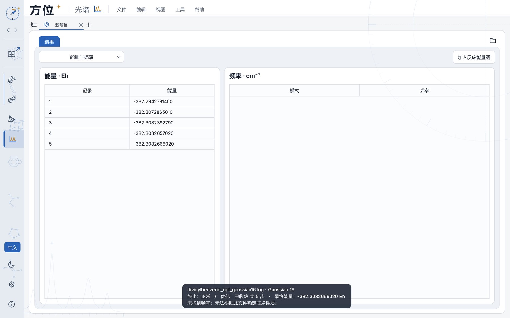

### 能量、收敛与热化学

- **能量与频率**——程序及其版本、最终能量和方法、是否正常结束、优化是否收敛、警告。
- **收敛**（用于优化）——每一步的能量以及收敛判据及其阈值（对数坐标）：可以看出是哪项判据拖住了优化。
- **热化学**（用于频率计算）——零点振动能、E、H 和 G 的校正以及在所选温度和压力下的总 H 和 G；按贡献分解的熵；由点群确定的对称数 σ。Grimme 的“准 RRHO”会减弱 100 cm⁻¹ 以下模式的贡献。虚频不计入，并会说明这一点。对于 MOPAC，不用总能量，而是 ΔHf(T) = ΔHf(298 K) + H(T) − H(298 K)，与 MOPAC 本身的算法一致。

理论——见图谱：[“由频率计算热化学”](https://www.azimuth-chem.com/atlas/?lang=zh#thermo)。

### 振动、红外与拉曼

“振动与红外”选项卡——频率和强度表、虚频、红外光谱以及所选振动的动画。

- 位移箭头——可选双向显示；“GIF…”保存一个振动周期，“XYZ 帧…”以帧的形式保存同一周期。
- “位移 +”和“位移 −”把沿该模式位移后的几何结构转到罗盘（见“如何离开鞍点”一节）。
- **校正因子**把谱图中的频率乘以 NIST CCCBDB 中该方法和基组的校正因子（B3LYP/6-31G* 为 0.960）：谐振频率高于实测频率，乘以校正因子后谱图更接近实验。校正因子会根据结果的方法和基组自动选取；振动模式表仍与输出相同。
- **拉曼。** 如果结果中有拉曼活性（在六分仪中勾选“拉曼”的 ORCA 计算），图表上方会出现选择“红外 / 拉曼：活性 / 拉曼：强度（532 nm）”，表格中会增加活性（Å⁴/amu）和退偏比 ρ：ρ = 0.75——非全对称振动，ρ < 0.75——全对称振动。对于有对称中心的分子，一个振动要么在红外中可见，要么在拉曼中可见——互斥规则。
- **振动圆二色（VCD）。** 如果输出中有振动的旋转强度（ORCA `%freq DoVCD true end`、Gaussian `Freq=VCD`），谱图的“振动圆二色”视图会显示从零向上和向下的谱带，振动模式表中会增加“R VCD”列。

导出——PNG、SVG 和 CSV。

理论——见图谱：[“简正振动”](https://www.azimuth-chem.com/atlas/?lang=zh#nm)。

### UV-Vis、电子圆二色与发射

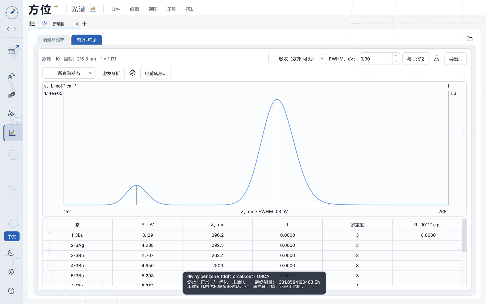

“紫外-可见”选项卡——TD-DFT 或 CIS 跃迁，以及以 eV、nm 或 cm⁻¹ 表示的光谱；谱带宽度。

- **圆二色（ECD）。** 如果输出中有旋转强度（ORCA 在 TD-DFT 中会自动输出，Gaussian 在 `TD` 中输出），图表上方会出现“查看”：“圆二色（ECD）”显示带符号的 Δε 光谱，表格中增加 R 列。镜像异构体的光谱互为镜像，非手性分子没有 ECD 光谱。把 ECD 与实验比较可以确定绝对构型（R 或 S）。
- **发射**——激发态优化之后：弛豫几何结构下发出的光的能量（单重态荧光或三重态磷光）、同一激发态在初始几何结构下的吸收、斯托克斯位移、振子强度和辐射寿命。
- **自然跃迁轨道（NTO）**——在激发态表下方，显示所选态的“从 → 到”轨道对及其权重；罗盘图标会把空穴轨道或粒子轨道放到模型上。

**激发分析**（需要轨道文件和 Multiwfn）对每个激发态计算“空穴”（电子离开的位置）和“电子”（电子到达的位置）的分布及其指数：D——中心间距离，Sr——重叠，H——尺度，t（t > 0——空穴和电子分离），Δr——电荷转移距离，HDI 和 EDI——离域程度。“性质”列说明这是局域激发还是电荷转移。“模型上的空穴与电子”在罗盘中显示两个表面。

**电荷转移…**——用原子编号指定片段，或使用罗盘中所选的原子，然后点击“计算”。窗口会显示激发中片段间电荷转移和局域激发各占多少、每对片段之间转移了多少电子，以及跃迁矩阵的热图。

理论——见图谱：[“激发态与光谱”](https://www.azimuth-chem.com/atlas/?lang=zh#exc)。

### NMR

“NMR”选项卡——屏蔽常数以及相对于所选参比（例如用相同方法计算的 TMS）的化学位移；等价原子会合并。

- 参比按计算水平（方法、基组、溶剂）分别保存。“以此级别计算 TMS”把带有该结果设置的 TMS 输入文件发送到六分仪；TMS 结果在光谱中打开后，参比会被自动记住，该水平的所有结果都会显示化学位移。
- **多重峰（耦合常数）**——如果计算了自旋–自旋耦合常数：谱仪频率（¹H，MHz）、¹³C 的“¹H 去耦”、表中的“多重峰”列（“qd, J = 7.2, 1.2 Hz”）以及以赫兹为刻度的所选信号。裂分按一级规则处理；当 Δν/J 小于 5 时，程序会提示强耦合。等价原子的 J 取平均值。
- **与实验比较…**（0.231.0）——针对所选核的窗口。输入实验位移，每行一个信号。不写原子编号时，信号按顺序匹配（最大的计算位移对应最大的实验位移）：这是计算给出的归属。写上原子编号（“C1 77.2”、“H3 H4 H5 2.15”）时按您的归属匹配，也可以只输入谱图的一部分。窗口显示“计算 – 实验 – 偏差”表、平均绝对误差（MAE）、最大偏差和图。线性校正：过各点作直线 σ = a + b·δexp，位移按 δ = (σ − a)/b 重新计算；它不需要参比（TMS）。直线是用计算误差的同一批信号拟合的，因此信号较少时校正后的误差偏低。如果两个计算信号彼此的距离小于方法的通常误差（¹H 为 0.1 ppm，¹³C 为 2 ppm），窗口会指出它们：这类信号按计算归属不可靠。
- **计算方法…**（0.237.0，光谱的“工具”菜单和六分仪的“计算”菜单）——供报告使用的一段文字：程序及版本、方法与基组或泛函、赝势与截断能、k 网格、溶剂、收敛阈值。它由计算文件生成，只包含文件中记录的内容；文字可在窗口中编辑。“保存输入文件压缩包…”把计算文件夹的输入文件和这段文字放入 zip——作为报告的附录。
- **构象平均…**（0.232.0）——用于柔性分子。构象之间的转换比谱仪的测量更快，因此一个核只给出一个信号——各构象按占比的平均。选择各构象的 NMR 计算（相同方法、相同原子编号）：窗口显示它们的能量和所选温度下的玻尔兹曼占比。占比按电子能给出；更准确的是按自由能：请把含频率计算的数值填入“ΔG”一列（“工具 → 多个文件的能量”）。“显示平均谱”把平均后的屏蔽常数放到选项卡上；之后其余功能照常使用——参比、等价原子平均、与实验比较。
- 基组 **pcSseg-1** 和 **pcSseg-2**（ORCA）专为屏蔽常数设计：它们比同样大小的普通基组更快收敛到基组极限。

理论——见图谱：[“NMR：从屏蔽到化学位移”](https://www.azimuth-chem.com/atlas/?lang=zh#nmr)。

### 比较光谱与实验

- 红外或 UV-Vis 选项卡上的 **“与…比较”**——把另一个文件的光谱以虚线叠加在第一个光谱上（例如用另一种方法或另一个程序进行的同一计算）。
- **“实验与构象”**（红外和 UV-Vis 选项卡上带烧瓶的按钮）：“实验光谱…”——把来自 JCAMP-DX、文本或 CSV 的实测光谱以绿色叠加在计算光谱上，单位自动换算，图例中给出谱形相似度；“在 NIST 中查找…”从 NIST Chemistry WebBook 获取实测红外或 UV-Vis 光谱。计算结果会立即拟合实验（红外用频率校正因子，UV-Vis 和 ECD 用平移）；“与实验拟合”重新拟合。
- **“构象平均…”**按玻尔兹曼比例叠加各构象的光谱（若都有频率则按 G，否则按 E）。

### 如何离开鞍点

1. 打开带虚频的频率计算结果。
2. 在“振动与红外”选项卡中选择虚频模式，点击“位移 +”（或“位移 −”）。
3. 位移后的几何结构在罗盘中打开——把它发送到六分仪重新优化。

计算医生会自动完成这一步：如果带频率的优化以虚频结束，计算窗口中会有“沿虚频模式移动并重新优化”按钮。

理论——见图谱：[“几何优化”](https://www.azimuth-chem.com/atlas/?lang=zh#opt)。

### 轨道

1. “轨道…”按钮或“文件 → 打开轨道…”。
2. 轨道表和能级图，HOMO 和 LUMO。所选轨道、电子密度或自旋密度的等值面直接由文件计算——不需要 CUBE 文件。
3. “显示：在罗盘的模型上”把轨道、密度或 ESP 转到模型上。“表面上的 ESP”用静电势给 ρ = 0.001 表面着色，并标出其极小值和极大值。

轨道窗口中的“密度分析…”按钮会打开详细的 QTAIM 表和密度差 Δρ。ORCA 的轨道取自输出旁的 `.gbw` 文件（用 ORCA 自带的 `orca_2mkl` 程序转换）。如果 GAMESS (US)、Firefly、NWChem 和 Q-Chem 的输出中打印了轨道，也可以直接从输出中打开。

理论——见图谱：[“双原子分子的分子轨道”](https://www.azimuth-chem.com/atlas/?lang=zh#mo)。

### 电子密度分析

体数据场（表面、临界点）显示在罗盘的模型上（见“模型上的性质与电子密度”一节），表格、等值线图和曲线则显示在“波函数”类别的选项卡中。大多数分析需要结果的轨道文件和 Multiwfn 程序。

- **等值线图与剖面**——函数（ρ、∇²ρ、|∇ρ|、ELF、LOL、ESP、ALIE、RDG、sign(λ₂)ρ 等）在三个原子所确定平面上的分布——带等值线的彩色图——或沿两个原子连线的分布（剖面；原子之间 ρ 的极小值就是键临界点）。平面附近找到的临界点和键径会显示在图上。“保存图片…”——PNG。
- **电子密度拓扑**——详细的临界点表：坐标、ρ、∇²ρ、椭率 ε、能量密度 G、V、H、|V|/G 以及 Hessian 本征值 λ1–λ3。各点在本类型内编号（n1… 核，b1… 键，r1… 环，c1… 笼）；编号也标注在模型上。双击某行会打开罗盘并定位到该点。各点按类型写入“Анализ”中的表格：`<名称>_qtaim_nuclei.csv`、`…_bonds.csv`、`…_rings.csv`、`…_cages.csv`。
- **态密度**——DOS（用高斯或洛伦兹线展宽的轨道能级）、PDOS——各片段的 Mulliken 贡献（按元素，或所选原子与其余原子）、两个片段的 OPDOS（零以上——成键轨道，零以下——反键轨道）；图下方显示 HOMO–LUMO 能隙。
- **离域**——5–7 元环及其 HOMA（苯为 1，Kekulé 结构为 0），按按钮还可计算 FLU、PDI 和 MCI；离域指数——两个原子共享多少电子对（约 1——单键，1.4–1.5——芳香键，约 2——双键）。
- **NCI**——在罗盘中完成 NCI 或 IRI 计算之后：RDG — sign(λ₂)ρ 散点图（左侧蓝色——氢键；零附近绿色——范德华作用；右侧红色——排斥）以及弱相互作用域表——表面上的每个区域占一行：类型（氢键、卤键、硫属键、C–H···π、π 堆积、范德华接触、排斥）、原子、sign(λ₂)ρ、体积、距离和角度；对氢键还给出由 ρ 估算的能量。行号标在图中对应的低谷上方以及模型上该区域的中心。
- **分子间 IGMH**——δg_inter：只在不同分子密度相遇处出现的密度梯度。在“NCI”选项卡中有曲线图、域表以及原子对及其对相互作用贡献的表。

理论——见图谱：[“电子密度”](https://www.azimuth-chem.com/atlas/?lang=zh#dens)、[“分子中的原子（Bader）”](https://www.azimuth-chem.com/atlas/?lang=zh#aim)。

### 分析文件

每种分析都会把表格写入计算文件夹的“Анализ”子文件夹（与轨道文件同处），以便在电子表格中打开或放入论文。

表：分析表格

| 文件 | 内容 |
|---|---|
| `<名称>_<函数>_extrema.csv` | 表面极值：数值、坐标、最近原子 |
| `<名称>_esp_summary.csv` | 分子表面汇总：面积、体积、平均值、σ²tot、ν、Π、MPI |
| `<名称>_qtaim_nuclei.csv`、`…_bonds.csv`、`…_rings.csv`、`…_cages.csv` | 按类型列出的密度临界点 |
| `<名称>_excitations.csv` | 激发指数（D、Sr、H、t、Δr、HDI、EDI） |
| `<名称>_charge_transfer_S<k>.csv` | 第 k 个激发态在片段之间的电荷转移 |
| `<名称>_nci_domains.csv` | NCI 弱相互作用域 |
| `<名称>_resp.chg` | 用于分子动力学的坐标和 RESP 电荷 |
| `fukui_<场>_extrema.csv` | Fukui 函数表面的极值 |
| `batch_energies.csv` | 计算队列的能量和玻尔兹曼比例 |
| `<名称>_multiwfn_<分析>.txt` | Multiwfn 程序的输出 |

### 反应能量图

1. “文件 → 反应能量图…”，或在已打开的结果上方点击“加入反应能量图”（该结果会成为一个阶段）。
2. “从文件添加阶段…”——选择反应物、过渡态和产物的结果：每个文件成为一个阶段（按文件名排序；“上移”和“下移”调整顺序）。如果某阶段包含两种物质（A + B），选中该阶段并点击“添加到阶段…”。论文或黑板上的数值——“手动输入…”。双击阶段可重命名。
3. 在顶部选择物理量（ΔE、含零点能的 ΔE₀、ΔH、ΔG）、单位、T 和 P 以及作为零点的阶段。ΔH 和 ΔG 需要频率计算。对于溶液中分子数会变化的反应（A + B → C），请勾选“标准态 1 mol/L”。
4. 图下方——能垒（‡ 表示过渡态，它恰有一个虚频）和反应能。⚠ 标记是检查结果：原子或电荷不守恒、理论水平不同、有多余的虚频、未确认正常结束。
5. “图片或表格…”——PNG、SVG 或 CSV；“保存反应图…”——以便以后连同结果一起打开。
6. 速率常数（0.224.0）。选择 ΔG 时，每个能垒下方给出正、逆反应的 Eyring k，k = (k_B T/h)·(c°)^(1−n)·exp(−ΔG‡/RT)。单分子步骤还给出半衰期 t½。级数 n 是起始阶段中的物种数；k 的单位为 s⁻¹、L·mol⁻¹·s⁻¹…… 对双分子步骤，无论选择哪种标准态，k 都相同：程序按所勾选的取 c° = 1 mol/L 或 P/RT。这是 κ = 1、不含隧穿的过渡态理论。“复制 k(T)”把 200 到 600 K（步长 50 K）及所选温度下的 k 表放入剪贴板，可直接粘贴到报告或表格中。
7. 隧穿修正（0.239.0）。如果过渡态有频率，能垒下方会给出与 k 相乘的系数 κ：Wigner 公式 κ = 1 + (hν‡/kT)²/24，以及 Eckart 公式——势垒由虚频 ν‡ 和含零点能的正、逆向势垒高度确定。hν‡ 小于 kT 时 Wigner 适用；势垒窄、温度低时 Eckart 更准确。两种修正都是一维的：对氢转移，真实的 κ 可能更大。“复制 k(T)”表中有 κ 和 k·κ 两列。

理论——见图谱：[“反应速率：过渡态”](https://www.azimuth-chem.com/atlas/?lang=zh#kin)、[“平衡：从能量到平衡常数”](https://www.azimuth-chem.com/atlas/?lang=zh#eqm)。

### 光谱的工具

光谱的“工具”菜单：

- **“分子离子的同位素峰…”**——M、M+1、M+2……及其精确质量和图（结果的分子式或自定义分子式，例如 C6H5Cl；单同位素质量和平均质量）。
- **“多个文件的能量…”**——并列显示多个计算的输出：E、G（如有频率）、ΔE、ΔG 和玻尔兹曼比例。在组成、理论水平、电荷或多重度不同、有虚频或未确认正常结束时给出警告。
- **“玻尔兹曼分布…”**——对粘贴的一列能量（hartree、kcal/mol、kJ/mol、eV）做同样的计算。
- **“两种形式的平衡…”**（0.226.0）——用于同一分子的两个“优化 + 频率”结果（构象异构体、互变异构体、异构体）：平衡常数 K = [B]/[A]、ΔG° 以及 200 到 600 K 和所选温度下两种形式的比例。下方表格显示 K 的组成：因子 exp(−ΔE₀/RT) 以及平动、转动、振动和电子配分函数之比。对称数 σ 和镜像形式数（手性形式且样品中两种对映体都存在时为 2）按点群给出建议，可以修改。软扭转振动请打开“准 RRHO”。“复制表格”用于报告。
- **“受阻转子…”**（0.227.0）——用于势垒低、谐振子描述不好的扭转振动。打开二面角的弛豫扫描（任务“弛豫势能面扫描”）：程序用扫描得到的势能求解转子的一维转动问题，并比较 200 到 600 K 的配分函数——谐振子、受阻转子和自由转子。ΔG 是对用谐振频率算得的自由能的修正；平衡常数或速率常数要乘以每个物种的“K 的乘子”。最好扫描整圈 0–360°；若只扫了半圈（0–180°）或三分之一圈，请选择扫描覆盖的范围。转子的对称数 σ：甲基为 3，苯基为 2。“谐振频率”是频率计算中该模式的频率；保留“按扫描曲率”时，取势能极小点处的形状对应的频率。约化转动惯量按键两侧的两部分分子计算；键在环中时工具会拒绝。
- **“频率校正因子…”**和**“该分子的实验数据…”**——参考资料中的表格（第 4 章）。

表格按“设置 → 分析表格”中选择的格式保存为 CSV。

## 通过语言模型控制

可以通过语言模型——Claude 或本地模型——控制“方位”，只需使用任何支持 MCP（Model Context Protocol）协议的客户端。“方位”文件夹中的 `tools/azimuth_mcp.py` 程序为模型提供程序的各种工具。

表：“方位”MCP 服务器的工具

| 工具 | 作用 |
|---|---|
| 程序 | 本机上安装了哪些计算程序 |
| 选项 | 程序的任务、方法和基组 |
| 输入文件 | 为分子（SMILES、XYZ 或文件）和设置生成输入文件——不运行 |
| 计算 | 在本机上运行计算 |
| 结构（0.249.0） | 用与罗盘相同的代码构建和修改分子或晶体：分子来自 SMILES、名称（PubChem）、分子库或文件；替换原子、取代基、删除、加氢、键长、键角和二面角、UFF、构象；晶体来自 CIF 或 COD——原胞、超胞、(hkl) 表面、单层、真空、替位和空位。结果是罗盘可以打开的 XYZ、MOL 或 CIF 文件（默认在 `文档/Azimuth/Структуры`），以及带编号的原子列表 |
| 晶体（0.243.0） | 在本机上用 Quantum ESPRESSO 或 CP2K 计算 CIF 给出的晶体：晶体计算面板的任务和设置、不运行的输入文件、运行、结果（能量、晶胞、压强、带隙两侧的能级、系列中的各次计算） |
| 状态与结果 | 计算进程和结果：能量、收敛、频率、热化学、激发、错误以及医生的建议 |
| 服务器 | 在六分仪配置的 SLURM 服务器上运行 ORCA 或 MOPAC 计算——受以下限制 |
| 测试 | 运行程序的测试 |

**连接。** 在客户端设置中，命令填写程序文件夹中的 `.venv/bin/python`（Windows 上为 `.venv\Scripts\python.exe`），参数填写 `tools/azimuth_mcp.py`。详见 `docs/features/HEADLESS.md`。

**服务器计算的限制。** 模型可以把 ORCA 或 MOPAC 计算发送到六分仪配置中的 SLURM 服务器，但只能：

- 使用 SSH 密钥登录（绝不使用密码）；
- 在有 SLURM 的服务器上作业进入队列（0.242.0）：核数按请求给出，但单个作业不超过节点核数的 80 %；空闲核不足时作业等待；队列中的作业数不限；
- 在没有 SLURM 的服务器上没有队列：只能使用空闲的核和内存，且加上新计算后服务器被占用的核不超过 80 %，同时最多三个作业；
- 每个作业都有时间限制；
- 只能停止自己的作业；不会在服务器上删除任何内容，也不会在那里执行模型给出的任何命令。

所有操作都会记入日志。

## 出现问题时

表：常见问题与解决方法

| 问题 | 解决方法 |
|---|---|
| 程序打不开 | 原因记录在启动日志中：`~/Library/Logs/Azimuth/startup.log`（macOS）或 `%LOCALAPPDATA%\Azimuth\Logs\startup.log`（Windows）。检查安装：`verify_install.py`（见“检查安装”一节） |
| macOS：“无法打开‘Azimuth’” | 允许启动（见“在 macOS 上安装”一节） |
| Windows：SmartScreen 窗口 | “更多信息”→“仍要运行” |
| 六分仪找不到 ORCA | 运行卡片中的“指定…”、“计算 → 指定程序…”或“文件 → 设置… → 程序”——选择 `orca`（`orca.exe`）文件 |
| ORCA 多核运行时停止 | 用六分仪中的按钮安装 Open MPI（Windows 上为 MS-MPI），或用单进程计算。在 macOS 上，错误“Library not loaded: libmpi.40.dylib”表示 ORCA 找不到 Open MPI 库；六分仪会在计算文件夹中放一个小的 mpirun 来解决这个问题——请从六分仪安装 Open MPI |
| Windows 上的计算无法打开文件 | 计算文件夹或程序的路径中含有中文等非拉丁字母或空格——请在“设置 → 计算”中选择拉丁字母路径 |
| SCF 不收敛、内存不足、没有基组 | 按计算医生的建议操作（见“计算医生”一节） |
| 优化后出现虚频 | “沿虚频模式移动并重新优化”或参见“如何离开鞍点”一节 |
| 服务器不响应 | 在服务器窗口中点击“检查连接”；如果服务器在 VPN 后面——在同一窗口中选择 OpenVPN Connect 配置 |
| 波函数分析菜单项为灰色 | 未找到 Multiwfn，或结果没有轨道文件——菜单项的提示会说明缺少什么 |
| PubChem 或 COD 不响应 | 检查网络；如果提示与证书有关（macOS），请运行“应用程序”中 Python 文件夹里的“Install Certificates.command” |
| 模型不显示或显示不正常 | 关闭“浏览 → VTK 三维图形（试用）”并重启程序；在 Linux 的 Wayland 下请在 X11 下启动 |
| 程序出错或关闭 | 保存报告并发送给作者（见“错误与给作者的报告”一节） |

**报告错误。** “关于”窗口中的“报告错误”按钮和“文件 → 错误报告…”会打开一封给作者的邮件，其中带有程序版本。请描述你当时在做什么、期望看到什么；附上报告，如果错误与某个文件有关，也请附上该文件。邮箱：contact@azimuth-chem.com。

## 附录 A。文件格式

表：“方位”可打开的文件

| 格式 | 扩展名 | 打开位置 |
|---|---|---|
| XYZ（单帧或多帧） | `.xyz` | 罗盘；同一分子的多帧作为步骤，不同分子作为项目 |
| “方位”项目 | `.qcc` | 罗盘 |
| Molfile、SDF | `.mol`、`.sdf`、`.sd` | 罗盘；含多个分子的 SDF 作为结构集 |
| MOL2 | `.mol2` | 罗盘 |
| PDB | `.pdb`、`.ent` | 罗盘；多个模型作为步骤；蛋白质带飘带 |
| ChemDraw XML | `.cdxml` | 罗盘 |
| ORCA 输入文件 | `.inp` | 罗盘、六分仪 |
| Gaussian 输入文件 | `.gjf`、`.com`、`.gjc` | 罗盘、六分仪 |
| 计算输出 | `.out`、`.log`、`.nwout`、`.qcout`、`.gamout` | 光谱和罗盘（ORCA、Gaussian、Psi4、xtb、MOPAC、NWChem、Q-Chem、GAMESS、Firefly） |
| MOPAC 辅助文件 | `.aux` | 与 MOPAC 输出一起读取 |
| 轨道 | `.molden`、`.molf`、`.fchk`、`.fch`；ORCA 为输出旁的 `.gbw` | 光谱、罗盘 |
| 体数据 | `.cube` | 光谱 |
| 晶体 | `.cif` | “罗盘 · 晶体” |
| CRYSTAL 和 TOPOND 输出 | `.out`、`.outp` | “罗盘 · 晶体” |
| 实验光谱 | JCAMP-DX、文本、CSV | 光谱（与实验比较） |

表：“方位”可保存的文件

| 内容 | 格式 |
|---|---|
| 分子坐标 | XYZ、MOL、SDF、MOL2、PDB；ORCA、Gaussian、NWChem 输入块，Z 矩阵；SMILES 和 InChI |
| 晶体 | CIF（带对称性或 P 1 中的晶胞块）、POSCAR（VASP）、扩展 XYZ |
| 模型图片 | PNG、SVG、PDF；旋转、步骤和振动的 GIF |
| 3D 打印模型 | STL、VRML |
| 光谱、能量图、等值线图 | PNG、SVG、CSV |
| 分析表格 | CSV（分隔符和小数点在设置中指定） |
| 输入文件 | 各计算程序的格式 |
| 程序设置 | JSON（不含密码和密钥） |
| 自定义片段和显示方案 | JSON |

## 附录 B。快捷键

在 macOS 上用 `⌘` 代替 `Ctrl`，用 `⌥` 代替 `Alt`。

表：通用快捷键

| 快捷键 | 操作 |
|---|---|
| `Ctrl+1` … `Ctrl+5` | 图谱、“罗盘 · 分子”、“罗盘 · 晶体”、六分仪、光谱 |
| `Ctrl+?` | 菜单搜索（左侧面板上的放大镜） |
| `Ctrl+N` | 新建分子 |
| `Ctrl+O` | 打开文件 |
| `Ctrl+S` / `Ctrl+Shift+S` | 保存 / 另存为 |
| `Ctrl+W` | 关闭选项卡 |
| `Ctrl+Shift+V` | 从剪贴板粘贴结构 |
| `Ctrl+Z` / `Ctrl+Shift+Z` | 撤销 / 重做 |

表：罗盘

| 快捷键 | 操作 |
|---|---|
| `Ctrl+A` | 全选 |
| `Ctrl+]` | 选择范围扩大一步 |
| `Ctrl+Shift+]` | 选择整个分子 |
| `Ctrl+C` / `Ctrl+V` | 复制 / 粘贴原子 |
| `Ctrl+B` | 连接或断开所选原子 |
| `Delete` | 删除所选原子（在坐标表中——所选行的原子） |
| 空格、`←` `→` | 暂停以及在模型上切换振动 |

表：六分仪和输入文件编辑器

| 快捷键 | 操作 |
|---|---|
| `Ctrl+Enter` | 运行计算或队列 |
| `Ctrl+.` | 停止计算或队列 |
| `Ctrl+F` / `F3` / `Shift+F3` | 查找 / 查找下一个 / 查找上一个 |
| `Ctrl+R` | 替换 |
| `Ctrl+G` | 转到行 |
| `Ctrl+D` | 复制当前行 |
| `Ctrl+Shift+K` | 删除当前行 |
| `Alt+↑` / `Alt+↓` | 上移 / 下移当前行 |
| `Ctrl+/` | 用程序的注释符号注释或取消注释 |
| `Ctrl+Shift+U` / `Ctrl+Shift+L` | 大写 / 小写 |
| `F5` | 插入日期和时间 |
| `Ctrl+U` | 自动换行 |
| `Ctrl+=` / `Ctrl+-` / `Ctrl+0` | 放大 / 缩小 / 正常大小 |
| `F1` | 编辑器的所有快捷键 |

表：“服务器文件”窗口

| 快捷键 | 操作 |
|---|---|
| `Enter` | 进入文件夹或在“方位”中打开文件 |
| `F3` / `F4` | 查看 / 编辑文本文件 |
| `Shift+F4` | 新建文件 |
| `F5` / `F6` | 复制 / 移动到另一面板 |
| `Shift+F6` | 重命名 |
| `F7` | 新建文件夹 |
| `F8` 或 `Delete` | 删除（会询问） |
| `Alt+F7` | 按通配符查找文件 |
| `Ctrl+D` | 收藏的文件夹 |
| `Insert` 或空格 | 标记文件 |
| `+` / `−` / `*` | 按通配符标记 / 按通配符取消标记 / 反转标记 |
| `Ctrl+F3` … `Ctrl+F6` | 按名称、类型、日期、大小排序 |
| `F2` 或 `Ctrl+R` | 刷新面板 |
| `Backspace` | 返回上一级 |
| `Tab` | 切换到另一面板 |
| `F1` | 该窗口的所有快捷键 |

## 附录 C。各计算程序支持的任务

表：六分仪的分子任务

| 任务 | ORCA | Gaussian | Psi4 | xtb | MOPAC | NWChem | GAMESS |
|---|:-:|:-:|:-:|:-:|:-:|:-:|:-:|
| 能量 | ✓ | ✓ | ✓ | ✓ | ✓ | ✓ | ✓ |
| 几何优化 | ✓ | ✓ | ✓ | ✓ | ✓ | ✓ | ✓ |
| 优化 + 频率 | ✓ | ✓ | ✓ | ✓ | ✓ | ✓ | ✓ |
| 频率与热化学 | ✓ | ✓ | ✓ | ✓ | ✓ | ✓ | ✓ |
| 过渡态 + 频率 | ✓ | ✓ | ✓ | | ✓ | ✓ | ✓ |
| UV-Vis 光谱（TD-DFT） | ✓ | ✓ | ✓ | | | ✓ | ✓ |
| NMR（屏蔽） | ✓ | ✓ | | | | ✓ | |
| 激发态优化 | ✓ | ✓ | | | | | |
| 弛豫势能面扫描 | ✓ | ✓ | | ✓ | | | |
| 反应路径（NEB-CI） | ✓ | | | | | | |
| 从过渡态出发的路径（IRC） | ✓ | | | | | | |
| Fukui 函数 | ✓ | | | | | | |
| 给体–受体键 CDA | ✓ | | | | | | |
| 含 BSSE 的相互作用能 | ✓ | | | | | | |

CREST 只做一项任务——构象搜索（iMTD-GC，GFN2-xTB）。xtb 不需要方法、基组和内存设置（GFN2-xTB 本身就是方法）。MOPAC 使用半经验方法 PM7（默认）、PM6、PM6-D3H4、AM1、RM1、MNDO，不需要基组，溶剂模型为 COSMO。GAMESS 没有 def2 基组——请使用 cc-pVDZ、pcseg-1 或 Pople 基组。GAMESS 由其自带的 `rungms` 脚本启动，NWChem 由 `nwchem` 程序启动（多进程通过 mpirun）。

表：各程序的任务设置

| 设置 | 程序 |
|---|---|
| 过渡态搜索 | ORCA、Gaussian、Psi4、MOPAC |
| 优化收敛标准 | ORCA、Gaussian、Psi4、xtb、GAMESS |
| 优化循环上限 | ORCA、Gaussian、Psi4、xtb、GAMESS、NWChem |
| 精确 Hessian | ORCA、Gaussian、Psi4、GAMESS |
| 热化学温度 | ORCA、Gaussian、Psi4、MOPAC、GAMESS、NWChem |
| 压力、数值频率 | ORCA、Gaussian、Psi4 |
| 拉曼 | ORCA |
| 耦合常数（NMR） | ORCA |
| 激发态数目 | ORCA、Gaussian、Psi4、GAMESS、NWChem |
| TDA 或完整 TD-DFT | ORCA、Gaussian、Psi4 |
| 三重态 | ORCA、Gaussian、Psi4、NWChem |
| 自然跃迁轨道 | ORCA |
| 波函数稳定性检查 | ORCA、Gaussian |
| 第二个扫描坐标 | ORCA |
| 从先前计算的轨道开始 | ORCA |

## 附录 D。外部程序与参考文献

“方位”把部分分析交给其他程序完成。界面中并不总能看到它们的名称；这里说明这些程序是什么，以及在工作中应引用哪些文献。

**Multiwfn**（Tian Lu，sobereva.com/multiwfn）——波函数分析：ADCH、CM5、Hirshfeld、AIM 和 RESP 电荷，键级，轨道组成和格点数据，NCI、IRI 和 IGMH，分子表面上的 ESP，密度临界点（QTAIM），ELF 和 LOL，激发分析，CDA。它读取 Molden、fchk、wfn、wfx 和 mwfn 轨道文件（ORCA 的 `.gbw` 会先由“方位”转换为 Molden）。已在 2026.7.15 版本上验证。请同时引用两篇论文：

- T. Lu, F. Chen, *J. Comput. Chem.* **33**, 580 (2012);
- T. Lu, *J. Chem. Phys.* **161**, 082503 (2024).

**分析方法：**

- ADCH——T. Lu, F. Chen, *J. Theor. Comput. Chem.* **11**, 163 (2012);
- CM5——A. V. Marenich, S. V. Jerome, C. J. Cramer, D. G. Truhlar, *J. Chem. Theory Comput.* **8**, 527 (2012);
- Hirshfeld 电荷——F. L. Hirshfeld, *Theor. Chim. Acta* **44**, 129 (1977);
- QTAIM——R. F. W. Bader, *Atoms in Molecules: A Quantum Theory* (Oxford, 1990);
- NCI——E. R. Johnson 等, *J. Am. Chem. Soc.* **132**, 6498 (2010);
- IRI——T. Lu, Q. Chen, *Chemistry–Methods* **1**, 231 (2021);
- 分子表面分析——T. Lu, F. Chen, *J. Mol. Graph. Model.* **38**, 314 (2012);
- ELF——A. D. Becke, K. E. Edgecombe, *J. Chem. Phys.* **92**, 5397 (1990);
- LOL——H. L. Schmider, A. D. Becke, *J. Mol. Struct. THEOCHEM* **527**, 51 (2000);
- 键级：Mayer——I. Mayer, *Chem. Phys. Lett.* **97**, 270 (1983)；Wiberg——K. B. Wiberg, *Tetrahedron* **24**, 1083 (1968)；模糊键级（FBO）——I. Mayer, P. Salvador, *Chem. Phys. Lett.* **383**, 368 (2004)；拉普拉斯键级（LBO）——T. Lu, F. Chen, *J. Phys. Chem. A* **117**, 3100 (2013);
- 轨道组成——T. Lu, F. Chen, *Acta Chim. Sinica* **69**, 2393 (2011);
- 空穴–电子分析——Z. Liu, T. Lu, Q. Chen, *Carbon* **165**, 461 (2020)；Δr 指数——C. A. Guido 等, *J. Chem. Theory Comput.* **9**, 3118 (2013);
- BSSE 校正——S. F. Boys, F. Bernardi, *Mol. Phys.* **19**, 553 (1970).

**蜂群构象搜索（ABC）**——SmartChemDesign/abc 方法（github.com/SmartChemDesign/abc，MIT 许可证），在“方位”中重新实现；人工蜂群算法——D. Karaboga, B. Basturk, *J. Glob. Optim.* **39**, 459 (2007)。

**xtb 和 GFN2-xTB**——C. Bannwarth, S. Ehlert, S. Grimme, *J. Chem. Theory Comput.* **15**, 1652 (2019)。

**UFF 力场**——A. K. Rappé, C. J. Casewit, K. S. Colwell, W. A. Goddard III, W. M. Skiff, *J. Am. Chem. Soc.* **114**, 10024 (1992)。

**共价半径**——B. Cordero 等, *Dalton Trans.* 2832 (2008)。

引用在“方位”中完成的计算时，既要按计算程序（ORCA、xtb、MOPAC……）作者的要求引用该程序，也要引用“方位”（引用格式见手册第二页和 `CITATION.cff` 文件）。
